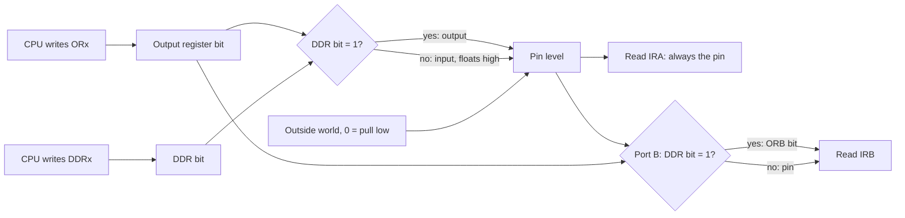
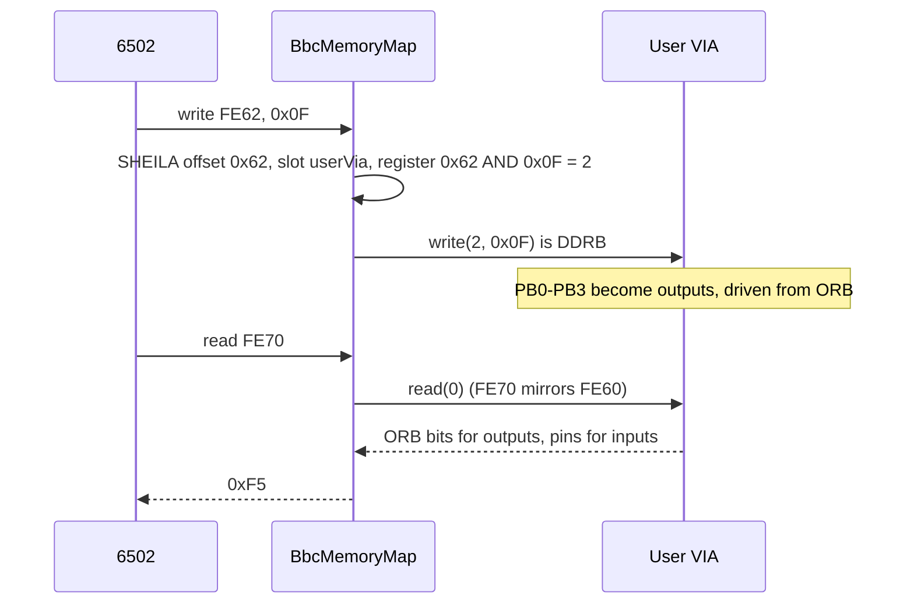
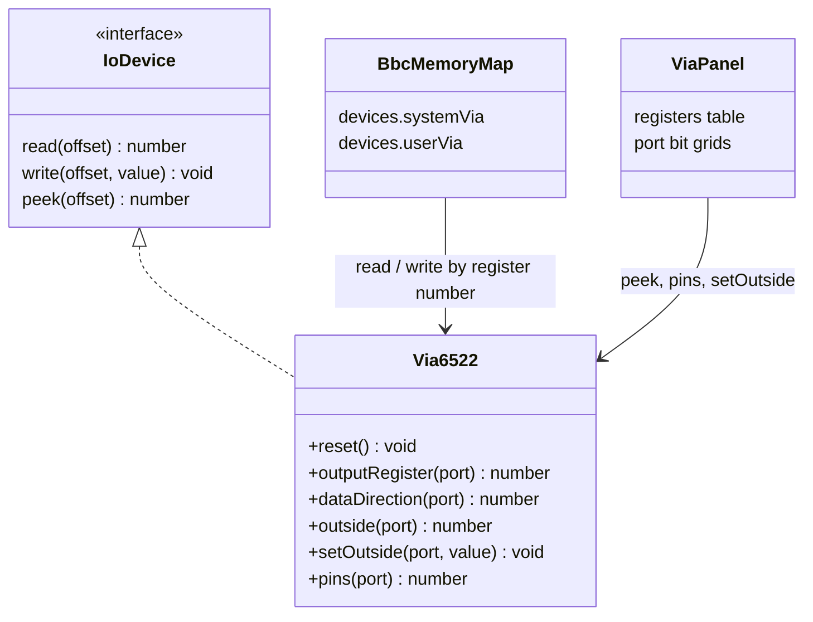

# Stage 24: VIA ports & registers

> **Part:** 4 (The 6522 VIA) · **Branch:** `stage/24-via-ports` · **Needs:** 23
> **Status:** done

## Goal

This stage builds the first real chip on SHEILA: the **6522 Versatile Interface Adapter (VIA)**. The Model B has two of them, the **System VIA** at `&FE40` and the **User VIA** at `&FE60`. This stage covers only the part of the VIA that is *ports*:

- its 16 registers, and how a register number picks one;
- the two 8-bit ports, A and B, and their **data direction registers** (DDRA, DDRB), which decide line by line whether a pin is an input or an output;
- what a write to an output register does to a pin, and what a read gives back. Port A and port B answer that question **differently**.

Timers come in Stage 25, and interrupts and the control lines (CA1/CA2/CB1/CB2) in Stage 26. Their registers exist from today, so the register map is complete, but for now they're plain storage (see [Our design](#our-design)).

It comes now because Stage 23 showed that the MOS's first question to the hardware is a read from the System VIA (`LDA &FE4E`, its IER), and every keyboard test it makes goes through the System VIA's port A. The VIA is the chip the MOS needs first.

## What you can now see

```bash
npm run dev        # then open http://localhost:5173
```

The playground opens with the new default example, **Stage 24: VIA ports (Step, then Run)**, and a new **VIA** panel in the workbench column, showing the **User VIA** (`&FE60`).

1. **Straight after Assemble & Run** (a power-on, so both VIAs are reset): every DDR bit is `in`, ORA/ORB are `&00`, and every register read of a port gives `&FF`, because nothing outside pulls a line low.
2. **Step 6 times** (`Step` under the Registers panel). The port B grid shows:
   ```
              PB7 PB6 PB5 PB4 PB3 PB2 PB1 PB0
   DDRB        in  in  in  in out out out out   &0F
   ORB          1   0   1   0   0   1   0   1   &A5
   Outside      1   1   1   1   1   1   1   1   &FF
   Pin          1   1   1   1   0   1   0   1   &F5
   CPU reads IRB 1  1   1   1   0   1   0   1   &F5
   ```
   ORB's high nibble (`1010`) is stored but goes nowhere: those lines are inputs, floating high. A is now `&F5`.
3. **Run.** The program stores `&F5 &0F &3F` at `&80`-`&82` (Memory panel), then makes port B count `&00` → `&FF` in binary, about 26 ms a count, so the panel's bits tick over for about 6.5 seconds and stop at the `BRK`.
4. **Pull PB7 low while it counts** (click the `1` under PB7 in the *Outside* row: it turns red). When ORB bit 7 is 1, the *Pin* row shows 0 but *CPU reads IRB* still shows 1. Measured in the browser: ORB `&A7`, pins `&27`, IRB `&A7`. `INC &FE60` reads IRB, so the count carries on as if nothing happened.
5. **Pull PA5 low** after the run. Port A has PA7-PA4 as outputs driving `0011` (ORA `&3C`). The read row drops to `&1F`: **port A reads the pin**, even on an output line.
6. **System VIA** button: the same chip at `&FE40`, untouched by this program.

Things to try: in the Assembler, change `INC orb` to `INC ora` with `DDRA = &FF`, pull a port A line low and Run. That line's bit is copied into ORA on every `INC`, so the count goes wrong. That's the port A read path at work.

## The real hardware

### The chip

The 6522 (MOS Technology / Rockwell R6522 / Synertek SY6522) is a 40-pin chip that sits on the 6502's bus like memory. It has:

| Pins | What they're for |
|---|---|
| D0–D7 | the data bus, to the CPU |
| RS0–RS3 | **register select**: 4 address lines, so 16 registers |
| CS1, /CS2 | chip select: the board's address decoder turns the VIA on |
| R/W, φ2, /RES | read or write, the clock, and reset |
| **PA0–PA7** | port A: 8 lines to the outside world |
| **PB0–PB7** | port B: 8 more |
| CA1, CA2, CB1, CB2 | control (handshake and interrupt) lines: Stage 26 |
| /IRQ | interrupt request out to the CPU: Stage 26 |

The register select table (6522 datasheet, "Register Select" / Figure 2 of the R6522 sheet):

| RS3–RS0 | Reg | Write | Read | Built in |
|---|---|---|---|---|
| `0000` | `&0` | ORB: output register B | IRB: input register B | **24** |
| `0001` | `&1` | ORA: output register A (with handshake) | IRA: input register A (with handshake) | **24** (handshake in 26) |
| `0010` | `&2` | DDRB | DDRB | **24** |
| `0011` | `&3` | DDRA | DDRA | **24** |
| `0100` | `&4` | T1 low-order latch | T1 low-order counter | 25 |
| `0101` | `&5` | T1 high-order counter | T1 high-order counter | 25 |
| `0110` | `&6` | T1 low-order latch | T1 low-order latch | 25 |
| `0111` | `&7` | T1 high-order latch | T1 high-order latch | 25 |
| `1000` | `&8` | T2 low-order latch | T2 low-order counter | 25 |
| `1001` | `&9` | T2 high-order counter | T2 high-order counter | 25 |
| `1010` | `&A` | SR: shift register | SR | not planned |
| `1011` | `&B` | ACR: auxiliary control | ACR | 25 |
| `1100` | `&C` | PCR: peripheral control | PCR | 26 |
| `1101` | `&D` | IFR: interrupt flags | IFR | 26 |
| `1110` | `&E` | IER: interrupt enable | IER | 26 |
| `1111` | `&F` | ORA, **no handshake** | IRA, **no handshake** | **24** |

Notice that the same register number can mean **two different things** depending on the direction: register `&0` is ORB when you write it and IRB when you read it. They aren't two names for one byte of storage. A write lands in a latch inside the chip, and a read looks (mostly) at the pins. That difference is what this stage is about.

### Where the two VIAs sit in the Model B

Each VIA gets a 32-byte SHEILA slot, but it only sees A0–A3 on RS0–RS3, so its 16 registers appear twice (Stage 21's mirroring: `&FE4E` and `&FE5E` are both System VIA IER).

| | System VIA, `&FE40`–`&FE4F` | User VIA, `&FE60`–`&FE6F` |
|---|---|---|
| **Port A** | the "slow data bus": keyboard, SN76489 sound chip, speech | the parallel **printer** port |
| **Port B** | PB0–PB2: which addressable-latch bit; PB3: its value (Stage 28). PB4–PB5: joystick fire buttons (inputs, **low = pressed**). PB6–PB7: speech | the **user port**: 8 lines on a connector under the machine, free for your own hardware |

(Advanced User Guide, "The 6522 VIA" chapter, and the SHEILA address list.) On this stage's playground both VIAs are real 6522s, but nothing is wired to their pins yet: no keyboard, no latch, no printer. Stage 28 and Part 7 connect the System VIA's outside world.

## Key concepts

### 1. A data direction register decides each line separately

Each port has an 8-bit DDR, one bit per line:

- DDR bit = **1**: the line is an **output**. The VIA drives it with the matching bit of the output register.
- DDR bit = **0**: the line is an **input**. The VIA lets go of it, and something outside decides its level.

So one port can be half and half. With `DDRB = &0F`, PB0–PB3 are outputs and PB4–PB7 are inputs, which is exactly how the System VIA is set up: the low four bits address the latch, and PB4/PB5 read the joystick buttons.

The output register keeps every bit you write, even for input lines. Those bits just don't reach a pin until the DDR turns the line into an output:

```
LDA #&A5 : STA &FE60   ; ORB = &A5 (1010 0101), but DDRB = &00: every line is still an input
LDA #&0F : STA &FE62   ; DDRB = &0F: now PB0-PB3 drive 0101 from ORB's low nibble
```

### 2. Reset makes every line an input

`/RES` clears every register except the timers and the shift register (6522 datasheet, "Reset" / RES pin description). DDRA and DDRB become `&00`, so **after reset all 16 lines are inputs**. That's a safety rule: the chip mustn't drive a line until software says which way it goes, because whatever is on the other end might be driving it too, and two outputs fighting each other can damage both.

### 3. What a read returns: port B looks at the register, port A looks at the pins

This is the part that's easy to get wrong.

**Reading IRB** (register `&0`) gives, bit by bit (datasheet, "Port B"):
- for an **output** line: the bit in **ORB**, what the VIA is *trying* to drive;
- for an **input** line: the **pin level**.

**Reading IRA** (registers `&1` and `&F`) gives the **pin level for every line**, input or output (datasheet, "Port A").

Normally the two agree, because an output line's level *is* what the VIA drives. They disagree when something outside overpowers an output: a heavy load or a short to ground pulls the line down even though ORA says 1. Port A then reads the truth (0); port B reads the intention (1).

A worked example, with something outside pulling PA7 and PB7 low:

| | Port A | Port B |
|---|---|---|
| DDR | `&FF` (all outputs) | `&FF` (all outputs) |
| OR | `&81` (1000 0001) | `&81` |
| pins | `&01`: PA7 dragged low | `&01`: PB7 dragged low |
| **CPU reads** | **`&01`** (the pins) | **`&81`** (ORB, because every line is an output) |

The reason is in the circuit. Port B's outputs are stronger push-pull drivers (they can source enough current to switch a Darlington transistor directly), so the designers read back the register. Port A's outputs are ordinary one-TTL-load drivers, and the read path goes straight from the pins. It matters for read-modify-write instructions: `INC &FE60` on an output-only port B reads ORB, adds 1 and writes it back, so it counts. On port A, a dragged line would get copied into ORA.

### 4. Two registers for port A: with and without handshake

Register `&1` and register `&F` both write ORA and read IRA. The difference is a **side effect**: an access to `&1` also runs the **handshake** on CA1/CA2 (clears their interrupt flags and, in handshake mode, pulses CA2 to tell the printer "new data"). Register `&F` doesn't. The BBC's keyboard code uses `&FE4F` so that reading the keyboard doesn't disturb the CA1/CA2 interrupt flags, which belong to vsync and the keyboard interrupt.

In this stage there's no handshake yet (Stage 26), so the two behave the same, but the device already keeps them apart in its code so Stage 26 has a place to add the side effect.

### 5. Input latching (the basic idea)

The ACR (auxiliary control register, `&B`) has two bits that turn on **input latching**: bit 0 for port A and bit 1 for port B. With latching on, IRA/IRB don't show the live pins. Instead they show what the pins were at the moment of the last active edge on CA1 (port A) or CB1 (port B). That way a peripheral can put data on the lines, pulse CA1 ("data ready"), and walk away, and the CPU can read the data later.

Latching needs the CA1/CB1 edge detectors, so it's built with the control lines in Stage 26. The Model B's MOS doesn't turn it on for the System VIA as far as I know (it leaves the ACR's latch bits clear), so nothing we run soon depends on it.

### 6. Our model of "outside"

A real pin is a voltage, and the outside world is a circuit. We need something simpler. For each port, the outside world is one byte:

- a **1** bit means "nothing outside pulls this line low";
- a **0** bit means "something outside pulls this line low": a switch to ground, an open-collector output, or a short.

The level on each line is then:

```
level = (driven by the VIA, or high if it's an input) AND (outside)
      = ((OR & DDR) | ~DDR) & outside
```

So an input line with nothing on it reads **1**. That matches what you'd expect from NMOS/TTL inputs, which float high, and I believe it's what a bare Model B's user port reads (`?&FE60` giving 255 with nothing plugged in). I haven't checked the exact pull-up arrangement against the circuit diagram, so treat it as our model's choice. An outside 0 always wins, even over an output driving 1. Our model can't push an output line *up* when the VIA drives it to 0. The BBC's own hardware never needs that: the keyboard and the joystick buttons pull lines *down*.

## Diagrams

How one line of a port works. The DDR bit picks whether the VIA drives the pin; the outside can always pull it low; and the read path differs between the ports:



A CPU access to `&FE62`, from address to register, through Stage 21's memory map:



The pieces of TypeScript, and who calls what:



## Our design

### `src/devices/via6522.ts`

```ts
export type ViaPort = 'a' | 'b';

export class Via6522 implements IoDevice {
  read(offset: number): number;          // the CPU's read: register offset & 0x0f
  write(offset: number, value: number): void;
  peek(offset: number): number;          // read() without side effects (none yet; Stage 26 adds some)
  reset(): void;                         // the /RES pin

  outputRegister(port: ViaPort): number; // ORA / ORB, which no register read shows directly
  dataDirection(port: ViaPort): number;  // DDRA / DDRB
  outside(port: ViaPort): number;        // what the outside world does: 0 bits pull low
  setOutside(port: ViaPort, value: number): void;
  pins(port: ViaPort): number;           // the level on each line
}
```

Decisions:

- **Register numbers are named after the datasheet** (`VIA_ORB = 0x0`, `VIA_DDRA = 0x3`, `VIA_ORA_NO_HANDSHAKE = 0xf`, …), and `sheila.ts`'s `VIA_REGISTERS` names stay the display names.
- **Ports are the union `'a' | 'b'`**, not a class per port. The two ports differ in exactly one place (the read), so one `if` there is clearer than two classes.
- **The pin API is "outside" as a byte with pull-low bits** (concept 6). It's one number per port, so Stage 28's addressable latch and Part 7's keyboard can drive it without a new interface.
- **Registers `&4`–`&E` are storage stubs.** A write stores the byte and a read returns it. That's right already for ACR, PCR and SR (plain read/write registers), and wrong for the timers, IFR and IER, which Stages 25 and 26 replace. It keeps the register map whole, so the panel can show all 16, without building ahead.
- **Reset follows the datasheet**: everything to 0 except the T1/T2 registers and SR. A new `Via6522` starts in the reset state. The real chip's power-on contents are random until /RES, but the Model B's power-on circuit always resets it.
- **Nothing outside is told when an output changes.** The panel polls `pins()`. Stage 28 (the latch) will need a callback when port B changes, and will add it then.
- **The playground's memory map gets two real VIAs**, so you can program them in the browser. Assemble & Run counts as a power-on (it resets both VIAs); the Registers panel's Reset is like the BREAK key and leaves them alone, which is what the Model B does (Stage 23).

### The VIA panel

A new workbench panel, `VIA`, with a picker for the System VIA (`&FE40`) and the User VIA (`&FE60`):

- a **register table**: all 16 registers, their addresses, what a CPU read would return now (`peek`, no side effects), and which stage builds the stubs;
- a **bit grid for each port**, one column per line (PA7 … PA0): DDR, output register, outside (a button per bit: click to pull that line low), the pin level, and what the CPU reads. Output lines and input lines are marked, so you can see at a glance which bits come from where.

As usual the decisions live in a DOM-free view model (`via-view-model.ts`) that Jest tests, and the panel only builds elements.

## Code walkthrough

- [`src/devices/via6522.ts`](../../src/devices/via6522.ts): the chip.
  - The register constants (`VIA_ORB = 0x0` … `VIA_ORA_NO_HANDSHAKE = 0xf`) follow the datasheet's register select table.
  - `pins(port)` is the whole electrical model in one line: `((or & ddr) | ~ddr) & outside & 0xff`. `~ddr` sets every input bit to 1 (floating high), `or & ddr` keeps only the output bits of the register, and `& outside` lets the outside drag any line low.
  - `peek()` carries the read rules. `VIA_ORB` gives `(orb & ddrb) | (pins & ~ddrb)`: the register for outputs and the pins for inputs. `VIA_ORA` and `VIA_ORA_NO_HANDSHAKE` give `pins('a')`. `read()` just calls `peek()` for now; Stage 26 gives it side effects (clearing CA1/CB1 flags).
  - `write()` is a `switch`. Registers 1 and 15 share a `case` with a comment marking where the handshake will go.
  - `reset()` clears the ports, DDRs, ACR, PCR, IFR and IER but not the timer registers or SR, per the datasheet. It doesn't touch `outside`, because the outside world isn't part of the chip.
  - Registers `&4`–`&E` live in `stub`, a `Uint8Array(16)`. There's no allocation in `read`/`write`/`peek`, and no closures.
- [`src/web/workbench/via-view-model.ts`](../../src/web/workbench/via-view-model.ts): `buildViaView()` turns a VIA into rows. Each `ViaLine` records `readFrom: 'register' | 'pin'`, which is the port A/B difference as data, so the panel can underline the bits that come from ORB. `toggleOutsideBit()` flips one outside bit with XOR.
- [`src/web/workbench/via-panel.ts`](../../src/web/workbench/via-panel.ts): DOM only. A picker, the register table and two bit grids. The outside cells are `aria-pressed` buttons labelled "Pull PB4 low" / "Let go of PB4".
- [`src/main.ts`](../../src/main.ts): two `Via6522`s go into `new BbcMemoryMap({ devices: { systemVia, userVia } })`. Assemble & Run resets both (power-on); the Reset button doesn't (BREAK). `window.workbench.systemVia` / `.userVia` are on the console handle.
- [`src/playground/examples.ts`](../../src/playground/examples.ts): `VIA_PORTS_SOURCE` is the new default. The Stage 21 example now reads `&FE80` (the 8271's placeholder) for its floating-bus lesson, because `&FE44` is a real chip now.

## Tests

| Test file | What it proves |
|---|---|
| `src/devices/via6522.test.ts` (31) | Reset state (all inputs, reads `&FF`); /RES clears ports, DDRs, ACR, PCR and IER but keeps the T1/T2 registers and SR, and leaves the outside alone; DDRs read back; DDRB `&0F` + ORB `&A5` → pins `&F5`; ORB bits wait for DDR; output → input lets go; IRB = ORB on outputs even when dragged low, pins on inputs, mixed bit by bit; IRA = pins on every line; registers 1 and 15 share ORA; stubs `&4`–`&E` store and read back without touching the ports; RS0–RS3 only (register 18 = 2); byte masking; `peek` = `read` for all 16; the memory map reaches the User VIA at `&FE60` and its mirror `&FE70`, and the two VIAs are separate chips |
| `src/web/workbench/via-view-model.test.ts` (7) | 16 rows at `&FE60`–`&FE6F` with datasheet names; the "Reads" column is IRB (`&F5`), not ORB; built vs stub status per register; line order PB7 → PB0 with direction; `readFrom` register vs pin on each port; the pull-low toggle |
| `src/playground/examples.test.ts` (+3, 2 changed) | The VIA example leaves `&F5 &0F &3F`; it counts through all 256 values in 6–7 emulated seconds and ends at `&00`; with PB7 pulled low it still counts all 256. The Stage 21 example's floating read is now the 8271 FDC; the default example is `via-ports` |
| `e2e/via.spec.ts` (4) | Default example and User VIA selected; stepping shows DDRB `&0F` / IRB `&F5`; pull PB4 → IRB `&EF`; after Run, pull PA5 → IRA `&1F` with ORA `&3C`; picker shows `&FE42` for the System VIA |
| `e2e/memory-map.spec.ts` (changed) | Opens `?program=memory-map` (no longer the default); the log now names the 8271 FDC; per-slot counts updated |

Nothing in this stage needs ROMs.

## Gotchas & hardware quirks

- **ORx and IRx are not one byte.** Writing register 0 and reading it back doesn't have to give the same value. That's the most important idea in this stage, and the source of the classic "read-modify-write on port A" bug.
- **Port A vs port B on reads.** IRA = pins always; IRB = ORB on output lines. So `INC`, `ROL`, `ORA`-then-store and so on are safe on port B outputs but can pick up a dragged line on port A.
- **ORB keeps bits for input lines.** Turning a line into an output instantly drives whatever ORB already held there. Real software usually writes ORx *before* DDRx so a line never glitches to the wrong level.
- **Reset makes everything an input**, and the Model B only resets the VIAs at power-on, not on BREAK. Our playground copies that: Assemble & Run resets them, the Reset button doesn't.
- **Simplification: the outside can only pull low.** A real line driven low by the VIA could in principle be forced high by a stronger source. Nothing on the Model B does that, so we don't model it.
- **Simplification: floating inputs read 1.** That's our choice for "nothing connected", believed right for the Model B but not checked against the circuit diagram.
- **Stubs read back what was written.** That's right for ACR, PCR and SR, but wrong for T1C-L/T2C-L (counters), IFR (write 1s to *clear*) and IER (bit 7 set/clear). Stages 25 and 26 replace them. Don't trust registers `&4`–`&E` in the panel until then. They're greyed out.
- **No handshake and no input latching yet.** Registers 1 and 15 behave identically for now, and ACR bits 0–1 do nothing. Stage 26.
- **The MOS runner is unchanged.** `demo:mos` still runs on placeholders, so its Stage 23 findings stand. The VIAs join the real machine in Stage 27.
- **Outside persists across reset**, because it models the world, not the chip. If you pulled a line low in the panel, it stays pulled after Assemble & Run.

## Playwright verification

- **MCP, interactive:** loaded `/`, checked the VIA panel snapshot (User VIA selected, 16 registers, all lines `in`, reads `&FF`). Stepped 6 instructions: A = `&F5`, and the port B grid as shown above. Pressed Run: the grid redraws every frame (ORB `&4F` after 2.5 s). Pulled PB7 low mid-count: ORB `&A7`, pins `&27`, IRB `&A7`, and counting continued. Took a screenshot of the whole panel after a run.
- **Durable:** `e2e/via.spec.ts` (4 tests), plus the updated `e2e/memory-map.spec.ts`. The full e2e suite passes (91 tests).

## Check your understanding

1. With `DDRB = &F0` and `ORB = &5A`, and nothing pulling on port B, what does `LDA &FE60` return? What about `LDA &FE70`?
2. Same port values on port A (`DDRA = &F0`, `ORA = &5A`), but something outside shorts PA6 to ground. What do the pins show, and what does `LDA &FE61` return? What would port B return in the same situation?
3. Why does `INC &FE60` count reliably on an all-output port B, but `INC &FE61` might not on port A?
4. Straight after power-on, a program writes `&FF` to ORB. Do any user port lines change? What one extra write makes all 8 go high (as outputs)?
5. Registers 1 and 15 both write ORA. Why does the MOS use `&FE4F` rather than `&FE41` when it scans the keyboard?

<details>
<summary>Answers</summary>

1. `&5F`. PB7–PB4 are outputs, so their bits come from ORB (`0101`). PB3–PB0 are inputs with nothing pulling, so they read `1111`. `&FE70` is the same register through the mirror (the VIA only sees A0–A3), so it also returns `&5F`.
2. Pins: the outputs drive `0101` but PA6 is dragged low, giving `0001`; the inputs float to `1111`. So the pins are `&1F`. IRA reads the pins: **`&1F`**. Port B would return **`&5F`**, because IRB reads ORB's `0101` for output lines whatever the pin is doing.
3. `INC` is read-modify-write. On port B the read gives ORB itself for output lines, so it adds 1 to the true register value. On port A the read gives the pin levels, so any line held low by the outside comes back as 0, and that wrong bit is written into ORA.
4. No. Reset left `DDRB = &00`, so every line is an input and ORB only reaches the pins when DDR says so. (They already *read* high, because they float high, but the VIA isn't driving them.) Writing `&FF` to DDRB (`&FE62`) makes them outputs, and they then drive ORB's `1`s.
5. Register 1 has handshake side effects: a read or write clears the CA1/CA2 interrupt flags, and in some PCR modes pulses CA2. On the System VIA those flags belong to vsync (CA1) and the keyboard interrupt (CA2), so reading through register 1 would quietly lose interrupts. Register 15 moves the same data with no side effects.

</details>

## Further reading

- Rockwell R6522 VIA datasheet: "Port A and Port B Operation", "Register Select", the RES pin description. (The MOS Technology MCS6522 and Synertek SY6522 sheets say the same about the ports.)
- *The Advanced User Guide for the BBC Microcomputer*, the "6522 Versatile Interface Adapter" chapter (System VIA and User VIA use) and the SHEILA address list.
- BeebWiki: "System VIA" and "User VIA" pages, for which line goes where on the Model B.
- 6502.org: the 6522 section of the documents archive, for the datasheets.
