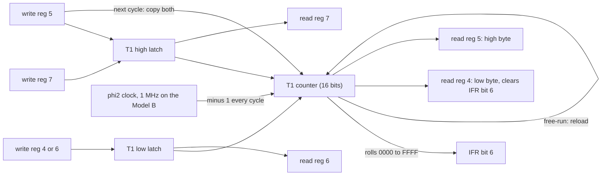
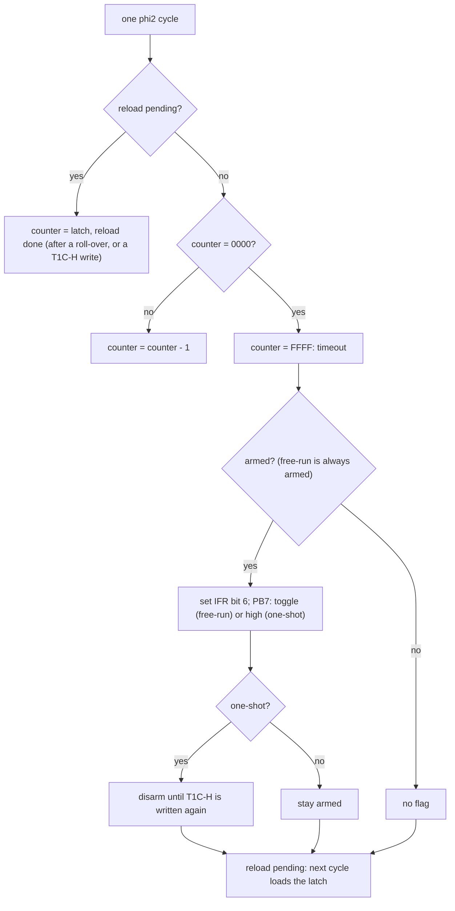
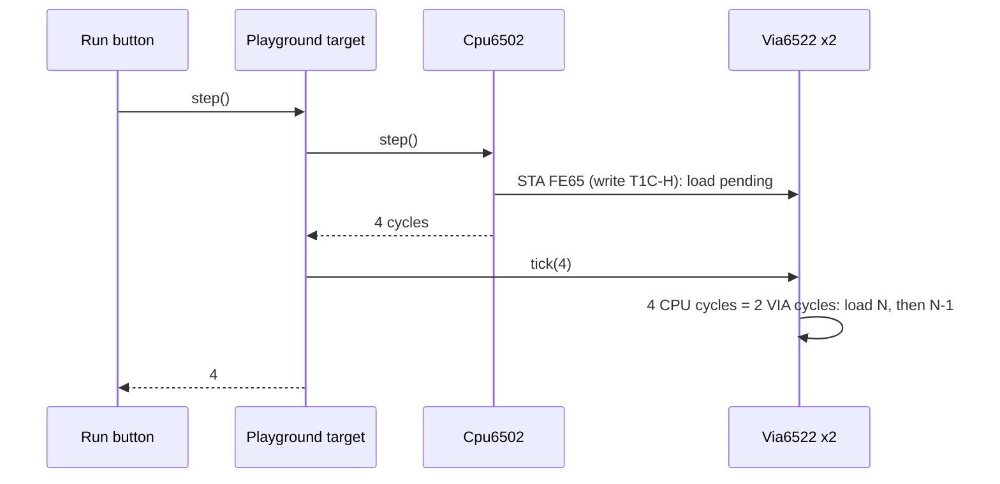

# Stage 25: VIA timers

> **Part:** 4 (The 6522 VIA) · **Branch:** `stage/25-via-timers` · **Needs:** 24
> **Status:** done

## Goal

This stage gives the 6522 its sense of time. Each VIA has two 16-bit **down-counters**, Timer 1 and Timer 2, and the MOS can't run without them: System VIA Timer 1 interrupts 100 times a second, and that one interrupt drives the clock (`TIME`), the keyboard scan, auto-repeat, sound envelopes and the flashing colours.

This stage builds:

- **Timer 1**, in **one-shot** and **free-running** modes, with its separate **latches** and **counter**, and its **PB7 output**;
- **Timer 2**, in one-shot (timed-interrupt) mode;
- the **ACR** bits that choose those modes;
- the two **timer flags** in the IFR (bit 6 for T1, bit 5 for T2), and the reads and writes that clear them;
- a `tick(cycles)` method, so the VIA moves forward in time as the CPU runs, the way BUILD-PLAN §3 describes.

Turning a flag into an actual interrupt (IER, IFR bit 7 and the `/IRQ` pin) is Stage 26. In this stage a program finds out that a timer has run out by **polling** the flag.

It comes straight after the ports because Timer 1 is the next thing the MOS needs. Its reset code at `&DA88` programs the System VIA's T1 for 100 Hz, as shown in [Key concepts §6](#6-what-the-mos-does-with-it).

## What you can now see

### In the browser: the VIA panel's new Timers table

```bash
npm run dev        # then open http://localhost:5173
```

The playground opens on the new default example, **Stage 25: VIA timers (Step, then Run)**. The **VIA** panel (User VIA, `&FE60`) now has a **Timers** table between the registers and the port grids:

```
Timer  Counter            Latch   Mode                                   Armed  IFR flag
T1     &7582 = 30,082 ▇▇▇  &C34E   free-running; PB7 = 0 (square wave)    yes    bit 6 = 0
T2     &EAE4 = 60,132 ▇▇▇▇ &xxFF   one-shot                               no     bit 5 = 1
IFR reads &20: bit 6 = T1 ran out, bit 5 = T2 ran out. …
```

1. **Step twice** (`LDA #&34`, `STA t1cl`). T1's **latch** becomes `&0034`, but its **counter** doesn't change: a write to `&FE64` goes to the latch.
2. **Step 5 more** (to `STA t2ch`). T2 shows `&FFFE = 65,534`, armed. The `STA` took 4 CPU cycles = 2 VIA cycles: one to load `&FFFF`, one to count. Each further Step takes it down by 1 or 2 (half the instruction's cycles).
3. **Run.** T1 starts free-running with latch `&C34E` (49,998, so 50 ms a lap). Its bar drains and refills about 20 times a second; the counter is different in every frame. In the port B grid, **PB7's DDRB cell says `T1`**, and its *Pin* bit flips every 50 ms: a 10 Hz square wave, although DDRB is `&00`.
4. The program polls IFR with `BIT &FE6D` / `BVC`, clears the flag by reading `&FE64`, and counts at `&80` (Memory panel: watch it go `&00` → `&64`). After 100 timeouts it stops:
   `Stopped at BRK (&0448) after 2,857,312 instructions, 10,000,329 cycles = 5 s at 2 MHz`.
5. **T2 ran out once**, 65 ms into the run, and was never re-armed: its flag is still set (`bit 5 = 1`, in red) and it keeps counting down from `&FFFF`.
6. `&82`/`&83` hold `&7E &00`: T2 used as a stopwatch measured the 50-round delay loop at **126 µs**.

The Stage 24 example still works at `/?program=via-ports`. Its timers now run in the panel too (they always do).

### On the command line: the timing diagrams

```bash
npm run demo:timers
```

```
T1 free-running, latch &0003, ACR = &C0 (free-run + PB7):
VIA cycle      write     1     2     3     4     5     6     7     8     9    10    11    12
counter         0000  0003  0002  0001  0000  FFFF  0003  0002  0001  0000  FFFF  0003  0002
IFR bit 6          0     0     0     0     0     1     1     1     1     1     1     1     1
PB7                0     0     0     0     0     1     1     1     1     1     0     0     0

T1 one-shot, latch &0003, ACR = &80 (one-shot + PB7):
counter         0000  0003  0002  0001  0000  FFFF  0003  0002  0001  0000  FFFF  0003  0002
IFR bit 6          0     0     0     0     0     1     1     1     1     1     1     1     1
PB7                0     0     0     0     0     1     1     1     1     1     1     1     1

T2 one-shot, &0003:
counter         0000  0003  0002  0001  0000  FFFF  FFFE  FFFD  FFFC  FFFB  FFFA  FFF9  FFF8
IFR bit 5          0     0     0     0     0     1     1     1     1     1     1     1     1

Part 2: the MOS's System VIA setting (os12.rom &DA88): ACR = &60, latch = &270E
  timeouts in one emulated second: 100
  first at CPU cycle 20,000, then every 20,000 CPU cycles

Part 3: reading a 16-bit counter one byte at a time
  low byte read first:  &04   (counter was &FF04)
  high byte, 7 µs later: &FE   (counter is now &FEFD)
  the program sees &FE04: 256 µs out, because the low byte wrapped in between.
```

(The `write` column shows the power-on counter, `&0000`: the load happens in cycle 1.)

## The real hardware

### Six registers and a few bits of the ACR

These are the timer rows of Stage 24's register table (6522 datasheet, register select table and the timer register descriptions; R6522 data sheet figures 13-17):

| Reg | Write | Read | Side effect |
|---|---|---|---|
| `&4` T1C-L | T1 **low-order latch** | T1 **counter**, low byte | read **clears IFR bit 6** |
| `&5` T1C-H | T1 high-order latch, then **latches → counter**, start | T1 counter, high byte | write **clears IFR bit 6** |
| `&6` T1L-L | T1 low-order latch | T1 low-order latch | — |
| `&7` T1L-H | T1 high-order latch (no transfer to the counter) | T1 high-order latch | write clears IFR bit 6 (see [Gotchas](#gotchas--hardware-quirks)) |
| `&8` T2C-L | T2 **low-order latch** | T2 counter, low byte | read **clears IFR bit 5** |
| `&9` T2C-H | T2 high byte, then **latch + high byte → counter**, start | T2 counter, high byte | write **clears IFR bit 5** |

The **auxiliary control register** (ACR, register `&B`) sets the modes (datasheet, ACR description):

| ACR bit | Meaning | Built in |
|---|---|---|
| 7 | 1 = T1 drives **PB7** | **25** |
| 6 | 0 = T1 **one-shot**, 1 = T1 **free-running** | **25** |
| 5 | 0 = T2 **one-shot timer**, 1 = T2 **counts pulses on PB6** | **25** (pulse counting itself isn't built: see Gotchas) |
| 4-2 | shift register mode | not planned |
| 1 | port B input latching | 26 |
| 0 | port A input latching | 26 |

The **interrupt flag register** (IFR, register `&D`) has a bit for each source. The timers own two of them:

| IFR bit | Set by | Cleared by |
|---|---|---|
| 6 | T1 runs out | reading T1C-L, writing T1C-H (or T1L-H), or writing a 1 to IFR bit 6 |
| 5 | T2 runs out | reading T2C-L, writing T2C-H, or writing a 1 to IFR bit 5 |

### The clock: 1 MHz, not 2

The timers count **φ2 cycles**: one count per cycle of the clock the VIA is given. On the Model B that **isn't** the CPU's 2 MHz clock. The VIAs sit on the machine's **1 MHz** side (like every slow chip on SHEILA, which is why the CPU's accesses to them get stretched; Stage 21). So **one count is one microsecond**, and the timers move once every **two** CPU cycles.

That's why BBC programs can work in microseconds without doing any sums: a latch of `&270E` (9,998) is a period of 10,000 µs (see [§3](#3-why-n2-the-free-running-period)).

## Key concepts

### 1. Latches and counters are different things

Each timer has two parts:

- a **counter**, which goes down by 1 every cycle, **all the time**, whether or not anyone is using it;
- **latches**, which hold the value to load into the counter. Writing a latch doesn't touch the counter.

That's why the same register number reads and writes different things. **Writing** `&FE44` (T1C-L) sets the low **latch**. **Reading** `&FE44` gives the low byte of the **counter**, which is moving.

The load happens on **the write of the high byte**. T1C-H (`&5`) writes the high latch, then copies **both** latches into the counter in one go:

```
LDA #&0E : STA &FE44   ; T1 low latch  = &0E   (the counter is untouched)
LDA #&27 : STA &FE45   ; T1 high latch = &27, then counter = &270E, and T1 starts
```

Why the high byte last? Because a 6502 can only write one byte at a time. If the counter loaded each byte as it arrived, it would count down from a half-written value (`&xx0E`) for the few cycles between the two `STA`s. The latch collects the bytes, and the counter loads all 16 bits at once.

Timer 2 is simpler: it has a low-order latch only. Writing T2C-H loads `high byte << 8 | low latch` straight into the counter.

### 2. The count: N, N-1 … 0, &FFFF

Load a timer with N and it counts down **through zero and one step past it**. The datasheet's timing diagrams (R6522, "Timer 1 one-shot mode timing") show the interrupt flag being set when the counter rolls over from `&0000` to `&FFFF`, which is **N + 1.5 cycles** after the write:

```
cycle after the write:   1      2      3     …   N+1     N+2
counter:                 N     N-1    N-2    …    0     &FFFF
                                                     ▲
                                        IRQ flag set here: N+1.5 cycles
```

The **.5** is because the diagram shows the flag (and `/IRQ`) changing half-way through a clock cycle, not on its edge. Our VIA only exists between whole cycles, so it sets the flag when the counter rolls over to `&FFFF`, in the same cycle as the real chip. As far as we can tell a CPU read can't see the difference, because a read samples the data bus at the end of its cycle, after the half-way point.

### 3. Why N+2: the free-running period

In **free-running** mode (ACR bit 6 = 1), Timer 1 reloads itself from the latches after it runs out, and then counts down again:

```
N, N-1, … 1, 0, &FFFF, N, N-1, … 1, 0, &FFFF, N, …
└──────────── N+2 cycles ─────────┘└──────── N+2 ──────
```

From `N` round to the next `N` is **N + 2** cycles: N steps down to 0, one to `&FFFF`, and one to reload. So to get a period of P cycles, you load **P − 2**. The MOS wants 10 ms = 10,000 µs, so it loads 9,998 = `&270E`. With a tiny latch of `&0003` the period is 5:

| VIA cycle | 0 (write) | 1 | 2 | 3 | 4 | 5 | 6 | 7 | 8 | 9 | 10 | 11 |
|---|---|---|---|---|---|---|---|---|---|---|---|---|
| counter | — | 3 | 2 | 1 | 0 | **FFFF** | 3 | 2 | 1 | 0 | **FFFF** | 3 |
| IFR bit 6 | 0 | 0 | 0 | 0 | 0 | **1** | 1 | 1 | 1 | 0* | **1** | 1 |

\* if the program cleared it by reading T1C-L in between.

The flag is a **flag**, not a count. If the program doesn't clear it between two timeouts, the second one is lost. That's why an interrupt handler must clear the flag every time it handles it.

**Writing the latch while it runs** (T1L-L, T1L-H) changes the *next* period without disturbing the current one. That's how you fine-tune a free-running timer without a glitch.

### 4. One-shot mode

In **one-shot** mode (ACR bit 6 = 0), Timer 1 sets its flag **once** per write to T1C-H. When it runs out it reloads from the latch and keeps counting, but it won't set the flag again until the program writes T1C-H again. Timer 2's one-shot is different: it **doesn't reload**. It rolls over to `&FFFF` and keeps going down (`&FFFE`, `&FFFD`, …), so a program can read the counter afterwards and see how long ago it ran out.

(Whether T1 reloads in one-shot mode is a point where the datasheets are vague: see [Gotchas](#gotchas--hardware-quirks).)

### 5. PB7: a timer you can see on a pin

With ACR bit 7 = 1, Timer 1 takes over **PB7** and drives it whatever DDRB bit 7 says:

- **one-shot**: PB7 goes **low** when T1C-H is written and **high** when the timer runs out, so it makes one low pulse N + 1.5 cycles long. That's a programmable delay with no CPU involved.
- **free-running**: PB7 also goes low on the write, then **inverts** at every timeout. That's a square wave with a period of 2 × (N + 2) cycles, which could drive a speaker or clock another circuit.

On the User VIA, PB7 is on the user port connector, so you could put a scope on it. In this stage's example it's the bit that flashes in the VIA panel's port B grid.

### 6. What the MOS does with it

Here is the real code from `os12.rom` at `&DA88`, part of the reset routine:

```
DA88  A9 60     LDA #&60
DA8A  8D 4B FE  STA &FE4B   ; System VIA ACR = &60: T1 free-running, T2 counts PB6 pulses
DA8D  A9 0E     LDA #&0E
DA8F  8D 46 FE  STA &FE46   ; T1L-L = &0E
  …             (the same &0E also goes to the User VIA's PCR and to &FEC0)
DAA2  A9 27     LDA #&27
DAA4  8D 47 FE  STA &FE47   ; T1L-H = &27   (latch = &270E)
DAA7  8D 45 FE  STA &FE45   ; T1C-H = &27   (counter = &270E: go)
```

`&270E` = 9,998, so the period is 9,998 + 2 = **10,000 µs: 100 interrupts a second**. ACR `&60` = `0110 0000`: bit 6 (free-run) and bit 5 (T2 counts pulses). Bit 7 is clear, so T1 leaves PB7 alone: on the System VIA, PB6 and PB7 are inputs from the (optional) speech system.

Notice the MOS writes the low latch through `&FE46`, not `&FE44`. For a write the two are identical. Writing `&27` to T1L-H and then to T1C-H looks redundant, because T1C-H sets the high latch as well. We don't know why the authors did it: belt and braces is the likeliest explanation.

## Diagrams

Where each register's bytes go. **Latches** only change on writes; the **counter** changes every cycle.



What one VIA clock cycle does to Timer 1. This is the `clockOnce` method in `via6522.ts`:



How the timer fits into the instruction-stepped loop (BUILD-PLAN §3): the CPU runs a whole instruction, then the playground ticks both VIAs by that many CPU cycles, and each VIA turns every **two** of them into one count.



## Our design

### `tick(cpuCycles)` and the 2:1 clock

The VIA's own timing logic works in **VIA cycles**, exactly as the datasheet draws them (`clockOnce()`, one φ2 cycle). The playground and, from Stage 27, the machine know only CPU cycles. So `tick` takes **CPU** cycles and divides by `CPU_CYCLES_PER_VIA_CYCLE = 2`, keeping the odd half-cycle in a `phase` field for next time:

```ts
tick(cpuCycles: number): void {
  this.phase += cpuCycles;
  while (this.phase >= CPU_CYCLES_PER_VIA_CYCLE) {
    this.phase -= CPU_CYCLES_PER_VIA_CYCLE;
    this.clockOnce();
  }
}
```

A 3-cycle `LDA #` followed by a 3-cycle `BNE` is 6 CPU cycles, so 3 VIA cycles, and none are lost on the way. Counting one cycle at a time is the clearest way to follow the datasheet's diagrams, and it's cheap: about 1 million calls a second per VIA, with no allocation. A closed-form "subtract n and work out how many timeouts happened" would be faster. If profiling in Part 6 says so, we can switch to it.

The alternative was to make `tick` take VIA cycles and do the halving in the machine. We put it in the VIA because the 2:1 ratio **is** the VIA's clock input on this board, and every caller would otherwise have to remember it. A test for "one VIA cycle" is just `tick(2)`.

### Who calls `tick`

`playgroundTarget` gains an optional list of **clocked devices**:

```ts
export interface Clocked {
  /** Moves the device forward by this many 2 MHz CPU cycles. */
  tick(cpuCycles: number): void;
}
```

After every `step()` (and `reset()`, since the reset sequence takes 7 cycles of real time too), the target ticks each device by the cycles just used. The browser passes both VIAs. This is a small preview of Stage 27's machine loop, and the playground's version goes when the playground does.

### State inside `Via6522`

| Field | What it is |
|---|---|
| `t1Counter`, `t1Latch` | 16-bit. The latch holds both bytes, high and low |
| `t1Armed` | one-shot: will the next timeout set the flag? |
| `t1Reload` | the next cycle loads the latch: set by a roll-over **and** by writing T1C-H |
| `pb7` | the level T1 would put on PB7 (only used when ACR bit 7 = 1) |
| `t2Counter`, `t2LatchLow` | T2's counter and its one latch byte |
| `t2Armed` | will T2's next roll-over set the flag? |
| `t2Load`, `t2LoadValue` | a T2C-H write waiting for its load cycle, and the 16 bits it will load |
| `acr` | the real ACR byte. Bits 7-5 are used; bits 4-0 are stored for later |
| `ifr` | the real IFR: bits 6 and 5 for now |
| `phase` | CPU cycles not yet worth a whole VIA cycle (0 or 1) |

IER stays plain storage until Stage 26, and IFR bit 7 ("any enabled flag set") reads 0 until then, because working it out needs IER.

The IFR's write rule is built now, though: **writing a 1 to an IFR bit clears it**, and writing a 0 leaves it alone (datasheet, IFR description). It's one line, and without it a program could never clear the timer flags through IFR, which is exactly what Stage 26's interrupt handlers will do.

### The load cycle

Writing T1C-H or T2C-H doesn't put N in the counter straight away. It sets a "load pending" flag, and the **next** φ2 cycle does the load, so the counter shows N in cycle 1, as in the datasheet's diagram ([§2](#2-the-count-n-n-1--0-ffff)). T1 uses the same `t1Reload` flag that free-running's reload uses: in both cases "the next cycle loads the latch". A first version loaded N during the write. `npm run demo:timers` showed every timeout arriving a cycle early compared with the diagram, so we changed it.

### Power-on values

A real 6522 powers up with **random** values in its counters and latches, because `/RES` doesn't touch them. We start them at `&0000`, which is just as legal and is repeatable. After reset the counters are already running (they always are) but nothing is armed, so no flag appears until a program writes T1C-H or T2C-H.

### The panel

The VIA panel gains a **Timers** table: for T1 and T2 it shows the counter (hex, decimal, and a bar for how far through its count it is), the latch, the mode from the ACR, whether it's armed, and the IFR flag. PB7 shows up in the port B grid as an output driven by T1 whenever ACR bit 7 is set.

## Code walkthrough

**[`src/devices/via6522.ts`](../../src/devices/via6522.ts)**: the chip.

- New constants named after the datasheet: `ACR_T1_PB7_OUTPUT` (`&80`), `ACR_T1_FREE_RUN` (`&40`), `ACR_T2_PULSE_COUNT` (`&20`), `IFR_T1` (`&40`), `IFR_T2` (`&20`), and `CPU_CYCLES_PER_VIA_CYCLE = 2`.
- `tick(cpuCycles)` adds to `phase` and calls `clockOnce()` for every whole VIA cycle.
- `clockOnce()` is the second diagram above. For T1: a pending load wins; otherwise `&0000` rolls to `&FFFF` and triggers a timeout, which always sets up a reload and sets the flag only if free-running or armed. Otherwise it counts down. For T2: a pending load, or (unless ACR bit 5) a count down that flags once on the roll-over to `&FFFF`.
- `write()` gains a `case` for each timer register. T1C-L and T1L-L share a case, because a **write** to either sets the same low latch. T1C-H sets the high latch, arms, clears IFR bit 6, sets `pb7 = 0` and asks for a load. The IFR case is `ifr &= ~(v & &7F)`: write-1-to-clear.
- `read()` now has side effects: after taking the value from `peek()`, a read of `&4` clears IFR bit 6 and a read of `&8` clears IFR bit 5. `peek()` stays pure, so the panel never acknowledges a timeout behind the program's back.
- PB7: `orbSeenByPins()` and `ddrbSeenByPins()` substitute T1's level and force bit 7 to an output when ACR bit 7 is set. Both `pins('b')` and the IRB read use them, so the override lives in one place.
- `timers()` returns a snapshot for the workbench (it allocates, so it's never called from `tick`).

**[`src/devices/clocked.ts`](../../src/devices/clocked.ts)**: the `Clocked` interface, `tick(cpuCycles)`. Stage 27's machine will use it too.

**[`src/web/workbench/debug-target.ts`](../../src/web/workbench/debug-target.ts)**: `playgroundTarget(memory, name, devices)` ticks each device after `step()` and `reset()`, with an indexed `for` loop (no iterator, no closure per step). [`src/main.ts`](../../src/main.ts) passes `[systemVia, userVia]`.

**[`src/web/workbench/via-view-model.ts`](../../src/web/workbench/via-view-model.ts)**: `timerRows()` builds the two Timers rows (counter in hex and decimal, latch, mode, armed, flag, a 0..1 `fraction` for the bar, and PB7's state). `portView()` shows PB7 as an output carrying T1's level, with `timer1: true`. Register statuses: `&4`–`&9` are built, ACR and IFR are part-built, and only SR, PCR and IER remain stubs.

**[`src/web/workbench/via-panel.ts`](../../src/web/workbench/via-panel.ts)**: the Timers table, the IFR line, and `T1` in PB7's DDRB cell.

**[`src/playground/examples.ts`](../../src/playground/examples.ts)**: `VIA_TIMERS_SOURCE`, the new default. The polling loop is the stage's key idiom:

```
wait:   BIT ifr           ; BIT copies bit 6 of IFR into V
        BVC wait          ; until T1 runs out
        LDA t1cl          ; reading T1C-L clears IFR bit 6
```

`BIT` is made for this: it copies bit 6 of the operand into V and bit 7 into N without touching A, so T1's flag (bit 6) can be tested with one instruction and no mask.

**[`scripts/demo-timers.ts`](../../scripts/demo-timers.ts)**: `npm run demo:timers`.

## Tests

| Test file | What it proves |
|---|---|
| `src/devices/via6522-timers.test.ts` | Latches vs counter (writing T1C-L/T1L-H doesn't touch the counter; T1C-H loads both latches in the next cycle). One count per 2 CPU cycles with the odd one carried. The counter runs and reloads even unarmed, without flagging. One-shot: flag at the roll-over to `&FFFF`, once per T1C-H write, reloading, re-armed by T1C-H. Free-running: the exact `N … 0, FFFF, N` sequence (period N+2); repeated flags; latch `&270E` gives 100 timeouts a second, 20,000 CPU cycles apart; latch writes change the next period only. Every way to clear IFR bit 6 (and that `peek`, T1C-H reads and latch reads don't). PB7: a one-shot low pulse, a free-run square wave of period 2(N+2), overriding DDRB, back to normal with ACR bit 7 = 0. T2: low latch, load, flag, no reload, flags once, clears, pulse mode holds. `/RES` clears IFR/ACR, disarms, keeps counting. IFR bit 7 reads 0; ACR reads back. |
| `src/devices/via6522.test.ts` | Updated: `/RES` keeps the timer latches; only SR, PCR and IER are still storage. |
| `src/web/workbench/debug-target.test.ts` | The playground ticks every clocked device by each step's cycles, and by reset's 7. |
| `src/web/workbench/via-view-model.test.ts` | Register statuses; the Timers rows for T1 free-run, T1 one-shot with its flag and PB7, and T2 (latch `&xx34`, pulse mode "not built"); PB7 in the port grid as a T1 output. |
| `src/playground/examples.test.ts` | The timers example: latch read back `&34`, the stopwatch reads 126 µs, 100 timeouts in 5.00 emulated seconds, PB7 changes level 101 times, and T2's flag is left set. |
| `e2e/via-timers.spec.ts` | In the browser: default example, Timers table, latch vs counter while stepping, T2 counting per step, then a Run with a moving T1 counter, `T1` on PB7, `&80` = `&64`, stopwatch `&7E`, and T2's flag. |
| `e2e/via.spec.ts` | Now opens `?program=via-ports`, since that's no longer the default. |

All 2,024 Jest tests: 2,023 pass, and 1 skips (`dfs.rom` is missing). All 94 Playwright tests pass.

## Gotchas & hardware quirks

- **A 16-bit counter read one byte at a time can tear.** The 6502 reads `&FE68` and `&FE69` several cycles apart, and the counter moves in between. The first draft of the example timed a 100-round loop. The counter was `&FF03` when the low byte was read, but had passed `&FF00` by the time the high byte was read (`&FE`), so the program saw `&FE03`, i.e. 508 µs instead of about 252. The cure on real hardware is the same as here: keep the measurement away from a byte boundary, or read high, low, high again and retry if the two highs differ. (`demo:timers` part 3 reproduces it.)
- **When does the CPU see the write?** Our CPU runs a whole instruction, then the VIA is ticked for all of it. On a real 6502 a store's write is its **last** cycle, so the VIA cycles we tick after a `STA &FE65` really happened *before* the write. The load cycle absorbs one of them, so after `STA` (4 CPU cycles = 2 VIA cycles) we show N−1 where the real chip would show N. This is within the approximation BUILD-PLAN §3 accepts. Periods are exact, because they don't depend on when the CPU looks. A cycle-exact core that ticks devices *before* each bus access (Part 12) would remove it. (Parking lot.)
- **Does T1 reload in one-shot mode?** The datasheet says that after a one-shot timeout the counter "continues to decrement". We reload from the latch and keep decrementing, and only stop the flag and PB7 from re-triggering. That's how it's commonly described for T1, and it's what established emulators do (consulted for behaviour only, not code). T2 definitely doesn't reload. Unconfirmed on real hardware here. (Parking lot.)
- **T1L-H clears IFR bit 6.** The datasheet's IFR table says the flag is cleared by "write T1 high", which could mean T1C-H only. Most descriptions, and established emulators' behaviour, apply it to T1L-H too, and so do we. Unconfirmed. (Parking lot.)
- **PB7 overrides DDRB bit 7.** We let ACR bit 7 drive PB7 whatever DDRB says. Some datasheet versions suggest DDRB bit 7 should be set as well. Unconfirmed. Nothing in the MOS depends on it (it leaves ACR bit 7 clear).
- **T2's pulse-counting mode isn't built.** With ACR bit 5 set, T2 holds still, because nothing generates PB6 pulses yet. The **MOS sets this mode** on the System VIA (ACR `&60`), so in Stage 27 its T2 will sit still. That's harmless: on the Model B, PB6 comes from the optional speech system. Building it needs falling-edge detection on PB6. (Parking lot.)
- **IFR bit 7, IER and `/IRQ` are Stage 26.** IFR reads only its flag bits for now. The write-1-to-clear rule is built, because a program needs it to clear the timer flags.
- **Power-on values.** A real 6522 powers up with random counters and latches. Ours start at `&0000`, so both counters already run at power-on: `&0000`, `&FFFF`, reload `&0000`, and so on, with no flags.
- **The panel can't show a real-speed counter smoothly.** At real speed T1 counts 20,000 per 50 Hz frame, so a 50 ms timer goes round in 2.5 frames. That's real life. Use Step to watch it count, 1 or 2 per instruction.

## Playwright verification

- **MCP (interactive):** opened `http://localhost:5173/`, pressed Run, and took screenshots of the VIA panel mid-run: T1 free-running `&7582 = 30,082` with the bar part-drained, latch `&C34E`, PB7's DDRB cell `T1`; T2 `&EAE4`, flag `bit 5 = 1` in red; IFR reads `&20`. After the run: `Stopped at BRK (&0448) after 2,857,312 instructions, 10,000,329 cycles = 5 s at 2 MHz`, `&80` = `&64`, `&82` = `&7E`. The screenshot also showed the flag cell picking up the Registers panel's global `.flag` button style, so it was renamed `ifr-flag`.
- **Durable:** `e2e/via-timers.spec.ts` (three tests: see Tests). `e2e/via.spec.ts` now opens `?program=via-ports`.

## Check your understanding

1. A program writes `&10` to `&FE64` and then reads `&FE64`. Why doesn't it get `&10` back? What would it have to read to see the `&10`?
2. You want System VIA T1 to interrupt every 20 ms. What 16-bit value do you put in the latch, and in which order do you write the two bytes? Why that order?
3. In free-running mode, T1 sets its flag at 0 µs and the program clears it at 25 ms, with a 10 ms period. How many timeouts did the program notice, and how many really happened?
4. The MOS sets ACR to `&60`. What does each set bit do, and why is bit 7 clear?
5. Why does `peek(4)` exist alongside `read(4)`? What would go wrong in the workbench if the VIA panel used `read`?

<details>
<summary>Answers</summary>

1. Writing register 4 sets T1's **low latch**, but reading register 4 returns the low byte of the **counter**, which is counting down from whatever it last loaded. Read register 6 (T1L-L, `&FE66`) to see the latch.
2. 20 ms = 20,000 µs (one count per µs at 1 MHz), and the period is N+2, so N = 19,998 = `&4E1E`. Write the low byte first (`&1E` to `&FE44` or `&FE46`), then the high byte (`&4E` to `&FE45`). Writing the high byte loads both latches into the counter at once, so the counter never runs from a half-written value.
3. It noticed **one**. Timeouts happened at 0, 10 and 20 ms, but IFR bit 6 is a single flag, not a count: the 10 ms and 20 ms timeouts set a flag that was already set. That's why an interrupt handler (Stage 26) must clear the flag every time, promptly.
4. `&60` = `0110 0000`. Bit 6 makes T1 free-running (it reloads, giving the 100 Hz tick). Bit 5 makes T2 count pulses on PB6 instead of clock cycles. Bit 7 is clear so T1 doesn't drive PB7, which on the System VIA is an input from the speech system.
5. `read(4)` has a side effect: it clears IFR bit 6. If the panel used it while redrawing, every frame would silently acknowledge T1's timeout, and a program polling with `BIT &FE6D` would never see the flag. A debugger mustn't change the thing it's watching.

</details>

## Further reading

- 6522 datasheet (MOS Technology; Rockwell R6522 data sheet): "Timer 1 Operation", "One-Shot Mode", "Free-Running Mode", "Timer 2 Operation", the T1/T2 register figures, the ACR and IFR descriptions, and the timing diagrams with the N + 1.5 annotation.
- *Advanced User Guide for the BBC Microcomputer*, the 6522 VIA chapter (timers and the ACR), and the System VIA's use for the 100 Hz clock interrupt.
- BeebWiki, "System VIA" and "User VIA".
- `os12.rom` at `&DA88`: the MOS's T1 setup, quoted in [Key concepts §6](#6-what-the-mos-does-with-it).
