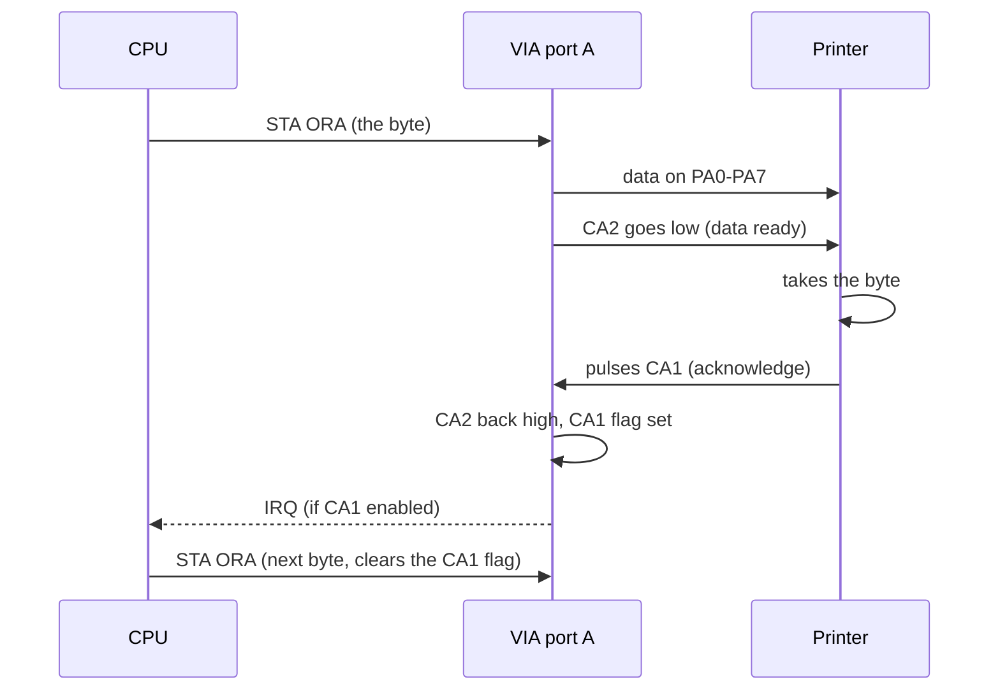
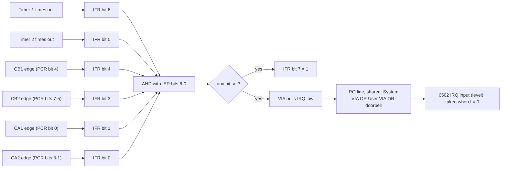
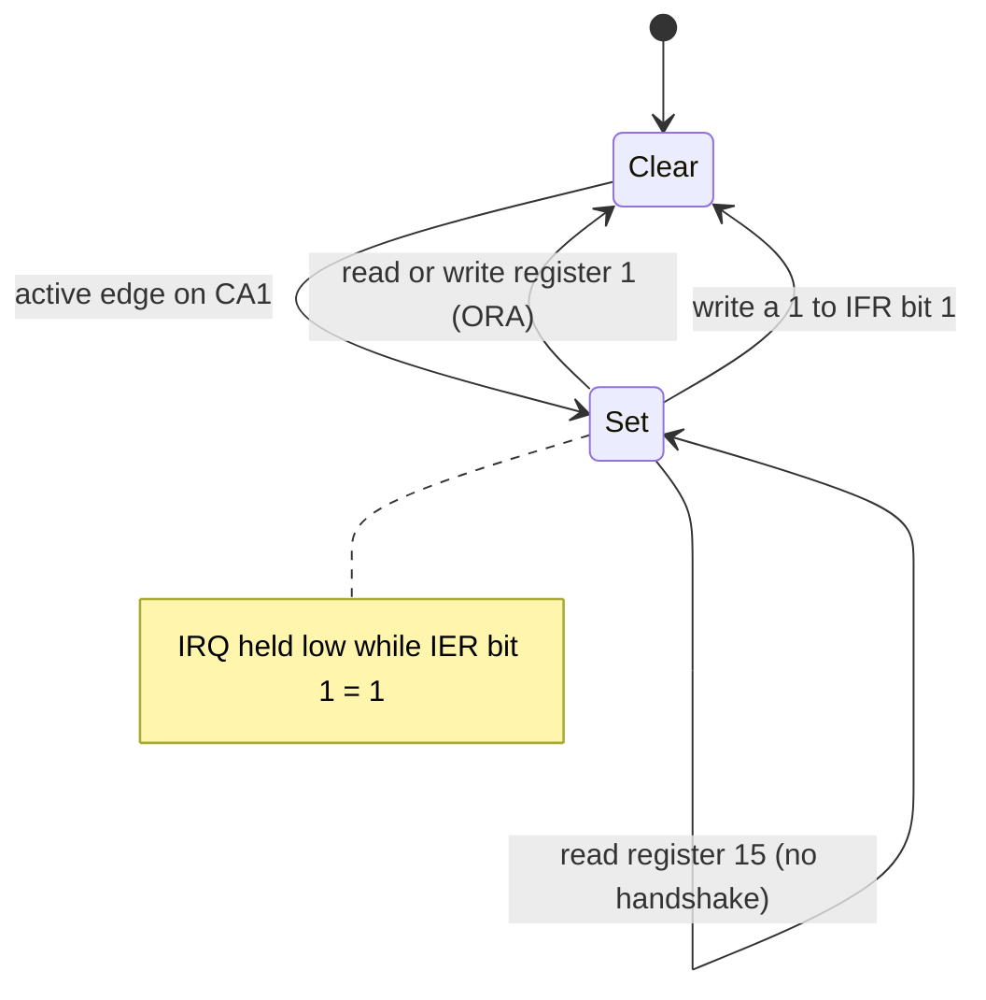
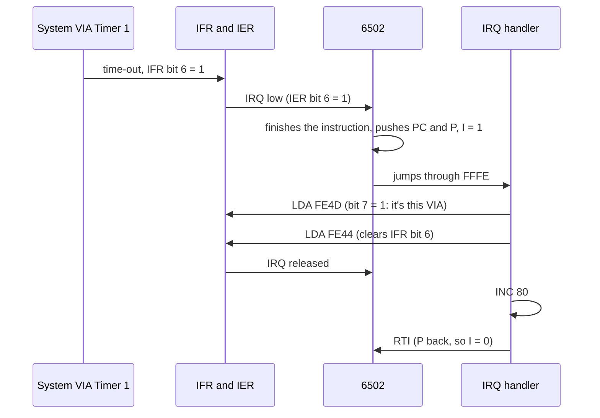

# Stage 26: VIA interrupts & control lines

> **Part:** 4 (The 6522 VIA) · **Branch:** `stage/26-via-interrupts` · **Needs:** 25
> **Status:** done

## Goal

In Stage 25 a timer could run out, but the only way a program found out was by **polling** the flag in a loop. This stage lets the VIA **interrupt** the CPU instead. The CPU gets on with something else, and the VIA taps it on the shoulder when it needs attention.

This stage builds:

- the **interrupt enable register** (IER), with its odd "bit 7 says set or clear" write;
- **IFR bit 7**, the "any enabled flag" summary bit;
- the VIA's **/IRQ output**, wired to the CPU in the playground target;
- the four **control lines** CA1, CA2, CB1 and CB2, with **edge detection** chosen by the **PCR**, their four IFR flags, and the reads and writes that clear them;
- CA2/CB2's **output modes** (handshake, pulse and manual), and the ACR's **input latching**.

It comes now because every interrupt the MOS handles, apart from BRK, arrives through a VIA. The 100 Hz clock, the keyboard, the vertical sync and the ADC all flag a VIA, and the VIA pulls /IRQ. Stage 27 puts the VIAs into a real machine, and the MOS will need this to get past the stall Stage 23 found.

## What you can now see

### In the browser: an IRQ-driven clock

```bash
npm run dev        # then open http://localhost:5173
```

The playground opens on the new default example, **Stage 26: VIA interrupts (Run me)**. The **VIA** panel now opens on the **System VIA** (`&FE40`), because that's where the MOS keeps its 100 Hz tick and the example copies it.

1. **Step 13 times** (up to the `CLI`). Watch the register table: `STA ier` with `&7F` leaves IER reading `&80` (bit 7 always reads 1), and then `&C2` turns on T1 and CA1. The VIA panel's new **Interrupts** table shows bits 6 and 1 with IER enable = 1.
2. Still before `CLI`, click **pull low** next to **CA1** in the **Control lines** table. That's one falling edge. The CA1 row lights up (flag 1, enable 1, **→ IRQ yes**), the caption turns red: `Interrupts: IFR &82, IER &C2. /IRQ is LOW: this VIA wants attention`. The **Interrupts** panel (under the screen) says:
   ```
   IRQ line   held by the System VIA
   I flag     1: IRQs held off
   IRQ waiting: I = 1 holds it off until CLI or RTI clears I.
   ```
   Step once more (`CLI`) and the next step goes to the handler at `&0429`. Click **let go** to release the line.
3. **Run.** Type `0080` in the Memory panel's Go box:
   - `&80` counts centiseconds `&00` → `&63` (99) and wraps, 100 times a second;
   - `&81` counts seconds;
   - `&84`/`&85` race: that's the main loop, which never looks at the timer.

   In one check, 3,280,088 cycles (1.64 s at 2 MHz) had `&81` = `&01` and `&80` = `&40` (64): 1.64 s exactly.
4. While it runs, click **let go** and then **pull low** on CA1: `&82` goes up by **one** for each press, however long you hold it low.
5. There's no BRK in this program, so Run stops at the playground's cycle limit (20,000,000 cycles = **10 emulated seconds**), with `&81` at about 10. Press Run again to carry on.
6. **Experiment:** in the Assembler, change `LDA t1cl` in the handler to `NOP`, then Assemble & Run. `&80` spins at a blur and `&84` freezes: IRQ never lets go, so the CPU goes straight back into the handler after every RTI.

Earlier examples: `/?program=via-timers` and `/?program=via-ports` (click **User VIA** in the panel).

What the Interrupts table looks like in step 2:

```
Interrupts: IFR &82, IER &C2. /IRQ is LOW: this VIA wants attention
Bit  Source                    Wired to                    IFR flag  IER enable  → IRQ
6    T1: Timer 1 ran out                                       0          1
5    T2: Timer 2 ran out                                       0          0
4    CB1: an edge on CB1       ADC end of conversion           0          0
3    CB2: an edge on CB2       light pen strobe                0          0
2    SR: 8 bits shifted (not built)                            0          0
1    CA1: an edge on CA1       vertical sync (6845 CRTC)       1          1       yes
0    CA2: an edge on CA2       keyboard                        0          0
```

## The real hardware

### The interrupt registers

Two registers in each VIA deal with interrupts (6522 datasheet, "Interrupt Operation"; Rockwell R6522 data sheet, figures 25 and 26):

| Reg | Name | Read | Write |
|---|---|---|---|
| `&D` | **IFR**, interrupt flag register | bit 7 = "an enabled flag is set"; bits 6-0 = the flags | a **1** clears that flag; a 0 leaves it; bit 7 is ignored |
| `&E` | **IER**, interrupt enable register | bits 6-0 = the enables; **bit 7 always reads 1** | bit 7 = 1: **set** the bits written as 1. Bit 7 = 0: **clear** the bits written as 1 |

Both registers have the same bit layout. One bit per **source**:

| Bit | Source | Set by | Cleared by |
|---|---|---|---|
| 7 | IRQ | any bit 6-0 set **and** enabled | (follows the others) |
| 6 | Timer 1 | time-out | read T1C-L, write T1C-H (Stage 25) |
| 5 | Timer 2 | time-out | read T2C-L, write T2C-H (Stage 25) |
| 4 | CB1 | active edge on CB1 | read or write ORB (register 0) |
| 3 | CB2 | active edge on CB2 (input modes) | read or write ORB, **unless** "independent" mode |
| 2 | Shift register | 8 bits shifted | not built (the shift register is out of scope) |
| 1 | CA1 | active edge on CA1 | read or write ORA (register **1**) |
| 0 | CA2 | active edge on CA2 (input modes) | read or write ORA (register 1), **unless** "independent" mode |

Any flag can also be cleared by writing a 1 to its IFR bit.

The **/IRQ pin** is an open-drain output. It's low (asserted) whenever

```
IFR & IER & &7F  ≠  0
```

and floats otherwise. That's the same test as IFR bit 7: bit 7 is the pin, made readable.

### The control lines

Each port has two **control lines** next to its eight data lines:

- **CA1** and **CB1** are always **inputs**. They exist to say "something happened": a falling or rising **edge** sets their IFR flag.
- **CA2** and **CB2** can be **inputs** (like CA1/CB1, with more options) or **outputs**.

The **peripheral control register** (PCR, register `&C`) picks what each one does (6522 datasheet, PCR description):

| PCR bits | Line | Values |
|---|---|---|
| 0 | CA1 | 0 = flag on a **negative** (falling) edge, 1 = **positive** (rising) edge |
| 3-1 | CA2 | see below |
| 4 | CB1 | as CA1 |
| 7-5 | CB2 | as CA2, but the handshake and pulse modes react to **writes** of ORB only |

The CA2/CB2 three-bit field:

| Value | Mode | What it does |
|---|---|---|
| `000` | input, negative edge | flag on a falling edge; cleared by reading or writing ORA |
| `001` | **independent** input, negative edge | flag on a falling edge; reading or writing ORA leaves it alone |
| `010` | input, positive edge | flag on a rising edge; cleared by reading or writing ORA |
| `011` | independent input, positive edge | rising edge; ORA leaves it alone |
| `100` | **handshake** output | goes low on a read or write of ORA; goes high again on the active CA1 edge |
| `101` | **pulse** output | goes low for one cycle after a read or write of ORA |
| `110` | manual output **low** | |
| `111` | manual output **high** | |

For port B, read "ORB" for "ORA", and in modes `100`/`101` only a **write** of ORB starts the handshake. (A printer on port B is fed by writes; port A also handshakes on reads, for input devices.)

### The two ORAs

Stage 24 noted that registers 1 and 15 both read IRA and write ORA. **This** is the difference: register 1 ("ORA/IRA") clears the CA1/CA2 flags and runs the CA2 handshake, and register 15 ("ORA/IRA, no handshake") does neither. The MOS reads the keyboard through `&FE4F` (register 15), so poking at the keys doesn't throw away the keyboard's CA2 interrupt flag.

### Input latching

ACR bits 0 and 1 (left over from Stage 25):

| ACR bit | Meaning |
|---|---|
| 0 | 1 = port A **latching**: IRA returns the pins as they were **at the last active CA1 edge** |
| 1 | 1 = port B latching: IRB's **input** bits come from the pins at the last active CB1 edge (output bits still read ORB) |

It lets a slow CPU read data that was only on the pins for a moment: the device puts a byte on the port, pulses CA1, and can then take it away.

### How the Model B wires them

From the Advanced User Guide (System VIA and User VIA chapters) and BeebWiki's System VIA page:

| Line | System VIA (`&FE40`) | User VIA (`&FE60`) |
|---|---|---|
| CA1 | **vertical sync** from the 6845 CRTC, 50 times a second | printer **acknowledge** |
| CA2 | **keyboard**: a key is pressed | printer **strobe** (output) |
| CB1 | **ADC** end of conversion (`&FEC0`) | user port |
| CB2 | light pen strobe | user port |
| /IRQ | to the CPU's /IRQ | to the CPU's /IRQ, **wired together** with the System VIA's |

Both VIAs share one IRQ line. Each pulls it low on its own, and nothing is driving it high, so the line is low when **either** wants attention ("wire-OR"). Stage 27 builds that properly for the whole machine; this stage already ORs the two VIAs with the Stage 17 doorbell.

### What the MOS does with it

At power-on the MOS (`os12.rom`) runs this at `&DA6B` (bytes as they are in the ROM):

```
DA6B  A9 7F      LDA #&7F
DA6D  E8         INX               ; X = 1, then 0
DA6E  9D 4D FE   STA &FE4D,X       ; System VIA IER (X=1), then IFR (X=0)
DA71  9D 6D FE   STA &FE6D,X       ; the same for the User VIA
DA74  CA         DEX
DA75  10 F7      BPL &DA6E
      …
DA80  A2 F2      LDX #&F2
DA82  8E 4E FE   STX &FE4E         ; IER: enable T1, T2, CB1 and CA1
DA85  A2 04      LDX #&04
DA87  8E 4C FE   STX &FE4C         ; PCR: CA2 (keyboard) on a rising edge
DA8A  A9 60      LDA #&60
DA8C  8D 4B FE   STA &FE4B         ; ACR: T1 free-runs, T2 counts PB6
DA8F  A9 0E      LDA #&0E
DA91  8D 46 FE   STA &FE46         ; T1 low latch
DA94  8D 6C FE   STA &FE6C         ; User VIA PCR = &0E: CA2 (printer strobe) high
      …
```

- `&7F` to IER is "bit 7 = 0, so **clear** bits 6-0": every interrupt off. `&7F` to IFR clears every flag.
- `&F2` = `1111 0010`. Bit 7 = 1, so **set** bits 6, 5, 4 and 1: Timer 1, Timer 2, CB1 (ADC) and CA1 (vsync). The keyboard's CA2 (bit 0) is left off for now. The MOS turns it on (`LDA #&81 : STA &FE4E` at `&EEE4`) when no key is down and it stops scanning, and off again (`LDA #&01` at `&EF06`) when a key press wakes it.
- PCR `&04` = `000 0 010 0`: CB2 negative-edge input, CB1 negative edge, **CA2 `010` positive-edge input**, CA1 negative edge.
- The User VIA's PCR `&0E` = `000 0 111 0`: CA2 = `111`, a manual high output. That's the printer strobe sitting idle.

And its IRQ handler, at `&DD06`, asks the System VIA first:

```
DD06  AD 4D FE   LDA &FE4D         ; System VIA IFR
DD09  10 3C      BPL &DD47         ; bit 7 = 0: not this VIA, try the User VIA
DD0B  2D 79 02   AND &0279         ; (a MOS mask byte)
DD0E  2D 4E FE   AND &FE4E         ; only the ENABLED flags
DD11  6A         ROR A
DD12  6A         ROR A             ; CA1 (bit 1) into the carry
DD13  90 54      BCC &DD69         ; not vsync: look at the next source
      …                            ; the 50 Hz vsync work
DD42  A9 02      LDA #&02
DD44  4C 6E DE   JMP &DE6E         ; → STA &FE4D: write a 1 to bit 1, clearing CA1
```

That's the pattern every 6522 interrupt handler follows: **is it this chip (bit 7)? Which source (AND with IER)? Acknowledge it (clear the flag), or it will interrupt again straight after RTI.**

## Key concepts

### 1. Flag, enable, line: three separate things

A **flag** says that something happened. An **enable** says whether that something should interrupt. The **line** is the result:

```
IFR  = 0100 0010   T1 ran out, and CA1 saw an edge
IER  = 1100 0000   (reads with bit 7 = 1) only T1 is enabled
       --------
AND    0100 0000   ≠ 0, so /IRQ is low and IFR reads 1100 0010 = &C2
```

Flags are set whether or not they're enabled. That's why Stage 25's polling worked with IER = `&00`: the flag rose, the line didn't. And it's why the MOS clears all flags (`&7F` to IFR) **before** enabling anything: an old flag left over from before reset would interrupt the moment it was enabled.

### 2. Why IER has a set/clear bit

There are 7 enable bits, and different parts of a program own different ones. If IER were a plain register, turning on CA1 would mean reading IER, ORing in `&02` and writing it back, and an interrupt between the read and the write could change IER underneath you.

Instead, a write says *what to do* with the bits it names:

```
STA &FE4E with A = &82  (1000 0010)   set   bit 1   → CA1 on,  others unchanged
STA &FE4E with A = &02  (0000 0010)   clear bit 1   → CA1 off, others unchanged
STA &FE4E with A = &7F  (0111 1111)   clear bits 6-0 → everything off
STA &FE4E with A = &FF  (1111 1111)   set   bits 6-0 → everything on
```

One instruction, nothing read back first, no race. IFR's "write a 1 to clear" is the same idea: `LDA #&02 : STA &FE4D` clears CA1's flag and can't touch any other.

Reading IER returns bit 7 = **1**. Stage 23 found that the MOS uses this: on RESET it does `LDA &FE4E : ASL A`. Bit 7 falls into the carry, and what's left is zero only if every enable bit is clear. Power-on resets the VIAs (IER = `&00`, reads `&80`, ASL gives `&00`): it's a power-on. BREAK doesn't reset them, so IER still reads `&F2`, ASL gives `&E4`: it's a BREAK.

### 3. Level vs edge

The CPU's /IRQ input is **level**-sensitive (Stage 17): as long as the line is low and I = 0, it takes the interrupt again. So the VIA's job is to **hold** the line low until someone deals with it. It does that by remembering: the flag is a little latch.

The control lines are **edge**-sensitive. CA1 isn't "is the line low?", it's "did the line just go from high to low?". The VIA compares each line's level with what it was a moment ago:

```
CA1 level:   1 1 1 0 0 0 0 0 1 1 1 0 0 1
                   ↓                 ↓
PCR bit 0 = 0  (negative edge): flag set here, and here. Not while it stays low.
PCR bit 0 = 1  (positive edge): flag set at the two rising edges instead.
```

A line that goes low and **stays** low gives one interrupt, not a stream of them. That's what vsync needs: one interrupt per frame, however long the sync pulse lasts.

### 4. Acknowledging: three ways to clear a flag

Every flag is cleared by **something the handler naturally does next**:

| Source | The natural next step | which also clears the flag |
|---|---|---|
| T1 ran out | reload or check the timer | read T1C-L (`&FE44`) |
| CA1 edge (data arrived on port A) | read the data | read IRA (`&FE41`) |
| CB1 edge (printer ready on port B) | send the next byte | write ORB (`&FE40`) |
| any | (nothing natural) | write a 1 to its IFR bit |

So a handler that reads the port has acknowledged the interrupt as a side effect. The "independent" CA2/CB2 modes exist for when that's wrong, when CA2 means something unrelated to port A's data. And register 15 lets you read port A without touching CA1/CA2 at all.

The flip side: if a handler **forgets** to clear its flag, the line stays low, and the CPU is back in the handler straight after RTI. The machine looks hung, but it's actually running the handler over and over.

### 5. Handshaking

CA2's handshake mode turns the VIA into half of a conversation with a peripheral, with no software timing:



The **pulse** mode does the same with a fixed one-cycle low pulse instead of waiting for CA1. The MOS's printer driver doesn't use either: at `&E153` it pulses the User VIA's CA2 by hand, writing the PCR with CA2 = `110` (`ORA #&0C`, low) and then `111` (`ORA #&0E`, high), the manual modes. We build all three; only the manual one has a BBC user so far.

## Diagrams

How a source becomes a CPU interrupt:



One CA1 flag's life:



The playground's IRQ-driven counter, one tick:



## Our design

### The VIA (`src/devices/via6522.ts`)

New state, all plain numbers:

- `ier`: bits 6-0 (replaces the IER stub);
- `pcr` (replaces the PCR stub);
- `ca1`, `ca2`, `cb1`, `cb2`: the **level the outside world puts on each line**, `0 | 1`, starting at 1 (nothing pulling);
- `ca2Out`, `cb2Out`: the level the VIA drives when CA2/CB2 are outputs;
- `latchA`, `latchB`: the pins captured at the last active CA1/CB1 edge.

New public members:

```ts
export type ControlLine = 'ca1' | 'ca2' | 'cb1' | 'cb2';

/** true while the VIA pulls /IRQ low: an enabled flag is set. */
get irq(): boolean;
/** The outside world drives a control line; an active edge sets its flag. */
setControlLine(line: ControlLine, level: 0 | 1): void;
/** The level on a control line: the outside's, or the VIA's for CA2/CB2 outputs. */
controlLine(line: ControlLine): 0 | 1;
```

**Edges happen at the moment `setControlLine` is called.** A real VIA samples its control lines once per φ2 cycle, so it would see the edge up to 1 µs later. In our instruction-stepped model, the CPU can only notice the interrupt between instructions anyway, so the difference can't be seen.

`irq` is **computed** (`(ifr & ier & 0x7f) !== 0`), not stored. There's nothing to keep in step, and it's 2 ANDs. The IFR read builds bit 7 the same way.

### The playground (`src/web/workbench/debug-target.ts`)

`playgroundTarget` takes a fourth argument, the **IRQ sources**:

```ts
export interface IrqSource { readonly irq: boolean }
playgroundTarget(memory, name, clocked, [{ name: 'System VIA', source: systemVia }, …]);
```

After every step (and after a button changes a line), the target computes the line as the OR of the doorbell and every source, and copies it to `cpu.irq`. That's the wire-OR, with an indexed loop and no allocation. A new `irqHolders` getter lists who is holding it, for the Interrupts panel ("held by the System VIA"). Stage 27's machine takes over this job.

Why a separate list, not "every clocked device"? Not every clocked device has an IRQ (the Stage 25 tests' fake counters don't), and the panel needs names, which the VIA doesn't have.

### The panels

- The **VIA panel** gets an **Interrupts** table: one row per IFR/IER bit, showing the source's BBC wiring (e.g. "CA1: vertical sync" on the System VIA), its flag, its enable, and whether it is the reason /IRQ is low. Below it, a **Control lines** row: each line's mode (from the PCR), its level, and a button to pull it low or let go (inputs only).
- The **Interrupts panel** names the holders: "held by the System VIA", or "the doorbell and the User VIA".
- The **default VIA** in the picker becomes the **System VIA**, because the new example uses it, as the MOS does.

### Alternatives considered

- **Storing IFR bit 7** and updating it whenever a flag or IER changes. That would mean remembering to update it in eight places. Computing it on read can't go wrong.
- **Counting cycles for the pulse output.** CA2's pulse lasts one VIA cycle. We drive it low on the access and high again at the next `clockOnce()`, which is the same thing.
- **Making the VIA call the CPU** when /IRQ changes (a callback). The CPU only samples /IRQ between instructions, so asking after each step is enough, and it keeps the VIA free of any reference to the CPU.

## Code walkthrough

- [`src/devices/via6522.ts`](../../src/devices/via6522.ts)
  - New constants: `IFR_IRQ`, `IFR_CB1` … `IFR_CA2`, `IER_SET`, `PCR_CA1_POSITIVE`, `PCR_CB1_POSITIVE`, `ACR_PA_LATCH`, `ACR_PB_LATCH`, and the `C2_MODE` object for the 3-bit CA2/CB2 field.
  - `get irq()`: the /IRQ pin, `(ifr & ier & 0x7f) !== 0`. `peek(VIA_IFR)` adds bit 7 from it; `peek(VIA_IER)` ORs in `&80`.
  - `write(VIA_IER)`: bit 7 picks `ier |= v & 0x7f` or `ier &= ~(v & 0x7f)`.
  - `setControlLine(line, level)`: stores the outside's level and calls `isEdge(was, now, positive)`. An active CA1/CB1 edge sets the flag, captures the pins for latching, and ends a CA2/CB2 handshake.
  - `portAAccess()` / `portBAccess(isWrite)`: the side effects of registers 1 and 0. Register 15 has its own `case` that only stores ORA.
  - `controlLine(line)` and `c2Level()`: an input reads the outside, an output reads the PCR (manual) or the handshake state.
  - `clockOnce()` ends a pulse-mode low at the next VIA cycle.
- [`src/devices/irq-source.ts`](../../src/devices/irq-source.ts): `IrqSource` (`readonly irq: boolean`) and `NamedIrqSource`. The VIA implements it.
- [`src/web/workbench/debug-target.ts`](../../src/web/workbench/debug-target.ts): `playgroundTarget`'s new `irqSources` argument. `lineHeld()` is the wire-OR (doorbell or any source); `syncIrq()` copies it to `cpu.irq` before and after each step and when `pendingInterrupt` is read. `irqHolders` names who is holding it.
- [`src/web/workbench/via-view-model.ts`](../../src/web/workbench/via-view-model.ts): `interruptRows()` (bits 6-0 with flag, enable, `firing`) and `controlLineViews()` (PCR mode in words). `SYSTEM_VIA_WIRING`/`USER_VIA_WIRING` hold the Model B's connections. `toggleControlLine()` is the button.
- [`src/web/workbench/via-panel.ts`](../../src/web/workbench/via-panel.ts): the Interrupts and Control lines tables. The control-line rows are built **once** and updated in place (see Gotchas).
- [`src/web/workbench/interrupts-view-model.ts`](../../src/web/workbench/interrupts-view-model.ts): "held by the System VIA", and "the handler must clear the System VIA's flag".
- [`src/playground/examples.ts`](../../src/playground/examples.ts): `VIA_INTERRUPTS_SOURCE`, the new default.
- [`src/main.ts`](../../src/main.ts): both VIAs passed as IRQ sources; the VIA panel opens on the System VIA.

## Tests

| Test file | What it proves |
|---|---|
| `src/devices/via6522-interrupts.test.ts` (40) | IER set/clear writes, bit 7 reads 1, the MOS's `&F2` and power-on test; IFR bit 7 and `irq` only for enabled flags; T1/T2 raising and releasing IRQ; write-1-to-clear; CA1/CB1 edges by PCR bits 0/4; register 1 vs 15; ORB clearing CB1; all eight CA2/CB2 modes (input, independent, handshake, pulse, manual); input latching on both ports; each source's IFR bit |
| `src/devices/via6522.test.ts` | updated: after `/RES` IER reads `&80`; only SR is a stub |
| `src/web/workbench/debug-target.test.ts` (+5) | unenabled flags don't reach the CPU; an enabled one does and the next step is the IRQ; a timer running out mid-step; the doorbell + VIA wire-OR and `irqHolders`; a handler's `STA &FE6D` releasing the line, on the real memory map |
| `src/web/workbench/via-view-model.test.ts` (+5) | the interrupt rows and Model B wiring, `firing` only for flag AND enable, PCR modes in words (`&04`, `&0E`), `toggleControlLine` |
| `src/web/workbench/interrupts-view-model.test.ts` (+1) | naming the holders and the acknowledgement needed |
| `src/playground/examples.test.ts` (+5) | the example's MOS-style setup; 100 ticks a second (2.5 s → `&81` = 2, `&80` = 50); the main loop runs between interrupts; one count per CA1 falling edge; without the acknowledge the main loop starves |
| `e2e/via-interrupts.spec.ts` (4) | default example and System VIA; Run ticks `&80`/`&81`; CA1 button counts at `&82` while running; the Interrupts panel names the System VIA |
| `e2e/via.spec.ts`, `e2e/via-timers.spec.ts` | now open their own example and click **User VIA** |

No new tests need ROMs.

## Gotchas & hardware quirks

- **IER bit 7 reads 1, IFR bit 7 can't be written.** They look like a matching pair, but they behave differently. Writing `&FF` to IFR clears every flag. It doesn't "set bit 7".
- **A flag that's already set interrupts the moment it's enabled.** That's why the example (and the MOS) write `&7F` to IFR before enabling anything. Click CA1 *before* stepping the program, and the `STA ifr` wipes it out: you'll see `&82` stay at 0.
- **Register 15 isn't just a copy of register 1.** It's how you read port A without acknowledging CA1/CA2. The MOS's keyboard code depends on it.
- **CB2's handshake starts on writes only.** CA2's starts on reads and writes. Port B is meant for output devices (a printer), port A for either.
- **Edges, not levels.** Holding CA1 low gives one interrupt. A handler that wants "while the line is low" has to read the line itself.
- **Forgetting the acknowledge looks like a hang.** The CPU isn't stuck: it runs the handler, RTIs, and is interrupted again before one main-loop instruction can run (the 6502 checks /IRQ at the end of every instruction, including RTI). Our test proves the main loop's count doesn't move.
- **Buttons in a panel that redraws every frame lose clicks.** Found by the e2e test: during Run, the Control lines buttons were rebuilt 60 times a second, so a click's mouse-down and mouse-up landed on different elements. The rows are now built once and updated in place. The port grids' **outside** buttons still rebuild (parked).
- **Simplifications** (noted in the parking lot):
  - Edges count the instant `setControlLine` is called. A real 6522 notices them at its next φ2, up to 1 µs later.
  - The pulse output lasts until the next VIA cycle, which is always inside the same instruction's tick, so nothing can see it low except a test calling `controlLine` directly.
  - Writing the PCR resets CA2/CB2's handshake output to high only if the mode changes. The datasheet doesn't say what happens; unconfirmed.
  - The input latches start at `&FF` (unknown on a real chip until the first edge).
  - The shift register (IFR bit 2) still isn't built.

## Playwright verification

- **MCP check:** opened `/`, ran the example, and read `&80`/`&81` through `window.workbench.peek`: at 3,280,088 cycles, `&81` = `&01`, `&80` = `&40`. Let go of and pulled CA1 while running: `&82` = `&01`. Screenshots of the whole VIA panel and of the Interrupts table in the "firing" state (13 steps, CA1 pulled, I = 1). The first screenshot showed the IFR/IER cells styled as buttons (a CSS class clash with `.flag`). Renamed to `ifr-bit`/`ier-bit`.
- **Durable:** `e2e/via-interrupts.spec.ts` (4 tests). Full suite: **98 passed**.

## Check your understanding

1. IER reads `&C2`, and the flags set in IFR bits 6-0 are `&41`. Is /IRQ low? What does a read of IFR return?
2. A handler wants to turn **off** Timer 2's interrupt without touching any other enable. What byte does it write to `&FE4E`? And to turn it back on?
3. Why does the MOS read the keyboard through `&FE4F` rather than `&FE41`?
4. The example's handler clears T1 by reading `&FE44` but CA1 by writing `&02` to `&FE4D`. Why not read `&FE41` for CA1, and could it write `&40` to `&FE4D` for T1 instead?
5. Someone sets CA1 to a rising edge (`PCR` bit 0 = 1) and then holds the button down for 3 seconds before letting go. When does the interrupt happen, and how many?

<details>
<summary>Answers</summary>

1. `&41` = T1 (bit 6) and CA2 (bit 0). `&C2` enables T1 and CA1. `&41 AND &42` = `&40`: T1 is both set and enabled, so **yes**, /IRQ is low, and IFR reads `&C1` (bit 7 set). CA2's flag is set too, but not enabled, so on its own it wouldn't interrupt.
2. `&20` (bit 7 = 0: clear; bit 5 = T2). To turn it back on: `&A0` (bit 7 = 1: set; bit 5).
3. Reading register 1 (`&FE41`) clears the CA1 and CA2 flags. CA2 is the keyboard's interrupt, so scanning the keys would throw away the "a key was pressed" flag. Register 15 reads the same pins with no side effects on the flags.
4. On this playground nothing is connected to port A, so reading `&FE41` would work, but on the real System VIA port A is the keyboard/sound bus, and the read would also clear CA2 (keyboard). Writing a 1 to the flag clears **only** that flag, which is the safe way when several sources share a port. And yes, writing `&40` to `&FE4D` would clear T1 just as well. Reading T1C-L is just the habit when you're touching the timer anyway.
5. With a rising edge active, pulling the line low (falling) does nothing. The interrupt happens when you **let go**, after 3 seconds, and there's exactly **one**.

</details>

## Further reading

- Rockwell R6522 data sheet: "Interrupt Operation" (IFR/IER, figures 25-26), "Peripheral Control Register" (figure 24), "Handshake Control", "Input latching".
- *BBC Microcomputer Advanced User Guide*: the System VIA and User VIA chapters, and the interrupt chapter (IRQ1V/IRQ2V, how the MOS polls the VIAs).
- BeebWiki: *System VIA* and *User VIA* pages (which line goes where).
- `os12.rom`: `&DA6B` (VIA set-up at reset), `&DD06` (the System VIA IRQ dispatch), `&EEE4`/`&EF06` (keyboard CA2 on and off), `&E153` (printer strobe via PCR).
