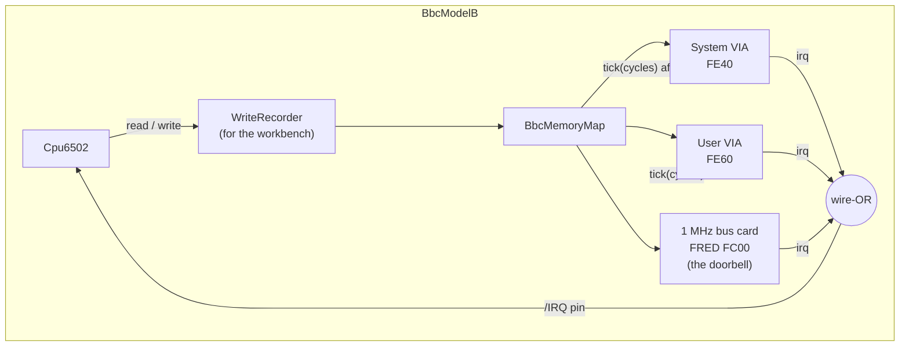
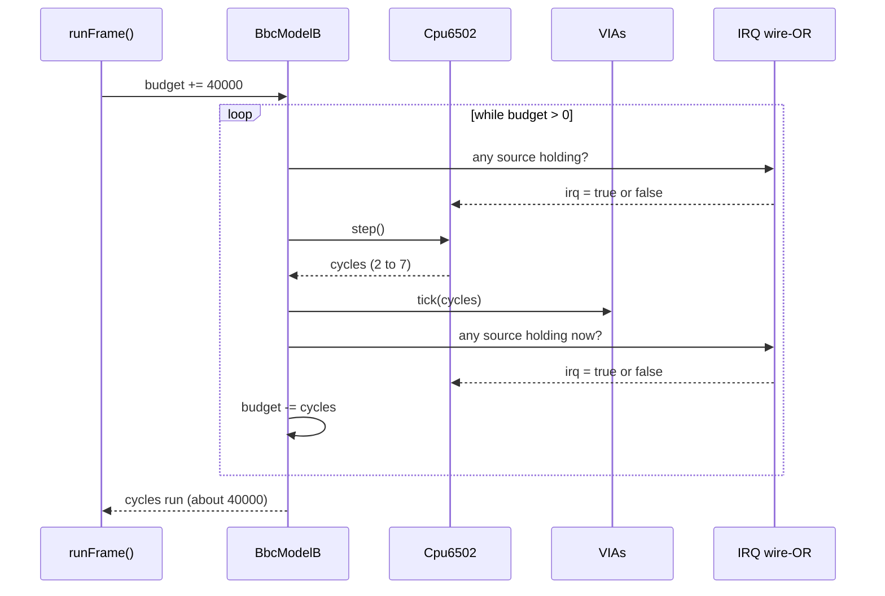
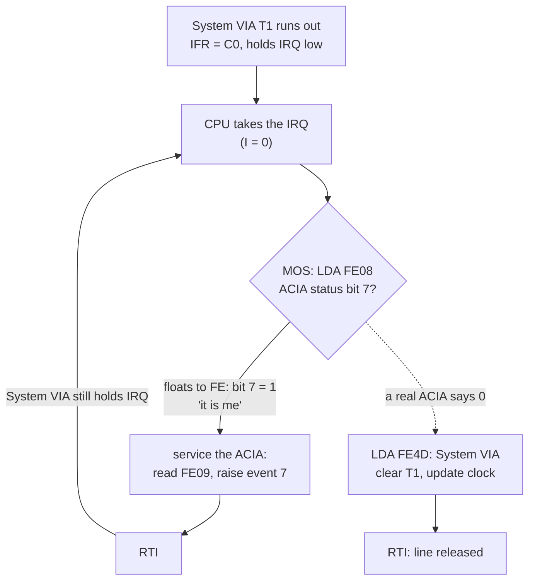

# Stage 27: Machine & scheduler

> **Part:** 5 (Assembling the machine) · **Branch:** `stage/27-machine-scheduler` · **Needs:** 26
> **Status:** done

## Goal

Until now the pieces have been wired together by whoever needed them. The playground target ticked two VIAs. The Stage 23 MOS runner had no devices at all. Each demo built its own little rig. This stage builds **the machine**: one object, `BbcModelB`, that owns the CPU, the memory map, the ROMs and the two VIAs, and knows how to move them all forward in time together.

It adds:

- `src/machine/bbc-model-b.ts` with `step()`, `runCycles(n)`, `runFrame()`, `powerOn()` and `reset()` (BREAK);
- the **wire-OR** IRQ line, owned by the machine: System VIA, User VIA and any card on the 1 MHz bus;
- a **frame budget** of 40,000 cycles that never drifts, however the instructions fall;
- the Stage 17 doorbell rebuilt as a real **1 MHz bus card** in FRED (`&FC00`), so it shares /IRQ like any other device;
- the browser workbench running on the machine, with a new **MOS** mode (`?machine=mos`) that boots the real ROMs;
- `npm run demo:boot`: the MOS on the real machine, getting further than Stage 23 and stalling somewhere new.

It comes now because every chip from here on (the latch, the CRTC, the Video ULA, the keyboard, sound, disc) needs a place to plug in and a clock to run from. Stage 28 plugs in the latch and the stubs; Stage 29 gets to the `BASIC` prompt.

## What you can now see

### `npm run demo:boot`: the MOS on the real machine

```bash
npm run demo:boot      # needs roms/os12.rom (and basic2.rom for Part 5); skips politely without
```

Five parts. Here are the key lines (the full output is longer):

**Part 2: frame by frame.** Every frame runs whole instructions, so a few cycles over or under, but the drift never grows. And you can watch the MOS set up the System VIA:

```
  frame     ran   drift   IER  IFR  /IRQ held by   I   PC
      1   40000      0   &80  &00 nobody         1   &D9F2
      4   40001      1   &80  &00 nobody         1   &D9EE
     13   40001      2   &F2  &00 nobody         1   &C8D4
     14   40000      2   &F2  &C0 System VIA     1   &CC59
  60 frames: 2400002 cycles = 60 × 40,000 + 2. That's 1.2 s of BBC time, to the cycle.
  ...T1 is the 100 Hz tick: its latch is &270E = 9998, + 2 = 10,000 µs at 1 MHz. But I = 1: the CPU isn't listening.
```

**Part 3: the new stall.** It's the same CTRL+SHIFT wait as Stage 23, for a new reason. This time a real VIA answers `LDX &FE4F` with `&80`/`&81`: PA7 is an input with nothing driving it.

```
    &FE43  write &7F   System VIA reg 3 (DDRA)
    &FE4F  write &81   System VIA reg 15 (ORA/IRA, no handshake)
    &FE4F  read  &81   System VIA reg 15 (ORA/IRA, no handshake)
  What the MOS believes now. Compare Stage 23: BREAK type 2, 16K, mode 4.
    &028D = &01   last BREAK type: 0 soft, 1 power-on, 2 hard
    &028E = &80   RAM size: &40 = 16K, &80 = 32K
  And /IRQ: held by the System VIA (IFR &C0), with I = 1. The 100 Hz tick waits, unanswered.
```

**Part 4: BREAK.** `reset()` leaves the VIAs alone, so the MOS reads IER `&F2` and knows it's not a power-on. With CTRL "held" (PA7 again), it's a CTRL+BREAK: `&028D = 2`.

**Part 5: the experiment.** PA7 is pulled low (as a keyboard with no key down would do). The banner appears in screen memory, and then the IRQ storm:

```
    │BBC Computer 32K                        │
    │BASIC                                   │
  /IRQ is held by the System VIA (IFR &C0), and nothing ever clears it.
  From one IRQ to the next (56 steps), from the trace:
  2549407  &806E            IRQ (via &FFFE)   B4 09 0E FF Nv--dizC
  ...
  2549463  &DCA2  AD 08 FE  LDA &FE08         81 09 0E F7 Nv--dIzC  ; ACIA reg 0 (status / control)
  2549467  &DCA5  70 02     BVS &DCA9         FE 09 0E F7 Nv--dIzC
  2549469  &DCA7  10 5D     BPL &DD06         FE 09 0E F7 Nv--dIzC
  ...
  2549495  &DCB3  AC 09 FE  LDY &FE09         9F FF 0E F7 Nv--dIzC  ; ACIA reg 1 (data)
  ...
  2549507  &DCBA  A0 07     LDY #&07          FE 7E FE F7 Nv--dIzc
  2549509  &DCBC  4C 94 E4  JMP &E494         FE 7E 07 F7 nv--dIzc
  ...
  2549568  &DE8B  40        RTI               B4 09 0E FC Nv--dIzC
  2549574  &806E            IRQ (via &FFFE)   B4 09 0E FF Nv--dizC
```

`LDA &FE08` gets `&FE` (floating): N = 1, so `BPL &DD06` (the System VIA's handler) is **not** taken. The MOS deals with an "ACIA" that isn't there, and `RTI` lands straight back in the IRQ at the same `&806E`.

### In the browser: MOS mode

```bash
npm run dev     # then open http://localhost:5173/?machine=mos  (or click "MOS 1.20" at the top of the workbench)
```

1. The workbench header says `Target: BBC Model B running MOS 1.20 from roms/`, and `ROMs: os12.rom, basic2.rom (missing: dfs.rom)`. There's no Assembler: assembling would overwrite the MOS's reset vector.
2. **Step** a few times: the Disassembly panel names MOS routines (it uses the Stage 23 labels).
3. **Run.** It runs for the playground's 10 emulated seconds. Afterwards the **Interrupts** panel says `IRQ line: held by the System VIA`, `I flag: 1: IRQs held off`, and the **Memory map** panel shows the System VIA's reads and writes climbing into the hundreds of thousands (the keyboard loop). The **VIA** panel shows IER `&F2` and IFR `&C0`.
4. Memory opens on page 2: `&028D` = `01`, `&028E` = `80`.
5. In DevTools: `workbench.machine.runFrame()`, `workbench.powerOn()`.

### In the browser: the playground still works

Open `/`. Every Stage 06–26 example runs as before, now on the machine. Try `?program=interrupts` (Stage 17): the IRQ button rings the doorbell **card**, and the **Memory map** panel's I/O log now shows the handler's `STA &FC00` (FRED), which it never could before.


## The real hardware

### One clock, one bus, one IRQ line

A Model B is one 6502 and a crowd of chips that all hang off the same buses:

- **One clock.** A 16 MHz crystal is divided down to give the 6502 its **2 MHz** clock and the "slow" chips (the VIAs, the ACIA, the ADC and everything on the 1 MHz bus) their **1 MHz** one. Every chip's sense of time comes from that crystal, so they never drift apart. (Advanced User Guide, chapter on the system architecture; the 1 MHz half is why Stage 25's VIA halves the CPU's cycles.)
- **One address and data bus.** Address decoding (Stage 21) decides which chip answers. The CPU can't tell a VIA from RAM, except that VIA registers do things when touched.
- **One /IRQ line, and one /NMI line.** These are **open-collector** (open-drain) lines. A resistor pulls each one up to +5 V, and any chip can pull it down to 0 V. No chip can push it up. On the Model B:

  | Line | Who can pull it low |
  |---|---|
  | **/IRQ** | System VIA, User VIA, the 6850 ACIA (serial), the Tube, and any card on the 1 MHz bus |
  | **/NMI** | the 8271 disc controller, the Econet ADLC, and the 1 MHz bus |

  (Advanced User Guide, interrupts chapter; BeebWiki "Interrupts". We only build the /IRQ sources that exist so far: the two VIAs and the doorbell card.)

So "is an interrupt being requested?" has one answer for the whole machine: **is anybody holding /IRQ low?** The CPU sees the line, not the chips. It has no idea *who* wants attention. Its handler has to go and ask each chip in turn.

### Power-on vs BREAK

Stage 23 found that the MOS tells these apart by reading the System VIA's IER (`&FE4E`):

| What happened | Who is reset | IER reads | `ASL A` gives |
|---|---|---|---|
| **power-on** | the CPU *and* every chip (the VIAs clear IER) | `&80` | `&00`: power-on |
| **BREAK** | the CPU only | `&F2` (what the MOS set last boot) | `&E4`: BREAK |

So the machine needs **two** reset buttons: `powerOn()` resets everything, and `reset()` is the BREAK key, which resets only the CPU. (BeebWiki and the AUG describe BREAK this way; we haven't checked it against the circuit diagram.)

### What a frame is

The Model B's video runs at **50 Hz** (PAL). The CPU runs at **2 MHz**. So one video frame lasts

```
2,000,000 cycles per second ÷ 50 frames per second = 40,000 cycles per frame
```

From Stage 30 the browser will ask the machine for "one frame's worth" of emulation each time it draws. This stage builds that `runFrame()`, and makes sure it keeps exact time.

### The 1 MHz bus and FRED

The Model B has a **1 MHz bus** socket on its underside for add-on hardware. Cards on it are given two pages of address space: **FRED** (`&FC00`–`&FCFF`) for their registers and **JIM** (`&FD00`–`&FDFF`) for paged memory (AUG, memory map; BeebWiki "1MHz bus"). The socket also carries /IRQ and /NMI, so a card can interrupt the CPU.

That's exactly what the playground's Stage 17 doorbell pretended to be. In this stage it becomes one properly: an `IoDevice` plugged into FRED, and an `IrqSource` on the machine's wire-OR, instead of a wrapper around the CPU's bus.

## Key concepts

### 1. The machine is a scheduler

Every chip has its own sense of time, but we only have one thread. The machine takes turns:

1. the CPU runs **one whole instruction** and says how many cycles it took (2 to 7, or 7 for an interrupt sequence);
2. every clocked device is **ticked** by that many cycles;
3. the IRQ line is worked out again from every source, and copied to the CPU's /IRQ pin.

That's the **instruction-stepped** model from `BUILD-PLAN.md` §3. It's the playground target's step from Stage 26, moved into a real machine:

```
step():
  sync /IRQ           (the debugger may have poked a VIA since the last step)
  trace the step      (for the workbench and demo:boot)
  cycles = cpu.step()
  tick System VIA by cycles      (it halves them: 1 MHz)
  tick User VIA by cycles
  sync /IRQ           (a timer ran out? the handler acknowledged?)
  return cycles
```

Its limit, already in the parking lot: a device only sees the CPU **between** instructions. A 6-cycle `INC &FE60` looks to the VIA like one moment, not six. That's fine for nearly all software. Part 12's cycle-exact extras refine it.

### 2. Wire-OR: the line is low if *anyone* holds it

In logic terms, /IRQ is **active low** and **wired-OR**:

```
/IRQ is low  ⇔  System VIA holds it  OR  User VIA holds it  OR  ACIA holds it  OR  …
```

Each chip's IRQ output is "holding or not", worked out from its own registers. For a 6522 it's Stage 26's `IFR & IER & &7F ≠ 0`. The machine doesn't keep a copy of the line. It asks every source again each time, so the line can never disagree with the chips.

A worked example, with the MOS's 100 Hz tick (System VIA T1) and a program using User VIA T2:

| Moment | System VIA IFR & IER | User VIA IFR & IER | /IRQ |
|---|---|---|---|
| both quiet | `&00` | `&00` | high (released) |
| T1 runs out | `&40` | `&00` | **low** |
| T2 runs out too | `&40` | `&20` | **low** |
| handler reads `&FE44` (clears System T1) | `&00` | `&20` | **still low** |
| handler reads `&FE68` (clears User T2) | `&00` | `&00` | high |

The fourth row is the point of wire-OR: acknowledging *one* chip doesn't release the line while another still holds it. The CPU will take another IRQ straight after `RTI`, and the handler will find the User VIA this time.

### 3. Polling: the handler has to find out who

Because the line is shared, the MOS's IRQ handler has to **poll**: ask each chip "is it you?" in a fixed order, and deal with the first one that says yes. MOS 1.20 asks the **ACIA first** (`&DCA2 LDA &FE08`, the 6850 status register, whose bit 7 is "I'm interrupting"), then the **System VIA** (`&DD06 LDA &FE4D`, IFR bit 7), then the User VIA, and finally passes anything unclaimed on through IRQ2V.

This only works if every chip on the line **answers truthfully**. A chip that says "it's me" when it isn't will be "serviced" while the real requester keeps holding the line. That is exactly where this stage's experiment ends up (concept 6).

### 4. The frame budget, and why it carries over

`runFrame()` should run 40,000 cycles. But instructions are 2 to 7 cycles long, so we almost never land exactly on 40,000. If the last instruction starts at cycle 39,998 and takes 4, the frame ran **40,002**.

The naïve fix is to start each frame at zero and run "until ≥ 40,000". That overshoots by 0 to 6 cycles **every** frame, and the overshoot adds up: the emulated clock creeps ahead of real time. After 50 frames (one second) you could be up to 300 cycles fast. Small, but it never stops growing.

The fix is to **carry the overshoot**: keep a running budget, add 40,000 to it each frame, and subtract every instruction's cycles. A frame that overshoots by 2 leaves the budget at −2, so the next frame only has 39,998 to run.

```
frame 1: budget  0 + 40,000 = 40,000 → runs 40,002 → budget −2
frame 2: budget −2 + 40,000 = 39,998 → runs 39,999 → budget −1
frame 3: budget −1 + 40,000 = 39,999 → runs 40,003 → budget −4
…
```

Each frame wobbles by a few cycles, but the **total** after *n* frames is always within one instruction (≤ 7 cycles) of *n* × 40,000. It never drifts. `runCycles(n)` works the same way, so `runFrame()` is just `runCycles(40_000)`.

### 5. A free-running clock and two kinds of reset

The machine owns everything that happens at reset:

| | `powerOn()` | `reset()` (BREAK) |
|---|---|---|
| CPU reset sequence (7 cycles, PC from `&FFFC`) | ✅ | ✅ |
| System VIA and User VIA `reset()` | ✅ | — |
| 1 MHz bus cards (the doorbell) | ✅ | ✅ (see Gotchas) |
| RAM | left alone | left alone |
| trace | cleared | cleared |

RAM is left alone in both cases. On real hardware, RAM at power-on holds random junk, and the MOS clears it itself (Stage 23's `&D9E7` loop). We start with zeros, which is one valid kind of junk.

### 6. The new stall, and what's behind it

Stage 23 stalled because the System VIA floated. Now there's a real one, and the MOS gets further:

- `LDA &FE4E` reads `&80`: **power-on**, so RAM is cleared and measured (**32K**, `&028E` = `&80`), and `&028D` = 1.
- The MOS sets up the System VIA: IER `&F2`, ACR `&60`, PCR `&04`, and T1 ticking every 10 ms. Within 10 ms the System VIA is **holding /IRQ low** (IFR `&C0`).

But it still stalls in the CTRL+SHIFT "halt scrolling" loop from Stage 23, for a new reason. The keyboard is read through the System VIA: the MOS writes a key number to port A bits 0–6, and **PA7** says whether that key is down. PA7 is an input, and nothing is driving it (the keyboard is Stage 28). In our model (Stage 24), an input with nothing on it reads 1. So **every key is "down"**: CTRL and SHIFT are held, and the MOS waits for them to be let go. Interrupts are still disabled (I = 1) at that point, so the 100 Hz tick is waiting, unanswered.

And if we pretend a keyboard is there with no keys down (pull PA7 low, which is Stage 28's job)? The MOS prints `BBC Computer 32K` and `BASIC` into screen memory, enables interrupts, and then falls into an **IRQ storm**:

1. The System VIA's T1 holds /IRQ low.
2. The MOS asks the ACIA first. There's no ACIA yet, so `&FE08` floats, and the floating bus holds `&FE`, the high byte of the address just fetched. Bit 7 is set: "**it's me**".
3. The MOS services the ACIA: it reads the "received byte" at `&FE09`, sees error bits, raises event 7 (RS423 error), and returns with `RTI`.
4. Nobody touched the System VIA. /IRQ is still low, so the CPU goes straight back into the handler. Forever.

That's concept 3 going wrong in real life, and it tells us what Stage 28/29 must stub: the keyboard *and* an ACIA that says "not me".

## Diagrams

### The machine, and who it ticks



### One step, and one frame



### The IRQ storm, step by step



## Our design

### `BbcModelB`

```ts
export const CYCLES_PER_FRAME = 40_000; // 2 MHz / 50 Hz

export class BbcModelB {
  readonly map: BbcMemoryMap;
  readonly cpu: Cpu6502;
  readonly systemVia: Via6522;
  readonly userVia: Via6522;
  readonly trace: Tracer;        // the last 1,024 steps
  readonly writes: WriteLog;     // the CPU's writes, for the Memory panel

  step(): number;                // one instruction (or interrupt), devices ticked
  runCycles(n: number): number;  // whole instructions, budget carried over
  runFrame(): number;            // runCycles(CYCLES_PER_FRAME)
  powerOn(): number;             // everything reset
  reset(): number;               // BREAK: the CPU only (and 1 MHz bus cards)

  plugIn(card: OneMhzBusCard): void; // into FRED, and onto /IRQ
  readonly irqLine: boolean;     // the wire-OR, worked out now
  readonly irqHolders: readonly string[]; // who, by name (panels only)
}
```

- **It's a class with no hidden global state.** Two `BbcModelB`s are two separate machines (CLAUDE.md). Tests make dozens.
- **It satisfies the workbench interfaces structurally** (`TracedTarget`: `peek`, `poke`, `registers`, `cycles`, `step`, `reset`, `writes`, `trace`, `pendingInterrupt`), but imports nothing from `src/web/`. The web layer adds the IRQ/NMI buttons in a small adapter, `machineTarget(machine, doorbell)`.
- **The hot path allocates nothing.** The device and IRQ-source lists are arrays built once (a card added later is pushed, which is rare), walked with indexed loops. The tracer writes into its typed-array ring.
- **The machine always traces.** Stage 20 measured that at 1.7× slower, still 23× real speed. The workbench and `demo:boot` both need the trace. If Stage 30's frame loop needs the time back, tracing can become switchable.

### The 1 MHz bus card

```ts
export interface OneMhzBusCard extends IoDevice, IrqSource {
  readonly name: string; // for irqHolders, e.g. "the doorbell"
  reset(): void;         // /RST on the 1 MHz bus
}
```

The memory map gains `plugFred(device)`: FRED reads and writes go to that device (with the register offset `address & &FF`) and still go into the I/O log. It's a method, not a constructor option, because a card is plugged into a machine that already exists, and the doorbell needs the map's floating bus for the FRED addresses it doesn't answer.

The **doorbell** keeps its behaviour from Stage 17 (`&FC00` reads `&80` while ringing, and any write answers it). It just stops being a `Bus` wrapper: it's an `IoDevice` + `IrqSource` that answers offset 0 and floats elsewhere. The Part 2 playground (`playgroundTarget`, still used by tests on a flat `TestBus`) routes `&FC00` to the same class.

### MOS runner

`MosRunner` (Stage 23's stall detector, call stack and trace) now watches **any** machine that can step: a `BbcModelB`, or the Stage 23 bare rig (`bareMos(map)`: a CPU on a map, nothing else), so `demo:mos` still tells Stage 23's story unchanged. It uses the machine's own tracer rather than keeping a second one.

### Browser

The workbench target is now always a `BbcModelB` (with the doorbell plugged in):

- **Playground** (the default): Assemble & Run installs your program into the machine and calls `powerOn()`. Every example from Stages 06–26 runs as before, including the Stage 17 doorbell, whose accesses now show up in the I/O log.
- **MOS** (`?machine=mos`): loads the ROMs from `roms/` and powers on. Run, and watch the MOS set up the System VIA and stall in the keyboard loop. A link in the workbench header switches between the two.

### Alternatives considered

- **Keep the playground target for examples and add a second BBC target.** Less change today, but two code paths for every panel. You chose one machine.
- **A per-frame "run until cycle N" with a fresh start each frame.** Simpler, but it drifts (concept 4).
- **Store the IRQ line and update it when a device changes.** Every device would need to tell the machine. Recomputing an OR of 2–3 booleans per step is cheaper than getting that right.
- **A stub keyboard now, so the MOS gets to BASIC.** That's Stage 28's job. Here it's only an experiment inside `demo:boot`, clearly labelled.

## Code walkthrough

- [`src/machine/bbc-model-b.ts`](../../src/machine/bbc-model-b.ts): the machine.
  - The constructor builds the two VIAs, the map with them in their SHEILA slots, a `WriteRecorder` in front of the map, the CPU on the recorder, and a `Tracer` that peeks the map. The `clocked` and `irqSources` arrays are made **once**.
  - `step()` is the scheduler: sync, trace, `cpu.step()`, `tick()`, sync. `tick()` and the `irqLine` getter are indexed `for` loops over those arrays, so nothing is allocated per step.
  - `runCycles(n)` is four lines: `budget += n`, then step while `budget > 0`. The **sign** of `budget` is the whole idea. Negative means "already ran ahead", and that carries into the next call. `runFrame()` is `runCycles(CYCLES_PER_FRAME)`.
  - `powerOn()` resets both VIAs and then calls `reset()`. `reset()` resets the cards, clears the trace and the budget, runs the CPU's reset, and ticks the devices by its 7 cycles.
  - `irqHolders` uses `forEach` and builds an array. That's fine, because only panels and demos call it.
- [`src/memory/bbc-memory-map.ts`](../../src/memory/bbc-memory-map.ts): `plugFred(card)`. FRED's reads, writes, peeks and pokes go to the card at `address & &FF`. With no card, the read is the floating bus as before. JIM is unchanged.
- [`src/playground/doorbell.ts`](../../src/playground/doorbell.ts): now an `IoDevice` and `IrqSource`. `peek(0)` gives `&80`/`&00`, any other offset floats, and `write(0)` answers it.
- [`src/web/workbench/debug-target.ts`](../../src/web/workbench/debug-target.ts):
  - `machineTarget(machine, doorbell)` is the panels' view of the machine: the machine's own members, plus `ringIrq` for the doorbell.
  - `playgroundTarget` (tests and CLI demos on a flat `TestBus`) sends just `&FC00` to the same `Doorbell` class.
- [`src/mos/mos-runner.ts`](../../src/mos/mos-runner.ts): `MosRunner` watches a `MosMachine` (`cpu`, `trace`, `peek`, `step`, `reset`). `bareMos(map)` is Stage 23's rig, and `new MosRunner(map)` still builds it, so `demo:mos` is unchanged. The new `clear()` lets `demo:boot` call `machine.powerOn()` itself.
- [`src/main.ts`](../../src/main.ts): one `BbcModelB` with the doorbell plugged in. `?machine=mos` fetches the ROMs (`fetchStandardRoms`, built in Stage 22 and waiting for this), powers on, uses `MOS_LABELS` for the disassembly, and leaves out the Assembler and Listing panels. The playground's Assemble & Run is now `installProgram(pokeWriter(machine), …)` then `machine.powerOn()`.
- [`scripts/demo-boot.ts`](../../scripts/demo-boot.ts): the five parts above. Part 3 and Part 5 each use a fresh machine, so each story starts from power-on.
- [`src/web/workbench/run-model.ts`](../../src/web/workbench/run-model.ts): `CYCLES_PER_FRAME` now comes from the machine, so there's one 40,000 in the codebase.


## Tests

| Test file | What it proves |
|---|---|
| `src/machine/bbc-model-b.test.ts` | **Parts:** VIAs in their slots; two machines share nothing; 40,000 = 2 MHz / 50. **Resets:** power-on resets both VIAs (IER `&80`) and the CPU (7 cycles, PC from `&FFFC`); BREAK keeps IER `&F2`; neither touches RAM; both reset 1 MHz bus cards and the trace; the reset's 7 cycles reach the VIAs. **Step:** VIAs ticked exactly as a lone VIA would be, across odd and even instruction lengths; trace and write log; `peek` has no side effects. **Wire-OR:** released when nobody holds it; held by either VIA, a card, or any mix (with names); acknowledging one VIA doesn't release the line while the other holds it; an IRQ is taken via `&FFFE` once I = 0; a device that lets go mid-step (the doorbell answered by `STA &FC00`) releases the pin. **Frame budget:** `runFrame` overshoots by less than one instruction; overshoot carries (`runCycles(1)` → 3, 0, 0, 3); 50 frames of mixed 2–7-cycle instructions never drift more than 6 cycles; reset starts the budget afresh. **With ROMs** (skip without): power-on seen, 32K, IER `&F2`/ACR `&60`/PCR `&04`; then I = 1 with the System VIA holding /IRQ; BREAK → CTRL+BREAK (2) with PA7 floating, soft BREAK (0) with PA7 low; the PA7-low experiment prints the banner and storms. |
| `src/memory/bbc-memory-map.test.ts` | A FRED card gets `&FC00`–`&FCFF` as registers `&00`–`&FF` for read, write, peek and poke, and is logged; JIM still floats; unplugging makes FRED float again. |
| `src/playground/doorbell.test.ts` | Rewritten for the card: register 0 reads `&80`/`&00`, `irq` follows, any write to register 0 answers it, the rest of FRED floats, `reset()` quietens it, and through a real map `&FC00` reaches it and lands in the I/O log. |
| `src/web/workbench/debug-target.test.ts` | `machineTarget`: steps, resets, peeks, traces and logs writes through the machine; the IRQ button rings the doorbell card and `irqHolders` names it; NMI latches. |
| `src/mos/mos-runner.test.ts` | Watching a `BbcModelB`: it uses the machine's tracer (one record per step); from power-on it stalls in the keyboard loop (`keyTest` in the loop, `ctrlShiftWait` in the call chain), as a power-on, with the System VIA holding /IRQ and I = 1. (Skip without ROMs.) |
| `src/playground/examples.test.ts` | The Stage 17 interrupts example now runs on a `BbcModelB` with the doorbell card: BRK, IRQ (answered at `&FC00`), NMI, and the "forgot to answer" storm all behave as before. |
| `e2e/machine.spec.ts` | `/` is the playground on the machine, with the mode links; `/?machine=mos` loads the ROMs, has no Assembler, and after 20 frames shows a power-on, 32K, IER `&F2` and "held by the System VIA". (Skips without `roms/os12.rom`.) |

Totals: `npm test` 2,112 passed, 1 skipped (the DFS header test: `dfs.rom` isn't in `roms/` yet). Typecheck and lint clean. `npx playwright test` 100 passed.


## Gotchas & hardware quirks

- **"Floating inputs read 1" decides where we stall.** PA7 reading 1 is our model's choice for an undriven input (Stage 24's parking-lot item). On a real Model B, PA7 is never undriven: the keyboard is always there. So this stall is a property of an *incomplete* machine, which is exactly what a stall should tell us. Stage 28's keyboard stub drives PA7.
- **The floating ACIA is worse than a missing one.** A chip that isn't there, but whose status register floats to a value with bit 7 set, claims every interrupt. The ACIA is marked "out of scope" (no cassette/serial), but the MOS still polls it first on every IRQ. So it needs a *stub* that reads "no interrupt" (a 6850's status after reset has bit 7 = 0). That's in the parking lot for Stage 28/29.
- **BREAK and the 1 MHz bus.** We reset the doorbell on BREAK as well as power-on, as the playground's Reset did. Whether the bus's /RST line follows BREAK or only power-on on a real Model B isn't something we've checked against the circuit diagram. It only matters for the doorbell, which is ours.
- **The budget's sign.** `runCycles` can return **0** (if the last call overshot by more than `n`) or more than `n`. Callers must use the return value, not assume `n`. The browser frame loop (Stage 30) will just call `runFrame()` once per 20 ms and not care.
- **A reset clears the budget.** Otherwise a leftover overshoot of a few cycles would be "owed" by a machine that has just been reset, which means nothing.
- **`powerOn()` doesn't clear RAM.** The real RAM holds junk at power-on. We hold whatever was there (zeros, or the last program). The MOS clears it anyway; a playground program relies on `installProgram` instead.
- **`peek` on the machine goes straight to the map,** not through the `WriteRecorder` or the CPU. So the workbench can never trigger a side effect, or appear in the write log.
- **Speed.** The machine runs at about 21 MHz under `tsx` (10× real time), the same as the playground target within measurement noise. A heavy *synchronous* test (75 frames in one `page.evaluate`) starved a parallel e2e Run test past its timeout, so `e2e/machine.spec.ts` runs 20 frames. Stage 30's frame loop won't run synchronously like that.
- **The interrupt is still seen between instructions.** An IRQ raised by a VIA during a 6-cycle instruction is noticed after it. That's the instruction-stepped model (BUILD-PLAN §3), plus the NMOS one-instruction-late quirks in the parking lot.


## Playwright verification

- **MCP checks** on `/?machine=mos`:
  - The header showed `ROMs: os12.rom, basic2.rom (missing: dfs.rom)`, and the panel list had no Assembler or Listing.
  - After 70 frames through the console handle: `&028D = &01`, `&028E = &80`, IER `&F2`, IFR `&C0`, `irqHolders = ["System VIA"]`.
  - Clicking **Run** ran to the 10 s limit. The screenshot showed Interrupts "held by the System VIA / 1: IRQs held off", vectors `&D9CD`/`&DC1C`, and the Memory map's System VIA counts at 153,737 reads and 845,585 writes. The FRED row read "1 MHz bus: add-on cards (the workbench plugs in a doorbell at &FC00)".
- **Durable:** `e2e/machine.spec.ts` (two tests; the MOS one skips without `roms/os12.rom`). The whole suite is 100 passed. `main`'s 98 also pass on the same machine; the first version of the new spec (75 frames) made `compare-branch`'s Run test time out under parallel load, hence 20 frames.


## Check your understanding

1. The System VIA holds /IRQ (T1) and so does the User VIA (T2). The handler reads `&FE44`. What happens to the /IRQ line, and what does the CPU do straight after `RTI`?
2. Why does `runCycles` keep a running `budget`, instead of counting from zero to `n` each call? What goes wrong over a minute of emulation without it?
3. After `powerOn()` the MOS writes `&F2` to IER. You then call `reset()`. What does `LDA &FE4E : ASL A` give, and what does the MOS conclude? What would it conclude if `reset()` also reset the VIAs?
4. In Part 5 the System VIA is the only chip holding /IRQ, yet the MOS never reads `&FE4D`. Why not? What value would a real 6850 ACIA have to return from `&FE08` to fix it?
5. Why does the machine recompute the IRQ line from every source, rather than storing it and updating it when a device changes?

<details>
<summary>Answers</summary>

1. Reading `&FE44` (T1C-L) clears the System VIA's IFR bit 6, so it **lets go**. The User VIA still holds the line, so /IRQ **stays low** (wire-OR). After `RTI` restores I = 0, the CPU takes **another IRQ straight away**. The handler polls again, finds the User VIA this time, and must clear its T2 flag (read `&FE68`) to release the line.
2. Instructions are 2–7 cycles, so a frame overshoots by 0–6. Counting from zero each frame **adds** each overshoot to emulated time, so the clock creeps ahead. That's up to 300 cycles a second, and nearly 18,000 (9 ms) a minute, and it keeps growing. Carrying the overshoot as a negative budget makes the next frame shorter, so the total stays within one instruction of exact, forever.
3. IER still holds `&F2` and reads `&F2`, and `ASL` gives `&E4` (Z = 0): **a BREAK**, so the MOS keeps memory and doesn't re-measure it. If BREAK reset the VIAs, IER would read `&80`, `ASL` would give `&00`, and every BREAK would look like a power-on: memory cleared, and your BASIC program gone.
4. The MOS asks the **ACIA first** (`&DCA2 LDA &FE08`). With no ACIA the read floats to `&FE`: bit 7 = 1 means "I'm interrupting", so `BPL &DD06` (the jump to the System VIA code) isn't taken. The MOS services the phantom ACIA and returns, and never reaches the VIA. A real 6850 that isn't interrupting has status **bit 7 = 0** (after reset, typically just TDRE, bit 1, "transmit register empty", plus whatever its /DCD and /CTS pins say in bits 2 and 3; we haven't checked those pins' levels on the Model B). Then `BPL` is taken to `&DD06`.
5. Because a device's IRQ output is a *function of its registers* (`IFR & IER & &7F ≠ 0` for a 6522). Many different reads and writes change it, and some happen through the debugger. A stored copy would need every one of those paths to remember to update it. Recomputing an OR of 2–3 booleans per step is cheap and can't disagree with the chips. (It's the same reasoning as Stage 26's computed IFR bit 7.)

</details>


## Further reading

- *Advanced User Guide*: the memory map (FRED, JIM, SHEILA), the interrupts chapter (IRQ sources and the IRQ1V/IRQ2V chain), and events (event 7: RS423 error).
- BeebWiki: "1MHz bus", "Interrupts", "Break key".
- Rockwell R6522 datasheet: "Reset" (what /RES clears), IFR/IER, and the open-drain /IRQ output.
- Motorola MC6850 ACIA datasheet: the status register (bit 7 = IRQ, bit 1 = TDRE). This is what Stage 28/29's ACIA stub must say.
- `os12.rom` itself: `&DCA2` (ACIA first), `&DD06` (System VIA), `&E494` (events).

