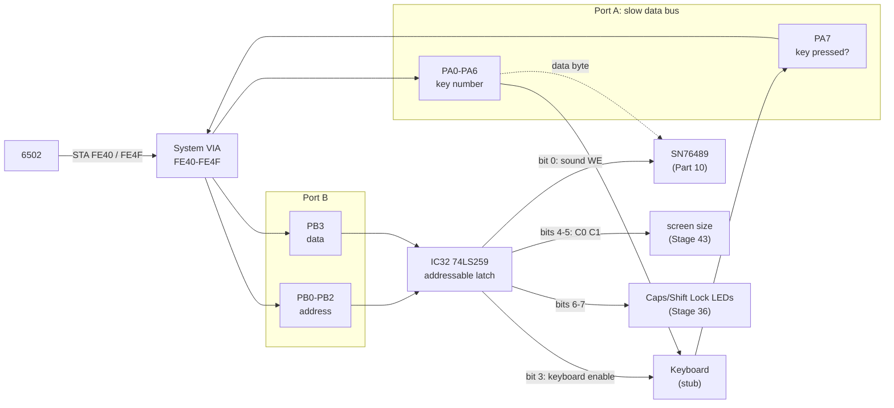
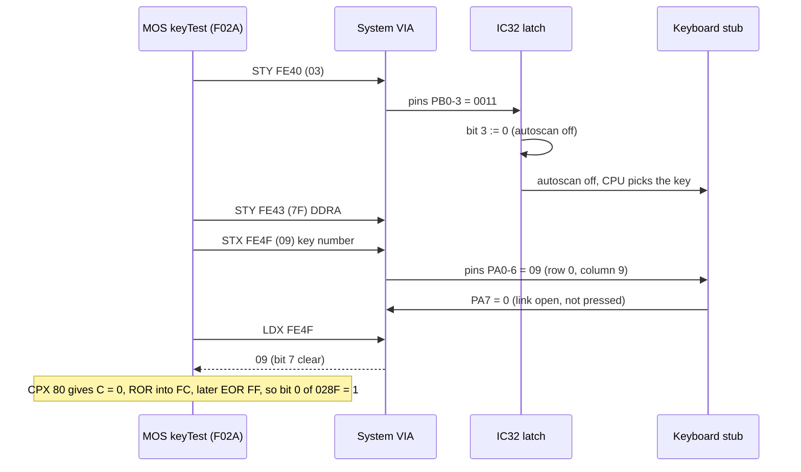
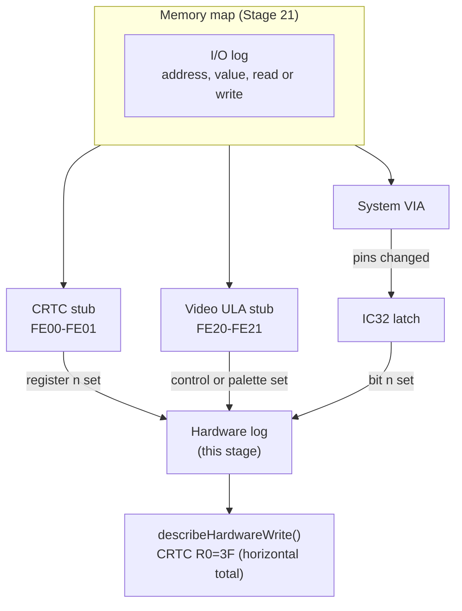
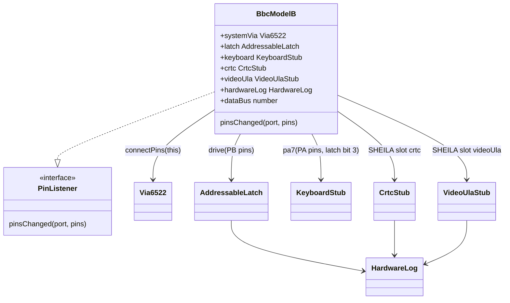

# Stage 28: Addressable latch & peripheral stubs

> **Part:** 5 (Assembling the machine) · **Branch:** `stage/28-latch-stubs` · **Needs:** 27
> **Status:** done

## Goal

Stage 27's machine boots the MOS into a wall: PA7 floats high, so every key reads "pressed", and the MOS sits in its CTRL+SHIFT wait. Stage 27's Part 5 experiment showed that a keyboard holding PA7 low gets the banner into screen memory. This stage gives the machine the **parts the MOS talks to while it starts up**, built just well enough that the MOS is happy:

- **IC32, the addressable latch**: eight output bits driven from four System VIA wires. It switches the sound chip's write enable, the keyboard's autoscan, the screen size and the two keyboard LEDs.
- A **keyboard stub**: no keys pressed, and the eight start-up option **links** answering as keys do.
- **Register-storage stubs** for the **6845 CRTC** and the **Video ULA**. They remember what they're told and do nothing else yet.
- A **hardware log** that names what the MOS does to all of them: `CRTC R0=&3F`, `ULA ctrl=&4B`, `latch: sound WE off`.

It comes now because Stage 29 has to diagnose "what is the MOS waiting for?" from traces. Raw `&FE01 write &3F` lines don't answer that. Named ones do, and a boot that no longer stalls on the keyboard leaves Stage 29 with the next real problem.

## What you can now see

```bash
npm run demo:boot      # needs roms/os12.rom (and basic2.rom for the banner); skips politely without
```

Six parts. The key lines follow (the whole output is about 150 lines).

**Part 1: power-on.** The latch is set before the CPU runs anything:

```
  powerOn(): the latch reads &80. The VIA's reset makes PB0-PB3 inputs, floating high: &F,
  address 7, data 1. So IC32 bit 7 is set before the CPU has run an instruction:
           0  latch: Shift Lock LED off (bit 7 = 1)
```

**Part 2: raw vs named.** The same moment, seen by the I/O log and by the hardware log:

```
    &FE00  write &01   CRTC reg 0 (address register)
    &FE01  write &28   CRTC reg 1 (register data)
    &FE00  write &00   CRTC reg 0 (address register)
    &FE01  write &3F   CRTC reg 1 (register data)
  The hardware log has what the CRTC made of them:
    CRTC R1=&28 (horizontal displayed)
    CRTC R0=&3F (horizontal total)
  ...
    &FE40  write &0B   System VIA reg 0 (ORB/IRB)
    latch: keyboard autoscan on (bit 3 = 1)
```

**Part 3: every hardware write from power-on to MODE 7.** Runs of sound writes are folded together:

```
   cycles   what
        0  latch: Shift Lock LED off (bit 7 = 1)
   507352  latch: sound WE on (bit 0 = 0)                ← the DDRB write at &DA05
   507358  latch: Caps Lock LED off (bit 6 = 1)          ← the walk, &0E down to &08
   507369  latch: screen size C1 = 1 (bit 5 = 1)
   ...
   507424  latch: sound WE off (bit 0 = 1)
   507444  latch: keyboard autoscan off (bit 3 = 0)      ← reading the links
   507893  latch: Caps Lock LED on (bit 6 = 0)
   507901  latch: Shift Lock LED on (bit 7 = 0)
   507913  latch: keyboard autoscan on (bit 3 = 1)
   512176  latch: sound WE on, then off: one byte into the sound chip   × 11
   518945  latch: screen size C0 = 0 (bit 4 = 0)
   519081  ULA ctrl=&4B
   519145  CRTC R11=&13 (cursor end)
   ...
   519619  CRTC R0=&3F (horizontal total)
   521851  CRTC R12=&28 (start address high)
   521861  CRTC R13=&00 (start address low)
```

(The arrows are annotations added here; the demo prints a "Reading it" key underneath.) After that come about 90 more writes, mostly R14/R15 as the cursor follows the banner being printed.

**Part 4: what the MOS left in the stubs.** `&028F = &FF`, MODE 7, all 16 CRTC registers, ULA `&4B`, latch `&AF` (Caps Lock LED on, as a real BBC starts), and the banner in screen memory.

**Part 5: change the links.**

```
  links  &028F  MODE  ULA ctrl  CRTC R0  R1   palette writes
   &FF   &FF     7     &4B      &3F    &28   0
   &FC   &FC     4     &88      &3F    &28   16
   &FB   &FB     3     &9C      &7F    &50   16
   &F9   &F9     1     &D8      &7F    &50   16
   &F8   &F8     0     &9C      &7F    &50   16
```

**Part 6: the new stall.** There's no CTRL+SHIFT wait now. The banner is printed, and then the machine hits Stage 27's IRQ storm on the absent ACIA (`&FE08` reads `&FE`), which is Stage 29's first job. BREAK now gives `&028D = 0`, a soft BREAK, because CTRL no longer reads "down".

> The Stage 27 doc's `demo:boot` output (frame table, CTRL+SHIFT stall) no longer matches: the demo moves on with the machine. `git show stage/27-machine-scheduler:scripts/demo-boot.ts` has the old one.

## The real hardware

### The System VIA's port B, and IC32

The System VIA at `&FE40` has two 8-bit ports. Port A (`&FE41`/`&FE4F`) is the **slow data bus**, shared by the keyboard and the sound chip (and the speech chip, which we don't have). Port B (`&FE40`) is split in half (Advanced User Guide, System VIA section, "port B"):

| PB | Direction | What it's wired to |
|---|---|---|
| PB0–PB2 | output | IC32 **address**: which latch bit (0–7) |
| PB3 | output | IC32 **data**: the value for that bit |
| PB4, PB5 | input | joystick fire buttons (active low) |
| PB6, PB7 | input | speech chip interrupt and ready (no speech chip: they float) |

So the MOS sets **DDRB = `&0F`**: the low four lines are outputs and the high four are inputs. You can see it in os12.rom at `&DA03`: `LDX #&0F : STX &FE42`.

IC32 is a **74LS259 8-bit addressable latch**. It has three address inputs (A0–A2), one data input (D), and eight outputs (Q0–Q7) that each hold a bit. With its enable input low, **the output picked by A0–A2 copies D**, and the other seven keep what they had (74LS259 datasheet, function table: "addressable latch" mode). On the Model B those inputs are wired straight to PB0–PB3. So four VIA lines control eight outputs. The cost is that only one output can change per write.

The eight outputs (Advanced User Guide, System VIA section, "addressable latch"; BeebWiki "System VIA"):

| Bit | Name | 0 means | 1 means | Used by |
|---|---|---|---|---|
| 0 | Sound write enable | **write** the byte on port A into the SN76489 | idle | Part 10 |
| 1 | Speech read select | (speech chip) | | not fitted |
| 2 | Speech write select | (speech chip) | | not fitted |
| 3 | Keyboard enable | autoscan **off**: the CPU picks the key on PA0–PA6 and reads it on PA7 | autoscan **on**: the keyboard scans itself, and a keypress raises CA2 | Part 7 |
| 4 | C0 | screen size (hardware wrap-around), with C1 | | Stage 43 |
| 5 | C1 | | | Stage 43 |
| 6 | Caps Lock LED | LED **on** | off | Stage 36 |
| 7 | Shift Lock LED | LED **on** | off | Stage 36 |

Most of them are **active low**: 0 is the "doing something" state. That's normal for TTL control lines, and the reason it's worth naming the bits in logs. `bit 0 = 0` means "write to the sound chip *now*", and that's easy to read backwards.

### The keyboard, as the MOS sees it

The keyboard is a matrix of 10 columns × 8 rows (Part 7 builds it properly). The MOS reads one key like this, at `&F02A` in os12.rom (the routine Stage 23 called `keyTest`):

```
F02A  LDY #&03
F02C  STY &FE40    ; latch bit 3 := 0: autoscan off, the CPU picks the key
F02F  LDY #&7F
F031  STY &FE43    ; DDRA = &7F: PA0-PA6 outputs, PA7 an input
F034  STX &FE4F    ; the key number on PA0-PA6: PA0-PA3 = column, PA4-PA6 = row
F037  LDX &FE4F    ; read it back: bit 7 is the keyboard's answer
F03A  RTS          ; X ≥ &80 means "pressed"
```

So the keyboard does one thing on this path: **it drives PA7 high if the key on PA0–PA6 is down, and low if it isn't.** Key `&00` is SHIFT and `&01` is CTRL (row 0, columns 0 and 1).

Stage 27's stall happened because nothing drove PA7, so it floated high and every key read "down".

### The links: switches that pretend to be keys

Row 0, columns 2–9 aren't keys. They're eight **links** (a DIP switch or jumpers, depending on the board issue) on the keyboard PCB. A closed link joins its row and column, exactly as a held key does. The MOS reads them once, at reset (`&DA10`–`&DA3D`):

```
DA11  TXA            ; for keys X = 9, 8 ... 2, then 1 (CTRL)
DA12  JSR &F02A      ;   keyTest
DA15  CPX #&80       ;   C = 1 if "pressed"
DA17  ROR &FC        ;   collect the bits in &FC
  ...
DA39  LDA &FC
DA3B  EOR #&FF       ; flip them: a closed link (pressed) becomes a 0
DA3D  STA &028F      ; the start-up options
```

Working through the `ROR`s, **bit *b* of `&028F` is the link on column 9 − *b***, and it's **1 when the link is open**. The MOS gives the bits these meanings (Advanced User Guide, `*FX255`):

| `&028F` bits | Meaning | All links open |
|---|---|---|
| 0–2 | screen MODE at power-on | `111` = MODE 7 |
| 3 | SHIFT+BREAK action reversed | `1` |
| 4–5 | disc drive timings (read by the DFS) | `11` |
| 6–7 | not used by MOS 1.20 | `11` |

All open gives `&FF`: MODE 7. That's our default. We haven't confirmed how Acorn shipped the links, so treat `&FF` as a sensible default and not a fact about every Model B.

### The 6845 CRTC (`&FE00`–`&FE07`)

The CRTC generates the video timing: how many characters across, how many rows, where the sync pulses go, where screen memory starts. It has 18 registers, R0–R17, but only **two addresses** (6845 datasheet, register file):

| Address | Write | Read |
|---|---|---|
| `&FE00` | **address register**: which R*n* the next data access goes to | (nothing useful) |
| `&FE01` | **R*n* := value** | R14–R17 only (cursor, light pen) |

So setting one register takes two writes, `&FE00 ← n` and then `&FE01 ← value`. The MOS sets all of them when it changes MODE, from a table: for MODE 7, R0 is `&3F` (64 characters per line in all, counting the invisible ones). Stage 37 builds the real chip. This stage only **stores** the values.

### The Video ULA (`&FE20`–`&FE2F`)

An Acorn custom chip that turns screen bytes into pixels. Two **write-only** registers (Advanced User Guide, Video ULA):

| Address | Register |
|---|---|
| `&FE20` | **video control**: character rate, characters per line, teletext on/off, cursor shape, flash |
| `&FE21` | **palette**: the top nibble is a logical colour (0–15) and the bottom nibble its physical colour |

"Write-only" means the chip doesn't drive the data bus on a read, so a read sees the floating bus (Stage 21). Stage 40 decodes these. This stage stores them: the control byte, and one palette entry per logical colour.

## Key concepts

### 1. Four wires, eight bits: how an addressable latch works

Write `&0B` to `&FE40`:

```
&0B = 0000 1011
           │└┴┴─ PB0-PB2 = 011 = 3   → address: latch bit 3
           └──── PB3     = 1         → data: set it to 1
```

Latch bit 3 becomes 1 (autoscan on). The other seven bits keep their values. To turn autoscan off you write `&03` (address 3, data 0). The MOS's keyboard-scanning loop does exactly this, `&03` before it reads keys and `&0B` afterwards (`&F0EB`, `&F12E`).

At start-up the MOS walks the latch (`&DA08`–`&DA0E`):

```
DA08  DEX           ; X = &0E, &0D ... &08
DA09  STX &FE40     ; &0E: bit 6 := 1, &0D: bit 5 := 1 ... &08: bit 0 := 1
DA0C  CPX #&09
DA0E  BCS &DA08
```

Seven writes, setting bits 6 down to 0 to 1: sound write off, speech off, autoscan on, C0 = C1 = 1, Caps Lock LED off. Bit 7 (Shift Lock LED) is left for the LED routine at `&EEEB`.

**The sound write is a pulse.** At `&EB23` the MOS puts a byte on port A, then

```
EB2B  INY           ; Y = &00
EB2C  STY &FE40     ; latch bit 0 := 0: write enable on, the SN76489 takes the byte
EB2F  LDY #&02      ; ... waits a few cycles ...
      LDY #&08
      STY &FE40     ; latch bit 0 := 1: off again
```

That's why the log says `sound WE on` and then `sound WE off`: the two edges of one write pulse. (Part 10 makes the sound chip listen.)

### 2. A latch follows its pins, not the CPU's writes

IC32 doesn't know what a "write to `&FE40`" is. It sees four wires. **Anything that changes PB0–PB3 changes the latch**, including:

- a write to **DDRB**. At power-on DDRB = `&00`, so PB0–PB3 are inputs floating high: `1111`, address 7, data 1. When the MOS writes DDRB = `&0F`, the lines become outputs driving ORB, which is `&00` after reset: `0000`, address 0, data 0. **That write to DDRB pulls the sound chip's write enable low.** It stays low for the next 6 cycles, until the MOS's first latch write. If the board is wired as we believe, a real Model B would clock whatever is on port A into the SN76489 at power-on. We haven't checked that on hardware. We log it because it's what the wires do.
- the moment of power-on itself. With PB0–PB3 floating high, bit 7 (Shift Lock LED) is set to 1 before the MOS has run a single instruction.

So our latch is told about the **pin levels** of port B, whenever they change, and not about register writes. The VIA gets a small new feature for this: a **pin listener**, told when a port's pin levels change.

### 3. The value of stubs

A stub stands in for a chip that isn't built yet. A good one has three properties:

1. **It doesn't lie.** The Stage 27 IRQ storm came from an *absent* ACIA whose status read floated to `&FE` and claimed, "I'm interrupting". A stub that answers must answer like a chip that has nothing to say. Our keyboard stub says "not pressed" for every real key. Our ULA stub, like the real write-only chip, doesn't answer reads at all.
2. **It remembers.** The CRTC and ULA stubs keep every value written, so later stages (and today's log) can see what the MOS asked for. When Stage 37 replaces the CRTC stub, its first test can be "the MOS's MODE 7 values arrive", and they already do.
3. **It's obviously temporary.** The stubs live in `src/devices/stubs/`, and each one names the stage that replaces it.

The alternative, building the real CRTC or keyboard now, is building ahead. We'd be designing them without the MOS behaviour that later stages will show us.

### 4. Naming hardware writes

The I/O log (Stage 21) records bus accesses: `&FE00 write &00`, `&FE01 write &3F`. It can't name more than the address, because:

- a CRTC write's meaning depends on the **previous** write (which register was selected), and
- the latch isn't on the bus at all. A write to `&FE40` is a VIA write. Whether it changes a latch bit, and which one, depends on DDRB and the other port pins.

Only the device knows what happened. So each stubbed device reports to a **hardware log** when something changes inside it: "CRTC register 0 set to `&3F`", "latch bit 0 set to 1". Like the trace and the I/O log, the hardware log stores numbers in a ring buffer and turns them into words only when someone reads it.

## Diagrams

### How the System VIA reaches the latch and the keyboard



### One link read, end to end



### Who logs what



## Our design

### The VIA tells someone when its pins change

```ts
// src/devices/via6522.ts
export interface PinListener {
  /** A port's pin levels changed: after a register write, a reset, or setOutside. */
  pinsChanged(port: ViaPort, pins: number): void;
}

via.connectPins(listener);   // one listener per VIA; undefined disconnects
```

After every register write, `reset()` and `setOutside()`, the VIA works out both ports' pins and calls the listener for any port whose pins differ from last time. Register writes are rare compared with instructions, so this costs nothing measurable. Timer 1 toggling PB7 inside `tick()` does **not** notify, to keep the hot path clean. Nothing on the Model B listens to PB7 as an output (it's the speech ready input), and the gap is noted in the Gotchas.

### `AddressableLatch` (`src/devices/addressable-latch.ts`)

```ts
export const LATCH_SOUND_WRITE_ENABLE = 0; // and the other 7 bit numbers, from the AUG table
export class AddressableLatch {
  get value(): number;               // Q7..Q0 as a byte
  bit(n: number): 0 | 1;
  /** The four input pins (PB0-PB3) now: the addressed bit takes D. */
  drive(pins: number): void;
  reset(): void;                     // all 0: see the Gotchas
}
```

It's a plain object with no idea it's on a VIA. That makes it easy to test, and the wiring lives in the machine.

### Stubs (`src/devices/stubs/`)

- `CrtcStub`: an address register (5 bits, as the datasheet's register file shows) and 18 stored registers. Reads return `&00` (the real read rules are Stage 37's). A `registers()` accessor gives tools the stored values.
- `VideoUlaStub`: the control byte and 16 palette entries. Reads float, like the real write-only chip, so it needs the machine's floating data bus.
- `KeyboardStub`: `links` (a byte that matches `&028F`: bit *b* is column 9 − *b*, 1 = open) and `pa7(keyNumber, autoscan)`, which answers "pressed?" for the key on PA0–PA6. No real key is ever down. In autoscan mode it never interrupts, and it drives PA7 low.

### `HardwareLog` (`src/devices/hardware-log.ts`)

```ts
export type HardwareDevice = 'crtc' | 'ulaControl' | 'ulaPalette' | 'latch';
export class HardwareLog {
  constructor(clock: { readonly cycles: number }, capacity?: number);
  record(device: HardwareDevice, register: number, value: number): void;  // numbers only
  recent(count?: number): HardwareWrite[];
}
export function describeHardwareWrite(write: HardwareWrite): string;     // "CRTC R0=&3F (horizontal total)"
```

It's a ring buffer, the same shape as the I/O log. The device is stored as a small number. Each entry records `cpu.cycles` at the time, which is the start of the instruction that did the write (the CPU adds an instruction's cycles once it's finished).

### The machine wires them together



`BbcModelB.pinsChanged`:

1. Port B changed → `latch.drive(pins & &0F)`.
2. Either port changed (or the latch did) → work out the keyboard's PA7 from PA0–PA6 and latch bit 3, and `systemVia.setOutside('a', pa7 ? &FF : &7F)`.

Step 2 can call back into `pinsChanged` (PA7 is a pin too). The second time round PA0–PA6 are the same, so the answer is the same, `setOutside` changes nothing, and it stops.

**Alternatives considered:**

- *Decode the latch from the I/O log.* No: a DDRB write or a `setOutside` changes the pins without a write to ORB, and the log would need the VIA's whole state to replay them.
- *Wrap the System VIA in a device that intercepts `&FE40` writes.* That works for the latch, but the keyboard needs port A too, and the wrapper would have to duplicate the VIA's pin logic. A listener on the real pins is what the circuit does.
- *Log hardware writes as strings.* That's simple, but it allocates on every CRTC write. Numbers in typed arrays cost nothing until someone looks.

## Code walkthrough

- **[`src/devices/via6522.ts`](../../src/devices/via6522.ts)**: `PinListener` and `connectPins()`. `checkPins()` runs at the end of `write()`, `reset()` and `setOutside()`. It handles port B first, then works out port A afresh, because the latch (port B) decides the keyboard's answer on port A. It only calls the listener when the levels really differ, which is also what stops the keyboard's feedback loop.
- **[`src/devices/addressable-latch.ts`](../../src/devices/addressable-latch.ts)**: all of IC32 is `drive(pins)`: `n = pins & 7`, `d = pins & 8`, set or clear bit *n*. The `LATCH_*` constants name the bits after the AUG table.
- **[`src/devices/hardware-log.ts`](../../src/devices/hardware-log.ts)**: a ring buffer of `(cycles, device, register, value)` in typed arrays, plus `describeHardwareWrite()`. The latch descriptions are pairs `[when 0, when 1]`, so active-low bits read the right way round: `bit 0 = 0` is "sound WE **on**".
- **[`src/devices/stubs/`](../../src/devices/stubs/)**: three small stubs, each headed `STUB, replaced by … in Stage NN`.
  - `CrtcStub` keeps a 5-bit address register and `R0–R17`, and logs data writes.
  - `VideoUlaStub` keeps the control byte and one nibble per logical colour. Its reads float.
  - `KeyboardStub.isDown(key)` is only true for a closed link: row 0, columns 2–9, bit `9 − column` of `links` clear.
- **[`src/machine/bbc-model-b.ts`](../../src/machine/bbc-model-b.ts)**:
  - The constructor builds the log and stubs, hands the CRTC and ULA to the map, and connects the System VIA's pins *after* the CPU exists, because the log asks the machine for `cycles`.
  - `pinsChanged()` → `latch.drive()` → `answerKeyboard()`.
  - `answerKeyboard()` changes only the PA7 bit of `outside('a')`, so a VIA panel button on PA0–PA6 still works.
  - `powerOn()` clears the latch, resets the VIAs and calls `latchFollowsPins()`, because a pin listener only hears about *changes*.
- **[`scripts/demo-boot.ts`](../../scripts/demo-boot.ts)**: the six parts above. `foldedLines()` turns each pair of bit-0 writes into "one byte into the sound chip" and folds repeats.

## Tests

| Test file | What it proves |
|---|---|
| `src/devices/via6522-pins.test.ts` | The listener hears ORB, DDRB, ORA, `setOutside` and `/RES` changes with the new levels. It doesn't hear writes that leave the pins alone. It can call `setOutside` from inside and the levels settle. It can be disconnected. |
| `src/devices/addressable-latch.test.ts` | `&0B` sets bit 3 alone and `&03` clears it. Every address decodes. PB4–PB7 are ignored. The MOS's `&0E`…`&08` walk gives `&7F`. A sound write is a pulse. Each drive is logged. |
| `src/devices/hardware-log.test.ts` | The ring buffer's order, numbering, cycles, wrap and masking. Descriptions for CRTC R0/R12/R20, ULA control and palette, and active-low latch bits. |
| `src/devices/stubs/crtc-stub.test.ts` | The address register picks and holds and is 5 bits wide. MODE 7's table goes in and stays. R18–R31 change nothing. Reads give `&00`. Only data writes are logged. |
| `src/devices/stubs/video-ula-stub.test.ts` | Control and palette are kept (per logical colour, last write wins). Reads float. Both are logged. |
| `src/devices/stubs/keyboard-stub.test.ts` | No real key is down. All links open by default. A closed link reads as pressed (bit *b* = column 9 − *b*). Links are only in row 0, columns 2–9. Autoscan drives PA7 low. |
| `src/machine/bbc-model-b.test.ts` | **Wiring**: bit 7 at power-on. ORB `&0B` reaches the latch through the pins. A DDRB write alone pulses sound WE. The keyboard answers `&89` for a closed link with autoscan off and `&09` with it on. CTRL/SHIFT read up. PA0–PA6 pulls survive. CRTC/ULA writes are logged at the right cycle (8 and 14). ULA reads float. **With MOS 1.20** (skips without ROMs): `&028F = &FF` and MODE 7. Links `&FC` give MODE 4. ULA `&4B`, CRTC R0/R1/R12/R13. The named log starts with bit 7. The latch ends at `&AF`. BREAK is soft. Banner, then ACIA storm. |
| `src/mos/mos-runner.test.ts` | Updated Stage 27 test: from power-on the runner now stalls on `LDA &FE08` (the ACIA storm), not in `ctrlShiftWait`. |

The MOS tests skip with a message when `roms/os12.rom` (or `basic2.rom`) is missing. Totals: 2,168 passed, 1 skipped (the DFS header test, as before).

## Gotchas & hardware quirks

- **A latch follows pins, not writes.** The DDRB write at power-on pulls the sound write enable low without any write to ORB (see Key concept 2). Driving the latch from "ORB writes" would miss it, and miss bit 7 at power-on too.
- **Active low everywhere.** `bit 0 = 0` is "write the sound chip now", `bit 6 = 0` is "Caps Lock LED on", and `bit 3 = 0` is "autoscan off, the CPU reads keys". The log says the meaning, not just the bit, because this is so easy to read backwards.
- **CRTC R7 is `&1C`, not the table's `&1B`.** The MODE 7 table at `&C4A5` holds `&1B`, but at `&C95E` the MOS does `CPY #&07 : … : ADC &0290` (the `*TV` offset, 0 after reset). `CPY` with Y = 7 leaves carry set, so it adds one more. We read that from the ROM. Our `CPY` and `ADC` are covered by the Stage 19/20 test suites, so we believe it. The stub just stores what it's sent.
- **MODE 7 writes no palette.** Teletext colours come from the SAA5050, not the ULA palette. MODE 4 and the others write all 16 entries (`demo:boot` Part 5).
- **The listener isn't told about Timer 1 on PB7.** Checking pins on every VIA cycle would cost the hot path, and nothing on the Model B treats PB7 as an output. A future device on PB7 would need this revisited.
- **The keyboard owns PA7.** Every pin change re-asserts the keyboard's answer, so the VIA panel's PA7 "pull low" button on the System VIA no longer sticks. PA0–PA6 buttons still work. That's the real machine: the keyboard drives that line.
- **The keyboard doesn't answer while autoscan is on.** With latch bit 3 = 1 the stub drives PA7 low whatever key is selected. On a real board the counter picks the column, and a closed link might show up on PA7. The MOS doesn't read PA7 in autoscan mode, and Stage 35 builds the counter. Unconfirmed.
- **Unconfirmed board details** (written down here rather than guessed):
  - We assume IC32's enable is tied low (transparent), so the addressed bit follows the pins continuously.
  - We clear the latch at power-on, as if its /CLR were pulsed by the reset circuit. It might instead power up random; the MOS sets every bit it uses anyway.
  - How Acorn shipped the links: we default to all open (`&FF`).
- **The CRTC stub reads `&00`.** The real 6845 lets the CPU read R14–R17 only. The MOS doesn't read the CRTC during boot. Stage 37.
- **Still not booting to `>`.** The keyboard fix exposes the next problem, as planned: the floating ACIA at `&FE08` claims every IRQ. The plan's Stage 28 list has no ACIA, and Stage 29 is about diagnosing exactly this from a trace, so it's left for Stage 29.

## Playwright verification

This is a CLI stage, so there are no new browser checks. The machine changed underneath the workbench (the keyboard stub now holds the System VIA's PA7), so the whole e2e suite was run:

- 99 passed. `machine.spec.ts` still powers on `/?machine=mos` and finds IER `&F2` and `&028D = &01`.
- 1 timed out under parallel load: `compare-branch.spec.ts`'s Run test, the load-sensitive one already in the parking lot (Stage 27). Run alone it passes in 6.2 s.

## Check your understanding

1. The MOS writes `&0D` to `&FE40` (with DDRB = `&0F`). Which latch bit changes, to what, and what does that do on the Model B?
2. Why does IC32 change when the MOS writes **DDRB**, a register that holds no data at all? Which bit, and what's the side effect?
3. You want the BBC to start in MODE 1. What should `links` be, and which keys does the MOS think are pressed when it reads them?
4. Why can't the I/O log, by itself, say "CRTC R0 = `&3F`"? And why can't it say anything about the latch?
5. Stage 27 said that a stub must "say 'not me'". How does each of today's three stubs avoid lying to the MOS?

<details>
<summary>Answers</summary>

1. `&0D` = `0000 1101`. PB0–PB2 = `101` = bit 5, and PB3 = 1. So **latch bit 5 (C1) := 1**, one half of the screen-size setting that the hardware wrap-around uses (Stage 43). The other seven bits keep their values.
2. Because IC32 sees the **pins**, and DDRB decides whether PB0–PB3 are floating inputs (high, `&F`) or outputs driving ORB (`&0` after reset). The pins go from `1111` to `0000`: address 0, data 0. **Bit 0, sound write enable, goes low**, so the SN76489 would be told to take whatever is on port A. It goes high again 6 cycles later, in the MOS's latch walk.
3. MODE 1 means `&028F` bits 0–2 = `001`, so `links = &F9` (`1111 1001`). Bits 1 and 2 are 0: the links on columns 9 − 1 = **8** and 9 − 2 = **7** are closed. The MOS reads keys `&08` and `&07` as pressed (PA7 = 1), and keys `&09`, `&06`…`&02` as not pressed. `demo:boot` Part 5 shows `&F9` giving MODE 1, ULA `&D8`.
4. A write to `&FE01` goes to whichever register the **previous** `&FE00` write selected. That's CRTC state, not part of the access. The latch isn't on the bus at all: the bus sees "System VIA ORB := `&0B`", and whether that changes a latch bit depends on DDRB and the outside pins. Only the device knows what happened inside it, so the device logs it.
5. - The **keyboard** says "not pressed" for every real key, and answers on PA7 only when the CPU is asking (autoscan off), so CTRL and SHIFT stop reading "down".
   - The **Video ULA** is write-only, like the real chip: it never drives a read, which floats exactly as before.
   - The **CRTC** has no interrupt and no flags, and the MOS never reads it, so storing values and reading `&00` can't mislead anything.
   - The one part that still lies is the *absent* ACIA, which isn't a stub at all. That's Stage 29.

</details>

## Further reading

- *Advanced User Guide for the BBC Microcomputer*: the System VIA section (port A, port B and the addressable latch table), the Video ULA section, the 6845 CRTC section with each MODE's register values, and `*FX255` (start-up options).
- Texas Instruments **SN74LS259** datasheet: function table (addressable latch, memory and clear modes).
- Motorola / Hitachi **6845 CRTC** datasheet: the register file (R0–R17, which are read-only or write-only).
- BeebWiki: "System VIA", "Keyboard", "Video ULA", "6845 CRTC".
- os12.rom, read for this stage (our own disassembler):
  - `&DA03` (DDRB and the latch walk)
  - `&DA10`–`&DA3D` (links into `&028F`)
  - `&F02A` (keyTest)
  - `&EB23` (sound write pulse)
  - `&EEEB` (LEDs)
  - `&C95E` (the R7 `*TV` add)
