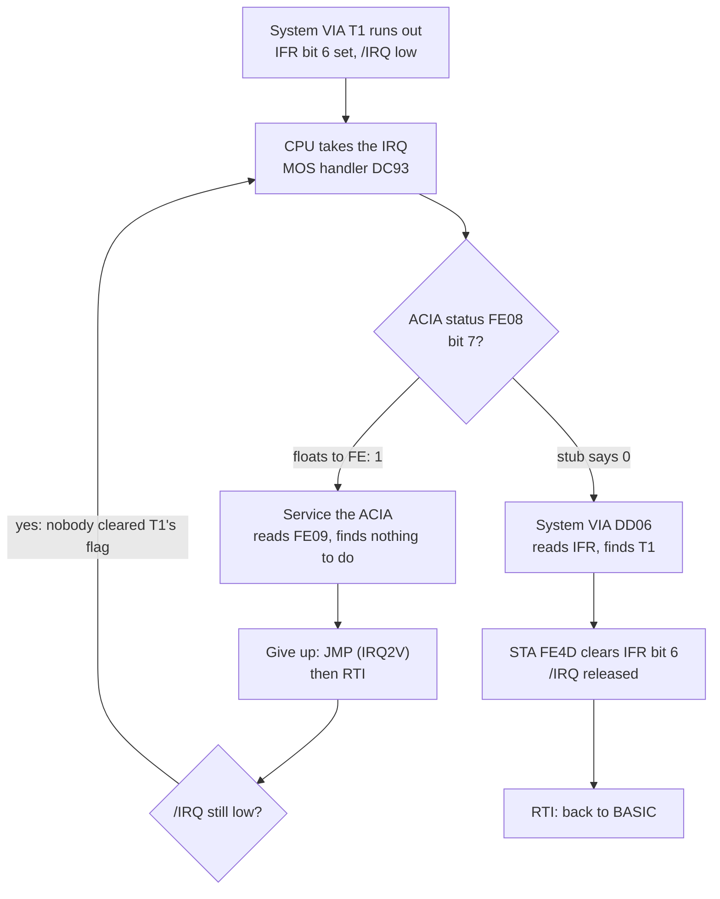
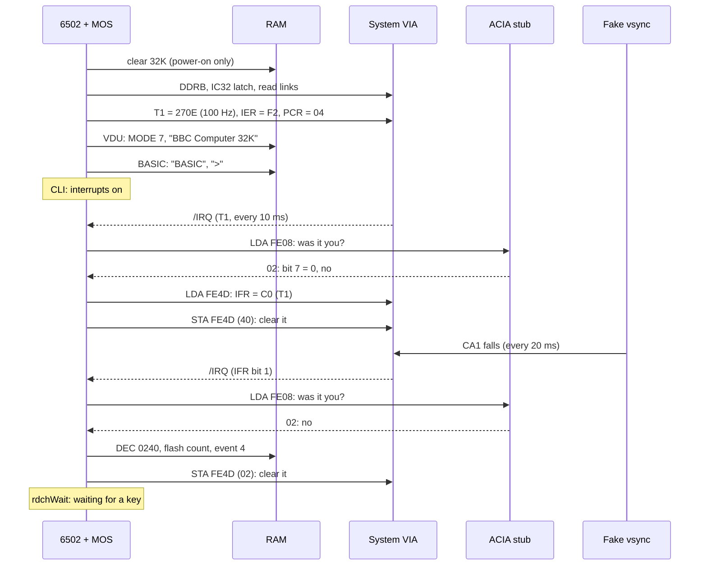
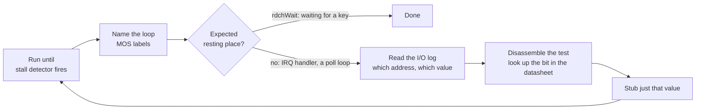
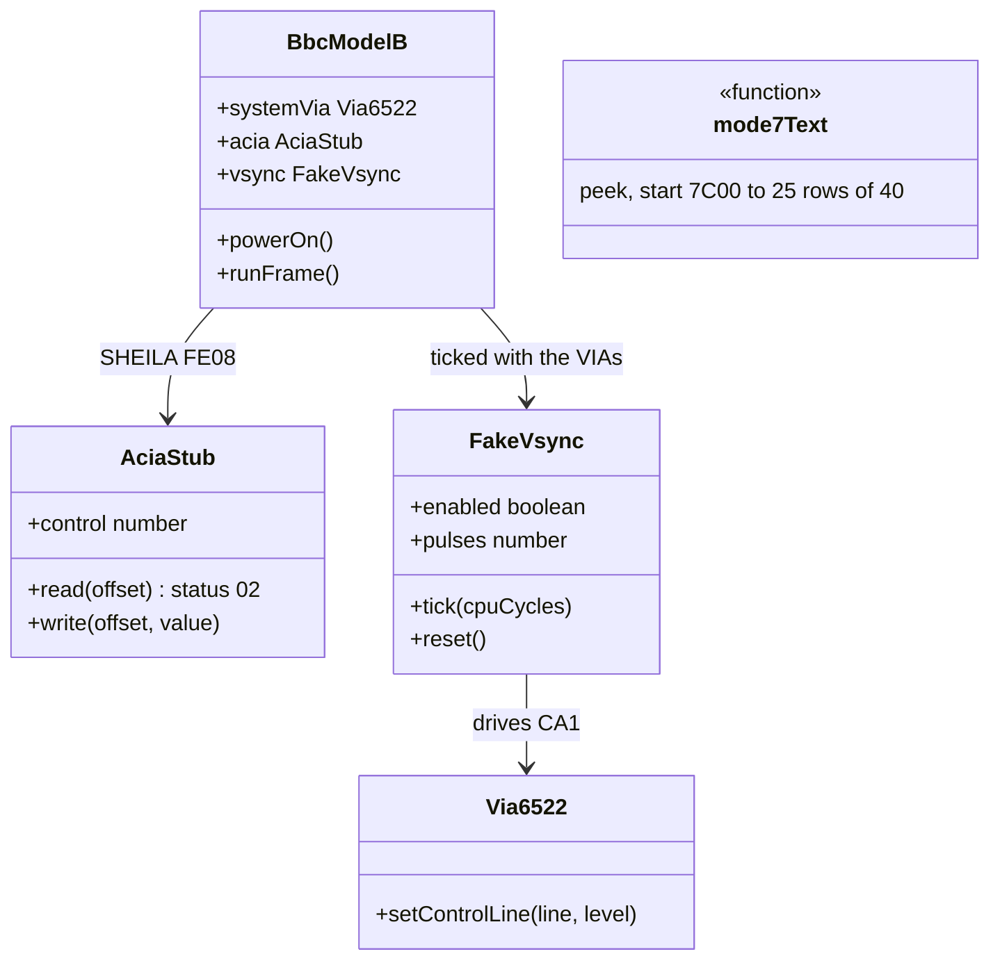

# Stage 29: First boot

> **Part:** 5 (Assembling the machine) · **Branch:** `stage/29-first-boot` · **Needs:** 28
> **Status:** done

## Goal

Get MOS 1.20 and BASIC II all the way to the `>` prompt, and print the Mode 7 screen as text:

```
BBC Computer 32K

BASIC

>
```

Stage 28 left the machine in an **IRQ storm**: the banner was in screen memory, but the CPU spent all its time in the interrupt handler and never got back to BASIC. This stage is about **reading a trace to find out what the MOS is waiting for**, fixing exactly that, and repeating until the prompt appears.

The plan predicted that the missing part would be the **vertical sync interrupt**, so this stage also adds a temporary 50 Hz vsync pulse on the System VIA's CA1. The traces turned out to say something slightly different, and that's the most useful lesson of the stage:

- The storm was caused by the **6850 ACIA** (the serial chip), which isn't fitted in our machine. A tiny ACIA stub is enough to reach `>`.
- **Vsync isn't needed to boot.** The MOS takes its clock from the System VIA's Timer 1, not from vsync. But several MOS services do depend on vsync, and one of them (`OSBYTE &13`, "wait for vsync") **hangs forever** without it. We add the fake pulse and show both.

It comes now because every part the MOS touches during start-up exists at last, at least as a stub (Stage 28). After this, the boot screen is real data in RAM, and Part 6 is about drawing it.

## What you can now see

```bash
npm run demo:boot      # needs roms/os12.rom and roms/basic2.rom; skips politely without them
```

**Part 1: the milestone.** 🎉

```
── Part 1: power on, and wait ──
  ">" appeared at &7CC8 after 277.5 ms (frame 14).
  After 50 frames (1 second), MODE 7 screen memory reads:

  &7C00 ┌────────────────────────────────────────┐
        │                                        │
        │BBC Computer 32K                        │
        │                                        │
        │BASIC                                   │
        │                                        │
        │>                                       │
        │                                        │
        └────────────────────────────────────────┘
        (rows 7-24 are blank too)
```

**Part 2: the diagnosis.** It shows the Stage 28 storm's I/O log lines, the four instructions of the IRQ handler that ask the ACIA, and the two status bytes in binary: `&FE = 11111110` (floating, bit 7 = "me") against the stub's `&02 = 00000010`. Then it decodes the `&56` the MOS wrote to the control register.

**Part 3: one Timer 1 interrupt, traced.** The interesting lines of a real interrupt, now that the handler gets past the ACIA:

```
  2012099  IRQ: System VIA IFR = &C0 (11000000), so /IRQ is low; the CPU goes through &FFFE
  2012155  &DCA2  AD 08 FE  LDA &FE08   ...  ; ACIA status: bit 7 = the ACIA is interrupting
  2012161  &DCA7  10 5D     BPL systemViaIrq ; bit 7 = 0: not the ACIA, so ask the System VIA
  systemViaIrq:
  2012165  &DD06  AD 4D FE  LDA &FE4D   ...  ; System VIA reg 13 (IFR)
  ...
  2012183  &DD13  90 54     BCC &DD69   ...  ; C = IFR bit 1 (CA1, vsync). Not vsync?
  ...
  2012201  &DDCE  8D 4D FE  STA &FE4D   ...  ; System VIA reg 13 (IFR)       ← A = &40: T1's flag cleared
```

**Part 4: where it rests.** The stall detector still fires, but the loop is `defaultIRQ1, systemViaIrq, rdchWait, defaultREM`: BASIC waiting for a key, with interrupts coming and going.

**Part 5: what vsync is for.** The same booted machine, one more second, with the fake vsync on and off:

```
               vsyncs  &0240 moved  ULA flash writes   *FX19 returned?  prompt at boot?
    vsync on       50           50  2 &4B &4A          yes              yes
    vsync off       0            0  0                  no: hangs        yes
```

and the five-instruction `waitVsync` loop at `&E9B6` that never ends without it.

**In the browser**, run `npm run dev` and open `http://localhost:5173/?machine=mos`. The MOS now boots to the prompt. Press **Run**, wait a second, then type `7C20` into the Memory panel's Go box. The ASCII column shows `BBC Comp` / `uter 32K` on rows `&7C20`–`&7C30`, `BASIC` on row `&7C70`, and `&3E` (`>`) at `&7CC8`. Part 6 will draw it.

> The Stage 28 doc's `demo:boot` output no longer matches: the demo moves on with the machine. `git show stage/28-latch-stubs:scripts/demo-boot.ts` has the old one.

## The real hardware

### How the MOS finds out who interrupted

The Model B has one `/IRQ` line, and several chips can pull it low (Stage 27's wire-OR). The CPU only knows *that* something interrupted, not *what*. So the MOS's IRQ handler has to **ask each chip in turn**: "was it you?" Each chip has a status bit that says so.

MOS 1.20's handler is at `&DC93` (the default target of `IRQ1V`, `&0204`). This is the start of it, from os12.rom:

```
DC93  CLD
DC94  LDA &FC        ; save A (the IRQ entry at &DC1C stored it in &FC)
DC96  PHA
 ...                 ; save X and Y, and push a return address
DCA1  CLV
DCA2  LDA &FE08      ; ACIA status register
DCA5  BVS &DCA9      ; (V was just cleared, so never taken from here)
DCA7  BPL &DD06      ; bit 7 = 0: "not me". Go and ask the System VIA
DCA9  ...            ; bit 7 = 1: service the ACIA (serial or cassette)
```

**The ACIA is asked first, before either VIA.** The MOS reads its status register at `&FE08`, and **bit 7 of the status says "I'm interrupting"**. Only if that bit is 0 does the handler go on to the System VIA at `&DD06`.

### The 6850 ACIA (`&FE08`–`&FE0F`)

The Motorola 6850 **Asynchronous Communications Interface Adapter** turns bytes into a serial bit stream and back. On the Model B it serves both the RS423 port and the cassette interface (through the Serial ULA at `&FE10`). Both are out of scope for this project, but **the MOS still talks to the chip**, so it has to be there.

Like the CRTC, it has two register-select positions (6850 datasheet, "Registers"):

| Address | Read | Write |
|---|---|---|
| `&FE08` | **status** | **control** |
| `&FE09` | receive data | transmit data |

The status register's bits (6850 datasheet, "Status register"):

| Bit | Name | Means |
|---|---|---|
| 0 | RDRF | receive data register full: a byte has arrived |
| 1 | TDRE | transmit data register empty: ready for another byte |
| 2 | /DCD | data carrier detect input (the Serial ULA drives it on the BBC) |
| 3 | /CTS | clear-to-send input |
| 4 | FE | framing error |
| 5 | OVRN | receiver overrun |
| 6 | PE | parity error |
| **7** | **IRQ** | **the chip is pulling `/IRQ` low** |

The control register (6850 datasheet, "Control register"):

| Bits | Name | Meaning |
|---|---|---|
| 0–1 | counter divide | ÷1, ÷16, ÷64, or `11` = **master reset** |
| 2–4 | word select | data bits, parity, stop bits |
| 5–6 | transmitter control | RTS level, and whether "transmitter empty" may interrupt |
| 7 | receive interrupt enable | whether "byte arrived" may interrupt |

The MOS writes the control register twice over in what we've traced:

- `&03` at `&FB65`, during reset: **master reset** (bits 0–1 = `11`).
- `&56` at `&E18C`, again and again: 100 times a second, on every Timer 1 interrupt (measured):

```
&56 = 0101 0110
      │└┤└┬┘└┤
      │ │ │  └─ bits 0-1 = 10:  divide by 64
      │ │ └──── bits 2-4 = 101: 8 data bits, no parity, 1 stop bit
      │ └────── bits 5-6 = 10:  RTS high, transmitter interrupt OFF
      └──────── bit 7    = 0:   receiver interrupt OFF
```

Both interrupt enables are off. **With those settings a real 6850 can never interrupt**, so its status bit 7 is always 0, and the MOS goes straight on to the System VIA. (The MOS only turns them on when you use RS423 or the cassette, which we don't emulate.)

### What happened without one

In our machine nothing answers `&FE08` (Stage 21's placeholder), so the read gets the **floating bus**: the last byte the data bus carried. `LDA &FE08` fetches its operand bytes `&08` then `&FE`, so the read sees **`&FE` = `1111 1110`**. Bit 7 is set, and the MOS concludes the ACIA is interrupting:



The Timer 1 flag is never cleared, because the code that clears it is never reached. So `/IRQ` stays low, and the CPU re-enters the handler the instant `RTI` sets the I flag back to 0. That is the **storm**: the CPU is running flat out, but only the same 100 or so instructions.

### Vertical sync and the System VIA's CA1

The 6845 CRTC (Stage 37) produces a **VSYNC** pulse once per frame: the signal that tells the TV to move its beam back to the top. On the Model B it is also wired to the **System VIA's CA1** input (Advanced User Guide, System VIA section, "CA1: vertical sync"). So the MOS gets an interrupt at the start of every frame, 50 times a second.

- **Period:** a PAL frame is 312.5 lines of 64 µs = **20 ms**: 40,000 cycles of the 2 MHz CPU (BUILD-PLAN §3).
- **Width:** set by the top nibble of CRTC **R3**. The MOS writes `R3 = &24` for MODE 7: a horizontal sync 4 characters wide, and a **vertical sync 2 lines** wide. Two lines is 2 × 64 µs = 128 µs = **256 CPU cycles**.
- **Which edge:** the MOS sets the System VIA's **PCR to `&04`**. PCR bit 0 = 0 means **CA1 interrupts on a falling edge** (6522 datasheet, PCR). Whether the 6845's VSYNC (active high) is inverted on its way to CA1, so that the falling edge marks the *start* of the pulse, I haven't confirmed from the circuit diagram. For a 50 Hz tick it doesn't matter. Stage 38 (the real CRTC timing) will settle it.
- **Enabled:** after start-up, the System VIA's **IER is `&F3`** = `1111 0011`. Bit 1 (CA1) is set, so a CA1 edge pulls `/IRQ` low.

### What the MOS does with vsync

When IFR bit 1 is set, the System VIA part of the handler (`&DD06`) takes the vsync branch:

```
DD06  LDA &FE4D      ; System VIA IFR
DD09  BPL &DD47      ; bit 7 = 0: not the System VIA. Try the User VIA
DD0B  AND &0279      ; only the sources the MOS handles (*FX233)
DD0E  AND &FE4E      ; ... and that are enabled (IER)
DD11  ROR A
DD12  ROR A          ; bit 1 (CA1) into the carry
DD13  BCC &DD69      ; not vsync: the timers and the rest
DD15  DEC &0240      ; vsync: count it
 ...                 ; a countdown at &EA, and the flash counter at &0251 (calls &EA00)
DD3D  LDY #&04
DD3F  JSR &E494      ; raise event 4, "vsync", for user programs (*FX14,4)
DD42  LDA #&02
DD44  JMP &DE6E      ; DE6E: STA &FE4D, which clears IFR bit 1
```

So vsync drives four things:

1. **`&0240`, a counter decremented every vsync**, which `OSBYTE &13` (`*FX19`) watches. That call means "wait until the start of the next frame", so that a game can change the screen without flicker. Its code at `&E9B6` (found by tracing `OSBYTE` with `A = &13`: the dispatch table at `&E5B3` sends it there):

   ```
   E9B6  LDA &0240   ; the count now
   E9B9  CLI         ; let interrupts in ...
   E9BA  SEI         ; ... for one instruction
   E9BB  CMP &0240   ; has a vsync changed it?
   E9BE  BEQ &E9B9   ; no: wait again
   ```

   **With no vsync, this loop never ends.**
2. **Flashing colours.** `&0251` counts down vsyncs. At zero, `&EA00` flips the Video ULA's flash bit (control register bit 0) with `STA &FE20` and reloads the count from `&0252` or `&0253`, the mark and space times (`*FX9`, `*FX10`, 25 frames each by default). That's why flashing colours alternate twice a second.
3. **Event 4** (vsync), for programs that ask for it with `*FX14,4`.
4. A timeout counter at `&EA`, used by the serial and cassette code (out of scope).

**What vsync is *not* used for:** the `TIME` clock, keyboard scanning and the sound envelopes. Those run from the System VIA's **Timer 1** at 100 Hz (Stage 26: T1 latch `&270E` = 9,998, so a period of 10,000 µs), on the branch at `&DDCA`. That's why the boot can finish without vsync at all.

## Key concepts

### 1. "What is the MOS waiting for?" A method

A stalled emulator usually means the software is waiting for some hardware to do something. Finding out what is detective work, and the tools of Stages 18–28 make it routine:

1. **Run until the stall detector fires** (Stage 23). It tells you the loop: the set of addresses that keep running.
2. **Name the loop.** Our MOS labels turn `&DC93` into `defaultIRQ1`. A loop inside the IRQ handler is a storm; a loop round `rdchWait` is the machine waiting for a key (which is *fine*).
3. **Read the I/O log** (Stage 21) for the last few hardware accesses. In the storm, they were the same two over and over: `&FE08 read &FE`, `&FE09 read &FE`.
4. **Ask what value the software wanted.** Disassemble the code around the read (`&DCA2`: `BPL &DD06`), and look up the bit in the datasheet (6850 status bit 7 = IRQ).
5. **Supply the smallest thing that gives that value.** A stub with the right status, *not* a whole serial chip.
6. **Run it again**, and repeat until the stall is the one you expect.

After the ACIA stub, the stall detector still fires. But now its loop is `rdchWait` and `defaultREM` (`&E464`: "is the keyboard buffer empty?"), with the System VIA's timer interrupts coming and going. That's **BASIC waiting for you to type**: the right place to stop.

### 2. Stubs are claims about the hardware

The ACIA stub returns status `&02`:

```
&02 = 0000 0010
             └─ bit 1, TDRE: transmitter empty
              (bit 7, IRQ = 0: not interrupting. Bits 2-3, /DCD and /CTS = 0)
```

Each bit is a claim:

- **Bit 7 = 0** is the one that matters, and it's justified above: the MOS has both ACIA interrupts disabled, so the real chip couldn't interrupt.
- **Bit 1 = 1** (TDRE) is what an idle transmitter shows after a master reset. The 6850 datasheet says TDRE is held at 0 while /CTS is high, so this also claims /CTS is low. On the Model B, /CTS comes from the RS423 port through the Serial ULA. I haven't confirmed what an unconnected port gives. Nothing in the boot reads this bit.
- **Bits 2–3** (/DCD, /CTS) = 0: same caveat.

A stub that's honest about which of its values are known, and which are guesses, is much easier to replace later.

### 3. A fake vsync: just a clock and a wire

The real VSYNC is a by-product of the CRTC's counters (Stage 38 builds those). Until then, all the MOS needs is a falling edge on CA1 every 40,000 cycles. So the fake is a **cycle counter that toggles a pin**:

```
cycle in frame:   0 ......... 255 | 256 .................... 39,999 | 0 ...
CA1:              ‾‾\_____________/‾‾‾‾‾‾‾‾‾‾‾‾‾‾‾‾‾‾‾‾‾‾‾‾‾‾‾‾‾‾‾‾‾‾‾\____
                    ↑ falling edge: IFR bit 1 set               ↑ next frame
```

It's ticked like any other device (BUILD-PLAN §3): `tick(cycles)` moves it on, and if it crosses an edge, it calls `systemVia.setControlLine('ca1', 0)` or `(…, 1)`. The VIA (Stage 26) already turns a falling edge into IFR bit 1 and `/IRQ`.

Because it's ticked after each whole instruction, the edge can arrive up to one instruction late (at most 7 cycles, 3.5 µs). The MOS can't tell: it never measures *when* vsync happened, only *that* it did.

### 4. Reading the screen without drawing it

In MODE 7, screen memory is **one byte per character cell**: 40 columns × 25 rows = 1,000 bytes at `&7C00`–`&7FE7` (Advanced User Guide, "MODE 7"). Each byte is a character code (`&42` is `B`). The SAA5050 teletext chip turns those codes into dots (Stage 31). Before we have it, we can still **read the screen as text**: row *r*, column *c* is at

```
&7C00 + r × 40 + c          e.g. row 1, column 0 = &7C00 + &28 = &7C28: "B" of "BBC Computer 32K"
```

Codes below `&20`, and `&80`–`&9F`, are **teletext control codes** (colour changes and so on). On screen each takes a cell and shows as a space, so we show a space. The rest of the teletext character set isn't quite ASCII either (`&23` is `£`, not `#`). That's Stage 31's job, so the dump shows plain ASCII for now.

## Diagrams

### The boot, end to end, with what each part needs



### The diagnosis loop



### Where the new parts sit



## Our design

### `AciaStub` (`src/devices/stubs/acia-stub.ts`)

An `IoDevice` in the SHEILA `acia` slot. Reads of register 0 return `ACIA_IDLE_STATUS = &02`; reads of register 1 (receive data) return `&00`. Writes to register 0 are kept in `control`, so the demo can show the `&56`. Writes to register 1 (transmit data) are ignored. Nothing is sent to the hardware log: the MOS rewrites `&56` 100 times a second and would flood it.

Alternatives considered:
- **A real 6850.** Out of scope (serial and cassette), and none of its behaviour is visible without them.
- **A status that tracks the control register** (bit 7 = TIE and TDRE). More faithful, but it only changes anything once RS423 is in use. Noted in the parking lot.

### `FakeVsync` (`src/devices/stubs/fake-vsync.ts`)

A `Clocked` device holding the System VIA. It keeps one number, its position in the frame, and walks it forward in `tick()`. A `while` loop handles a tick that crosses more than one edge (not possible with 7-cycle instructions, but `tick(100_000)` from a test shouldn't skip pulses). No allocation.

```ts
export const VSYNC_PERIOD_CYCLES = 40_000; // one 50 Hz PAL frame
export const VSYNC_WIDTH_CYCLES = 256;     // 2 lines of 64 µs (R3 = &24 in MODE 7)

class FakeVsync implements Clocked {
  enabled: boolean;                 // off: CA1 stays high, nothing happens
  get pulses(): number;             // falling edges since reset(), for demos and tests
  tick(cpuCycles: number): void;
  reset(): void;                    // CA1 high, just after a pulse
}
```

It starts just *after* a pulse, so the first falling edge comes 39,744 cycles after `powerOn()`. `powerOn()` resets it, and BREAK doesn't (a real CRTC keeps running through BREAK). `enabled` exists so the demo and tests can show the difference vsync makes.

### `mode7Text` (`src/video/mode7-text.ts`)

```ts
export function mode7Text(peek: (address: number) => number, start = MODE7_SCREEN_START): string[]
```

Pure: it takes a `peek` (so it works on the machine, a bare map or a test array) and returns 25 strings of 40 characters. It lives in a new `src/video/` folder, because Stage 31's renderer will read the same bytes.

It always reads from `&7C00`. When the screen scrolls, the MOS moves the CRTC's start address (R12/R13) instead of moving bytes, and the screen wraps round inside `&7C00`–`&7FFF`. The dump doesn't follow that yet. At boot nothing has scrolled. Stage 30's browser text grid will need it, so it's in the parking lot.

### The machine

`BbcModelB` gains `acia` and `vsync`. The ACIA is passed to the memory map for the `acia` slot. The vsync is added to the clocked list after the System VIA. Both are part of the box, so `new BbcModelB()` boots without any setup.

### MOS labels

New names, from this stage's reading of os12.rom: `systemViaIrq` (`&DD06`) and `waitVsync` (`&E9B6`), with notes on `&DCA2`/`&DCA7` (the ACIA question), `&DD13`/`&DD15` (the vsync branch), and `&E9BB` (`*FX19`'s test).

## Code walkthrough

### [`src/devices/stubs/acia-stub.ts`](../../src/devices/stubs/acia-stub.ts)

The whole stub is a constant and a byte of storage:

```ts
export const ACIA_STATUS_TDRE = 0x02;
export const ACIA_STATUS_IRQ = 0x80;
export const ACIA_IDLE_STATUS = ACIA_STATUS_TDRE;

read(offset: number): number {
  return (offset & 1) === ACIA_STATUS ? ACIA_IDLE_STATUS : 0x00;
}
```

The header comment carries the argument for each bit, because that's what Stage 29 is really about. `control` keeps the last write so the demo (and you, from the console) can see the `&56`.

### [`src/devices/stubs/fake-vsync.ts`](../../src/devices/stubs/fake-vsync.ts)

`position` runs from 0 to 39,999. Below 256, CA1 is low. `tick()` walks to the next edge, crosses it, and repeats while cycles are left:

```ts
const inPulse = this.position < VSYNC_WIDTH_CYCLES;
const toEdge = (inPulse ? VSYNC_WIDTH_CYCLES : VSYNC_PERIOD_CYCLES) - this.position;
if (left < toEdge) { this.position += left; return; }   // the usual case: no edge this instruction
```

Nearly every call takes the early `return`, so the cost per instruction is a comparison and an add. The `enabled` setter lets go of CA1 (drives it high) when switched off mid-pulse, so a disabled vsync can't leave the line stuck low.

### [`src/machine/bbc-model-b.ts`](../../src/machine/bbc-model-b.ts)

Three lines: the ACIA goes into the map's `acia` slot, `vsync` joins the `clocked` list after the two VIAs, and `powerOn()` calls `vsync.reset()`. `reset()` (BREAK) leaves the vsync running.

### [`src/video/mode7-text.ts`](../../src/video/mode7-text.ts)

`mode7Text(peek, start)` builds 25 strings. Each byte is masked to 7 bits (the SAA5050 ignores bit 7), and anything outside `&20`–`&7E` becomes a space. `formatMode7Text` draws the box for the CLI.

### [`src/mos/mos-labels.ts`](../../src/mos/mos-labels.ts)

Two new routine names (`systemViaIrq` at `&DD06` and `waitVsync` at `&E9B6`) and notes on the ACIA question, the vsync branch, `*FX19`'s test, and `&EEE2`, where the MOS enables CA2 once no key is down.

### [`src/main.ts`](../../src/main.ts)

The playground turns the fake vsync **off**: `if (!mosMode) machine.vsync.enabled = false`. Stage 26's example counts CA1 edges from the VIA panel's button, and a vsync on the same pin would add 50 a second and override a held button at the end of each pulse. MOS mode keeps it on.

### [`scripts/demo-boot.ts`](../../scripts/demo-boot.ts)

Rewritten for this stage (five parts, above). Part 3 waits for `pendingInterrupt === 'irq'`, clears the trace, steps to the `RTI`, and prints the first occurrence of each interesting address.

## Tests

| Test file | What it proves |
|---|---|
| `src/devices/stubs/acia-stub.test.ts` | Status bit 7 is 0 and the status is `&02` whatever the control register says. The control byte is kept (`&56`). Transmit writes go nowhere. Receive data is `&00`. Register select bit 0 only (mirrors). `peek` = `read`. |
| `src/devices/stubs/fake-vsync.test.ts` | 40,000-cycle period and 256-cycle pulse. The first falling edge comes 39,744 cycles after construction. The edge sets IFR bit 1 and `/IRQ`. CA1 rises 256 cycles later. 50 pulses in 2,000,000 cycles of 8-cycle ticks. One huge tick still makes every pulse. Acknowledge, then the next frame flags again. With PCR bit 0 = 1 the interrupt moves to the end of the pulse. Disabled: no pulses, CA1 high, even if disabled mid-pulse. `reset()`. |
| `src/video/mode7-text.test.ts` | 25 rows of 40. Row *r* column *c* at `&7C00 + 40r + c` (`&7C28` starts row 1, `&7FE7` is the last cell). Control codes show as spaces, bit 7 is ignored, `&7F` is a space for now, another start address works, and addresses wrap at `&FFFF`. |
| `src/machine/bbc-model-b.test.ts` | **(ROMs)** Boots to `"BBC Computer 32K"`, `"BASIC"`, `">"` in rows 1, 3 and 5. Rests in `rdchWait` with IRQs a tiny fraction of the steps (no storm). The ACIA is asked (`&FE08` read `&02`) and set to `&56`. `&0240` counts 10 vsyncs in 10 frames, and doesn't move with vsync off (while the boot still finishes). `*FX19` returns within 2 frames with vsync, and loops at `&E9B6`–`&E9BE` for 50 frames without. The ULA flash bit flips 4 times in 100 frames (`&4B` ↔ `&4A`). **Changed:** IER is now `&F3` (the boot gets far enough for `&EEE2` to enable CA2), and the MODE 7 ULA check ignores the flash bit. The Stage 28 storm test is gone. |
| `src/mos/mos-labels.test.ts` | `BPL systemViaIrq` and the ACIA note appear in a trace line. **(ROM)** The OSBYTE table entry for `&13` at `&E5B3 + 2 × &13` really is `&E9B6`. |
| `e2e/machine.spec.ts` | **(ROMs)** `/?machine=mos` boots to the prompt: after 20 frames, `&7C28` = `B`, `&7C78` = `B`, `&7CC8` = `>`, IER `&F3`. Replaces the Stage 27 "stalls with /IRQ held" check. |

Every ROM test uses `withRoms(...)` and skips with a message if `roms/os12.rom` or `roms/basic2.rom` is missing. `npm test`: 2,205 passed and 1 skipped (the DFS header test: `dfs.rom` isn't supplied yet). `npm run test:e2e`: 100 passed.

## Gotchas & hardware quirks

- **The plan's guess was wrong, and that's fine.** BUILD-PLAN expected vsync to be the missing piece. The trace pointed at the ACIA instead. Following the evidence, and not the plan, is the skill this stage teaches. Vsync was still worth adding: it's how `*FX19`, flashing and event 4 work, and Part 6 onwards needs a frame tick.
- **A missing chip isn't silent.** The floating bus (Stage 21) means a read of an absent chip returns *something*: here `&FE`, the operand's high byte, which happens to have bit 7 set. If the last byte on the bus had had bit 7 clear, the MOS would have carried on and we'd never have noticed the ACIA was missing. Absent hardware works or fails by accident.
- **Polling order matters.** The MOS asks the ACIA, then the System VIA, then the User VIA. Any device earlier in the chain that wrongly claims an interrupt starves everything after it. That's why one wrong bit froze the whole machine.
- **The ACIA's status is fixed.** If a program turns the ACIA's interrupts on (`*FX2`/`*FX5` for RS423, or the cassette code), a real 6850 would interrupt when its transmitter emptied. Ours never will. Serial and cassette are out of scope; it's in the parking lot.
- **/DCD and /CTS are guesses.** Status bits 2 and 3 are 0 (carrier present, clear to send). The Model B's Serial ULA wiring for an unconnected port is unchecked. Nothing in the boot reads them.
- **Which VSYNC edge reaches CA1 is unconfirmed.** With PCR `&04` (falling edge), our interrupt comes at the *start* of the pulse. If the real board doesn't invert VSYNC, it comes 256 cycles later, at the end. Stage 38 will decide.
- **Vsync edges land at the end of an instruction**, up to 7 cycles late (Stage 26 has the same note for every control line).
- **Vsync starts 39,744 cycles after power-on**, not at a random point of a frame. A real CRTC's phase at power-on is arbitrary, and the MOS doesn't care.
- **The playground has vsync off** (see `main.ts` above). That's a choice about the workbench, not the hardware: a real Model B always has vsync.
- **The text dump doesn't follow scrolling.** It reads from `&7C00`. When BASIC scrolls (after 25 lines), the MOS changes CRTC R12/R13 and the top row moves. Stage 30's text grid needs the start address. In the parking lot.
- **The IRQ handler re-asks the ACIA** inside the Timer 1 branch (`&DE2E: JSR &DCA2`), which is why Part 3's trace shows `&DCA2` twice in one interrupt.
- **IER `&F2` → `&F3`.** Stage 27's tests saw `&F2` because the storm began before the MOS reached `&EEE2`, where it finds no key down and enables CA2 (bit 0) so that the keyboard can wake it. Now it gets there, at frame 14.

## Playwright verification

The stage's outcome is a CLI demo, but MOS mode was also checked with the Playwright MCP: open `/?machine=mos`, press **Run**, and after 2 s screen memory read `BBC Computer 32K` / `BASIC` / `>` (rows 1, 3 and 5). A screenshot of the Memory panel at `&7C20` shows the bytes and their ASCII column. The durable check `e2e/machine.spec.ts` was rewritten: in MOS mode, after 20 frames, the banner and `>` are in screen memory and IER is `&F3`. It ran (not skipped, the ROMs are in `roms/`) and passed. The rest of the e2e suite (100 tests) passes too, including `via-interrupts.spec.ts`, which needs the playground's vsync off.

## Check your understanding

1. The floating read of `&FE08` returned `&FE`. Why `&FE` in particular? What would have happened if it had returned `&08`?
2. The MOS's IRQ handler asks the ACIA before the System VIA. If you could rewrite the MOS, why might asking the System VIA first be better, and what would it cost?
3. Why does the boot reach `>` with the fake vsync switched off? Name one thing that *does* break without it, and the address where the MOS waits.
4. The ACIA stub's status is `&02`. Which bit had to be right to fix the storm, and what fact about the MOS's control write `&56` justifies that value?
5. The fake vsync drops CA1 for 256 cycles every 40,000. Where do those two numbers come from? What would change if the MOS had set PCR bit 0 to 1?

<details>
<summary>Answers</summary>

1. The floating bus holds the last byte that crossed the data bus. `LDA &FE08` is `AD 08 FE`, so the last byte fetched before the read was the operand's high byte, `&FE`. `&08` is `0000 1000`: bit 7 = 0, so the MOS would have decided "not the ACIA" and gone straight to the System VIA. The bug would have been hidden by luck.
2. The System VIA interrupts 150 times a second (Timer 1 and vsync), and the ACIA almost never on a machine without serial. Asking the busy one first would save a read and a branch on nearly every interrupt. The cost is latency for the ACIA: at high baud rates a received byte must be read before the next one arrives, or the overrun bit is set. That is probably why Acorn put it first (a guess: the reasoning isn't documented).
3. The MOS's clock, keyboard scan and sound run from System VIA Timer 1 (100 Hz), and nothing on the boot path waits for a frame. Without vsync, `OSBYTE &13` (`*FX19`) loops forever at `&E9B6`–`&E9BE` waiting for `&0240` to change. Also, flashing colours stop (`&0251` never counts down) and event 4 never fires.
4. Bit 7 (IRQ) had to be 0. `&56` has bit 7 = 0 (receive interrupt off) and bits 6–5 = `10` (transmit interrupt off), so a real 6850 with those settings can't interrupt, and its bit 7 would be 0 too.
5. 40,000 = 2,000,000 cycles per second ÷ 50 frames per second (a PAL frame of 312.5 lines × 64 µs = 20 ms). 256 = 2 lines × 64 µs × 2 cycles per µs, and the 2 lines come from the top nibble of CRTC R3 (`&24`) in MODE 7. With PCR bit 0 = 1, CA1 would interrupt on the *rising* edge, at the end of the pulse: 256 cycles (128 µs) later. The MOS wouldn't notice.

</details>

## Further reading

- Motorola **MC6850 ACIA** datasheet: "Status register" and "Control register" (bit meanings, master reset, TDRE and /CTS).
- **Advanced User Guide** for the BBC Microcomputer: the System VIA section (CA1 = vertical sync, CA2 = keyboard), the interrupt chapter (polling order, `*FX231`–`233` masks at `&0277`–`&0279`), `OSBYTE &13`, and events (event 4 = vsync).
- Rockwell/Synertek **6522 VIA** datasheet: PCR (CA1 edge select), IFR and IER.
- Motorola **MC6845 CRTC** datasheet: R3 (sync widths), and how VSYNC is generated (Stage 37/38).
- BeebWiki: "System VIA", "6850 ACIA", "MODE 7".
- Stage 21 (the floating bus), Stage 23 (the stall detector), Stage 26 (VIA interrupts), Stage 28 (the hardware log).
