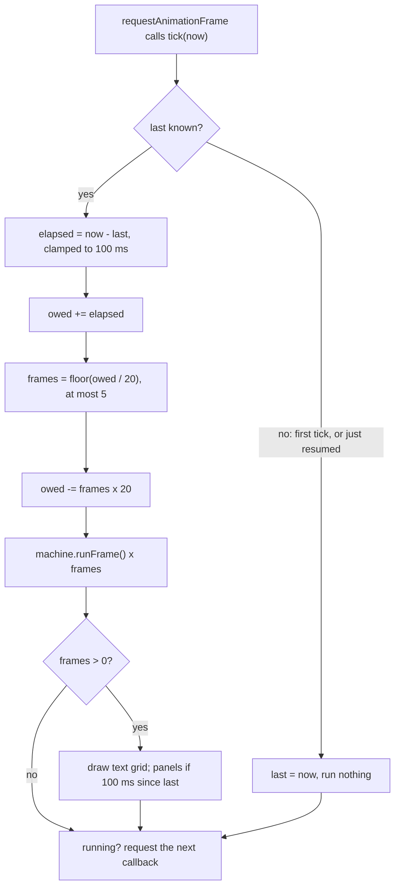
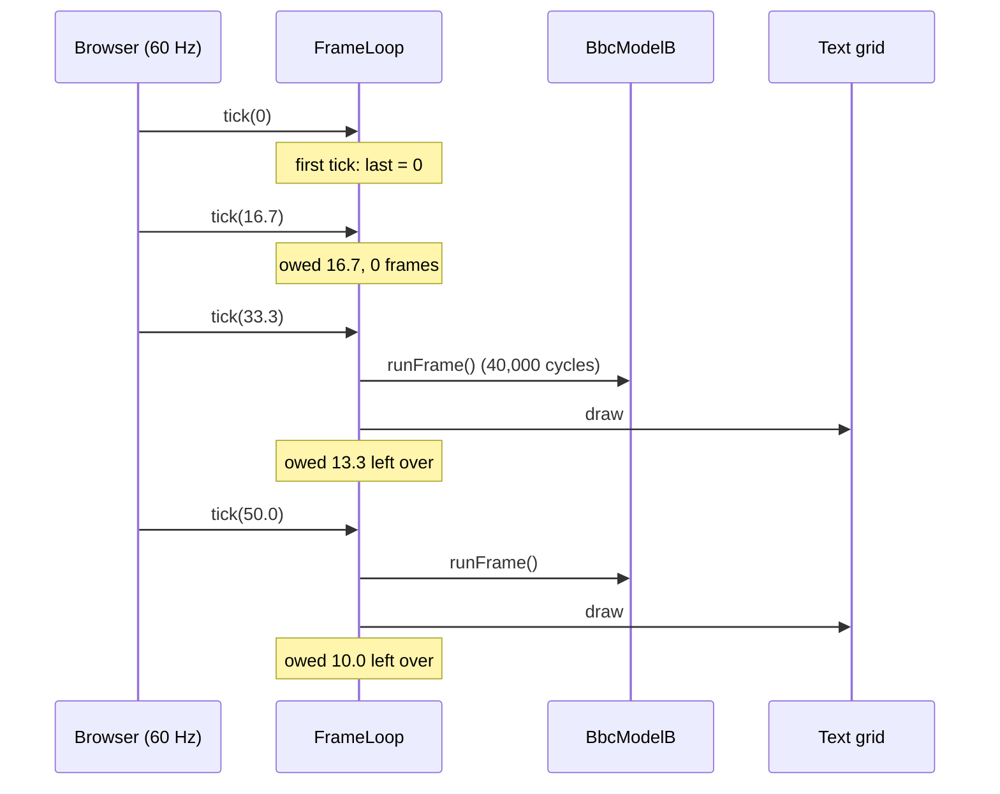
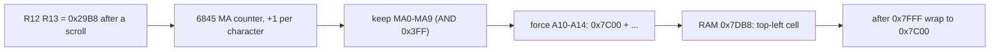
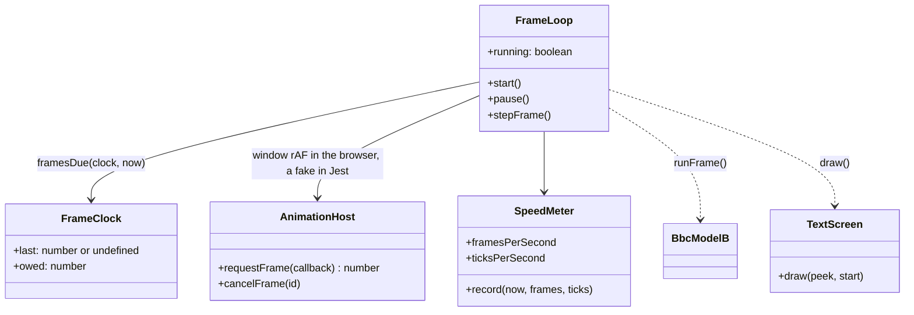

# Stage 30: Browser run loop

> **Part:** 6 (Mode 7 on screen) · **Branch:** `stage/30-run-loop` · **Needs:** 29
> **Status:** done

## Goal

Make the machine **run by itself in the browser, in real time**. Until now something always had to drive it: a CLI demo calling `runFrame()` in a `for` loop as fast as Node allows, or the workbench's Run button, which runs one 40,000-cycle slice per browser frame whatever the display's refresh rate. This stage adds a **frame loop** tied to the wall clock, so 1 second of your time is 1 second of BBC time. It also adds **Pause / Step frame / BREAK / Power on** controls, and shows MODE 7's screen memory as a live **40 × 25 text grid** over the screen. Open `/?machine=mos` and the boot text appears by itself, then the machine sits at `>`, ticking 50 times a second.

It comes now because Stage 29 got the MOS to `>`. There's finally something worth watching run. Stage 31 replaces the text grid with real teletext pixels on the canvas. The frame loop stays.

## What you can now see

```bash
npm run dev
# open http://localhost:5173/?machine=mos   (needs roms/os12.rom and roms/basic2.rom)
```

Nobody presses anything. About a third of a second after the page loads, the boot text appears over the black screen, and the machine sits at the prompt, running:

```
BBC Computer 32K

BASIC

>
```

Under the screen are **Pause · Step frame · BREAK · Power on**, and a status line:

```
Running: 50 frames/s (100%), display 60 Hz · frame 286
```

That line is the stage in one sentence. The display calls us back **60** times a second, and the BBC still gets **50** frames. On a 120 Hz or 144 Hz screen the "display" number changes and the 50 doesn't.

Things to try:

1. **Pause**, then **Step frame** a few times. The frame count goes up by exactly 1, and the Disassembly panel's cycle numbers by about 40,000.
2. While it's running, press **Step** in the Registers panel. The machine pauses first (one driver at a time), and you're single-stepping the MOS's keyboard wait loop.
3. **BREAK**: the banner is printed again, but as just **"BBC Computer"**, with no "32K". The MOS prints the memory size only after a power-on or hard reset. On a soft BREAK the VIAs kept their registers (Stage 27), so it knows this isn't one. **Power on** gives "BBC Computer 32K" again and restarts the frame count.
4. **Watch it scroll.** Paste this in the browser console. It makes the MOS print 20 line feeds (`LDX #20 / LDA #10 / JSR OSWRCH / DEX / BNE / JMP *`):
   ```js
   [0xa2,20,0xa9,0x0a,0x20,0xee,0xff,0xca,0xd0,0xf8,0x4c,0x0a,0x09].forEach((b,i)=>workbench.machine.poke(0x900+i,b)); workbench.cpu.regs.pc=0x900
   ```
   The cursor goes from row 5 to "row 25", so the screen scrolls up one row and the banner moves to the top. Then `workbench.machine.crtc.register(13).toString(16)` gives `28`: R12/R13 went from &2800 to **&2828**, and the grid now reads from **&7C28**. The bytes in RAM didn't move.
5. Open **`/?machine=mos&paused`**: powered on and waiting at the reset vector, PC = **&D9CD**, frame 0. Step through the very start of the MOS, then press Run.
6. Switch to another tab for ten seconds and come back. The frame count has hardly moved: a hidden tab's time is forgotten, not fast-forwarded.

The playground (`/`) shows its screen memory as text too: "HELLO, BBC MICRO" from &7C00. Its Run button now keeps real time as well.


(The screenshot is in `.playwright-mcp/`, which is gitignored. Run the steps above to see it yourself.)

## The real hardware

There's no new chip in this stage. The hardware facts that matter are about **time** and about **where MODE 7's screen is**.

### The BBC's clock and its frame

- The 6502 runs at **2 MHz**: 2,000,000 cycles a second, so **2,000 cycles per millisecond**.
- The 6845 CRTC, as the MOS programs it, makes a **50 Hz** PAL picture: one frame every **20 ms**. In MODE 7 the MOS writes R0 = &3F (64 character times per line, at 1 MHz: 64 µs), R4 = &1E (31 character rows), R9 = &12 and R8 = &93 (interlace sync and video, where the 6845 counts scan lines in twos, so each row is 10 lines of a field), and R5 = &02 (2 extra lines). That's 31 × 10 + 2 = 312 lines of 64 µs = 19,968 µs, about 20 ms. (Advanced User Guide, §18 "The 6845 CRTC"; we read these values from our CRTC stub after booting the real MOS. The 6845 itself is Stage 37.)
- So **one frame = 20 ms = 40,000 CPU cycles**. That's the `CYCLES_PER_FRAME` constant from Stage 27. Our fake vsync (Stage 29) pulses the System VIA's CA1 once per 40,000 cycles, so a "machine frame" and a "picture" are the same thing here.

Strictly, a real frame is 19,968 µs = 39,936 cycles, 0.16% short of 40,000. The fake vsync rounds to 40,000. The real CRTC (Stage 38) will produce its own vsync at its own rate, and the frame loop won't care: it hands the machine **time**, and the machine decides what happens in it.

### Where MODE 7's screen is: the CRTC start address

Stage 29's text dump read 1,000 bytes from &7C00. That's right at boot, but not after the screen scrolls. **The MOS doesn't scroll MODE 7 by copying 960 bytes up.** It moves the CRTC's **start address** (R12 high, R13 low) on by one row (40 bytes), clears the new bottom row, and lets the screen **wrap round** inside its 1K of RAM. That's much faster: the 6845 does the work.

The 6845 counts a 14-bit **memory address** (MA0-MA13), starting from R12/R13 at the top of each frame and going up by 1 per character. In MODE 7 the Model B doesn't use MA as a RAM address directly. The video circuitry sees **MA13 = 1** (the MOS sets R12 = &28, so bit 5 of R12, which is MA13, is set), and then builds the RAM address as:

```
RAM address = &7C00 + (MA AND &3FF)        (32K machine)
```

Only MA0-MA9 count. A10-A14 are forced to 1 (A15 is 0, it's RAM). So the screen is always somewhere in **&7C00-&7FFF**, and it **wraps every 1,024 bytes**. The Advanced User Guide gives the same thing the other way round, the value the MOS writes: R12/R13 = (start address − &7400) EOR &2000. For &7C00 that's &0800 EOR &2000 = **&2800**: R12 = &28, R13 = &00.

> **How sure are we?** The formula is the standard description (AUG §18, and BeebWiki's "6845 CRTC" and "Video ULA" pages describe the MODE 7 address translation the same way). We also **checked it against the real MOS** while writing this stage: boot, then make the MOS print 30 line feeds. The MOS left R12/R13 = **&29/&B8**, and its own record of the screen's top-left (VDU variable at &350/&351) said **&7DB8**. The formula gives &7C00 + (&29B8 AND &3FF) = &7C00 + &1B8 = **&7DB8**. ✓

(On a 16K machine the forced bits give &3C00 instead. We only build the 32K Model B.)

Why 1,024 and not 1,000? 40 × 25 = 1,000 bytes are shown, but the wrap is a power of two, because it's just "ignore the top address bits". So 24 bytes of the 1K (&7FE8-&7FFF at boot) are never visible, and as the start moves they're at a different place each time.

### What the browser gives us: requestAnimationFrame

The browser redraws the page in step with your **display**, typically 60 times a second (some screens do 120 or 144). `requestAnimationFrame(callback)` asks: "call me just before the next redraw". The callback gets a **timestamp** in milliseconds (a `DOMHighResTimeStamp`, from the same clock as `performance.now()`). That's our heartbeat. Two things about it matter:

1. **It isn't 50 Hz.** It's whatever the display is. On a 60 Hz screen the callbacks are 16.67 ms apart.
2. **It stops when the tab is hidden.** Switch tabs for 10 seconds and the next callback arrives 10,000 ms after the last.

## Key concepts

### 1. Real time: run as much BBC time as wall-clock time has passed

The goal is simple to say: *after t milliseconds of your time, the machine should have run t milliseconds of its time.* The obvious "one machine frame per animation frame" (what the Run button does since Stage 14) gets this wrong unless the display is exactly 50 Hz:

| Display | Callbacks/s | One frame per callback gives | Speed |
|---|---|---|---|
| 50 Hz | 50 | 50 frames/s | 100% ✓ |
| 60 Hz | 60 | 60 frames/s | **120%** |
| 120 Hz | 120 | 120 frames/s | **240%** |
| 144 Hz | 144 | 144 frames/s | **288%** |

The fix is a **time accumulator**. Keep a running total of time *owed* to the machine:

```
each callback, at time now:
    owed += now − last        (time since the last callback)
    last  = now
    frames = floor(owed / 20)  (whole BBC frames we owe)
    owed  −= frames × 20       (keep the remainder for next time)
    run that many frames, then draw
```

Worked example on a 60 Hz display (16.67 ms apart):

| Callback | owed before | + elapsed | owed | frames run | left over |
|---|---|---|---|---|---|
| 1 | 0 | 16.67 | 16.67 | 0 | 16.67 |
| 2 | 16.67 | 16.67 | 33.33 | 1 | 13.33 |
| 3 | 13.33 | 16.67 | 30.00 | 1 | 10.00 |
| 4 | 10.00 | 16.67 | 26.67 | 1 | 6.67 |
| 5 | 6.67 | 16.67 | 23.33 | 1 | 3.33 |
| 6 | 3.33 | 16.67 | 20.00 | 1 | 0.00 |

Five frames in six callbacks: **50 a second, exactly**. Nothing is lost, because the remainder carries over. It's the same idea as Stage 27's cycle **budget**, one level up: there, an instruction that overshoots a frame's 40,000 cycles is paid back next frame; here, a callback that's too early for a whole frame leaves its time for the next one.

On a 30 Hz display (or a slow laptop) it goes 1, 2, 2, 1, 2, 2 … also 50 a second.

### 2. Whole frames, not slices

We could instead hand the machine `elapsed × 2000` cycles every callback (33,333 at 60 Hz) and let its budget sort it out. That runs at the right speed too, and moves a little more smoothly. We don't, because **what we draw should be a finished BBC frame.** The real picture is built once per vsync. If we drew after 33,333 cycles we'd show the screen memory at an arbitrary point in the middle of a frame, with half of a scroll done, for example. Running whole frames means the screen we show is always the state at a frame boundary, which is when the MOS has finished its vsync work.

The cost: on a 60 Hz display one callback in six has nothing new to draw, so a smooth scroll moves in a 1, 1, 1, 1, 1, 0 rhythm. For text you won't notice. (Emulators that need perfectly smooth scrolling sync the *audio* or change the display rate. We'll come back to timing when sound arrives in Part 10.)

### 3. Don't try to catch up on everything: the "spiral of death"

The accumulator has a trap. Suppose the tab was hidden for 10 seconds. The next callback finds 10,000 ms owed: **500 frames**. Running 500 frames takes the browser maybe a second, during which the page is frozen, and then *that* second is owed too. Worse, on a machine too slow to run a frame in 20 ms, the debt grows every callback, each callback tries to repay more, and it never recovers. Game programmers call this the **spiral of death**.

Two guards, both standard:

- **Clamp the elapsed time.** No callback may add more than **100 ms** (5 frames) to the debt. Hide the tab for 10 s, and the BBC simply doesn't notice that time passed, like a real machine that was paused. Nobody wants the 10 s fast-forwarded.
- **Cap the frames per callback** at 5. If the computer can't keep up, the BBC runs in **slow motion** rather than freezing the page. The speed readout then says so (e.g. 70%).

### 4. Pausing is "stop asking for callbacks"

Paused means: don't request another animation frame. Resuming has one subtlety: the next callback's `now − last` would include the whole pause. So on resume we **forget `last`**; the first callback after it just records the time and runs nothing. A paused BBC owes nothing for the time it was paused.

### 5. Who's driving?

Until now the only things that ran the CPU were the workbench's Step and Run buttons. Now there's the frame loop too. Two drivers interleaving steps would be confusing (who cleared the write log? which "frame" are we in?), so **there's one driver at a time**: pressing Step, Step ×16, Run or Reset in the Registers panel **pauses** the frame loop first, and starting the frame loop **stops** a Run. Step frame (one 40,000-cycle frame, then draw) is the frame loop's own single-step.

### 6. Drawing 50 times a second, cheaply

Redrawing the text grid means comparing 1,000 cells. Most frames, almost nothing has changed, so the grid keeps the last code it showed in each cell (a `Uint8Array`) and only rebuilds a **row** (one text node of 40 characters) when one of its cells differs. At the `>` prompt that's **zero** DOM writes per frame.

Why rows and not one `<span>` per cell? We built the per-cell version first and **measured** it: when the whole screen changes (the Stage 14 example fills it with "Z"), laying out 1,000 boxes cost **9 ms**, almost half a BBC frame. With 25 text nodes the same change doesn't register above the noise. The grid also has CSS `contain: strict`, which tells the browser its size never depends on its text, so a change inside it can't make the rest of the page relayout.

The workbench panels are different: they rebuild their tables on every refresh (Stage 03 said "we'll measure first"). They don't need 50 Hz. Nobody reads a hex dump at 50 frames a second. While running, the panels refresh **10 times a second** (every 100 ms); the screen draws every frame; and a pause refreshes everything once, so the panels are exact when you stop to look.

## Diagrams

How a callback turns wall-clock time into BBC frames:



Over time on a 60 Hz display: five machine frames for every six display frames.



Where MODE 7's screen is, from the CRTC to RAM:



## Our design



- **`src/web/frame-loop.ts`**, in two layers:
  - Pure maths: `FrameClock` (`last`, `owed`), `framesDue(clock, now)` and `resetClock(clock)`. Mutable state in a plain object, so a tick allocates nothing. Jest tests the 50/60/30/144 Hz cases and the clamps directly.
  - The driver, `createFrameLoop(host, callbacks)`. `host` is the two animation-frame functions (`requestFrame`, `cancelFrame`). The browser passes `window.requestAnimationFrame`; Jest passes a fake that it calls by hand with chosen timestamps. So the whole loop, including pause and resume, is tested without a browser. `callbacks` are `runFrame()`, `draw(frames)` and `onError(error)`: the loop knows nothing about the BBC.
  - `SpeedMeter`: frames run and callbacks seen over the last second, for a status line like **"50 frames/s · 100% · display 60 Hz"**. It's what makes the 50-vs-60 story visible.
- **`src/video/mode7-text.ts`** gains the address translation: `mode7StartAddress(r12, r13)` and `mode7CellAddress(start, cell)` (wrapping inside &7C00-&7FFF). `mode7Text` now wraps the same way, so `demo:boot` and the grid agree. Still pure and DOM-free.
- **`src/web/text-screen.ts`**: the 40 × 25 grid over the canvas. One text node per row, built once; `draw()` rebuilds only the rows with a changed cell.
- **`src/web/run-controls.ts`**: the buttons and status line under the screen (MOS mode only; the playground keeps its BRK-stopping Run).
- **The Registers panel** gets an `onTakeControl` option: it's called before Step, Step ×16, Run or Reset, and `main.ts` uses it to pause the frame loop.
- **The Registers panel's Run** (the playground's "run until BRK", Stage 14) now uses the same `framesDue` accumulator, so it also runs at 50 frames a second on any display. Stage 14's doc promised this ("a proper run loop, tied to real time, is Stage 30's job"), and it turned out to fix a flaky e2e test as well (see Gotchas).
- **`/?machine=mos&paused`** powers on and *doesn't* start the loop, so you can single-step the MOS from its first instruction at the reset vector (&D9CD).

Alternatives considered:

- **`setInterval(tick, 20)`**: timers aren't tied to the display, drift, and are throttled to once a second in background tabs. rAF is the browser's own heartbeat for drawing.
- **A Web Worker running the machine**: it would keep the page responsive however slow the emulation, but every peek from the workbench would have to cross a message channel. The machine runs at about 10× real time, so there's no need yet.
- **Running the frame loop in the playground too**: playground programs end at BRK, and the Run button already stops there. A free-running loop would run straight through the BRK into whatever &FFFE points at. The playground keeps its debugger Run (now on the same accumulator, so it keeps real time too), and the text grid shows its screen memory either way.

## Code walkthrough

### The accumulator: [`src/web/frame-loop.ts`](../../src/web/frame-loop.ts)

The whole idea is `framesDue`:

```ts
export function framesDue(clock: FrameClock, now: number): number {
  const last = clock.last;
  clock.last = now;
  if (last === undefined) return 0;
  // Clamped both ways: a clock that goes backwards adds nothing, a hidden tab at most 100 ms.
  const elapsed = Math.min(Math.max(now - last, 0), MAX_ELAPSED_MS);
  clock.owed += elapsed;
  const frames = Math.floor(clock.owed / FRAME_MS);
  clock.owed -= frames * FRAME_MS;
  return Math.min(frames, MAX_FRAMES_PER_TICK);
}
```

- `last === undefined` covers both "first callback ever" and "just resumed" (`resetClock`). Either way, there's no previous time to measure from.
- `owed -= frames × 20`, not `owed = 0`: **the remainder is kept**. That's what turns 16.67 ms callbacks into exactly 50 frames a second.
- The clock is a plain object mutated in place, so a callback allocates nothing.

`createFrameLoop(host, callbacks)` wraps it. Its `tick` function is made **once** and passed to `requestFrame` each time, so there's no new closure per callback. If `runFrame` throws, `run()` pauses the loop and passes the error to `onError` rather than letting it escape into the browser's animation-frame machinery, where it would stop the loop silently.

`SpeedMeter` counts frames and callbacks over windows of at least a second. That gives the status line its "50 frames/s (100%), display 60 Hz".

### Following the scroll: [`src/video/mode7-text.ts`](../../src/video/mode7-text.ts)

```ts
export function mode7StartAddress(r12: number, r13: number): number {
  return MODE7_RAM_BASE | ((((r12 & 0xff) << 8) | (r13 & 0xff)) & MODE7_ADDRESS_MASK);
}
export function mode7CellAddress(start: number, cell: number): number {
  return MODE7_RAM_BASE | ((start + cell) & MODE7_ADDRESS_MASK);
}
```

This is the hardware's address translation, written as code: keep MA0-MA9 (`& 0x3ff`), force the rest to &7C00 (`|`). `mode7CellAddress` does the wrap. Because `start` is already in &7C00-&7FFF, `(start + cell) & 0x3ff` drops the &7C00 and any carry past &7FFF together. `mode7Text` (used by `demo:boot` and the machine tests) now goes through the same function, so every view of the screen agrees.

### The grid: [`src/web/text-screen.ts`](../../src/web/text-screen.ts)

`shown` is a `Uint8Array(1000)` of the code each cell last displayed, filled with &FF at first (a code `mode7DisplayCode` never returns, so the first draw writes everything). For each row it compares 40 cells, and only if one differs does it build the row's 40-character string and set the text node's `data`.

### Wiring: [`src/main.ts`](../../src/main.ts)

- `drawScreen()` reads R12/R13 from the CRTC stub, converts them to a start address and draws.
- The loop's `draw` callback draws the screen every frame, and refreshes the panels (and clears the write log) at most every `PANEL_REFRESH_MS = 100`.
- `pause()` and `run()` keep the controls' label and status in step. `run()` also stops any Registers-panel Run.
- After the ROMs load, `run()` starts the loop, unless the URL has `paused`.

### Run in the playground: [`src/web/workbench/registers-panel.ts`](../../src/web/workbench/registers-panel.ts)

`tick(now)` now asks `framesDue` how many 40,000-cycle slices to run, instead of always running one. The BRK and limit checks are unchanged (`advanceRun` from Stage 14).

## Tests

| Test file | What it proves |
|---|---|
| [`src/web/frame-loop.test.ts`](../../src/web/frame-loop.test.ts) | `framesDue`: 50 frames/s on 50, 60, 144 and 30 Hz callback rates (60 Hz gives 0,1,1,1,1,1; 30 Hz gives 1,2,2); the remainder carries; a 10 s gap owes 100 ms; at most 5 per callback; a backwards clock adds nothing; `resetClock` forgets a pause. `createFrameLoop` with a fake rAF: runs and draws only when a frame is due, pause cancels, resume owes nothing, double start is one chain, `stepFrame` pauses then runs one, an error pauses and is reported. `SpeedMeter`: 50 frames/s, 100% and 60 Hz; 70% when slow; nothing before a second; reset. |
| [`src/video/mode7-text.test.ts`](../../src/video/mode7-text.test.ts) | R12/R13 = &28/&00 → &7C00; the real MOS's &29/&B8 → &7DB8; only MA0-MA9 count; cells wrap every 1,024 bytes (cell 584 from &7DB8 is &7C00); `mode7Text` wraps and never reads outside &7C00-&7FFF. |
| [`src/machine/bbc-model-b.test.ts`](../../src/machine/bbc-model-b.test.ts) | **With ROMs** (skips without): 20 line feeds scroll once, R12/R13 → &7C28, which matches the MOS's own &350/&351; the banner is on row 0 when followed and still "on row 1" when read from &7C00; 10 more give &7DB8. |
| [`e2e/boot.spec.ts`](../../e2e/boot.spec.ts) | **With ROMs**: boot text appears with no clicks; speed never above 102%; Pause holds the frame count, Step frame adds exactly 1, Run resumes; Registers Step pauses the loop; `?paused` waits at &D9CD. Without ROMs: the playground's grid shows "HELLO, BBC MICRO" and has no machine controls. Runs as its own Playwright project after the rest (see Gotchas). |
| [`e2e/machine.spec.ts`](../../e2e/machine.spec.ts) | Updated: opens `?paused` and drives frames itself. |

## Gotchas & hardware quirks

- **The MOS scrolls by moving R12/R13, not bytes.** Reading from &7C00 works until the first scroll, then it's wrong in a confusing way: the old text seems to stay put while new lines appear in odd places. The machine test shows the two views side by side.
- **The wrap is 1,024, not 1,000.** 24 bytes of the 1K are always off screen, and where they are moves with each scroll.
- **The tab-hidden clamp is deliberate time loss.** The BBC's clock (the TIME variable) will be behind wall-clock time after the tab has been hidden. A real BBC would never lose time like that, but we can't run while the browser isn't calling us, and catching up would freeze the page.
- **A real frame is 39,936 cycles, not 40,000.** The fake vsync rounds it. The real CRTC (Stage 38) will make its own vsync from R0-R9, and the frame loop just hands over 20 ms at a time.
- **Speed tests and a busy machine don't mix.** Playwright runs four workers in parallel, and headless Chromium then gave us animation frames at as little as **12 Hz**. That's fine for the frame loop (5 frames per callback still makes 50/s down to 10 Hz), but a test asserting "about 100%" failed. The durable test checks only "never faster than real time" (the bug this stage fixes), and the exact 50 is checked in Jest. The real-time specs also run as a separate Playwright project (`real-time`, which depends on `chromium`), so they don't compete with the rest.
- **A pre-existing flaky test, fixed at the root.** `compare-branch.spec.ts`'s "Run stops at the BRK" needs 221 Run slices. With one slice per animation frame, it took about 21 s under load against a 20 s limit, and it failed sometimes **on `main` too** (we checked: 1 in 3). With Run on the accumulator it takes ~9 s.
- **The text overlay's font is approximate.** 40 characters of a monospace font at `4.1cqw` fill about 98% of the width (632 of 640 px measured). The exact width depends on the font. It's a stand-in: Stage 31 draws the SAA5050's real 6 × 10 cells on the canvas.
- **No cursor yet.** R14/R15 hold the cursor address (&28C9 at the prompt: row 5, column 1, just after `>`), and R10 = &72 says it should flash. That's the CRTC's job (Stage 37 onwards).
- **The machine always traces** (Stage 27). A frame costs about 2.0 ms of its 20 ms in Chrome, so there's plenty of room and tracing stays on.

## Playwright verification

- **MCP:** opened `/?machine=mos`. With no clicks, the boot text appeared and the status read *"Running: 50 frames/s (100%), display 60 Hz"*. We measured in the page: `runFrame()` 2.0 ms, a full panel refresh 2.85 ms (MOS mode) or 13-16 ms (playground), and 9 ms for a full-screen change with per-cell spans (now negligible with row text nodes). We poked the line-feed program, and the grid scrolled with R12/R13 = &2828. Checked the grid's geometry: rows 20.48 px apart over 512 px. Screenshot: `.playwright-mcp/stage30-boot.png`.
- **Durable:** `e2e/boot.spec.ts` (5 tests, project `real-time`); `e2e/machine.spec.ts` updated. The full suite (105 tests) passed 3 times in a row.

## Check your understanding

1. On a 144 Hz display, how many machine frames does a typical callback run? How many a second?
2. Why does `framesDue` subtract `frames × 20` from `owed`, rather than setting `owed` to 0?
3. The tab was hidden for 30 s. What happens when it comes back, and why is that better than running the 1,500 frames that are owed?
4. After a scroll, R12/R13 = &29/&E0. Where in RAM is the top-left character? And where is the character at row 24, column 39?
5. Why does pressing Step in the Registers panel pause the frame loop, rather than just stepping once while it keeps running?

<details>
<summary>Answers</summary>

1. Usually **0**, sometimes 1: callbacks are 6.94 ms apart, so a frame becomes due about every third callback (20 / 6.94 ≈ 2.9). It's still **50 a second**.
2. To keep the **remainder**. At 60 Hz each callback brings 16.67 ms. Throwing away the leftover each time would run one frame per 2 callbacks (30/s). Keeping it gives exactly 5 in 6. It's the same reason Stage 27's `runCycles` carries its budget.
3. The first callback's elapsed time is clamped to **100 ms**, so it runs 5 frames and then carries on in real time. The 30 s are simply skipped, as if the BBC had been paused. Running 1,500 frames (about 3 s of CPU at 2 ms each) would freeze the page, and more time would be owed by the end: the spiral of death.
4. &29E0 AND &3FF = &1E0, so the top-left is **&7DE0**. Row 24, column 39 is cell 999: &1E0 + 999 = &5C7, AND &3FF = &1C7, so it's **&7DC7**. It has wrapped past &7FFF.
5. **One driver at a time.** The loop clears the write log and refreshes panels on its own schedule, and it measures speed. A step in the middle would race with it, and the Registers panel would show a state that was already out of date by the next callback. Pausing gives the debugger a stopped machine to look at.

</details>

## Further reading

- MDN, `Window.requestAnimationFrame()` and `DOMHighResTimeStamp`: the callback timestamp, and why callbacks pause in background tabs.
- Glenn Fiedler, "Fix Your Timestep!" (gafferongames.com): the accumulator pattern and the spiral of death, from game physics.
- Advanced User Guide, §18 (The 6845 CRTC): R12/R13 and the MODE 7 start address formula.
- BeebWiki, "6845 CRTC" and "Video ULA": MODE 7 address translation (MA13 and the forced address lines).
- MDN, CSS `contain` and container query units (`cqw`).
