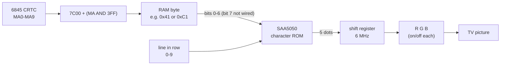
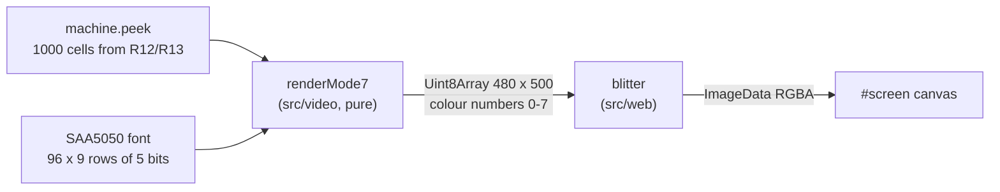

# Stage 31: Teletext font & canvas

> **Part:** 6 (Mode 7 on screen) · **Branch:** `stage/31-teletext-font` · **Needs:** 30
> **Status:** done

## Goal

Draw MODE 7 **as dots on the canvas**, the way the BBC's teletext chip does, in place of Stage 30's text grid. That takes three things:

1. **The font.** The SAA5050's 96 character shapes, transcribed dot by dot from the character table in its datasheet.
2. **A pure renderer.** Screen memory goes in and a 480 × 500 buffer of colour numbers comes out. It has no DOM, so Jest can test it pixel by pixel.
3. **A blitter.** It copies that buffer onto the `#screen` canvas 50 times a second.

This stage only draws **white characters on black**. Colours, mosaic graphics, double height and flashing are control codes (Stages 32 and 33). Here they show as blank cells, as they did in Stage 30's text.

It comes now because Stage 30 gave us a machine that runs in real time and an address for every cell. What's left is turning each byte into the right dots.

## What you can now see

```bash
npm run dev
# open http://localhost:5173/?machine=mos   (needs roms/os12.rom and roms/basic2.rom)
```

The boot screen is drawn **in teletext dots** on the canvas. It's the chunky, slightly rounded-looking font a real BBC shows in MODE 7, and it's no longer the browser's monospace font:


(Screenshots are in `.playwright-mcp/`, which is gitignored. Run the steps to see them yourself.)

Things to try:

1. **The whole character set.** Paste this into the browser console. It pauses the machine and pokes codes &20-&7F into screen memory, 16 to a row:
   ```js
   workbench.pause(); for (let c = 0x20; c < 0x80; c++) { const i = c - 0x20; workbench.machine.poke(0x7c00 + 8*40 + Math.floor(i/16)*80 + 4 + (i%16)*2, c) } workbench.machine.runFrame(); workbench.pause()
   ```
   Compare it with the data sheet's Fig. 11. Look for `£` where ASCII has `#`, the arrows and `½` where ASCII has `[ \ ] ^`, `#` at &5F, the long dash at &60, `¼ ‖ ¾ ÷`, and the 5 × 7 block at &7F. Note also the lower case's real descenders.

   

2. **"Not quite ASCII", live.** Poke some ASCII text with a `#` in it into row 22, for example:
   ```js
   [...'"#" is a pound sign'].forEach((ch, k) => workbench.machine.poke(0x7c00 + 22*40 + 2 + k, ch.charCodeAt(0))); workbench.machine.runFrame()
   ```
   The `#` comes out as **£**. (Poking a real `£` gives &A3, and bit 7 is dropped, so that's &23: also £.)
3. **Bit 7 doesn't matter:** `workbench.machine.poke(0x7c00, 0xC1)` draws an `A` top-left.
4. **Control codes are blank** for now: `workbench.machine.poke(0x7c01, 0x81)` (alphanumeric red) just leaves a gap. Stage 32 makes it red.
5. **Select the screen** with the mouse and copy. You get the text, `£` included, from the transparent text layer.
6. **How long a frame takes to draw:** `workbench.screen.lastDrawMs`. It's about **1.3 ms** in Chromium on this machine (render + blit), out of a 20 ms frame.

In the terminal, look at the font itself, dot by dot:

```bash
npm run demo:font                # all 96, 8 to a line, as on the data sheet
npm run demo:font -- A g £ '&7F' # just these, with their row bytes
```

```
&41 A     &67 g     &23 £     &7F ■
······    ······    ······    ······
·  █      ·         ·  ██     ·█████
· █ █     ·         · █  █    ·█████
·█   █    · ████    · █       ·█████
·█   █    ·█   █    ·███      ·█████
·█████    ·█   █    · █       ·█████
·█   █    ·█   █    · █       ·█████
·█   █    · ████    ·█████    ·█████
·         ·    █    ·         ·
·         · ███     ·         ·

&41 A: &04 &0A &11 &11 &1F &11 &11 &00 &00   (bit 4 = leftmost dot)
&67 g: &00 &00 &0F &11 &11 &11 &0F &01 &0E   (bit 4 = leftmost dot)
&23 £: &06 &09 &08 &1C &08 &08 &1F &00 &00   (bit 4 = leftmost dot)
&7F ■: &1F &1F &1F &1F &1F &1F &1F &00 &00   (bit 4 = leftmost dot)
```

The `·` marks the cell's gap column and gap line. The playground (`/`) draws its "HELLO, BBC MICRO" in dots too.

## The real hardware

### The SAA5050 teletext character generator

MODE 7 doesn't use the Video ULA's pixel logic at all. The Model B has a separate chip for it: the **Mullard SAA5050**, a teletext character generator. It's the same chip that drew Ceefax pages on 1980s televisions, and that's why MODE 7 looks like Ceefax. (Signetics/Philips data sheet "Teletext character generator SAA5050/55", Fig. 1 block diagram.)

Inside it there are:

- **A character ROM**, holding the dot pattern of each of the 96 characters.
- **A graphics generator** for the 64 mosaic blocks (Stage 32).
- **Control-character logic** that remembers colours and modes along a row (Stages 32 and 33).
- **Character rounding** (Stage 33).
- **A parallel-to-serial converter.** This shift register sends the dots out one at a time.
- **Three outputs, R, G and B**, each just on or off. That gives 8 colours.

Its clocks, from the datasheet's timing table:

| Signal | Rate | Meaning |
|---|---|---|
| **F1** | 1 MHz | Character clock. A new character code is latched every 1 µs. |
| **TR6** | 6 MHz | Dot clock. 6 dots per character. |
| Display period | 40 µs | 40 characters × 1 µs. |
| Line period | 64 µs | One TV line (the 6845's R0 = &3F, Stage 30). |

So a teletext row of text is **40 characters × 6 dots = 240 dots across**.

### How a byte reaches it

```
6845 address (MA) → &7C00 + (MA AND &3FF) → RAM byte → SAA5050 D1-D7 → dots
```

The first arrow is Stage 30's address translation. The new part is the last step:

- The SAA5050 has **7 data inputs, D1-D7** (Fig. 1). The RAM byte has 8 bits, and **bit 7 isn't used**. So &41 and &C1 both show as `A`.
- That's why the BBC's teletext colour codes are written &81, &82 and so on (Stage 32). With bit 7 dropped they arrive at the SAA5050 as &01, &02: the control codes in columns 0 and 1 of the datasheet's Table 1.

### The character cell: a 5 × 9 dot matrix in a 6 × 10 cell

Each character is drawn in a **cell 6 dots wide and 10 TV lines high** (datasheet Fig. 10). Inside it, the character ROM defines a **5 × 9 dot matrix** (Fig. 11). The spare column and line are background, and they're what keeps neighbouring characters apart.

- **Capitals and digits** are 7 lines high (matrix lines 0-6), like the 5 × 7 fonts of the time.
- **Lower case** has a 5-line body (lines 2-6). **Descenders** (`g j p q y`) use the last two matrix lines, 7 and 8. A 5 × 7 font can't do that, which is why teletext lower case looks better than most 1970s terminals.
- **&7F** is a solid 5 × 7 block, not a full cell (Fig. 11's 7/15). A full-cell block is a *mosaic* character (Stage 32).

**Which column and line are the spare ones?** The datasheet doesn't say in words. Two clues point the same way, so we take them, but this is our reading, not a quote:

- **Column: the spare one is on the left.** The timing table gives the delay from character in to dots out as **2.6 µs for graphics** and **2.767 µs for alphanumerics**. The difference is 0.167 µs, exactly **one dot at 6 MHz**. A mosaic block fills all 6 columns, so letters come out one dot later than it: the blank column comes first.
- **Line: the spare one is the top line.** Fig. 10 draws the full block (&7F) with about one line of background above it and more below. That fits matrix lines 1-9 of the cell, with line 0 blank.

So in our cell, **dots are columns 1-5 and lines 1-9**, and column 0 and line 0 are always background for a letter.

### 10 lines, or 20?

The SAA5050 counts **10 lines per character row**, so 25 rows × 10 = 250 lines per **field**. MODE 7 is the BBC's only **interlaced** mode (the 6845's R8 = &93, Stage 30). The second field's lines fall **between** the first field's, so the whole picture has 25 × 20 = **500 lines**.

Without character rounding, both fields draw the same dot line. So every matrix line is simply **2 picture lines tall**. Stage 33's rounding is the reason the two fields differ: on the second field the chip fills in half-dots on diagonals.

### The character set: "not quite ASCII"

Most of the 96 codes are ASCII, but the SAA5050 (English version) replaces some (Table 1 and Fig. 11):

| Code | ASCII | SAA5050 |
|---|---|---|
| &23 | `#` | **£** |
| &5B | `[` | **←** |
| &5C | `\` | **½** |
| &5D | `]` | **→** |
| &5E | `^` | **↑** |
| &5F | `_` | **#** |
| &60 | `` ` `` | **―** (a long dash) |
| &7B | `{` | **¼** |
| &7C | `\|` | **‖** (double bar) |
| &7D | `}` | **¾** |
| &7E | `~` | **÷** |
| &7F | DEL | **■** (a block) |

This is a British teletext chip, so `£` gets the ASCII `#` code. On a BBC in MODE 7, `PRINT "#"` shows **£**, and `PRINT "_"` shows **#**. Other countries' versions of the chip (the SAA5051 German, 5052 Swedish and so on) swap a different set of codes.

### Sizes on screen

| | Dots | Our pixels |
|---|---|---|
| One dot | 1 × 1 line | **2 × 2** |
| One cell | 6 × 10 | 12 × 20 |
| The screen | 240 × 250 per field | **480 × 500** |

Why **2 pixels per dot across**? Stage 33's rounding works in **half dots**, so we leave room for it now. Why **2 down**? Because the picture is interlaced: 2 lines per dot line, as above. 480 × 500 is the usual way to describe the SAA5050's resolution ("480 × 500 pixels, 12 × 20 per character").

## Key concepts

### A font is just a lookup table

The SAA5050's ROM is addressed by **(character code, line number)** and gives back **5 bits**, one per dot. We store it the same way: 9 rows per character, each a number &00-&1F, with **bit 4 the leftmost dot**.

Worked example: `A` (&41), from Fig. 11's 4/1:

```
line  dots    bits    value
 0    ..#..   00100   &04
 1    .#.#.   01010   &0A
 2    #...#   10001   &11
 3    #...#   10001   &11
 4    #####   11111   &1F
 5    #...#   10001   &11
 6    #...#   10001   &11
 7    .....   00000   &00
 8    .....   00000   &00
```

To draw line 4 of an `A`, look up `&1F`, then send its bits out left to right: dot, dot, dot, dot, dot. To draw line 0, look up `&04`: background, background, **dot**, background, background. The SAA5050's shift register does exactly that, 6 million dots a second. We do it in a loop.

### Placing a dot: from (row, column, line, bit) to a pixel

For the cell at text row `r` and column `c`, matrix line `l` and dot `d` (0 = leftmost):

```
x = c × 12 + (1 + d) × 2          (+1: the blank column; ×2: half-dots)
y = r × 20 + (1 + l) × 2          (+1: the blank line;   ×2: both fields)
```

That's a 2 × 2 square. So the top dot of the `A` in the top-left cell (line 0, dot 2) is the square at **x = 6-7, y = 2-3**.

### Pure renderer, separate blitter

The renderer is the part worth testing, so it doesn't know about canvases. It fills a `Uint8Array` with one **colour number** per pixel. The colour numbers are the BBC's physical colours (bit 0 red, bit 1 green, bit 2 blue). That's exactly what the SAA5050's R, G and B pins put out: 0 is black, 7 is white. This stage only ever writes 0 and 7, and Stage 32 will use the rest.

The browser side turns colour numbers into RGBA pixels for an `ImageData` and puts them on the canvas. Keeping the two apart means Jest can check "the dot at (6, 2) is white" without a browser.

## Diagrams

The real path, from one byte to dots on the TV:



One cell, with an `A` in it (column 0 and line 0 are the gap):

```
        column → 0 1 2 3 4 5
 line 0          . . . . . .      ← gap line
 line 1          . . . # . .      matrix line 0
 line 2          . . # . # .
 line 3          . # . . . #
 line 4          . # . . . #
 line 5          . # # # # #
 line 6          . # . . . #
 line 7          . # . . . #      matrix line 6 (capitals end here)
 line 8          . . . . . .      matrix lines 7-8: descenders only
 line 9          . . . . . .
                 ↑ gap column
```

Our version of the same path:



## Our design

### `src/video/saa5050-font.ts`: the font

The glyphs are written as **pictures**, 8 characters side by side, in the same order as the datasheet (&20-&27, &28-&2F, ...). A row of `#` and `.` is much easier to check against Fig. 11 than a row of hex bytes:

```ts
// &40-&47
`.###. ..#.. ####. .###. ####. ##### ##### .###.
 #...# .#.#. #...# #...# #...# #.... #.... #...#
 ...`
```

They're parsed **once, when the module loads**, into a `Uint8Array` of 128 × 9 rows. Codes &00-&1F are all zeros (the control codes are blank). The rest of the code reads it through two small functions:

```ts
export const GLYPH_ROWS = 9;    // matrix lines (Fig. 11)
export const GLYPH_COLUMNS = 5; // dots per line
/** The 5 dots of one matrix line of a character (bit 4 = leftmost). Bit 7 of code is ignored. */
export function glyphRow(code: number, line: number): number;
/** The character a code shows, as Unicode: &23 is '£', &5F is '#'. */
export function teletextCharacter(code: number): string;
```

`teletextCharacter` lets the hidden text layer (below) say `£` where the screen shows `£`.

**How the glyphs were transcribed.** We rendered the datasheet's Fig. 11 at high resolution and had a small throwaway script find each character's box and sample the middle of each of its 5 × 9 squares. Every square came out clearly black or clearly white, with nothing in between. Then we checked the arrows, the fractions, `£`, `÷` and the block by eye against the scan. So the data comes from the datasheet. It isn't a ROM dump, and it isn't copied from an emulator.

### `src/video/mode7-renderer.ts`: memory to pixels

```ts
export const MODE7_PIXEL_WIDTH = 480;   // 40 cells × 12
export const MODE7_PIXEL_HEIGHT = 500;  // 25 rows × 20
/** Draws the 1,000 cells from start into pixels (one colour number per pixel). */
export function renderMode7(peek: (address: number) => number, start: number, pixels: Uint8Array): void;
```

- It reads the cells through `mode7CellAddress` (Stage 30), so scrolling and wrapping just work.
- It writes into a buffer the caller owns, and allocates nothing per frame. The rendering isn't the CPU hot path, but it runs 50 times a second, and the same rule keeps it cheap.
- Control codes (&00-&1F after dropping bit 7) draw as blank cells for now.

### `src/web/screen-canvas.ts`: pixels to canvas

- It keeps one `ImageData` and a `Uint32Array` view of its bytes.
- It has an 8-entry palette of RGBA words, so each pixel is one array write.
- It ends with `putImageData`. The canvas becomes **480 × 500**, and CSS stretches it to the frame's 5:4 shape with `image-rendering: pixelated`, so the dots stay sharp.

### The text grid stays, invisible

Stage 30's text grid keeps its job as the screen's **accessible text**. It's transparent now, so you see the canvas, but:
- screen readers and Playwright can still read the screen;
- you can still select the screen and copy it as text;
- the e2e tests from Stage 30 keep working.

It now uses `teletextCharacter`, so its `#` becomes `£` like the dots.

**Alternatives considered.**
- **Draw text with a teletext web font.** It's quicker to build, but it would teach nothing about dot matrices, and Stages 32-33 need control at the dot level.
- **Render straight into RGBA in the core.** That would tie the core to a browser pixel format (and its byte order). Colour numbers are what the chip outputs, and they make tests read naturally ("this pixel is 7").

## Code walkthrough

### [`src/video/saa5050-font.ts`](../../src/video/saa5050-font.ts)

- **`PICTURES`** is 12 blocks of 8 characters, each 9 lines of `#`/`.`. That's the transcription itself, in the data sheet's order (&20-&27, &28-&2F, ...), so you can lay it beside Fig. 11.
- **`buildGlyphs()`** runs once, at module load. It turns each picture into a 5-bit number per line (`#..#.` → `10010` → &12) and stores it at `code × 9 + line` in a 128 × 9 `Uint8Array`. Codes &00-&1F stay zero. It throws if a block has the wrong shape, so a typo in the pictures fails every test at once and can't slip through.
- **`glyphRow(code, line)`** masks the code with `& 0x7f` (the chip's D1-D7) and reads the table. This is the one function the renderer needs.
- **`teletextCharacter(code)`**: a control code → space, one of the 12 swapped codes → its symbol from `NOT_ASCII`, anything else → ASCII.

### [`src/video/mode7-renderer.ts`](../../src/video/mode7-renderer.ts)

- **`renderMode7`** walks the 25 × 40 cells. It gets each cell's address from Stage 30's `mode7CellAddress(start, n)`, so scrolling and wrapping come for free.
- **`drawCell`** does the shift register's job for one cell:
  - For each of the 10 lines it picks a line of dots. Line 0 is the gap, so it's always 0. Lines 1-9 are `glyphRow(code, line - 1)`.
  - For each of the 6 dots, `(dots >> (5 - dot)) & 1` tests the bit. Dot 1 is bit 4, the leftmost, and dot 0 is the gap.
  - Each dot is written as a 2 × 2 square.
- **Every pixel is written every time**, black included, so there's no "clear the screen first" step and nothing is left over from the last frame.
- Nothing is allocated per frame. The `peek` function and the buffer come from the caller.

### [`src/web/screen-canvas.ts`](../../src/web/screen-canvas.ts)

- It makes the `ImageData` and an 8-word palette **once**.
- **The byte-order detail.** `ImageData` stores bytes as R, G, B, A. A `Uint32Array` over them reads 4 bytes as one number in the machine's byte order, which is little-endian on every PC and phone. So white with full alpha is the word `0xFFFFFFFF`, and pure red is `0xFF0000FF`: A, B, G, R from the top byte down. `paletteWords` checks the byte order rather than assuming it.
- **`draw`** = render + palette lookup + `putImageData`. It also times itself (`lastDrawMs`).

### [`src/web/text-screen.ts`](../../src/web/text-screen.ts), [`src/video/mode7-text.ts`](../../src/video/mode7-text.ts)

- Both now show **`teletextCharacter`**, so the text agrees with the dots (`£`, `■`).
- `mode7DisplayCode` is gone: `teletextCharacter` replaces it.
- The text grid is `color: transparent` in [`index.html`](../../index.html).

### [`src/main.ts`](../../src/main.ts)

- `drawScreen()` works out the start address once, then draws the canvas and the text layer from it.
- The canvas lookup uses `instanceof HTMLCanvasElement`, so no cast is needed.
- `workbench.screen` exposes `lastDrawMs` in the console.

### [`index.html`](../../index.html)

- `#screen` is 480 × 500, with `aspect-ratio: 5 / 4` and `image-rendering: pixelated`.

## Tests

| Test file | What it proves |
|---|---|
| [`src/video/saa5050-font.test.ts`](../../src/video/saa5050-font.test.ts) | Every glyph fits 5 bits × 9 lines. Every printable code has dots except space, and the control codes have none. `A` is exactly &04 &0A &11 &11 &1F &11 &11 &00 &00. Bit 7 is ignored. Capitals and digits are 7 lines with nothing below. **Only** `g j p q y , ; ½ ¼ ¾` use lines 7-8. `g`'s tail. `£` at &23 and `#` at &5F. &7F is a 5 × 7 block. Minus vs long dash. **Symmetrical characters are their own mirror image** (25 of them: an independent check on the transcription). `teletextCharacter`'s 12 swaps, control codes and bit 7. |
| [`src/video/mode7-renderer.test.ts`](../../src/video/mode7-renderer.test.ts) | The screen is 480 × 500. Spaces are all black. An `A` matches the font, with a blank column 0 and line 0. A dot is a 2 × 2 square (and its neighbours aren't lit). The bottom-right cell lands at (468, 480). &C1 = &41. Control codes are blank. &23 draws `£`. It follows the start address and wraps at &8000 → &7C00. Every pixel is redrawn. |
| [`src/video/mode7-text.test.ts`](../../src/video/mode7-text.test.ts) | Updated: &23, &5F and &7F read as `£#■`. |
| [`e2e/boot.spec.ts`](../../e2e/boot.spec.ts) | The real boot's canvas has no white in row 0 (the MOS's blank first line), dots in row 1 ("BBC Computer 32K") and row 5 (`>`). The playground's `H` is lit at (2, 2), (3, 3) and (10, 2), with the gap column, the gap line and the dot between its legs black. |

The MOS boot e2e test skips if `roms/` is missing. The playground one always runs.

## Gotchas & hardware quirks

- **`£` is &23.** It's the commonest MODE 7 surprise. ASCII `#` shows as `£`, and `_` (&5F) shows as `#`.
- **&7F is a 5 × 7 block, not a full cell.** For a solid cell you need a mosaic graphics character (Stage 32).
- **Bit 7 is invisible** to the SAA5050, so &C1 is `A`. The MOS's teletext colour codes are &81-&87 only because BBC BASIC users type `CHR$129`. The chip sees &01.
- **The gap column is on the left and the gap line on top.** This is our reading of the data sheet (the 0.167 µs alphanumeric delay, Fig. 10's drawing), not a sentence in it. If it's wrong, every character is one dot off, which you'd only see next to mosaic graphics (Stage 32). We didn't check it against another emulator.
- **No cursor.** The flashing cursor under the `>` isn't the SAA5050's: on the BBC it comes from the 6845's cursor output, through the Video ULA. Stage 39 draws it.
- **No colour, mosaics, flash, double height or rounding** (Stages 32-33). Our two fields are identical, so each dot line is simply doubled.
- **Our 480 × 500 is shown at 5:4**, the same shape as the 640 × 512 picture the bitmap modes will use. A real TV's visible area, and where MODE 7 sits inside it compared with the other modes, are a little different. The 6845 stages (37-39) settle the screen's geometry.
- **We redraw the whole screen every BBC frame (≈1.3 ms).** It would be cheaper to redraw only changed cells, but flashing (Stage 33) changes cells without changing memory, so a full redraw is simpler and fast enough.
- **The text layer is still built** (one text node per row, only changed rows rewritten, as in Stage 30). It costs almost nothing at the prompt.

## Playwright verification

- **MCP**:
  - On `/?machine=mos` the boot screen showed in teletext dots. Screenshot: `.playwright-mcp/stage31-boot.png`.
  - With all 96 codes poked into screen memory, the result matched Fig. 11. Screenshot: `.playwright-mcp/stage31-charset.png`.
  - Timed 20 draws: median **1.30 ms**, max 2.70 ms.
- **Durable** (`e2e/boot.spec.ts`), which reads canvas pixels with `getImageData`:
  - the MOS boot has dots in rows 1 and 5 and none in row 0;
  - the playground's `H` has its dots at the exact coordinates, with the gap column, the gap line and the dot between its legs black.
- The full e2e suite passes (106 tests).

## Check your understanding

1. Screen memory holds &A3 at &7C00. What does the top-left cell show, and why?
2. Which pixels (x, y ranges) does the top dot of an `A` in text row 2, column 3 cover?
3. Why are capitals only 7 lines high when the matrix has 9?
4. The data sheet gives 2.6 µs for graphics and 2.767 µs for alphanumerics, from code in to dots out. What does that difference tell us about the cell?
5. Why does the renderer produce colour numbers 0-7 and not RGBA? Give two reasons.

<details>
<summary>Answers</summary>

1. **£.** The SAA5050 has 7 data inputs, so bit 7 is dropped: &A3 → &23. In the English set &23 is the pound sign, not `#`. (It's a coincidence that &A3 is also £ in Latin-1.)
2. Cell (row 2, column 3) starts at x = 3 × 12 = 36, y = 2 × 20 = 40. The `A`'s top dot is matrix line 0, dot 2. That's cell line 1 (after the gap line) and cell dot 3 (after the gap column), so x = 36 + 3 × 2 = **42-43** and y = 40 + 1 × 2 = **42-43**.
3. Lines 7 and 8 are kept for **descenders** (`g j p q y`, and `,` `;` `½` `¼` `¾`). Capitals sit on the baseline at line 6, and lower case has a 5-line body from line 2 to 6.
4. 0.167 µs is **one dot at 6 MHz**. Letters come out one dot later than mosaic blocks, so the blank gap column is the **first** (left) column of the 6-dot cell. A mosaic block fills all 6 columns from the cell's left edge.
5. (a) It's what the hardware outputs: the SAA5050's R, G and B pins are one bit each, so 0-7 is the honest model. (b) It keeps the core free of browser details like `ImageData`'s byte order, and tests can say "this pixel is 7". The web layer turns numbers into RGBA in one table lookup.

</details>

## Further reading

- Signetics/Philips, *Teletext character generator SAA5050/55* data sheet: Fig. 1 (block diagram), the timing table (TR6 6 MHz, F1 1 MHz, t<sub>CDG</sub>/t<sub>CDA</sub>), Fig. 10 (character format), Table 1 (character codes), **Fig. 11 (the English character set: our source)**. The copy used: <http://www.elektronikjk.com/elementy_czynne/IC/SAA5050.pdf>.
- *BBC Microcomputer Advanced User Guide*, the MODE 7 / teletext chapter (control codes, the &7C00 screen).
- Wikipedia, "Mullard SAA5050": its history, and the 480 × 500 / 12 × 20 figures.
- BeebWiki, "MODE 7" and "SAA5050".
