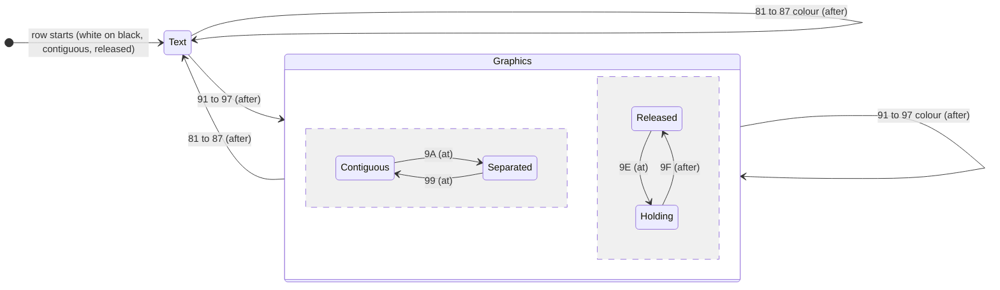
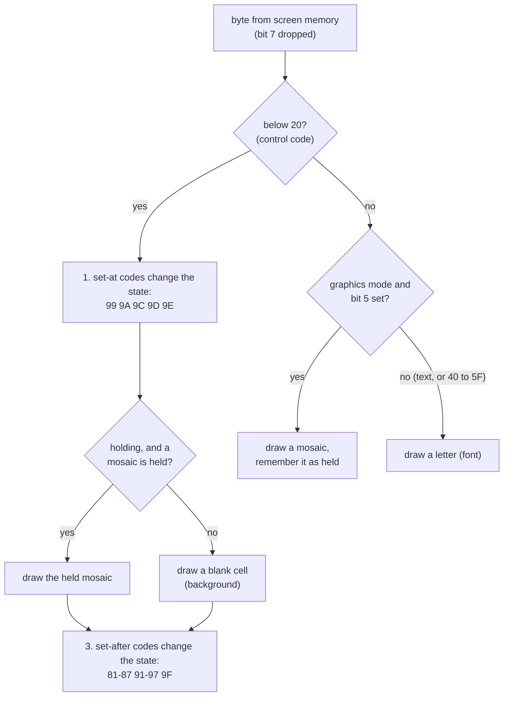

# Stage 32: Teletext colours & graphics

> **Part:** 6 (Mode 7 on screen) · **Branch:** `stage/32-teletext-colour-graphics` · **Needs:** 31
> **Status:** done

## Goal

Give MODE 7 its **colours and its chunky block graphics**. Stage 31 drew every control code (&80-&9F) as a blank cell. Now they mean something: "red text from here", "blue background from here", "graphics from here", "separated graphics", "hold graphics". The renderer gains an **attribute state machine** that walks along each row, one cell at a time, the way the SAA5050 does.

Double height, flashing and conceal are also control codes, but they're Stage 33. Here they're recognised and drawn as blank cells, and they change nothing else.

It comes now because Stage 31 gave us the dots. Colours and graphics are the next layer on top of the same cell: *what colour* each dot is, and *which dots* a graphics character lights.

## What you can now see

```bash
npm run dev
# open http://localhost:5173/?machine=mos   (needs roms/os12.rom and roms/basic2.rom)
# wait for the > prompt, then press **Test page** under the screen
```

The machine pauses and 1,000 bytes of teletext are poked into screen memory. The page shows every colour, both backgrounds, all 64 sixels contiguous and separated, blast-through capitals, and hold graphics with and without:


(Screenshots are in `.playwright-mcp/`, which is gitignored. Run the steps to see them yourself.)

Things to look at:

1. **The title bar** (row 0) is `&84 &9D &83`: blue, new background, yellow. The first cell is black (the &84 is set-after, so it's still white on black), and the blue starts in the &9D cell itself (set-at).
2. **"White on red"** (row 6) ends with `&9C`, and the black starts in that cell.
3. **Graphics colour bars** (rows 10 and 11). Each bar has a one-cell black gap before it: that's the colour code's cell. The separated row has a black grid between the blocks.
4. **All 64 sixels** (rows 14-17), in code order. The first is &A0, a graphics space. Row 17 ends with `&99 &FF &FF`, back to contiguous.
5. **Hold graphics** (rows 22-24). Row 22 has a gap at each colour change. Row 23, with &9E, is one unbroken bar, where each colour-change cell repeats the block before it in the old colour. In row 24, the &9F cell still holds (set-after), and the gaps come back after it.
6. **Press Run.** The page stays, because the MOS only writes when it prints. **BREAK** clears it.
7. In the playground (`/`), the same page is in the console: `workbench.testPage()`.
8. **Try your own.** Paused, in the console:
   ```js
   workbench.pause(); [0x81, 0x9d, 0x83, ...'Hello', 0x9c, 0x96, 0x9a, 0xb5, 0xea, 0xff].forEach((b, i) => workbench.machine.poke(0x7c00 + 10 * 40 + i, typeof b === 'number' ? b : b.charCodeAt(0))); workbench.pause()
   ```
   (`...'Hello'` spreads the string into characters.) Row 10 becomes `Hello` in yellow on red, then a separated left column, right column and full block in cyan. (The second `workbench.pause()` is there to redraw the screen.)

In the terminal, the state machine one cell at a time:

```bash
npm run demo:teletext            # the page in ANSI colour, then rows 6 and 23 traced
npm run demo:teletext -- 24      # trace one row: hold, then release
```

```
Row 24, cell by cell (stops at the first trailing space):
cell byte  code (as text)        state before                 draws as                         state after
   0  &91  graphics red         txt white/black              blank in white/black             gfx red/black
   1  &9E  hold graphics        gfx red/black                blank in red/black               gfx red/black hold
   2  &FF  '■'                  gfx red/black hold           mosaic &7F █ in red/black
   3  &92  graphics green       gfx red/black hold           mosaic &7F █ in red/black        gfx green/black hold
   4  &FF  '■'                  gfx green/black hold         mosaic &7F █ in green/black
   5  &9F  release graphics     gfx green/black hold         mosaic &7F █ in green/black      gfx green/black
   6  &93  graphics yellow      gfx green/black              blank in green/black             gfx yellow/black
   7  &FF  '■'                  gfx yellow/black             mosaic &7F █ in yellow/black
   ...
```

Read cell 3. The state before is red, the cell draws the held block **in red**, and only *after* it does the state turn green. That's set-after and hold working together. The preview draws mosaics with Unicode block sextants, so your terminal font needs them (Unicode 13). If you see boxes, the trace is still exact.

## The real hardware

### Control codes are in the text

A teletext page has **no colour memory**. On the BBC, MODE 7 is just 1,000 bytes at &7C00, one per cell, the same as in Stage 31. So where does the colour come from?

From **control codes in the text itself**. The SAA5050's Table 1 gives columns 0 and 1 (codes &00-&1F) to 32 control characters. Each one sits in a cell of its own, **shows as a space**, and changes how the rest of the row is drawn. On the BBC you type them with bit 7 set (`CHR$129` for red), and the SAA5050 drops bit 7 (Stage 31), so &81 arrives as &01.

| Code (BBC) | Chip sees | Table 1 name | Effect | Stage |
|---|---|---|---|---|
| &80 | &00 | NUL | nothing (see below) | |
| &81-&87 | &01-&07 | Alpha⁽ⁿ⁾ Red … White | text in colour *n*, graphics off | **32** |
| &88 | &08 | Flash | | 33 |
| &89 | &09 | Steady | | 33 |
| &8A / &8B | &0A / &0B | End Box / Start Box | nothing on a BBC (they're for mixing text into a TV picture) | |
| &8C | &0C | Normal Height | | 33 |
| &8D | &0D | Double Height | | 33 |
| &8E / &8F | &0E / &0F | SO / SI | nothing (reserved) | |
| &90 | &10 | DLE | nothing (see below) | |
| &91-&97 | &11-&17 | Graphics Red … White | graphics in colour *n* | **32** |
| &98 | &18 | Conceal Display | | 33 |
| &99 | &19 | Contiguous Graphics | solid blocks | **32** |
| &9A | &1A | Separated Graphics | blocks with gaps | **32** |
| &9B | &1B | ESC | nothing (reserved) | |
| &9C | &1C | Black Background | background black | **32** |
| &9D | &1D | New Background | background = the current foreground colour | **32** |
| &9E | &1E | Hold Graphics | control cells repeat the last block | **32** |
| &9F | &1F | Release Graphics | control cells are spaces again | **32** |

The colour number *n* is just the bottom 3 bits: &81 → 1 red, &82 → 2 green, &83 → 3 yellow, &84 → 4 blue, &85 → 5 magenta, &86 → 6 cyan, &87 → 7 white. Those are **bit 0 red, bit 1 green, bit 2 blue**, the same as the SAA5050's R, G and B pins and the same as the BBC's physical colour numbers that Stage 31's renderer already uses. Yellow is red + green, cyan is green + blue. No translation table is needed.

**There's no "black text" and no "black graphics".** Code &00 (where Alpha Black would be) is `NUL` and &10 is `DLE`, both marked `*` in Table 1: "reserved for compatibility with other data codes". Black foreground arrived in later teletext levels, not in the SAA5050. So on a BBC, &80 and &90 do nothing except take up a cell.

### What the row starts with

Table 1 marks some codes `**`: "These control characters are presumed before each row begins." They are **Alpha White, Steady, End Box, Normal Height, Contiguous Graphics, Black Background and Release Graphics**. So every row starts as white text on black, contiguous, not held. Nothing carries over from the row above. That's why every coloured line on a Ceefax page starts with its own colour code.

The pin list says how the chip does it: **LOSE** (pin 26) "resets the internal control character flip-flops prior to the start of each display line". That's every **TV line**, not every row. The SAA5050 doesn't remember anything between lines: it reads the same 40 bytes again for each of a row's 10 lines, and works out the attributes again each time. We do the same per row, which gives the same answer (until double height, Stage 33).

### Set-at and set-after

A control code takes a cell. Does that cell already get the new attribute, or only the cells after it? The SAA5050 data sheet doesn't say in words. The rules come from the teletext broadcast specification the chip was built for (BBC/IBA/BREMA *Broadcast Teletext Specification*, 1976, carried into ETS 300 706 as "spacing attributes"):

- **Set-at** codes take effect **in their own cell**: Steady, Normal Height, Conceal, Contiguous, Separated, **Black Background, New Background, Hold Graphics**.
- **Set-after** codes take effect **from the next cell**: the Alpha colours, Flash, Double Height, the Graphics colours, **Release Graphics**.

You can see why with backgrounds. In `&81 &9D` (red, new background), the &9D cell is set-at, so the control cell itself is already red: the red bar starts right there. If New Background were set-after, every coloured bar would start with one black cell.

### Background colour

Each cell has two colours: the **foreground** (lit dots) and the **background** (every other dot, the gap column and gap line included). Fig. 10's key calls them "Display colour" and "Background colour".

- **New Background** (&9D) copies the current foreground colour into the background. There's no "background red" code. You say "red" and then "make that the background": `&81 &9D`. After it, the text is still red on red, so you normally follow it with another colour: `&81 &9D &87` is white on red.
- **Black Background** (&9C) sets the background back to black.

### Graphics mode and the 64 sixels

After a Graphics colour code (&91-&97), the codes &20-&3F and &60-&7F stop being letters and become **mosaic graphics**: Table 1's columns 2a, 3a, 6a and 7a. Each one is a 2 × 3 grid of blocks, sometimes called **sixels**. The data sheet's **Fig. 9** says which bit lights which block:

```
 b1 | b2        bit 0 | bit 1     top:    3 lines
 ---+---        ------+------
 b3 | b4        bit 2 | bit 3     middle: 4 lines
 ---+---        ------+------
 b5 | b7        bit 4 | bit 6     bottom: 3 lines
```

"For graphics characters b6 is always a '1'": that's bit 5 (&20), the bit that marks columns 2, 3, 6 and 7. So the bottom-right block is **bit 6**, not bit 5. It's the oddest thing about the layout and the easiest to get wrong.

Unlike a letter, a sixel **fills the whole 6 × 10 cell**, gap column and gap line included ("occupies the complete 6 × 10 dot matrix", Fig. 9). That's what lets blocks join up into solid shapes. The cell splits into:
- **columns**: left block dots 0-2, right block dots 3-5 (3 + 3);
- **lines**: top block lines 0-2, middle lines 3-6, bottom lines 7-9 (3 + 4 + 3, from the dashed lines in Fig. 10's contiguous drawing).

Worked examples (the bit pattern is bits 6-0):

| Code | Bits | Blocks lit |
|---|---|---|
| &A0 / &20 | 010 0000 | none (a graphics space) |
| &A1 / &21 | 010 0001 | top-left |
| &B5 / &35 | 011 0101 | top-left, middle-left, bottom-left (left column) |
| &EA / &6A | 110 1010 | top-right, middle-right, bottom-right (right column) |
| &B7 / &37 | 011 0111 | top-left, top-right, middle-left, bottom-left (Fig. 10's example "0110111") |
| &F7 / &77 | 111 0111 | all but middle-right |
| &FF / &7F | 111 1111 | all six: a solid cell |

### Blast-through capitals

Codes &40-&5F (columns 4 and 5) have no graphics version. In graphics mode they still draw **capital letters**, in the graphics colour: Fig. 10 calls them "blast-through alphanumerics". So you can write labels in the middle of graphics without leaving graphics mode, as long as they're capitals (and `@ [ \ ] ^ _`, which are `@ ← ½ → ↑ #` on this chip).

### Contiguous and separated

**Separated Graphics** (&9A) draws each block smaller, with background showing round it. Fig. 10 draws both versions. (The figure is turned on its side on the page, so it takes some care to read.) Measured from a high-resolution render of the figure:
- each block loses its **leftmost dot**: the left block lights dots 1-2, the right block dots 4-5;
- each block loses its **bottom line**: the top block lights lines 0-1, the middle 3-5, the bottom 7-8.

So the gaps are on the **left and bottom** of every block, which matches the letters (gap column on the left), but with gaps on the bottom where letters have theirs on top. **Contiguous Graphics** (&99) goes back to full blocks. Both are set-at.

### Hold graphics

Every control code takes a cell. In the middle of a graphics picture that's a problem. To change from red to yellow blocks you need a cell for &93, and that cell is a hole in the picture.

**Hold Graphics** (&9E) fixes it. While hold is on, a control code's cell shows **the last graphics character drawn** (the "held" character) instead of a space. So `&91 &9E &FF &FF &93 &FF &FF` is a bar of 2 red blocks, 1 more red block (the held &FF, in red because &93 is set-after), and then 2 yellow ones. There's no hole. **Release Graphics** (&9F, set-after) turns it off.

The details, again from the broadcast specification because the data sheet doesn't spell them out:
- The held character is the **last mosaic** drawn in this row. Blast-through capitals aren't mosaics, so they don't change it.
- It's **cleared to a space** at the start of every row, and when the row **changes between text and graphics** (and, in Stage 33, between normal and double height).
- It's drawn with the separated/contiguous setting **it was drawn with first**. This is how the later ETS 300 706 spells it out. We haven't found the SAA5050's own behaviour documented, so this is **our choice**, and it's flagged in the Gotchas.

## Key concepts

### Serial attributes: the screen is a little program

Most displays use **parallel attributes**: every cell has its own colour, stored beside the character (the Video ULA modes, Stage 40 onwards, use pixels instead). Teletext uses **serial attributes**: the colour is a *state*, and the codes along the row *change* it. A row is read like a tiny program, left to right:

```
cell:  0    1    2    3    4    5    6    7    8    9
byte:  &81  &9D  &87  'H'  'i'  &9C  &84  'B'  'B'  'C'
       red  new  white H    i   black blue  B    B    C
            bg               bg
fg:    7    1    1    7    7    7    7    4    4    4      (colour the cell is drawn in)
bg:    0    1    1    1    1    0    0    0    0    0
shows: ' '  ' '  ' '  H    i    ' '  ' '  B    B    C
```

Read the columns as "before this cell, the state was..., this cell draws as...". Cell 0's &81 is set-after, so cell 0 itself is still white on black (a black space), and cell 1 is the first red one. Cell 1's &9D is set-at, so cell 1 is drawn with the red background. Cell 2's &87 is set-after, so cell 2 is still red on red, and from cell 3 on it's white on red. Cell 5's &9C is set-at, so cell 5 is a black space. Cell 6's &84 makes blue text from cell 7.

The upside is that a page is still just 1,000 bytes. The downside is that **every attribute change costs a blank cell**, and that's why teletext pages have little gaps before every coloured word.

### One cell, three steps

That leads to a simple rule for each cell, which is the whole state machine:

1. **Set-at:** if the code is a set-at control, change the state now.
2. **Draw:** work out the cell from the state as it is now: its foreground, background, and whether it's a letter, a mosaic, a held mosaic or a space.
3. **Set-after:** if the code is a set-after control, change the state now, ready for the next cell.

No "pending" flags are needed: the order of the three steps *is* the set-at / set-after rule.

### What a cell can be

After step 2 every cell is one of three things:

| Cell is | When | Dots |
|---|---|---|
| **blank** | a control code (with hold off, or nothing held) | all background |
| **letter** | &20-&7F in text mode (a space is a letter with no dots); &40-&5F in graphics mode | the 5 × 9 font, from dot 1 and line 1 (Stage 31) |
| **mosaic** | &20-&3F and &60-&7F in graphics mode; a control code while holding | the sixels, over the whole 6 × 10 cell |

## Diagrams

The attribute state machine for one row (the parts Stage 32 builds). Each arrow is a control code. "at" and "after" say whether the cell itself changes.



Background is a separate piece of state, changed in either mode: &9D sets it to the foreground colour, &9C to black (both set-at).

What happens to one cell:



How a mosaic's bits map onto the 6 × 10 cell, contiguous (left) and separated (right), for &FF:

```
 dot  012345        dot  012345
 l0   ######        l0   .##.##
 l1   ######  top   l1   .##.##
 l2   ######        l2   ......   ← bottom line of the top blocks
 l3   ######        l3   .##.##
 l4   ######  mid   l4   .##.##
 l5   ######        l5   .##.##
 l6   ######        l6   ......
 l7   ######        l7   .##.##
 l8   ######  bot   l8   .##.##
 l9   ######        l9   ......
      bits 0,1 / 2,3 / 4,6       ↑ left dot of each block
```

## Our design

### `src/video/teletext-attributes.ts`: the state machine (new)

Pure and DOM-free. Control codes are named after Table 1:

```ts
export const TELETEXT = {
  ALPHA_RED: 0x01, /* … */ ALPHA_WHITE: 0x07,
  GRAPHICS_RED: 0x11, /* … */ GRAPHICS_WHITE: 0x17,
  CONTIGUOUS_GRAPHICS: 0x19, SEPARATED_GRAPHICS: 0x1a,
  BLACK_BACKGROUND: 0x1c, NEW_BACKGROUND: 0x1d,
  HOLD_GRAPHICS: 0x1e, RELEASE_GRAPHICS: 0x1f, /* … and the rest, for names */
} as const;

/** The row's attributes so far. Mutable: one per renderer, reset at each row. */
export interface TeletextState { foreground; background; graphics; separated; hold; heldCode; heldSeparated }

/** What one cell draws as. Filled in by decodeCell, so it can be reused for every cell. */
export interface TeletextCell { kind: 'blank' | 'letter' | 'mosaic'; code; foreground; background; separated }

export function createTeletextState(): TeletextState;
export function startRow(state: TeletextState): void;        // Table 1's ** defaults
export function decodeCell(state: TeletextState, byte: number, cell: TeletextCell): void; // the 3 steps
export function mosaicLine(code: number, separated: boolean, line: number): number;     // 6 dots of a sixel line
```

- **`decodeCell` writes into a cell object the caller owns**, so rendering 1,000 cells allocates nothing.
- `kind` is a string literal union. Literals cost nothing to assign (they're interned), and tests read naturally.
- `mosaicLine` returns the **6 dots** of one cell line (bit 5 = dot 0, the leftmost). Letters use the same 6-dot form: `glyphRow` gives 5 bits, so dot 0 (bit 5) is the gap for free.

### `src/video/mode7-renderer.ts`: colour and mosaics

`renderMode7` keeps its signature. For each row it calls `startRow`, and for each cell `decodeCell`. `drawCell` now takes the decoded cell:
- for each of the 10 lines it gets a 6-dot mask: 0 for blank, `glyphRow` (from line 1) for a letter, `mosaicLine` for a mosaic;
- each dot is `foreground` if lit, otherwise `background`.

The state and cell objects are made once per `renderMode7` call (2 objects per frame, not per cell).

### The text layer and `mode7Text`

The transparent text layer (Stage 31) must agree with the dots, and a mosaic is no longer the letter its code would be. So both go through `decodeCell` and `teletextCellText(cell)`:
- a letter is `teletextCharacter(code)`, as before;
- a mosaic is Unicode's **"block sextant"** characters (U+1FB00-U+1FB3B, from Unicode 13's *Symbols for Legacy Computing*, which were added for exactly this). Their numbering is the same 1-6 order as Fig. 9, so the mapping is arithmetic. 4 of the 64 patterns already existed and aren't repeated there: empty (space), full (█), left half (▌) and right half (▐);
- a blank is a space.

So copying a graphics screen gives you the blocks, and a screen reader is told *something* is there. `text-screen.ts` still rebuilds only rows whose bytes changed; it now rebuilds a whole row through the state machine, since one code changes the cells after it.

### A test page: `src/video/teletext-test-page.ts` (new)

A pure function that builds a 1,000-byte page of colour bars, backgrounds, all 64 sixels contiguous and separated, blast-through, and hold graphics with and without. Rows are written as lists of bytes and strings (`[0x81, 'Red', 0x82, 'Green']`), padded with spaces to 40 and checked not to overflow.

**Alternatives considered.**
- **A full-screen attribute map, worked out before drawing.** One pass to fill colour arrays for 1,000 cells, then a drawing pass. It's how you'd do parallel attributes, but serial attributes only ever need "the state so far", which is a few variables.
- **A table of 128 handler functions.** Neat, but most of the 32 codes do nothing yet, and a `switch` over named constants reads closer to Table 1.

## Code walkthrough

### [`src/video/teletext-attributes.ts`](../../src/video/teletext-attributes.ts) (new)

- **`TELETEXT`** names all 32 control codes after Table 1, bit 7 dropped. Stage 33's codes are named too, so the `switch` and the demo can refer to them.
- **`TeletextState`** is seven fields: foreground, background, graphics, separated, hold, and the held mosaic with its separated flag. **`startRow`** puts back Table 1's `**` defaults.
- **`decodeCell(state, byte, cell)`** is the whole state machine, in the three steps:
  1. a `switch` for the **set-at** codes (&99 &9A &9C &9D &9E);
  2. the cell: a control code is `blank`, or the held `mosaic` if holding something; a code with bit 5 set in graphics mode is a `mosaic` (and becomes the held one); anything else is a `letter`;
  3. the **set-after** codes: &81-&87 and &91-&97 set the foreground and the mode, and &9F releases.
- **`setGraphics`** is where a change between text and graphics clears the held mosaic. A change of graphics colour isn't a change of mode, so it doesn't.
- **`mosaicLine(code, separated, line)`** turns Fig. 9 into dots. It picks the block pair from the line (0-2, 3-6, 7-9), returns 0 on a separated gap line (2, 6, 9), and ORs in a left mask (`111000`, or `011000` separated) and a right mask (`000111` / `000011`).
- **`teletextCellText`** gives a letter's `teletextCharacter`, or a mosaic's **block sextant**: bit 6 is moved down next to bits 0-4 to make Unicode's 6-bit block number, and the 4 patterns Unicode had already are special cases.
- **`decodeRow`** allocates a cell per byte, for tests and the demo. The renderer never calls it.

### [`src/video/mode7-renderer.ts`](../../src/video/mode7-renderer.ts)

- **`renderMode7`** makes one state and one cell per frame, then for each row calls `startRow`, and for each cell `decodeCell`, then `drawCell`.
- **`cellLine`** gives the 6 lit dots for one line: `mosaicLine` for a mosaic; for a letter, `glyphRow` from line 1 (its 5 bits are dots 1-5, so the gap dot is never lit); nothing for a blank.
- **`drawCell`** writes `foreground` for a lit dot and `background` for the rest. It still writes every pixel, so the background fills the gap column and gap line too.

### [`src/video/mode7-text.ts`](../../src/video/mode7-text.ts), [`src/web/text-screen.ts`](../../src/web/text-screen.ts)

- Both now decode each row with `decodeCell` + `teletextCellText`, so the text layer shows `█` where the canvas has a block, and still `■` for &7F in text mode.
- `text-screen.ts` still compares each row's 40 bytes with what it last showed, and only rebuilds rows that changed.

### [`src/video/teletext-test-page.ts`](../../src/video/teletext-test-page.ts) (new)

- **`pageRow(parts)`** turns `[0x81, 'Red']` into 40 bytes. It throws on overflow, and on non-7-bit text: write `#` for £.
- `ROWS` is the page itself, readable as a listing. `eachColour(base, after)` makes the 7-colour bars.

### [`src/main.ts`](../../src/main.ts), [`src/web/run-controls.ts`](../../src/web/run-controls.ts)

- **`showTestPage()`** pauses, then pokes the page from the *current* start address (`mode7CellAddress`), so it fills the screen even after the MOS has scrolled.
- A **Test page** button in the run controls (MOS mode), and `workbench.testPage()` in the console (both modes).

### [`scripts/demo-teletext.ts`](../../scripts/demo-teletext.ts) (new)

- The page in 24-bit ANSI colour, one character per cell, and a per-cell trace (state before, what it drew, state after) of any rows.

## Tests

| Test file | What it proves |
|---|---|
| [`src/video/teletext-attributes.test.ts`](../../src/video/teletext-attributes.test.ts) | Colour codes carry the colour in bits 0-2. Row-start defaults. **Alpha colours are set-after** (the code cell is the old colour); &01 = &81; &80/&90 do nothing. **Backgrounds are set-at**: &81 &9D makes the &9D cell red; &9C; the doc's worked example, colour by colour; backgrounds in graphics mode. **Graphics**: &FF is a mosaic after &91; blast-through `A _ @`; &20-&3F and &60-&7F are mosaics; alpha codes leave graphics; &99/&9A are set-at. **Hold**: a gap without it; the control cell repeats the last mosaic in the old colour; last not first; &9F is set-after; capitals aren't held; text mode clears the held mosaic, a graphics colour change doesn't; a held mosaic keeps its separated setting; nothing carries into the next row. Stage 33 codes are blank. **`mosaicLine`**: &7F fills the cell; each of the 6 bits lights its 3-dot × 3/4/3-line block (bit 6 bottom-right); bit 5 lights nothing; Fig. 10's &37; separated gaps on the left and bottom; bit 7 ignored. **Sextant text**: the 4 special cases, and all 64 mosaics have different text. |
| [`src/video/mode7-renderer.test.ts`](../../src/video/mode7-renderer.test.ts) | New: red `A` on black with a black control cell; a blue background filling the gap column and gap line to the end of the row, and not the next row; a solid green mosaic over all 6 × 10 dots; separated &FF dot for dot; separated gaps in the background colour (yellow on blue); two mosaics join with no gap; blast-through in the graphics colour; hold filling a colour change. Each 2 × 2 square is checked to be one colour. |
| [`src/video/mode7-text.test.ts`](../../src/video/mode7-text.test.ts) | New: in graphics mode &7F reads `█` and &21 a sextant, a capital stays a letter, and the next row is text again (`■`). |
| [`src/video/teletext-test-page.test.ts`](../../src/video/teletext-test-page.test.ts) | `pageRow` pads, rejects 41 cells and `£`. The page is 1,000 bytes, uses all 20 Stage 32 codes, and shows all 64 sixels both ways. |
| [`e2e/teletext.spec.ts`](../../e2e/teletext.spec.ts) | In the playground (no ROMs needed), after `workbench.testPage()`, reading canvas pixels: the title's black/blue/yellow; set-after red; a mosaic covering the gap column and line; separated gaps; the hold gap there and not there; and the text layer's sextants. |

No new test needs ROMs.

## Gotchas & hardware quirks

- **The bottom-right sixel is bit 6, not bit 5.** Bit 5 is "this is a mosaic" (Fig. 9: "b6 is always a '1'", counting from b1).
- **Set-at vs set-after is the difference between a bar starting in the right cell or one cell late.** The data sheet doesn't list it. We took it from the teletext specification the chip implements.
- **There's no black foreground on the SAA5050.** &80 and &90 are NUL and DLE. Later teletext decoders treat them as alpha black and graphics black, so pages made for them look different on a BBC.
- **New Background takes the *foreground* colour.** To get white on red you need three codes: `&81 &9D &87`.
- **Separated gaps are on the left and bottom of each block.** We measured that from Fig. 10, which is drawn sideways. Letters have their gap line on *top*, so separated blocks and letters don't line up exactly, and that's what the hardware does.
- **The held mosaic keeps its own separated setting.** That's ETS 300 706's rule. The SAA5050 data sheet says nothing about it, and we haven't checked a real BBC. If a real SAA5050 redraws the held character in the *current* mode, only pages that switch &99/&9A while holding would look different.
- **Hold clears on a text ↔ graphics change, not on a graphics colour change.** Also from the specification. Stage 33 adds the third trigger, a change of height.
- **Stage 33's codes are blank but inert.** &88 (flash), &8D (double height) and &98 (conceal) take a cell and do nothing yet. So a MODE 7 game's double-height title shows as normal-height text, twice.
- **The text layer's sextants may be a different width** from the other characters in the browser's monospace font. The layer is transparent, so you only notice when selecting graphics rows.
- **The MOS keeps the screen.** After Test page, Run continues and the page stays until the MOS prints over it or scrolls it. That's real behaviour: MODE 7 is only bytes in RAM.

## Playwright verification

- **MCP**:
  - On `/?machine=mos`, after the boot, **Test page** showed the page in colour. Screenshot: `.playwright-mcp/stage32-test-page.png`.
  - A 2× crop of the canvas (rows 14-24) checked the sixels, separated gaps, blast-through, and the three hold rows, block by block. Screenshot: `.playwright-mcp/stage32-zoom.png`.
  - Timed 30 draws with the page on screen: median **1.10 ms** (Stage 31: 1.30 ms), so the state machine costs nothing noticeable.
- **Durable**: new [`e2e/teletext.spec.ts`](../../e2e/teletext.spec.ts) (5 tests, playground, no ROMs). The full e2e suite passes: **111 tests**.

## Check your understanding

1. Screen memory row 5 starts `&83 &9D &84 'S' 'K' 'Y'`. What colours are cells 0, 1, 2 and 3 (foreground and background)?
2. Why is there no "background red" control code, and what's the shortest way to get a red bar with nothing written on it?
3. Which code would you put in a cell to draw just the bottom-right block of a mosaic? And just the left column?
4. `&91 &FF &FF &94 &FF &FF` draws a red bar, a gap, then a blue bar. Where would you put &9E to close the gap, and what colour is the cell that fills it?
5. In graphics mode, why does `&91 'HELLO'` show letters but `&91 'hello'` doesn't?

<details>
<summary>Answers</summary>

1. Cell 0 (&83, set-after): still the row default, **white on black**, and blank. Cell 1 (&9D, set-at): yellow is now the foreground, so the background becomes **yellow**, giving yellow on yellow, blank. Cell 2 (&84, set-after): still **yellow on yellow**, blank. Cell 3 (`S`): **blue on yellow**.
2. New Background copies the foreground colour, so a background is "pick a colour, then make it the background". That's 2 cells and covers every colour with one code. The bar: `&81 &9D` then spaces. The bar starts in the &9D cell, and the spaces are red on red.
3. Bottom-right is bit 6, plus bit 5 for "mosaic": &60 (or &E0 with bit 7). The left column is bits 0, 2, 4 + bit 5: &35 (&B5).
4. Anywhere before the &94, e.g. `&91 &9E &FF &FF &94 &FF &FF` (it costs a cell of its own, so it's best put where a gap is already). The &94 cell then shows the held &FF in **red**, because &94 only takes effect after its own cell.
5. Codes &40-&5F (capitals) have no mosaic: bit 5 is clear, so they **blast through** as letters. Lower case is &60-&7F, which has bit 5 set, so in graphics mode those are mosaics. `h` (&68) is a block pattern.

</details>

## Further reading

- Signetics/Philips, *Teletext character generator SAA5050/55* data sheet: **Table 1** (control codes, `**` row defaults), **Fig. 9** (graphics character bits), **Fig. 10** (character format: contiguous, separated, blast-through), pin 26 LOSE (control flip-flops reset every line). The copy used: <http://www.elektronikjk.com/elementy_czynne/IC/SAA5050.pdf>.
- BBC/IBA/BREMA, *Broadcast Teletext Specification* (1976), and its successor **ETSI ETS 300 706**, §12.2 "spacing attributes": set-at / set-after, hold mosaics.
- *BBC Microcomputer Advanced User Guide*, the teletext (MODE 7) chapter: the &80-&9F codes as seen from BASIC.
- Unicode 13.0, *Symbols for Legacy Computing* (U+1FB00-U+1FBFF): the block sextants used for the text layer.
- BeebWiki, "Teletext" and "MODE 7".
