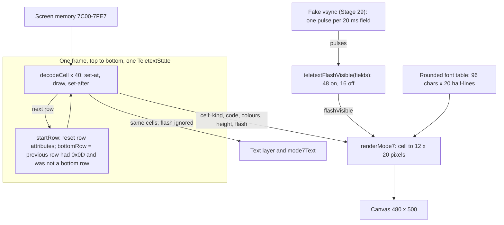
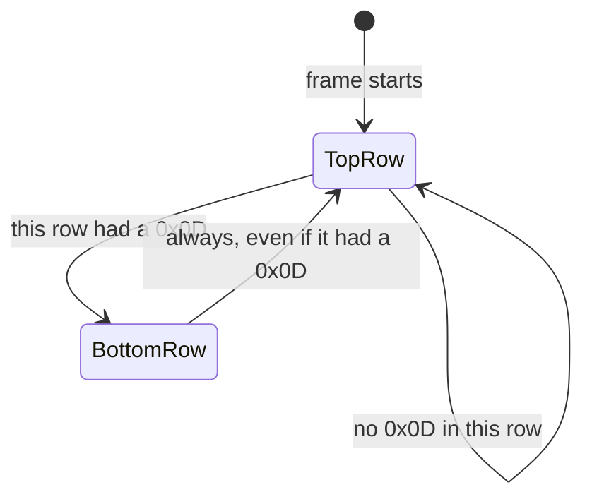
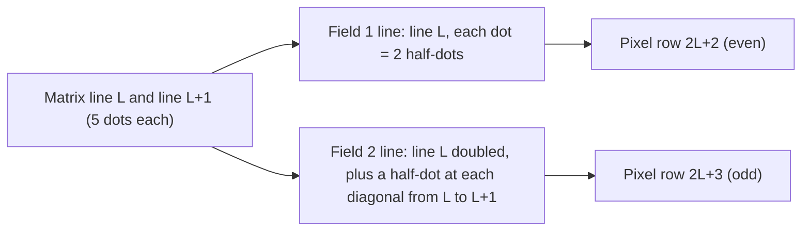

# Stage 33: Double height, flash & conceal

> **Part:** 6 (Mode 7 on screen) · **Branch:** `stage/33-teletext-double-height-flash` · **Needs:** 32
> **Status:** done

## Goal

Finish the SAA5050. Stage 32 gave the control codes their colours and graphics, but five codes still did nothing: **Flash** (&88), **Steady** (&89), **Normal Height** (&8C), **Double Height** (&8D) and **Conceal** (&98). This stage makes them work. It also adds the chip's **character rounding**, the trick that smooths the diagonals of letters using the half-dots between interlaced lines.

It comes now because it's the last of the teletext chip. After this, MODE 7 looks like a real BBC's, and Part 7 (the keyboard) can start typing into it.

## What you can now see

```bash
npm run dev
# open http://localhost:5173/?machine=mos   (needs roms/os12.rom and roms/basic2.rom)
# wait for the > prompt, then press **Test page** twice (page 1 is Stage 32's, page 2 is this stage's)
```

The machine keeps running (Stage 32's button paused; this one doesn't, because the flash needs vsyncs). Page 2 has a **double-height, flashing title** in yellow on blue:

| Flash on | Flash off |
|---|---|
|  |  |

(Screenshots are in `.playwright-mcp/`, which is gitignored. Run the steps to see them yourself.)

Things to look at:

1. **The title** (rows 0-1) is the same 40 bytes twice: `&84 &9D &83 &8D &88 Double height...`. It blinks: about a second on, a third of a second off. The blue bar stays during the off phase: only the dots go.
2. **Row 4-6:** "flashing" blinks between two steady words. "Blinks on red" leaves a red bar behind. Mosaics blink too.
3. **Rows 9-10:** `Normal Double Normal`, printed twice. The top row shows all three words; the bottom row only the bottom half of "Double": the normal-height words on a bottom row are hidden.
4. **Rows 14-15:** `HELLO` on the top row, `WORLD` on the bottom row. You get the top of HELLO on the bottom of WORLD (the chip can't see the row above), and two cells of magenta double-height blocks.
5. **Row 18:** "Answer:", then a gap where "Paris" is concealed, then "shown" (the &82 ended the conceal).
6. **Rows 21-22:** letters at double height, where the rounding is easy to see: the diagonals of A, M, V, W, X, Z, 2, 7 and s step by half a dot.
7. **Rows 23-24:** red blocks, held into the &8D cell (normal height, so only on the top row), then a space in the &92 cell because the height change cleared the held block.
8. **Pause** freezes the flash wherever it was (the SAA5050 counts vsyncs, and a paused machine has none).
9. In the playground (`/`), `workbench.testPage(2)` in the console shows the page, without flashing (its fake vsync is off).

In the terminal:

```bash
npm run demo:rounding             # A, V, Z, s: plain and rounded, at half-dot resolution
npm run demo:rounding -- Hello    # your own characters
npm run demo:teletext -- --page 2         # page 2 in ANSI colour (flash = terminal blink), then rows 9-10 traced
npm run demo:teletext -- --page 2 14 15   # the HELLO / WORLD pair
```

`demo:rounding` (an excerpt; `█` is a dot, `▒` a half-dot rounding added):

```
   A: plain       rounded
f1 ······██····  ······██····
f2 ······██····  ·····▒██▒···
f1 ····██··██··  ····██··██··
f2 ····██··██··  ···▒██··██▒·
f1 ··██······██  ··██······██
```

`demo:teletext -- --page 2 10` shows a bottom row: the normal-height `Normal` is `blank`, and `Double` is `letter ... bottom`:

```
Page 2, row 10 (a bottom row: the row above had an &8D), cell by cell ...
   1  &4E  'N'                  txt cyan/black               blank in cyan/black
   7  &8D  double height        txt cyan/black               blank in cyan/black                     txt cyan/black dbl
   8  &44  'D'                  txt cyan/black dbl           letter &44 D bottom in cyan/black
```

## The real hardware

### The five codes

| Code (BBC) | Chip sees | Table 1 name | Effect | Set-at or set-after |
|---|---|---|---|---|
| &88 | &08 | Flash | letters and mosaics from here blink | **after** |
| &89 | &09 | Steady | stop blinking | **at** |
| &8C | &0C | Normal Height | back to normal height | **at** |
| &8D | &0D | Double Height | letters and mosaics are twice as tall | **after** |
| &98 | &18 | Conceal Display | letters and mosaics from here are hidden | **at** |
| &8A / &8B | &0A / &0B | End Box / Start Box | nothing on a BBC | |

Table 1 marks **Steady** and **Normal Height** with `**`, "presumed before each row begins", so every row starts steady and normal height. Conceal isn't in the `**` list, but it ends at the end of the row like everything else (the LOSE pin resets the control flip-flops before every line), and an Alpha or Graphics colour code ends it earlier.

Which codes are set-at and which set-after is again from the teletext broadcast specification (BBC/IBA/BREMA 1976, carried into ETS 300 706 §12.2), not the data sheet. The pattern is the same as Stage 32's: codes that *turn something on* for the text after them are set-after; codes that *turn something off* (Steady, Normal Height) are set-at, so the change is clean at the control cell. Conceal is the odd one: set-at, so the control cell itself is hidden too (it was a space anyway).

**Box codes.** End Box and Start Box are for a TV: in "mixed" mode the set shows the TV picture everywhere except inside boxes, for subtitles and newsflashes. The SAA5050 tells the TV where the boxes are on a separate output. The BBC doesn't use it, so on a BBC they're just spaces. (Stage 32 already drew them as spaces; nothing changes.)

### Double height: the chip can't see the row above

On a teletext TV, a double-height row is sent once, and the decoder draws it across two rows, ignoring whatever the second row holds.

The SAA5050 can't do that. It isn't a decoder with a page store: it's a **character generator**, fed one row's 40 bytes at a time by whatever owns the memory (on the BBC, the 6845 reading &7C00 onwards). When it draws row 6 it has no way to look at row 5's bytes. So it does something simpler:

- While drawing a row, it notes whether any **Double Height** code appeared in it.
- If one did, the **next** row is a **bottom row**: on it, double-height characters show their **bottom halves**, from **that row's own bytes**.
- Normal-height characters on a bottom row are **not drawn** (they show as spaces, background colour only).
- A bottom row doesn't make the row after it a bottom row, even if it contains &8D itself. Rows pair up: top, bottom, then a fresh start.

So on a BBC you must **print double-height text twice**, on two consecutive rows:

```basic
10 MODE 7
20 PRINT CHR$141;"Hello"
30 PRINT CHR$141;"Hello"
```

`CHR$141` is &8D. Row 0 is a top row (top halves of `Hello`); row 1, because row 0 had an &8D, is a bottom row (bottom halves of its own `Hello`). If line 30 printed `World` instead, you'd get the top half of `Hello` stacked on the bottom half of `World`. It's the most famous BBC MODE 7 quirk, and it falls straight out of the chip not having a page store.

(How the chip knows "top" from "bottom" internally isn't documented in the data sheet we have. The pin list says LOSE resets the control flip-flops every TV line, so the "this row had double height" flag must be one that LOSE doesn't touch. We model the behaviour, not the flip-flops.)

**Hold graphics and height.** A change of height (normal ↔ double) clears the held mosaic to a space, just as a change between text and graphics does (ETS 300 706 §12.2; Stage 32's parking-lot item). Otherwise a held normal-height block would reappear at double height.

### Flash

Flashing characters alternate between being drawn and being **replaced by spaces**. Only the foreground goes: the background colour stays, so a flashing word on a red background blinks between text-on-red and plain red.

The flash is timed **inside the SAA5050**, not by the CPU or the MOS. The chip counts fields (it sees one vertical sync per 20 ms field). Our reading of the data sheet is **about 1 Hz, on for three quarters of the time and off for one quarter** (3:1). We count **64 fields per cycle: shown for 48, hidden for 16** (0.96 s on, 0.32 s off, 1.28 s in all). A 6-bit field counter whose top two bits both being 1 means "hidden" would give exactly that, which is the kind of thing a 1970s chip would do. **The 64 is our assumption**: we haven't found the exact count in the data sheet, and it's flagged in Gotchas.

This is a different flash from MODEs 0-6. There, the Video ULA flashes *colours* 8-15, timed by the MOS (`*FX9`/`*FX10`, Stage 40+). MODE 7's flash is all in the teletext chip, and the MOS has no say in it.

### Conceal

Concealed characters are drawn as **spaces** until the end of the row, or until an Alpha or Graphics colour code. On a TV it hid quiz answers until you pressed **Reveal** on the remote, which told the decoder to show them. The SAA5050 on the BBC has no reveal input wired to anything the CPU can change, so on a BBC **concealed text stays hidden**. (It's still in memory, so a program can read it with `?&7C00`.)

### Character rounding

A letter is a 5 × 9 dot matrix. Diagonals in a coarse matrix look like staircases. The SAA5050 smooths them, and it can because MODE 7 is **interlaced** (Stage 31): the second field's lines fall *between* the first field's. Each character line is drawn twice, once per field, so the chip has two TV lines per matrix line to play with.

In the first field, line *L* shows matrix line *L* as stored. In the second field the line *between* *L* and *L* + 1 shows matrix line *L* **plus extra half-dots wherever a diagonal crosses from line *L* to line *L* + 1**. A dot can be half as wide because the dot clock is 6 MHz and the chip can switch at 12 MHz half-dot edges (the "character rounding" description in the data sheet, and its rounded character illustration).

A diagonal is two dots that touch only at a corner:

```
line L:      . # .        line L:      . # .
line L + 1:  # . .        line L + 1:  . . #
             down-left                 down-right
```

The rule, for each pair of corner-touching dots where neither of the other two corners is lit: add the **half-dot of line *L*'s row that sits next to the lit dot, on the side the diagonal goes**. Worked through for `/` going down-left (dot 4 on line *L*, dot 3 on line *L* + 1), in half-dots (each dot is 2):

```
                  half-dots 0 1 2 3 4 5 6 7 8 9 10 11
field 1, line L             . . . . . . . . # # .  .     dot 4
field 2, between            . . . . . . . # # # .  .     dot 4 + half-dot 7
field 1, line L+1           . . . . . . # # . . .  .     dot 3
```

Instead of a 2-half-dot jump every 2 TV lines, the edge moves 1 half-dot every TV line. Rounding is for **letters only**. Mosaics are blocks that must line up with their neighbours, so they're never rounded.

**What we're not sure of.** The data sheet shows the effect (a rounded character), not the circuit. Our rule (second-field lines only, compared with the line below) is the simplest one that fills every corner exactly once and gives the picture's staircase. The real chip might compare in both directions or across both fields. It's flagged in Gotchas.

In double height, the same 20 half-lines of a character are stretched over two cells (40 of our pixel rows): each half-line becomes 2 pixel rows.

## Key concepts

### Two kinds of state: per row, and per pair of rows

Stage 32's state machine lived inside one row: Table 1's `**` defaults reset it at every row start. Double height adds the first piece of state that **crosses a row boundary**:

| State | Reset | Changed by |
|---|---|---|
| foreground, background, graphics, separated, hold, held mosaic | every row start | colour, background, graphics, hold codes |
| **flash, conceal, double height** | every row start | &88/&89, &98 (colour codes end it), &8C/&8D |
| **"this row had an &8D"** | every row start | any &8D in the row |
| **"this is a bottom row"** | worked out at each row start | the previous row's flag, unless the previous row was itself a bottom row |

So the renderer, the text layer and `mode7Text` must all decode the screen **top to bottom with one state**, not row by row in isolation. Stage 32's text layer cleverly re-decoded only rows whose bytes had changed. That breaks now: changing row 5 (adding an &8D) changes how row 6 draws, even though row 6's bytes didn't change.

### Three ways a cell can draw nothing

A cell that would draw a letter or a mosaic is drawn as a **space** (background only) if:

1. it's **concealed**;
2. it's **normal height on a bottom row**;
3. it's **flashing and the flash is in its "off" phase**.

The first two are fixed by the bytes, so the decoder decides them: the cell comes out `blank`. The third changes over time with no change to memory, so the decoder only marks the cell `flash: true` and the **renderer** decides, given the current flash phase. That keeps `decodeCell` a pure function of the bytes, which the text layer also uses. (The text layer shows flashing text all the time: it's for copying and screen readers, and blinking text there would be noise.)

### Worked example: a double-height, flashing title

The test page's first two rows are the same 40 bytes:

```
cell:  0    1    2    3    4    5    6    7   ...
byte:  &84  &9D  &83  &8D  &88  'D'  'o'  'u'  ...
       blue new  yel  dbl  flash D    o    u
            bg
fg:    7    4    4    3    3    3    3    3          (colour this cell is drawn in)
bg:    0    4    4    4    4    4    4    4
height:n    n    n    n    dbl  dbl  dbl  dbl         (&8D is set-after)
flash: -    -    -    -    -    yes  yes  yes         (&88 is set-after)
```

Row 0 has an &8D, so it's a top row and row 1 is a bottom row. Row 0 draws the top halves of "Double height...", row 1 the bottom halves. Both blink, 48 fields on, 16 off. Note the &88 cell itself (cell 4) is double height (the &8D was before it) but not flashing (set-after), and it's a space either way.

### Rounding is a property of the font, so precompute it

Rounding depends only on a character's own dots. There are 96 characters and 20 half-lines each, so all of it fits in a 1,920-entry table built once at start-up: `roundedLine(code, halfLine)` is then a single array read on the hot path. That's the same trick as the font itself (Stage 31 built `GLYPHS` once from the pictures).

## Diagrams

How a frame of MODE 7 is drawn now: one state walks the whole screen, row pairs come from the state, and the flash phase comes from the field count.



The row-pair rule as a state machine, decided at each row start:



What one character line looks like across the two fields, with rounding (our model: each matrix line *L* is drawn plain in field 1 and rounded in field 2, in the TV line just below):



## Our design

**`src/video/teletext-attributes.ts`** (Stage 32's state machine) grows:

```ts
export type TeletextHeight = 'normal' | 'top' | 'bottom';

export interface TeletextState {
  // ...Stage 32's fields...
  flash: boolean;
  conceal: boolean;
  doubleHeight: boolean;
  /** This row has had a Double Height code (decides whether the next row is a bottom row). */
  doubleHeightSeen: boolean;
  /** This row shows the bottom halves of double-height characters. */
  bottomRow: boolean;
}

export interface TeletextCell {
  // ...Stage 32's fields...
  /** Which part of the character to draw: a normal cell, or the top or bottom half of a double one. */
  height: TeletextHeight;
  /** Blinks: the renderer replaces it with a space in the flash's off phase. */
  flash: boolean;
}
```

- `startRow(state)` now also works out `bottomRow` from the previous row before resetting. A fresh state (`createTeletextState`) is the top of a page.
- `decodeCell` gains the five codes in their set-at / set-after steps. Conceal, and normal height on a bottom row, come out `kind: 'blank'`. A height change clears the held mosaic.
- `teletextFlashVisible(fields)`: the 48/16 rule, pure.

**`src/video/character-rounding.ts`** (new): `roundLine(line, below)` (the rule, on two 6-dot masks, giving a 12-half-dot mask) and `roundedGlyphLine(code, halfLine)`, a table built once from the font.

**`src/video/mode7-renderer.ts`**: `renderMode7(peek, start, pixels, flashVisible)`. Each cell is drawn as 20 pixel rows of 12 half-dots. For each pixel row it works out a **half-line** (0-19 of the character; for double height, the top or bottom 10 stretched ×2), then asks for that half-line's half-dots: from the rounded table for a letter, from `mosaicLine` doubled for a mosaic.

**Callers** that decoded rows one at a time (the text layer, `mode7Text`, the demo) now decode top to bottom with one state. The text layer drops its per-row byte cache: it builds all 25 row strings (cheap) and writes only those that changed (the DOM write is the expensive part).

**Where the flash phase comes from.** The SAA5050 counts fields, so the browser asks the machine's vsync for its pulse count: `teletextFlashVisible(machine.vsync.pulses)`. When the machine is paused, the flash freezes, as it would if you could freeze a real BBC. In the playground the fake vsync is off (Stage 29), so text stays in its "on" phase. The alternative, flashing by wall-clock time in the browser, would keep blinking while paused, but it would make the screen depend on something outside the machine.

**The test page** becomes two pages: Stage 32's (colours and graphics) and a new one for this stage. The **Test page** button and `workbench.testPage()` step through them; `workbench.testPage(2)` asks for one.

Alternatives considered:
- *Decide flash inside `decodeCell`* (pass the phase in). It would make the text layer blink and tie decoding to time. The renderer is the only part that cares.
- *Round on the fly* instead of a table. It's a dozen bit operations per pixel row; the table is simpler to test (one function, all 96 characters) and free at run time.
- *Copy the top row's bytes into the bottom row* to emulate a TV decoder. That's not what a BBC does: programs rely on printing twice.

## Code walkthrough

**[`src/video/teletext-attributes.ts`](../../src/video/teletext-attributes.ts)**: the state machine.
- `startRow` now starts with the one line that crosses rows: `state.bottomRow = state.doubleHeightSeen && !state.bottomRow`. Then it resets everything else, including the three new per-row attributes.
- `decodeCell`'s three steps gain the new codes. Set-at: `STEADY`, `NORMAL_HEIGHT`, `CONCEAL_DISPLAY`. Set-after: `FLASH`, `DOUBLE_HEIGHT` (which also sets `doubleHeightSeen`), and the colour codes now clear `conceal`.
- Between the steps, the cell gets `height` (`'top'`/`'bottom'` from `bottomRow`) and `flash`. After deciding letter/mosaic, one `if` blanks it when concealed or normal height on a bottom row. It's *after* the held-mosaic update on purpose: a concealed mosaic is still "drawn" as far as hold is concerned.
- `setDoubleHeight` mirrors Stage 32's `setGraphics`: a real change clears the held mosaic.
- `teletextFlashVisible(fields)` is one line: `fields % 64 < 48`.
- `decodeRows` (tests, CLI) decodes a page top to bottom; `decodeRow` is now "the top row of a page".

**[`src/video/character-rounding.ts`](../../src/video/character-rounding.ts)**: `roundLine` is the rule in four bit operations. `downLeft = line & (below >> 1) & ~(line >> 1) & ~below` reads "line has dot *i*, below has dot *i* − 1, and neither other corner is lit". A loop then sets one half-dot per corner. `buildRounded` runs it once over all 128 codes × 9 lines into a `Uint16Array`; `roundedGlyphLine` reads it.

**[`src/video/mode7-renderer.ts`](../../src/video/mode7-renderer.ts)**: `cellHalfDots(cell, y, flashVisible)` turns a pixel row into a half-line (`y`, `y >> 1`, or `10 + (y >> 1)`), then into 12 half-dots: the rounded table for a letter, `doubleDots(mosaicLine(..., halfLine >> 1))` for a mosaic. `drawCell` is now a plain 20 × 12 loop. The renderer now works at the resolution it always had (Stage 31 chose 2 × 2 pixels per dot for this stage).

**[`src/web/text-screen.ts`](../../src/web/text-screen.ts)**: decodes all 25 rows every frame with one state and writes a row's text node only if its string changed. Stage 32's per-cell byte cache is gone; it would have missed a row whose *previous* row gained an &8D.

**[`src/main.ts`](../../src/main.ts)**: `drawScreen` passes `teletextFlashVisible(machine.vsync.pulses)`. `showTestPage(page?)` no longer pauses, and steps through the pages.

**[`src/video/teletext-test-page.ts`](../../src/video/teletext-test-page.ts)**: `TEST_PAGES` (two pages), `teletextTestPage(page)`.

## Tests

| Test file | What it proves |
|---|---|
| `src/video/character-rounding.test.ts` | `doubleDots`; `roundLine` fills down-left and down-right diagonals with one half-dot, both ways at a peak, and nothing at an L-corner, a vertical or a bar; the table: gap line blank, even half-lines are the font exactly, odd ones only add, last line has nothing below, A's full 12 × 20 picture, bit 7 ignored |
| `src/video/teletext-attributes.test.ts` | Flash set-after / Steady set-at, mosaics and held mosaics flash, colour codes don't stop it; the 48/16 phase; Conceal set-at, ended by alpha or graphics colours, concealed mosaics still held; Double set-after / Normal set-at; height changes clear hold; row pairs (own bytes, mismatched pairs, hidden normal text with background, mosaics, no chaining, &8D at row end, fresh state is a top); box/NUL/DLE/SO/SI/ESC inert |
| `src/video/mode7-renderer.test.ts` | Letters drawn from the rounded font; mosaics not rounded; double-height top/bottom halves stretched ×2, mismatched pair, hidden normal text on a bottom row; a separated double-height mosaic's gaps 4 rows tall; flash on/off (background kept, steady after &89), flashing mosaics, conceal in both phases. Stage 32's colour tests now read letters from the first field |
| `src/video/mode7-text.test.ts` | Text of a double-height pair; flashing text shown, concealed hidden |
| `src/video/teletext-test-page.test.ts` | Two 1,000-byte pages; bad page number throws; page 2 uses all five codes, its title is a flashing double-height pair |
| `e2e/teletext.spec.ts` | (Browser, playground, no ROMs) page 2: D's stem in both rows and its top bar 4 pixel rows tall; off phase leaves blue; hidden normal text and concealed text in the text layer; a rounding half-dot at double height |

No test needs ROMs.

## Gotchas & hardware quirks

- **The SAA5050 can't see the row above.** That's the whole reason for the "print it twice" rule. If you want a TV-style double-height row on a BBC, you write the same bytes twice.
- **A bottom row hides its normal-height characters** but still draws their backgrounds. A coloured bar under a double-height title is still there on the bottom row.
- **Rows pair, they don't chain.** Three rows of &8D text give top, bottom, top: the third row is a top row with nothing below it.
- **&8D is set-after, &8C set-at.** The &8D cell is normal height; the &8C cell is normal height too. And since a height change clears the held mosaic, the &8D cell can still *show* a held block (at normal height, so only on the top row): you can see it at the bottom of page 2.
- **Flash timing (unconfirmed).** 3:1 on/off at about 1 Hz is our reading of the data sheet. The exact 64-field cycle (48 on, 16 off) is our assumption. Parking lot.
- **The flash count restarts at BREAK and power-on** in our model, because it's the fake vsync's pulse counter (Stage 29), which `reset()` zeroes. A real SAA5050's counter isn't reset by the 6502's reset. It changes only *when* the first blink happens. Stage 38's real CRTC vsync can revisit this.
- **The playground doesn't flash**: its fake vsync is off (Stage 29). The e2e test draws the off phase directly through `workbench.screen.draw`.
- **Rounding rule (our reading).** Second-field lines only, compared with the line below. The data sheet shows the result, not the logic. It gives the expected staircases on every diagonal we've looked at (`demo:rounding`), but the real chip might differ in a corner case. Parking lot.
- **Rounding at double height** is the 20 half-lines stretched ×2. On real hardware each matrix line is shown on two TV lines per field, and how the chip rounds those isn't documented. Ours looks right; it's unverified.
- **Conceal has no Reveal on a BBC.** Concealed text stays hidden. It's still in memory.
- **Hold and conceal.** A concealed mosaic still becomes the held mosaic (our choice: concealing is about display, not about what was "drawn"). Unconfirmed.
- **The text layer ignores the flash phase** on purpose: a blinking copy-paste target would be useless.

## Playwright verification

- **MCP, MOS mode:** pressed **Test page** twice with the machine running, then sampled the title's D stem every 40 ms for 3 s: `YYYYYYYYYY.......YYYYYYYYYYYYYYYYYYYYY.......YYYY...`, a 3:1 blink in real time. Screenshots in both phases (above): double-height title, hidden normal text on the bottom row, HELLO/WORLD mismatch, concealed answer, rounded double-height letters.
- **Draw time:** median 0.9 ms, max 1.9 ms over 50 draws of page 2 (Stage 32 measured 1.1 ms).
- **Durable:** `e2e/teletext.spec.ts` gained a "Stage 33" block (5 tests); all 116 e2e tests pass.

## Check your understanding

1. You `PRINT CHR$141;"Score"` on row 5, and nothing on row 6 (it's all spaces). What appears on screen, and why?
2. Row 3 is `&81 &9D &87 &88 Hello`. During the flash's off phase, what colour is the cell where the `H` is?
3. Why does the renderer, not `decodeCell`, decide whether a flashing cell is drawn?
4. In `&91 &9E &FF &8D &92 &FF`, what does the `&92` cell show, and what would it show without the `&8D`?
5. Why are mosaics never rounded, and why is the rounding only on the second field's lines?

<details>
<summary>Answers</summary>

1. The top halves of "Score", twice as tall, on row 5, and nothing below them. Row 6 is a bottom row (row 5 had an &8D), but it draws the bottom halves of *its own* double-height characters, and it has none: spaces. So you see a word cut off at the waist. The fix is to print the same text on row 6.
2. Red. &9D made the background red (set-at, from the &9D cell); the &87 made the text white; the &88 made the text flash from the `H` on. In the off phase a flashing cell is drawn as a space: background only, so red.
3. Because the flash changes with time, not with the bytes. `decodeCell` is a pure function of the bytes, shared with the text layer and `mode7Text`, which shouldn't blink. Only the renderer cares about the phase, so it takes `flashVisible` and the decoder just marks the cell `flash: true`.
4. A space (black). The &8D cell still holds and shows the red block at normal height, but then the height changes (set-after) and that clears the held mosaic. Without the &8D, the `&92` cell would be a held red block (hold is on and &92 is set-after), so the bar would have no gap.
5. Mosaic blocks have to meet their neighbours edge to edge to make pictures; half-dots would leave bumps on block edges. Rounding needs a line "between" two matrix lines, and the interlaced second field's lines are exactly that: the first field shows each matrix line as stored, the second field's line falls between line *L* and *L* + 1, so that's where the corner half-dots go.

</details>

## Further reading

- Mullard/Signetics *SAA5050 Teletext character generator* data sheet: Table 1 (control codes and the `**` row defaults), the pin list (LOSE), Fig. 10 (cell layout), and the character rounding description and drawing.
- ETS 300 706, *Enhanced Teletext specification*, §12.2 "Spacing attributes": set-at/set-after, hold-mosaic reset on size change, conceal ended by colour codes.
- *BBC Microcomputer User Guide*, chapter on MODE 7 teletext (double height printed twice, `CHR$136` flash, `CHR$152` conceal).
- BeebWiki, "MODE 7" and "SAA5050".
