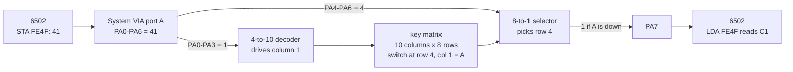
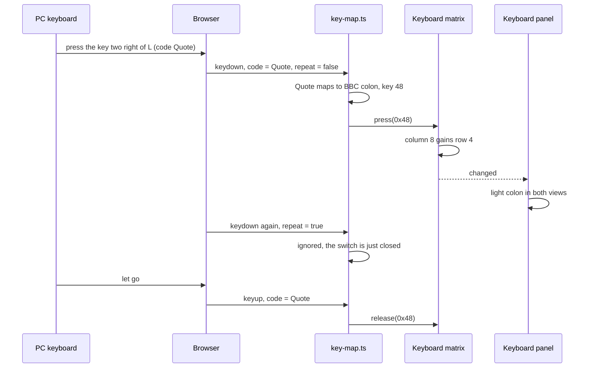
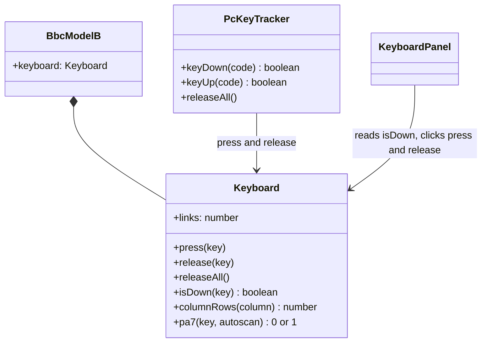

# Stage 34: Key matrix & PC mapping

> **Part:** 7 (Keyboard) · **Branch:** `stage/34-key-matrix` · **Needs:** 33
> **Status:** done

## Goal

Give the machine a **real keyboard matrix** in place of the Stage 28 stub: 10 columns × 8 rows of switches that can actually be pressed. Also map a **PC keyboard** onto it, so pressing `A` on your keyboard closes the BBC's `A` switch. A new **Keyboard panel** shows both views of the same switches: the keyboard as you see it on the desk, and the grid as the wiring sees it.

It comes first in Part 7 because everything else in the part reads this matrix. Stage 35 makes the keyboard scan itself and interrupt the CPU (then BASIC hears you type), and Stage 36 adds BREAK, the modifiers and the LEDs.

## What you can now see

```bash
npm run dev     # then open http://localhost:5173/?machine=mos (or / for the playground: no ROMs needed)
```

1. The **Keyboard** panel is the first one under the screen. It says *Click the screen to type.*
2. Click the screen. A green outline appears, and the panel says **Typing goes to the BBC.**
3. Hold **A**. The BBC's A lights in the desk view **and** at row 4, column 1 of the matrix. The status line reads `Down: A &41`.
4. Hold **Shift** and press the key **two to the right of L** (`'` on a PC). BBC **SHIFT** lights (both SHIFT keycaps, because they're one switch) and so does **`:`**, with `*` printed above it. That's what a real BBC would type.
5. Press **Esc**, **Tab** and click **SHIFT LOCK**: all three are on the desk's left edge, and all three light in matrix **column 0**.
6. Click somewhere else on the page while holding a key: it lets go (no stuck keys).

What the panel looked like in the Playwright check with Shift + `'` held:

```
Typing goes to the BBC. Down: SHIFT &00, : &48

 desk:  ... [ L ] [ ;+ ] [▓ :* ▓] [ ]} ] [ RETURN ]
        [ SHIFT LOCK ] [▓ SHIFT ▓] [ Z ] ... [ /? ] [▓ SHIFT ▓] [ DELETE ] [ COPY ]

 matrix:      0     1    2  ...   8     9
         &0x [▓SHF▓] CTL   b7 ...   b1    b0
         &4x  CAPS   A     X  ...  [▓:▓]  RET
```

BASIC doesn't react to any of this yet. The MOS only reads the keyboard properly when the keyboard **interrupts** it, and that's Stage 35. One thing does already work, through the MOS's `keyTest`: **hold Ctrl and press the BREAK button under the screen**, and the MOS does a **hard** reset (`&028D` = 2, and the banner says `BBC Computer 32K` again, as after power-on). A plain BREAK shows `BBC Computer` without the "32K". Nothing was written for that. The MOS's own BREAK code asks the matrix about CTRL (key `&01`), and now the answer can be yes.

## The real hardware

The Model B's keyboard is a **grid of switches**, not a set of 72 separate wires. The Advanced User Guide calls the positions **internal key numbers** and lists them all (AUG §"The keyboard", and the `INKEY` negative-number table, where `INKEY -n` tests internal key `n − 1`).

| | Thing | Where |
|---|---|---|
| **Columns** | 10 (0-9), each driven by one output of a 4-to-10 decoder | The decoder's input is PA0-PA3 (or, in autoscan, a counter: Stage 35) |
| **Rows** | 8 (0-7), each read through an 8-to-1 selector | The selector's input is PA4-PA6, and its output is **PA7** |
| **Key number** | `row × 16 + column`, i.e. `&rc` in hex | So `&41` is row 4, column 1: the **A** key |
| **Links** | Row 0, columns 2-9: eight wire links on the PCB, not keys | Read once at reset into `&028F` (Stage 28) |
| **Any key in this column?** | Rows 1-7 only, into the System VIA's **CA2** | Stage 35 |

The System VIA is at `&FE40`-`&FE4F`, and port A (`&FE41`/`&FE4F`) is the keyboard's. With autoscan off, the MOS's `keyTest` at `&F02A` writes a key number to port A and reads bit 7 back. Stage 28 wired exactly that, with a stub that only ever found the links. This stage keeps that wiring and puts real switches behind it.

The chip numbers on the keyboard PCB (BeebWiki lists a 74LS163 counter, a 74LS145 decoder, a 74LS251 selector and a 74LS30 NAND for "any key") are from BeebWiki's description. I haven't checked them against the circuit diagram. Nothing in this stage depends on them.

### The matrix

The whole grid, by internal key number (AUG; cross-checked against every `INKEY` negative number in the AUG's table):

| row \ col | 0 | 1 | 2 | 3 | 4 | 5 | 6 | 7 | 8 | 9 |
|---|---|---|---|---|---|---|---|---|---|---|
| **0** (`&0c`) | SHIFT | CTRL | link b7 | link b6 | link b5 | link b4 | link b3 | link b2 | link b1 | link b0 |
| **1** (`&1c`) | Q | 3 | 4 | 5 | f4 | 8 | f7 | - | ^ | ← |
| **2** (`&2c`) | f0 | W | E | T | 7 | I | 9 | 0 | _ | ↓ |
| **3** (`&3c`) | 1 | 2 | D | R | 6 | U | O | P | [ | ↑ |
| **4** (`&4c`) | CAPS LOCK | A | X | F | Y | J | K | @ | : | RETURN |
| **5** (`&5c`) | SHIFT LOCK | S | C | G | H | N | L | ; | ] | DELETE |
| **6** (`&6c`) | TAB | Z | SPACE | V | B | M | , | . | / | COPY |
| **7** (`&7c`) | ESCAPE | f1 | f2 | f3 | f5 | f6 | f8 | f9 | \ | → |

"link b*n*" is the link that becomes bit *n* of `&028F` (Stage 28: bit *b* is column 9 − *b*, inverted, so 1 = open).

Look at how scrambled that is compared with the keyboard on the desk. **Q** and **1** are neighbours on the desk, but Q is at `&10` and 1 is at `&30`. ESCAPE sits next to f1. Nobody designed the grid for people. It was designed for the **PCB**: each key's switch is joined to whichever row and column track happened to be nearest, so the copper could be laid on as few layers as possible. The MOS doesn't care: it has a table that turns key numbers back into characters (we'll meet it in Stage 35).

### What BREAK isn't

BREAK isn't in the grid. It's a separate switch wired to the machine's reset circuit, not to the VIA. That's why BREAK works even when the MOS has crashed. Stage 36 deals with it. The run controls' BREAK button already does a soft reset (Stage 30).

## Key concepts

### 1. Why a matrix?

72 keys as 72 wires would need 72 input pins. A matrix needs **10 + 8 = 18 wires**, and with the decoder and selector on the keyboard board, only **7 VIA pins** to choose a key plus **1** to hear the answer. The price is that you can only ask about **one key at a time**: "is the key at row 4, column 1 down?". Reading the keyboard means asking, key by key, very quickly. That's *scanning* (Stage 35).

A worked example. The MOS wants to know if **A** (`&41`) is down:

1. `LDA #&41 : STA &FE4F`: PA0-PA3 = `&1` (column 1), PA4-PA6 = `&4` (row 4).
2. The decoder drives column 1. Every switch in column 1 that is closed connects that column to its row.
3. The selector picks row 4 and puts it on PA7.
4. `LDA &FE4F` reads `&C1` if A is down (bit 7 set), `&41` if not.

### 2. Two views of the same switches

The panel shows the keyboard **twice**:

- **As laid out on the desk**: the rows you type on, ESCAPE at the top left, RETURN on the right.
- **As wired**: the 8 × 10 grid above.

Press one PC key and **one switch** lights in both. The point is that they are the same 80 positions, just arranged differently.

### 3. PC keys → BBC switches: by position, not by symbol

The browser tells us two things about a key press:

- `event.code`: **which physical key** it was, e.g. `"Digit2"` or `"Quote"`. It doesn't change with SHIFT or with the keyboard's language.
- `event.key`: **what character** it would type, e.g. `"2"`, `"@"` or `"\""`. It changes with SHIFT and with the layout setting.

We map **`event.code`**. A real BBC keyboard is a set of switches, and the BBC decides what character a switch means (with SHIFT, CTRL and CAPS LOCK, all of which are switches too). So the honest model is: **your PC key closes the BBC switch in the same place**.

That's where the symbol layouts collide. On the BBC, `"` is SHIFT+2 and `*` is SHIFT+`:`. On a UK PC, SHIFT+2 is also `"` (they agree), but on a US PC SHIFT+2 is `@`. The PC key right of `L` is `;` on both, and the one after it is `'` on a PC but `:` on the BBC. So **PC SHIFT+`'` gives BBC SHIFT+`:`, which is `*`**, not `"`. That surprises everyone the first time. A *symbolic* mapping (type `"` and the emulator fakes SHIFT+2) is friendlier for typing but lies about the hardware, and it has to fight the real SHIFT key you're holding. It's parked as an idea for later.

Our mapping, by row (PC key → BBC key):

| PC | BBC | Why |
|---|---|---|
| Esc, 1-0, `-`, `=` | ESCAPE, 1-0, `-`, `^` | Same places |
| Tab, Q-P, `[`, `]` | TAB, Q-P, `@`, `[` | Same places: right of P the BBC has `@` then `[` |
| Caps Lock, A-L, `;`, `'`, `#` (UK, `Backslash`) | CAPS LOCK, A-L, `;`, `:`, `]` | Same places on a UK keyboard |
| Shift, Z-M, `,`, `.`, `/` | SHIFT, Z-M, `,`, `.`, `/` | Same places |
| `\` left of Z (UK, `IntlBackslash`) | `\` | The BBC's `\` is where a PC has Backspace, so it goes on the PC's spare key |
| `` ` `` (top left) | `_` (SHIFT: `£`) | A spare PC key for a BBC key with no PC twin |
| Backspace / Delete | DELETE | The BBC's DELETE rubs out to the left, as Backspace does |
| Enter, Space, Ctrl | RETURN, SPACE, CTRL | The obvious ones |
| Arrow keys | ← → ↑ ↓ | Same meaning |
| End | COPY | No PC twin; End is near the arrows |
| F1-F9, F10 | f1-f9, f0 | By the number printed on the key (f0 is left of f1 on the BBC) |
| *(none)* | SHIFT LOCK, links | Click them in the panel |

Both PC Shift keys close the one BBC SHIFT switch, and both Ctrl keys close CTRL. So we have to **count**: if you hold both Shifts and let go of one, BBC SHIFT is still down. A BBC key is down while **any** PC key mapped to it is held.

### 4. Things the browser does to key events

- **Auto-repeat.** Hold a key and the browser sends `keydown` again and again (`event.repeat` is true). A real switch is just closed. The MOS does its own auto-repeat, with its own delay and rate (`*FX11`, `*FX12`). So we ignore repeats.
- **Lost key-ups.** If the window loses focus while a key is held (Alt-Tab, a click elsewhere), the `keyup` goes to someone else and the BBC key would be **stuck down** for ever. So on `blur` we let go of everything.
- **macOS and Cmd.** While ⌘ is held, macOS doesn't send `keyup` for other keys. We don't map ⌘, and we let go of everything when it's released.
- **The browser's own shortcuts.** Tab moves focus, Space scrolls, F5 reloads, arrows scroll. When the screen has focus and the key is mapped, we call `preventDefault()` so the BBC gets it instead. Keys only go to the BBC while **the screen has focus** (click it), so typing into the workbench's assembler or memory editor still works.

## Diagrams

How a key number on port A becomes an answer on PA7 (autoscan off, the only mode until Stage 35):



From a PC key press to a lit key in the panel:



How the TypeScript pieces fit:



## Our design

**`src/devices/keyboard.ts`: the matrix.** DOM-free, so Jest and the CLI can press keys too (Stage 35's `typeText()` will).

```ts
export class Keyboard {
  links: number;                      // as before: &028F's value, bit b = column 9 - b, 1 = open
  press(key: number): void;           // key = row << 4 | column
  release(key: number): void;
  releaseAll(): void;
  isDown(key: number): boolean;       // a pressed switch, or a closed link
  columnRows(column: number): number; // which rows are closed in a column, as a bit mask
  pa7(key: number, autoscan: boolean): 0 | 1;
}
```

- The state is **one byte per column**: bit *r* set = the switch in row *r* is closed. That's a `Uint8Array(10)`. It's the shape the hardware has: drive a column, see its rows. Stage 35's "any key in this column?" is then `columnRows(c) & 0xFE` (rows 1-7), one AND.
- The **links** stay a separate byte, because they aren't switches anyone presses. `isDown` and `columnRows` fold them in, so the MOS sees them exactly as it saw the stub's.
- The **key table** (`BBC_KEYS`) lives here too, as data: name, legend, shifted legend and key number for all 72 keys. It's hardware data, so it belongs with the device, and the panel and the PC map both use it.
- `Keyboard` takes an optional **`onChange`** callback. The machine uses it to recompute PA7 straight away: if the MOS has just written `&41` to port A and then you press A, the next read must see it. Before, the answer only changed when the port did.
- `KeyboardStub` is deleted, and its tests move into `keyboard.test.ts`.

**`src/web/key-map.ts`: PC → BBC.** No DOM in it (it only sees `code` strings), so it's tested under Jest.

```ts
export const PC_KEY_MAP: ReadonlyMap<string, number>;  // KeyboardEvent.code → BBC key number
export class PcKeyTracker {
  constructor(keyboard: KeyboardSwitches);
  keyDown(code: string): boolean; // true if the code is mapped (so the caller can preventDefault)
  keyUp(code: string): boolean;
  releaseAll(): void;
}
```

It keeps the set of PC codes held. A BBC key is pressed when the first of its PC keys goes down, and released when the last one comes up.

**`src/web/workbench/keyboard-panel.ts` + `keyboard-view-model.ts`.** The view model lays out the desk view (5 rows of keys with relative widths) and the matrix view (8 × 10), each cell with its key number and its PC key. The panel builds the buttons **once** and only toggles a `down` class on refresh. (The rebuild-every-refresh habit of the older panels loses clicks while the machine runs: parking lot, Stage 26.) Clicking a key holds it until you click it again (a "sticky" press), which is the only way to press SHIFT LOCK, or SHIFT and a key together with the mouse.

**Alternatives considered.**
- A `Set<number>` of held key numbers. Simpler to read, but Stage 35 asks "any key in column *c*?" every 1 µs tick of the scan, and that's one array read with the per-column bytes.
- Map `event.key` (symbolic). Explained above: friendlier, but not how the machine works, and it fights the SHIFT key. Parked.
- Capture keys on the whole page. Then the workbench's text boxes can't be typed into. Focus on the screen instead.

## Code walkthrough

**[`src/devices/keyboard.ts`](../../src/devices/keyboard.ts): the matrix.**
- `BBC_KEYS` is the AUG's table as data, one line per matrix row, so you can read it against the table above: `k('Q', 0x10), s('3', '#', 0x11), ...`. `s()` is a key with a shifted symbol, `k()` one without.
- `keyNumber` / `keyRow` / `keyColumn` are the `row × 16 + column` arithmetic, masked to PA0-PA6's widths (`& 0x07`, `& 0x0f`).
- `Keyboard.columns` is a `Uint8Array(10)`: `columns[1] = &50` means rows 4 and 6 of column 1 are closed (A and Z). `press`/`release` set or clear one bit, then call `onChange` **only if the byte changed**, so pressing an already-held key doesn't make the machine redo PA7 for nothing.
- `columnRows(c)` folds the link in as row 0 for columns 2-9. That keeps the links out of the switch state (nobody "presses" them) but makes them look the same to anyone reading the matrix, which is how the hardware behaves.
- `pa7()` is the Stage 28 stub's method, unchanged in meaning: in autoscan it's 0, otherwise it's `isDown(key & 0x7f)`.

**[`src/machine/bbc-model-b.ts`](../../src/machine/bbc-model-b.ts).** The stub is gone. The machine builds the `Keyboard` with `onChange = answerKeyboard`. That's the routine that already recomputed PA7 whenever port A or the latch changed (Stage 28), so a key press now goes through the same path.

**[`src/web/key-map.ts`](../../src/web/key-map.ts): PC → BBC.** `MAPPING` is one table of `[code, BBC key number, PC name]` triples, and both `PC_KEY_MAP` and `pcKeysFor` come from it, so the panel's tooltips can't disagree with the real mapping. `PcKeyTracker.held` is a `Map<code, key>`, and `keyUp` only releases the BBC key when no other held code maps to it (`isHeld`). It only ever releases what *it* pressed, so a SHIFT LOCK clicked in the panel survives a `blur`.

**[`src/web/keyboard-input.ts`](../../src/web/keyboard-input.ts): the browser events.** This is the only file that sees a `KeyboardEvent`. It ignores keys while ⌘ is held, treats a repeat as "mapped, so `preventDefault`, but press nothing", and lets go of everything on `blur` and on ⌘'s key-up.

**[`src/web/workbench/keyboard-view-model.ts`](../../src/web/workbench/keyboard-view-model.ts).** `DESK_ROWS` is the Model B's layout written out row by row (`caps('Q W E R T Y U I O P @ [ _ UP DOWN')`), with widths in key units. `matrixCells()` builds the 8 × 10 grid from `BBC_KEYS`, and the links get labels `b7`-`b0`, their `&028F` bit. `describeDown` is the status line.

**[`src/web/workbench/keyboard-panel.ts`](../../src/web/workbench/keyboard-panel.ts).** It builds every keycap and cell **once** and keeps a flat `lit` list of `{ element, key }`. `refresh()` walks it and toggles `down`. A `mousedown` `preventDefault` on each keycap stops a click from taking focus off the screen, so you can click SHIFT LOCK and carry on typing.

**[`src/main.ts`](../../src/main.ts).** Makes `.screen-frame` focusable (`tabIndex = 0`), attaches the input to it, and refreshes **just the Keyboard panel** on each key event, so it lights at once rather than at the next 10 Hz panel refresh. `workbench.keyboard` is on the console handle.

## Tests

| Test file | What it proves |
|---|---|
| `src/devices/keyboard.test.ts` | 35 keys checked against the AUG's `INKEY` numbers. 72 keys, all in different places, filling every position except the 8 links. No BREAK. The shifted symbols (`"`, `*`, `£`). Press/release/releaseAll, independence of neighbours, `columnRows` masks, `onChange` only on a real change. The Stage 28 stub's link and PA7 tests, kept. |
| `src/web/key-map.test.ts` | Letters, digits and named keys by place. Punctuation by place (`[`→`@`, `'`→`:`...). F1-F9/F10. Every BBC key except SHIFT LOCK reachable. ⌘, Alt and F12 unmapped. Both Shifts are one SHIFT. A key-up never releases what the tracker didn't press. `releaseAll` keeps panel presses. |
| `src/web/workbench/keyboard-view-model.test.ts` | The desk rows (BREAK at the end of the function row, `@ [ _ ↑ ↓` after P...). Two SHIFT keycaps on `&00`. All 72 keys shown. The tooltip text. An 8 × 10 matrix with A at `[4][1]` and the links labelled `b7`-`b0`. `describeDown`. |
| `src/machine/bbc-model-b.test.ts` | +2: a held A reads `&C1` on port A when `&41` is written, and a press while `&41` is already there is seen **without** a new port write. +1 with ROMs (**skips** without `roms/os12.rom`): CTRL held at BREAK makes `&028D` = 2. |
| `e2e/keyboard.spec.ts` | 7 browser checks (playground, no ROMs). Focus gates typing. A lights in both views. Shift + `'` gives SHIFT and `:`. Tab stays a BBC key. SHIFT LOCK click is sticky and keeps focus. Blur lets go. BREAK is disabled. |
| `e2e/workbench.spec.ts` | Updated: the Keyboard panel is now the first under the screen. |

## Gotchas & hardware quirks

- **72 keys, not 74.** 80 grid positions − 8 links = 72 keys, and BREAK makes 73. My first test said 74. The "every position except the links" test was right, and the count was wrong.
- **One switch, two keycaps.** Both SHIFT keys on a Model B close switch `&00`, so the BBC can't tell left SHIFT from right. Our panel lights both. The PC tracker has to count Shift presses for the same reason.
- **The links look like keys.** A closed link reads exactly like a held key in row 0. `isDown(&09)` is true with link b0 closed. `describeDown` leaves them out, because nobody is holding them.
- **The grid isn't *completely* random.** ESCAPE, TAB, CAPS LOCK, SHIFT LOCK and SHIFT run down the keyboard's left edge, and they're all column 0. The function keys are scattered, though (f0 is `&20`, f1 is `&71`).
- **Keys are live now, before scanning.** With autoscan off, the MOS's `keyTest` reads the real matrix. That's why CTRL+BREAK works already. It also means holding **Ctrl+Shift** in the browser will halt MODE 7 scrolling, as on a real BBC (the Stage 23 doc found the code). Neither is a bug, but either could look like one.
- **A PC key-up can release a panel-held key.** If you click A down in the panel and then press and release PC A, the PC key-up lets go of A. The tracker only checks its own presses. That's rare and harmless, so it isn't handled.
- **Ghosting isn't modelled.** On a matrix without diodes, holding three keys at three corners of a rectangle makes the fourth corner read as down. I don't know whether the Model B keyboard has diodes, so ours is perfect for now. That's in the parking lot.
- **The desk layout is from photos.** The widths are approximate. The position of each key in its row (`← →` at the end of the number row, `↑ ↓` after `_`, `DELETE COPY` after the right SHIFT) is from memory of the Model B's keyboard. The matrix positions don't depend on it.
- **Mapping is UK-PC-centric.** `Backslash` is the `#~` key beside Enter on a UK keyboard, which is where the BBC's `]` sits. On a US keyboard the same code is above Enter, so BBC `]` is there instead.

## Playwright verification

- **MCP**, at `/?machine=mos`: clicked the screen, held Shift + `'`. The status read `Down: SHIFT &00, : &48`, the desk view lit both SHIFT keycaps and `:`, and the matrix lit `&00` and `&48`. On release: `No keys down.` Screenshot checked by eye. Then I clicked SHIFT LOCK (focus stayed on the screen, class `screen-frame typing`) and held Esc + Tab: all three lit, all in column 0. Clicking the page body let go of Esc and Tab but kept SHIFT LOCK, and a second click released it. Long legends (`CAPS LOCK`, `SHIFT LOCK`) were truncated at first, so I made them wrap.
- **Durable**: `e2e/keyboard.spec.ts` (7 tests). The full suite passes: 123 tests. One run had the known load-sensitive `via-interrupts` Run test fail (parking lot, Stage 27). It passed on its own and in the next full run.

## Check your understanding

1. The MOS writes `&36` to `&FE4F` with autoscan off. Which key is it asking about, and what does it read back if that key is down?
2. Why does the key map use `event.code` rather than `event.key`? Give one thing that would go wrong with `event.key`.
3. You hold both PC Shift keys, then let go of the left one. What should BBC SHIFT be, and which piece of code makes that so?
4. Why must the `Keyboard` tell the machine when a switch changes, when the machine already recomputes PA7 whenever port A is written?
5. CTRL+BREAK already does a hard reset, but typing `PRINT` does nothing. What's the difference in how the MOS reads the keyboard in those two cases?

<details>
<summary>Answers</summary>

1. `&36` is row 3, column 6: **O**. If O is down, PA7 is 1, so `LDA &FE4F` reads `&B6` (`&36` with bit 7 set).
2. `event.code` names the physical key, and a BBC keyboard is physical switches. The BBC itself works out the character from SHIFT, CTRL and CAPS LOCK. With `event.key`, typing `"` on a PC gives `"` **with your Shift already held**, so to type it the BBC way we'd have to fake SHIFT+2 while also reporting the real SHIFT. Keys would also change meaning with the OS keyboard layout, and Shift-released key-ups wouldn't match their key-downs (press `2` with Shift, release Shift first, and the key-up says `2`, not `"`).
3. Still **down**: the right Shift maps to the same switch `&00`. `PcKeyTracker.keyUp` deletes `ShiftLeft` from `held`, then `isHeld(0x00)` finds `ShiftRight` still there, so it doesn't call `release`.
4. Because a key can change **between** the port write and the read. The MOS writes `&41`, and then you press A. Port A hasn't changed, so without `onChange` PA7 would still say "up" until the next write. Real hardware is just wires, so the answer changes the instant the switch closes.
5. CTRL+BREAK is read by **asking**: autoscan off, write `&01`, read PA7 (`keyTest`), which works with the matrix alone. Typed keys are found by **scanning**: with autoscan on, the keyboard's own counter walks the columns and pulls CA2 to interrupt the MOS when a key in rows 1-7 is down. That counter and the CA2 line are Stage 35.

</details>

## Further reading

- *Advanced User Guide for the BBC Microcomputer* (Bray, Dickens and Holmes), the keyboard chapter and the internal key number / `INKEY` table, and the System VIA port A description.
- BeebWiki, "Keyboard": the matrix, the scanning circuit and the start-up links.
- *BBC Microcomputer User Guide*, `INKEY` with a negative number: the same table from the BASIC side.
- MDN, `KeyboardEvent.code` vs `KeyboardEvent.key`, including the table of `code` values by physical position.
