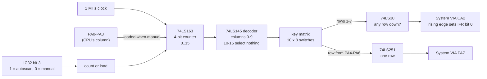
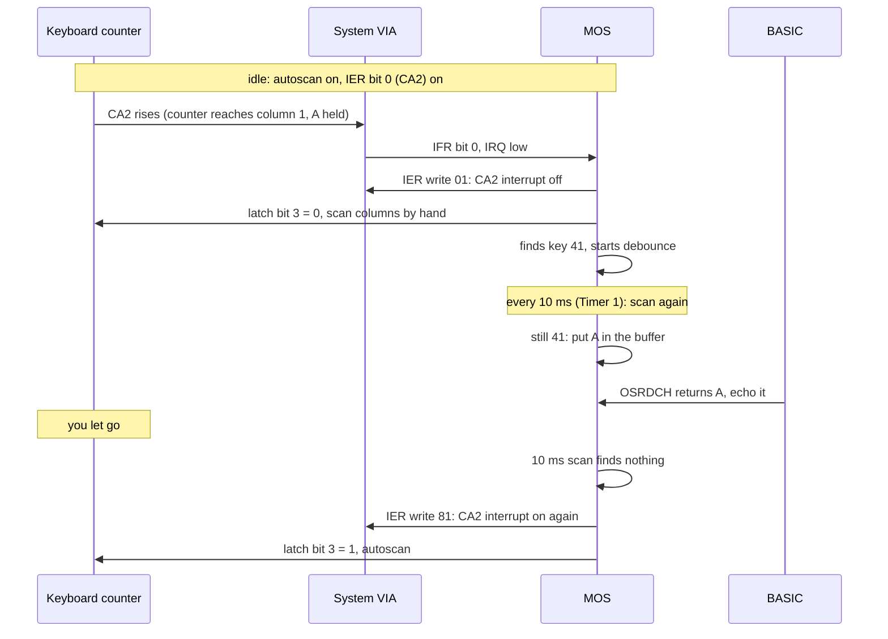
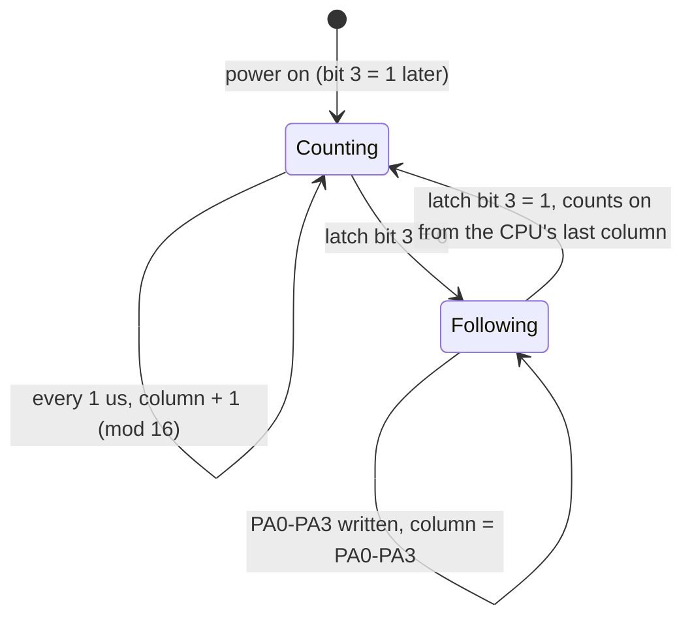

# Stage 35: Scanning & keyboard interrupts

> **Part:** 7 (Keyboard) · **Branch:** `stage/35-keyboard-scanning` · **Needs:** 34
> **Status:** done

## Goal

Make the keyboard **interrupt the CPU** when a key goes down, so the MOS notices it and BASIC sees what you type. Stage 34 built the switches. This stage builds the small circuit on the keyboard PCB that watches them while the CPU is busy elsewhere (the **autoscan counter**), and wires its "a key is down" output to the System VIA's **CA2**.

It comes here because it's the last thing between the boot screen and a usable BASIC. Since Stage 29 the machine has sat at the `>` prompt in `rdchWait`, waiting for a key. After this stage, that wait ends.

## What you can now see

**🎉 You can type into BASIC.**

```bash
npm run dev     # then open http://localhost:5173/?machine=mos
```

1. Wait for the `>` prompt, then **click the screen** (green outline).
2. Type `PRINT 2+2` and press **Enter**. BASIC prints `4` and a new `>`. On a UK PC keyboard, `+` is **Shift + `;`**, because keys map by place (Stage 34) and the BBC's `+` is SHIFT + `;`.
3. Under the screen, the **Keyboard** panel has a new scan line:
   - Idle: `Autoscan on · CA2 interrupt on: waiting for a key · CA2 rises: 0`
   - While you hold a key, it flips to `CA2 interrupt off: the MOS scans every 10 ms` (at the panel's 10 Hz refresh), and the rise count climbs by ~62,500 a second.

What Playwright saw after typing it:

```
BBC Computer 32K

BASIC

>PRINT 2+2
         4
>
Autoscan on · CA2 interrupt on: waiting for a key · CA2 rises: 51,596
```

And headless, with the whole story told:

```bash
npm run demo:typing
```

```
── Part 1: typing into BASIC ──
  typeText(machine, "PRINT 2+2\r"): 10 characters, each held 2 frames and let go 2 (1000 ms of BBC time).
  ... >PRINT 2+2 /          4 / >          (the MODE 7 screen, boxed)

── Part 2: one key press, as the hardware and the MOS see it ──
    0.000 ms  A (&41) goes down. IER = &F3: bit 0 set, so a CA2 rising edge will interrupt.
    0.003 ms  CA2 rises: the counter reached column 1, where row 4 is down. IFR bit 0 is set.
    0.003 ms  /IRQ: IFR bit 0 AND IER bit 0. The CPU takes the interrupt.
    0.069 ms  KEYV, from the CA2 interrupt: IER := &01 (CA2 interrupt off), 9 columns tested: CA2 says column 1, PA7 says key &41
    6.326 ms  KEYV, from the 100 Hz timer : IER := &01 (CA2 interrupt off), 10 columns tested: CA2 says column 1, PA7 says key &41
   16.328 ms  KEYV, from the 100 Hz timer : ...
   17.517 ms  "A" appears after the > on the screen: BASIC read it from the buffer and echoed it.
   ...
   60.002 ms  A is let go.
   66.327 ms  KEYV, from the 100 Hz timer : IER := &01 (CA2 interrupt off), 10 columns tested, no key
   76.328 ms  KEYV, from the 100 Hz timer : IER := &01 (CA2 interrupt off), 10 columns tested, no key
   76.901 ms  IER := &81: CA2 interrupt ON again. Nothing is down: back to waiting.
  CA2 rose 3,578 times while A was down (once every 16 µs), but interrupted once.

── Part 3: the full scan, test by test (A held) ──
    &09 → &FE4F, BIT &FE4D   column 9: IFR bit 0 = 0
    ...
    &01 → &FE4F, BIT &FE4D   column 1: IFR bit 0 = 1  ← CA2 rose: a key in rows 1-7
      &11 → &FE4F, BIT &FE4F       key &11: PA7 = 0
      &21 → &FE4F, BIT &FE4F       key &21: PA7 = 0
      &31 → &FE4F, BIT &FE4F       key &31: PA7 = 0
      &41 → &FE4F, BIT &FE4F       key &41: PA7 = 1  ← this key
```

Part 2 is the whole of Key concept 1, measured. One CA2 interrupt, then the 100 Hz timer takes over. Part 3 is Key concept 4: CA2 narrows the search to one column, and PA7 finds the row.

## The real hardware

The keyboard has its own little logic board. It's only four or five TTL chips, but it lets the keyboard work in **two modes**, chosen by **IC32 latch bit 3** (Advanced User Guide, System VIA, "addressable latch": *keyboard write enable*):

| Latch bit 3 | Mode | Who picks the column | What the MOS uses it for |
|---|---|---|---|
| **1** (`&0B` → `&FE40`) | **Autoscan** | A free-running **counter** on the keyboard, clocked at 1 MHz | Sitting idle: "tell me if anything happens" |
| **0** (`&03` → `&FE40`) | **Manual** (CPU scan) | The CPU, on **PA0-PA3** | Finding out *which* key it is |

In both modes the **column** chosen drives the key matrix, and two answers come back:

| Output | What it says | Where it goes |
|---|---|---|
| **PA7** | "The key at row PA4-PA6 in this column is down" | System VIA port A bit 7 (Stage 28/34) |
| **CA2** | "*Some* key in rows **1-7** of this column is down" | System VIA CA2, an interrupt input |

BeebWiki describes the parts as a **74LS163** 4-bit counter (the column counter, which can be loaded from PA0-PA3), a **74LS145** decoder (counter → one of 10 column lines), a **74LS251** selector (row → PA7) and a **74LS30** 8-input NAND gate (rows → CA2). I haven't checked these against the circuit diagram. What follows depends only on their behaviour, which the MOS's own code confirms (below).

### What the MOS ROM tells us

I disassembled MOS 1.20 (our `roms/os12.rom`) to see how it drives this. These are its instructions, in `&` hex:

| Address | Code | What it means for the hardware |
|---|---|---|
| `&DA87` | `LDX #&04 : STX &FE4C` | **PCR = `&04`**: CA2 is an input and interrupts on a **rising** edge (PCR bits 3-1 = `010`). So "a key is down" is CA2 going **high**. |
| `&DA82` | `LDX #&F2 : STX &FE4E` | IER at boot: T1, T2, CB1, CA1 on. **CA2 off** for now. |
| `&EEE2` | `LDA #&81 : STA &FE4E` | Only when no key is down (`&EC` and `&ED` both 0): **turn the CA2 interrupt on**. |
| `&F12E` | `LDA #&0B : STA &FE40` | `autoScanOn`: latch bit 3 := 1. The keyboard watches itself again. |
| `&EF04` | `LDA #&01 : STA &FE4E` | In `defaultKEY` (KEYV), when entered from the CA2 interrupt: **turn CA2 off**. |
| `&F0EB`-`&F0FD` | `STA &FE40` (`&03`), `&0F` → `&FE4F`, `&01` → `&FE4D`, `STX &FE4F`, `BIT &FE4D` | The scan loop. Autoscan off; select column **15**; clear IFR bit 0; select column **X**; test IFR bit 0. "**Did CA2 rise** when column X was selected?" |

That last row is the important surprise. The MOS uses CA2 **in manual mode too**, as a fast "is anything down in this column?" test, so it only has to try the 7 rows of a column that has a key in it. And it first selects column `&0F`. Column 15 doesn't exist (the decoder has outputs 0-9 only), so it has **no keys**, and CA2 goes **low**. Then selecting column X makes CA2 **rise** if X has a key down, and the rising edge sets the flag. Without that dummy column the line might already be high from the previous column, and there'd be no edge.

## Key concepts

### 1. Why interrupt at all?

The MOS could read the keyboard 100 times a second whether or not anyone is typing. Each full scan is 10 columns × up to 8 rows of `STA &FE4F : BIT &FE4F`, a few hundred cycles every 10 ms. Most of the time nobody is typing, so that's wasted.

So the MOS uses a two-step strategy:

1. **Idle (no key down):** autoscan on, CA2 interrupt **enabled**. The keyboard hardware checks every column, over and over, at no cost to the CPU. The MOS doesn't look at the keyboard at all.
2. **Something pressed:** CA2 rises → System VIA IFR bit 0 → `/IRQ`. The MOS turns the CA2 interrupt **off** (`&EF04`) and from then on scans the keyboard itself from the **100 Hz Timer 1 interrupt**, working out which key, debouncing it, handling auto-repeat, and putting characters into the keyboard buffer.
3. **All keys up again:** the 100 Hz scan finds nothing (`&EC` = `&ED` = 0). The MOS turns the CA2 interrupt back **on** (`&EEE2`) and goes back to step 1.

Why switch CA2 off in step 2? Because while a key is held, the counter keeps passing over it and CA2 keeps rising, every 16 µs. If the interrupt stayed on, the CPU would be interrupted 62,500 times a second.

### 2. The autoscan counter

The counter is 4 bits wide, so it counts **0, 1, 2 … 15, 0, 1 …**, one step per microsecond (the 1 MHz clock that also runs the VIAs). The decoder turns its value into one active column line, but only for 0-9. Values 10-15 select **nothing**.

One sweep of all 16 values takes **16 µs**, i.e. 32 CPU cycles. A key is "seen" for 1 µs of each sweep: the microsecond when the counter is on its column.

Worked example: you hold **A** (`&41`: row 4, column 1).

| µs | Counter | Column 1 rows (bit *r* = row *r*) | Rows 1-7 any? | CA2 |
|---|---|---|---|---|
| 0 | 0 | | `&00` → no | 0 |
| 1 | 1 | `&10` (row 4) | `&10 AND &FE` = `&10` → **yes** | **1** ← rising edge: IFR bit 0 set |
| 2 | 2 | | no | 0 |
| … | … | | | 0 |
| 17 | 1 (again) | `&10` | yes | 1 ← another edge |

So within 16 µs of a key going down, IFR bit 0 is set. If IER bit 0 is set too (IER reads `&F3` at the prompt: `&F2` plus CA2), `/IRQ` goes low and the CPU takes the interrupt at the end of the instruction.

### 3. Why rows 1-7 and not row 0?

Row 0 holds **SHIFT** (`&00`), **CTRL** (`&01`) and the eight **start-up links** (`&02`-`&09`). A closed link is a switch that's *always* closed. If row 0 went into CA2, a machine with any closed link would interrupt every 16 µs forever. And SHIFT or CTRL on their own don't type anything, so there's no reason to wake the CPU for them. The MOS reads them directly with `keyTest` (`&F02A`) when it has a real key to translate.

So the NAND gate's inputs are rows 1-7 only. In code that's `columnRows(c) & 0xFE`. A consequence you can try on a real BBC: **holding SHIFT alone does nothing**, no interrupt and no scan.

### 4. Manual mode: the counter follows the CPU

When latch bit 3 is 0, the counter stops counting and is **loaded** from PA0-PA3 instead. The column is whatever the CPU wrote to port A's low four bits. CA2 then reports "any key in rows 1-7 of *the CPU's* column", which is how the scan loop at `&F0FA` tests a whole column with one `BIT &FE4D`.

A worked example of the MOS's column test, with **A** held:

| Step | Instruction | Column | CA2 | IFR bit 0 |
|---|---|---|---|---|
| 1 | `LDA #&03 : STA &FE40` | (autoscan off; counter loaded from port A) | | |
| 2 | `LDA #&0F : STA &FE4F` | 15 (nothing) | 0 | |
| 3 | `LDA #&01 : STA &FE4D` | 15 | 0 | cleared |
| 4 | `STX &FE4F` with X = `&09` | 9 (RETURN, DELETE…) | 0 | 0 |
| | *loop:* `BIT &FE4D` → Z = 1 → next column | | | |
| … | `STX &FE4F` with X = `&01` | 1 | **1** | **1** (rising edge) |
| | `BIT &FE4D` → Z = 0 → try rows `&11`, `&21`, … in this column | | | |

(The loop starts again at `&F0E3` for each column, which is why steps 2 and 3 repeat before every `STX`.)

### 5. Typing without a keyboard: `typeText()`

For the headless test, Jest can't press PC keys, so we need a helper that types the way a person does, by closing the BBC switches for a while and opening them again:

```
"PRINT 2+2\r"
  P      → press &37, run a few frames, release, run a few frames
  +      → press SHIFT &00 and ; &57 together, ..., release both
  \r     → RETURN &49
```

It has to hold each key long enough for the MOS to notice. The MOS scans every 10 ms (one Timer 1 tick), and a key has to still be there on later scans before it becomes a character. So each key is held for a few **frames** (20 ms each), then released for a few more, so the next press is a new key-down and not a repeat. Measured (pressing `P` at 10 different points in the 10 ms cycle):

| Held for | 1-10 ms | 12 ms | 15 ms | 18 ms | 20 ms | 25 ms+ |
|---|---|---|---|---|---|---|
| Typed | 0/10 | 1/10 | 4/10 | 7/10 | 9/10 | 10/10 |

So `typeText` holds 2 frames (40 ms) and lets go for 2. 1 + 1 also worked for `PRP`, but with no margin. A characters-to-keys table goes from text to switches. It's **not** used for the browser, which stays positional (Stage 34). Here we choose the keys ourselves, so `"` really is SHIFT + `2` (`&31`).

## Diagrams

The two ways a column gets chosen, and the two answers:



What happens, over time, when you press and release a key at the `>` prompt:



The counter's state as the latch changes it:



## Our design

**`src/devices/keyboard.ts`** gains the keyboard PCB's scan logic. The counter is part of the keyboard, not the VIA. It's on the keyboard's own board.

```ts
class Keyboard implements Clocked {
  /** Latch bit 3, as the machine tells us: true = the counter counts. */
  setAutoscan(on: boolean): void;
  /** PA0-PA3 as the machine sees them: loads the counter while autoscan is off. */
  selectColumn(column: number): void;
  /** Moves the counter on (1 µs per 2 CPU cycles) while autoscan is on. */
  tick(cpuCycles: number): void;
  /** The column the counter is on now (0-15), and CA2's level. */
  readonly scanColumn: number;
  readonly ca2: 0 | 1;
  /** Rising edges on CA2 since power-on, for the panel. */
  readonly ca2Rises: number;
}
```

- **CA2 is pushed, not polled.** The keyboard is given a `ca2Listener(level)` (the machine wires it to `systemVia.setControlLine('ca2', level)`) and calls it the moment its CA2 level changes. That's either inside `tick` as the counter moves, or straight away when a key is pressed or the column is selected. If the machine only looked at CA2 after each instruction, it could miss a 1 µs pulse in the middle of a 4 µs instruction: the counter passes column 1 and leaves it again before the instruction ends. Every edge goes to the VIA as it happens.
- **The hot path.** `tick` runs after every instruction. With autoscan on it steps the counter once per µs, which is at most 4 steps per instruction. Each step is an array read, an AND with `&FE`, and a compare. No allocation. With autoscan off it returns at once.
- **The machine** (`bbc-model-b.ts`) already recomputes PA7 whenever port A, port B (the latch) or a key changes (`answerKeyboard`). It now also tells the keyboard the autoscan bit and the column there, and puts the keyboard on its list of ticked devices.
- **PA7 during autoscan** stays driven low, as in Stages 28 and 34. A real board would show "row PA4-PA6 of the counter's column", changing every µs. The MOS never reads PA7 in autoscan, so modelling it would cost a pin update per µs for nothing. It's still in the parking lot.

**`src/machine/type-text.ts`**: `keysFor(char)` gives the switches for one character (`'+'` → `[&00, &57]`). `typeText(machine, text)` presses, runs frames, and releases. It refuses characters the BBC can't type with one key plus SHIFT. Lowercase is refused too, because with CAPS LOCK on (the default) a lowercase letter needs SHIFT, and the helper shouldn't guess the lock state.

**The Keyboard panel** gets a scan line: autoscan on or off, the column, CA2 rises so far, and whether the CA2 interrupt is enabled (IER bit 0). You can watch the MOS flip between "idle, autoscan" and "scanning by hand" as you type.

**Alternatives considered.**
- *Poll CA2 after each instruction.* Misses pulses inside an instruction (above).
- *"Any key down anywhere → CA2 high."* Simpler and cheaper, and enough for the idle interrupt. But it's wrong for the scan loop at `&F0FA`, which needs CA2 for *one* column, so the MOS would try all 7 rows of every column (slow, but it would still work). The counter is only a few lines more and is what the hardware does.
- *Jump the counter by `cycles / 2` and check the range it passed.* Fewer iterations, but fiddlier (wrap-around, several columns at once) for at most 4 iterations saved.
- *Put the counter in the VIA.* No: the VIA only sees the CA2 wire. Where the edge comes from is the keyboard's business.

## Code walkthrough

**[`src/devices/keyboard.ts`](../../src/devices/keyboard.ts): the scan logic.**
- `counter`, `phase`, `autoscan`, `ca2Level` are the keyboard board's state. `tick()` is the 74LS163: while autoscan is on, each 2 CPU cycles is one count, `(counter + 1) & 0x0f`.
- `updateCa2()` is the 74LS30: `columns[counter] & CA2_ROWS` (`&FE`), with columns 10-15 reading as `0` (the 74LS145 has no outputs there).
- `setCa2()` only calls the listener on a **change**, and counts rises. So a held key costs one call per edge (two per 16 µs), and no keys cost nothing.
- `selectColumn(pins)` is the counter's parallel load. It's ignored while autoscan is on, which is exactly the latch-bit-3 mux in the first diagram.
- `connectCa2()` sends the current level straight away. See Gotchas: without that, the first key wasn't an edge.
- `press`/`release` recompute CA2 only if the key is in the counter's column: in manual mode that's the "key pressed while its column is selected" case.

**[`src/machine/bbc-model-b.ts`](../../src/machine/bbc-model-b.ts): the wiring.**
- The constructor connects CA2: `this.keyboard.connectCa2((level) => { this.systemVia.setControlLine('ca2', level); })`. The closure is made **once**, here, not in the hot path.
- `answerKeyboard()` already ran on every port A/B pin change and every key change (Stage 34). It now also does `setAutoscan(latch bit 3)` and `selectColumn(port A pins)`.
- `clocked` gains the keyboard, so `tick()` moves the counter along with the VIAs. `powerOn()` calls `keyboard.resetScan()`.

**[`src/machine/type-text.ts`](../../src/machine/type-text.ts): headless typing.**
- `KEYS_BY_CHAR` is built once from `BBC_KEYS`: each single-character legend is its key, and each shifted legend is `[SHIFT, key]`. Plus space and RETURN.
- `typeText` checks the whole string first (a `RangeError` before any key is pressed), then press → `holdFrames` → release → `gapFrames`, per character.

**[`src/web/workbench/keyboard-view-model.ts`](../../src/web/workbench/keyboard-view-model.ts): `describeScan(keyboard, ier)`.** The panel's new line: who picks the column, IER bit 0, and the rise count. `main.ts` passes `machine.peek(0xfe4e)` (no side effects) as the IER.

**[`scripts/demo-typing.ts`](../../scripts/demo-typing.ts).** It watches the CPU's PC for four MOS 1.20 addresses found in the disassembly: `&EF02` (KEYV), `&F0E1` (the column loop starts), `&F0FD` (`BIT &FE4D`, the column test) and `&F10B` (`BIT &FE4F`, one key).

## Tests

| Test file | What it proves |
|---|---|
| `src/devices/keyboard.test.ts` | Counter steps once per µs (2 CPU cycles) and wraps after 15. No keys → no CA2 edges. A held → CA2 high for 1 µs every 16 µs. A pulse inside one 7-cycle tick is still sent (rise and fall). Neighbouring columns give one rise. Row 0 (SHIFT, CTRL, closed links) never reaches CA2. Manual mode follows PA0-PA3 at once (column `&0F` is empty). A key pressed in the selected column raises CA2 at once. Autoscan resumes from the CPU's column. `resetScan`. Connecting CA2 sends the current level. |
| `src/machine/bbc-model-b.test.ts` | `&0B` → `&FE40` with A held: IFR bit 0 within 16 µs, and with IER `&81` the System VIA holds `/IRQ`. SHIFT alone: no CA2. The MOS's column test by register writes (`&0F`, clear IFR bit 0, column) finds column 1, not 9. The counter only moves with autoscan on. |
| `src/machine/type-text.test.ts` | `keysFor`: letters, digits, `+` = `[&00, &57]`, `"` = `[&00, &31]`, unshifted `;` `:` `@`, space, RETURN, lowercase refused. `typeText` refuses before pressing anything, and holds 2 / gaps 2 frames. **With ROMs:** `PRINT 2+2` ↵ prints `4`, and afterwards IER is `&F3` with autoscan on. |
| `src/web/workbench/keyboard-view-model.test.ts` | `describeScan` wording: idle, key down (IER `&F2`), autoscan off with the column. |
| `e2e/typing.spec.ts` | **With ROMs**, in the `real-time` project: PC keys held 60 ms type `PRINT 2+2` ↵ and row 6 shows `4`. The panel's scan line reads idle, then counts rises after a key. |

The ROM tests skip (with the missing file named) without `roms/os12.rom` and `roms/basic2.rom`.

## Gotchas & hardware quirks

- **A floating-high CA2 hid the first key.** Our VIA's CA2 input starts at 1 (nothing pulling it), and the keyboard only spoke on a *change*. Its first "1" was 1 → 1, not an edge, so the very first key never interrupted. On the real board the NAND gate always drives the line, so `connectCa2` now sends the level at once. That bug was caught by the machine-level test before it got near the MOS.
- **Column 15 matters.** The MOS's column test only works because columns 10-15 have no keys: selecting `&0F` pulls CA2 low so the next column can make a rising edge. If our counter's spare columns read as anything else, the scan would see phantom keys.
- **Row 0 is excluded from CA2**, or a closed link would interrupt forever. Holding SHIFT alone does nothing, on ours and on a real BBC.
- **The MOS writes IER `&01` on every KEYV call while a key is down**, every 10 ms, not just once (`demo:typing` Part 2). And inside the column loop (`&F0E3` → `&F129`), it switches autoscan back on and does `CLI : SEI` for each column, a brief window for other interrupts. So `&03`/`&0B` to `&FE40` doesn't mark "one scan". My first version of the demo counted it that way and was wrong.
- **A very short press is ignored, by the MOS.** Under ~10 ms it's never typed, and from ~25 ms it always is (table above). In the browser, keydown and keyup that arrive between two animation frames give the machine **no** emulated time with the key down. Playwright's instant `press('P')` is lost that way. Human presses (tens of ms) are fine, and the e2e holds keys 60 ms. A "minimum hold" in the web layer could make very fast taps reliable; parked.
- **PA7 in autoscan** is still driven low, not modelled (the MOS doesn't read it then). Parked since Stage 28.
- **Chip numbers** (74LS163/145/251/30) are BeebWiki's, not checked against the circuit diagram. The behaviour we built is what the MOS's code requires, which is the stronger evidence here. No other emulator was consulted.

## Playwright verification

- **MCP:** `/?machine=mos`, screen focused. An instant `P` press (`browser_press_key`) was **not** typed (Gotchas). Then `PRINT 2+2` ↵ through `workbench.keyboard.press/release` with 80 ms holds: rows 5-7 read `>PRINT 2+2`, `         4`, `>`, and the panel `Autoscan on · CA2 interrupt on: waiting for a key · CA2 rises: 51,596`. Screenshot: `.playwright-mcp/s35-2.png`.
- **Durable:** `e2e/typing.spec.ts` (2 tests, `real-time` project, skips without ROMs). `playwright.config.ts` now sends `(boot|typing).spec.ts` to that project. Full suite: 125 passed.

## Check your understanding

1. The MOS turns the CA2 interrupt **off** as soon as a key goes down. What would happen if it left it on while you held a key?
2. Why does the MOS write `&0F` to `&FE4F` before each column it tests, and what would go wrong if columns 10-15 of the counter had keys on them?
3. SHIFT is in the matrix, but holding it alone never interrupts the CPU. Why, and how does the MOS find out about SHIFT when you type `+`?
4. Our keyboard sends CA2 changes to the VIA *during* `tick()`, not once after each instruction. Give a case where checking only after each instruction would miss a key.
5. `typeText` holds each key for 40 ms. Why can't it press and release a key in the same frame, given what the MOS does every 10 ms?

<details>
<summary>Answers</summary>

1. The counter passes the key's column every 16 µs, so CA2 rises 62,500 times a second, and each rise would set IFR bit 0 and interrupt. The CPU would spend all its time in the interrupt handler. Switching CA2 off and scanning from the 100 Hz timer costs a few hundred cycles every 10 ms instead.
2. To make a fresh **rising edge**. The VIA only flags edges, not levels. Column 15 has no keys, so CA2 goes low; then if the real column has a key, CA2 rises and IFR bit 0 is set (after the MOS has cleared it with `&01` → `&FE4D`). If column 15 had keys, CA2 might already be high, and a column with a key would give no edge, so the MOS would miss it. Or, the other way round, it would find keys that aren't there.
3. CA2's gate only sees rows 1-7, and SHIFT is in row 0 (`&00`). A modifier on its own types nothing, and the links in row 0 are permanently closed. The MOS reads SHIFT and CTRL directly with `keyTest` (`&F02A`: `&00`/`&01` → `&FE4F`, then PA7) when it handles a real key.
4. A key in column 1 only, and a 4 µs instruction that starts with the counter on column 0. During it, the counter goes 1 (CA2 high) and 2 (CA2 low). After the instruction CA2 is low again, so a check then sees "low" before and after, and no edge. Sending each change as it happens lets the VIA see the 1 µs pulse.
5. If the release happens before the machine runs, the key was never down in emulated time: no CA2 edge at all. Even with some time, the MOS only turns a key into a character after it's still down on later 10 ms scans (we measured: never under 10 ms, always from 25 ms). 40 ms clears that whatever the timer's phase.

</details>

## Further reading

- Advanced User Guide: the System VIA (port A and the keyboard, CA2), the addressable latch (bit 3, keyboard write enable), and the keyboard's internal key numbers.
- 6522 datasheet: the PCR's CA2 input modes (`010` = interrupt on a positive edge), and the IFR/IER.
- BeebWiki, "Keyboard" (the keyboard PCB's counter, decoder, selector and NAND gate).
- Our own disassembly of MOS 1.20: `&DA82` (IER `&F2`), `&DA87` (PCR `&04`), `&EEE2` (CA2 on), `&EF02` (KEYV), `&F0E1`-`&F134` (the scan loop), `&F12E` (`autoScanOn`).
