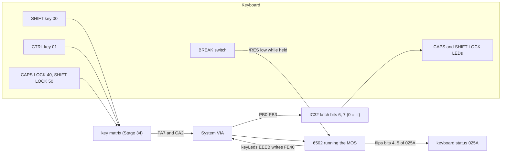
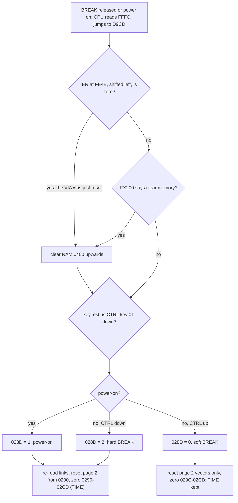
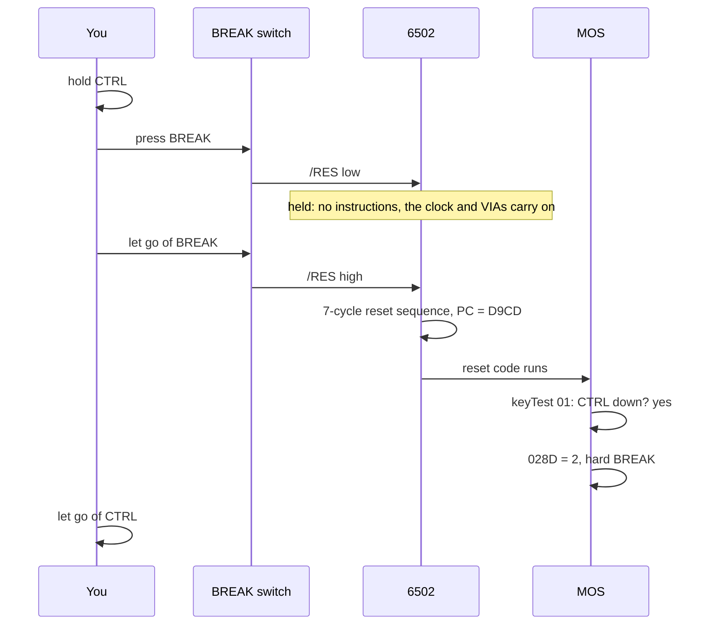

# Stage 36: Modifiers, BREAK & LEDs

> **Part:** 7 (Keyboard) · **Branch:** `stage/36-modifiers-break-leds` · **Needs:** 35
> **Status:** done

## Goal

Finish the keyboard. Three things are left, and none of them is a key that types a character:

- **The modifiers.** SHIFT, CTRL, CAPS LOCK and SHIFT LOCK change what the *other* keys mean.
- **BREAK.** It's on the keyboard, but it isn't in the matrix. It's wired to the CPU's reset pin.
- **The two lock LEDs.** They're driven by the IC32 latch, not by the keyboard.

Most of the modifier behaviour already works, because the MOS does it in software and Stage 34 gave it real switches to read. So this stage is mostly about *understanding* what the MOS does with them, proving it with tests, and making BREAK behave like a real key that you **hold down and let go**.

It comes last in Part 7 because it needs the whole keyboard: the matrix (34) for SHIFT and CTRL, and scanning (35) for CAPS LOCK to be typed at all.

## What you can now see

**In the browser:**

```bash
npm run dev     # then open http://localhost:5173/?machine=mos
```

1. Under the screen, beside the run controls, are two LEDs: **● CAPS LOCK** lit and **○ SHIFT LOCK** out, as on a BBC after it boots. Click the screen, press **Caps Lock** on the PC, and the CAPS LOCK LED goes out (and the light on the panel's CAPS LOCK keycap with it). Press it again and it comes back.
2. Click the **SHIFT LOCK** keycap in the Keyboard panel (it has no PC key), then click it again to let go. SHIFT LOCK lights and CAPS LOCK goes out.
3. Type a program, e.g. `10 PRINT "HI"` ↵, then **hold F12** (BREAK). The panel says `Down: BREAK (the 6502 is held in reset)`. Let go: the banner comes back as `BBC Computer`, without "32K" (a soft BREAK). Type `OLD` ↵ `LIST` ↵ and your program is back.
4. **Hold Ctrl, tap F12, then let go of Ctrl**: a hard BREAK, with `BBC Computer 32K`. Or do it all by mouse: click CTRL, click BREAK twice, click CTRL.

What the durable e2e test typed and screenshotted (`e2e/basic-program.spec.ts`, real PC key presses):

```
BBC Computer 32K

BASIC

>10 FOR I=1 TO 5
>20 PRINT I,I*I
>30 NEXT
>RUN
         1         1
         2         4
         3         9
         4        16
         5        25
>
```

**Headless, with everything measured:**

```bash
npm run demo:break
```

```
── Part 1: the lock LEDs at power-on (IC32 bits 6 and 7, 0 = lit) ──
     0.000 ms  bit 7 := 1  SHIFT LOCK LED off
   253.679 ms  bit 6 := 1  CAPS LOCK  LED off
   253.946 ms  bit 6 := 0  CAPS LOCK  LED on
   253.951 ms  bit 7 := 0  SHIFT LOCK LED on
   266.110 ms  bit 6 := 0  CAPS LOCK  LED on
   266.113 ms  bit 7 := 1  SHIFT LOCK LED off
  ... 14 more (keyLeds at &EEEB is called again and again while starting up).
  The ~250 ms gap is the MOS clearing RAM. Then both LEDs are lit for ~12 ms: keyLeds ran while &025A was still &00.

── Part 2: the lock keys are plain switches; the lock is a bit in &025A ──
  after                &025A   LEDs
  boot                 &20    CAPS ●  SHIFT ○
  CAPS LOCK            &30    CAPS ○  SHIFT ○
  CAPS LOCK again      &20    CAPS ●  SHIFT ○
  SHIFT LOCK           &10    CAPS ○  SHIFT ●
  SHIFT + CAPS LOCK    &A0    CAPS ●  SHIFT ○

── Part 3: what the modifiers do to the A key (BASIC: PRINT GET) ──
  A                 (CAPS LOCK on)      65  "A"
  SHIFT + A         (CAPS LOCK on)      65  "A"
  CTRL + A                               1  control
  A                 (CAPS LOCK off)     97  "a"
  SHIFT + A         (CAPS LOCK off)     65  "A"
  SHIFT + A    (SHIFT+CAPS LOCK mode)   97  "a"

── Part 4: three kinds of reset, one /RES pin ──
  reset        banner             &028D  TIME after  OLD + LIST
  BREAK        BBC Computer           0         560  program back
  CTRL+BREAK   BBC Computer 32K       2         182  program back
  power-on     BBC Computer 32K       1         157  Bad program

── Part 5: the MOS reads CTRL after BREAK comes up ──
  BREAK up, then CTRL up:  &028D = 2 (hard)
  CTRL up, then BREAK up:  &028D = 0 (soft)
```

Part 1 is a small surprise: at power-on, both LEDs light together for about 12 ms. That's the MOS calling `keyLeds` before `&025A` has its default value. (Whether a real BBC shows the same blink also depends on IC32's state at power-on, which is parked from Stage 28.)

## The real hardware

### SHIFT and CTRL: ordinary switches

SHIFT is key `&00` (row 0, column 0) and CTRL is `&01` (row 0, column 1), in the same matrix as every other key (Advanced User Guide, internal key numbers). Nothing on the board knows they're special. Two things make them behave like modifiers:

1. **They're in row 0**, so they're left out of the CA2 gate (Stage 35, Key concept 3). Holding SHIFT alone never interrupts the CPU.
2. **The MOS asks about them** with `keyTest` (`&F02A`) when it has a real key to translate, and folds the answer into the character.

### CAPS LOCK and SHIFT LOCK: ordinary switches too

`&40` and `&50` are plain momentary keys. There's nothing that "locks" in the hardware. The lock is a **bit in RAM**: the MOS's keyboard status byte at `&025A` (Advanced User Guide, OSBYTE `&CA`, "keyboard status byte"). Each press of a lock key flips its bit.

| `&025A` bit | Meaning | Value at the `>` prompt |
|---|---|---|
| 3 | SHIFT is pressed | 0 |
| 4 | **0 = CAPS LOCK engaged** | 0 (engaged) |
| 5 | **0 = SHIFT LOCK engaged** | 1 (off) |
| 6 | CTRL is pressed | 0 |
| 7 | SHIFT enabled: SHIFT+CAPS LOCK mode, where SHIFT gives lower case | 0 |

So `&025A` is `&20` after a boot. Measured on our machine, pressing the lock keys one at a time:

| After | `&025A` | CAPS LOCK LED | SHIFT LOCK LED |
|---|---|---|---|
| Boot | `&20` | on | off |
| CAPS LOCK | `&30` | off | off |
| CAPS LOCK again | `&20` | on | off |
| SHIFT LOCK (from `&30`) | `&10` | off | on |
| SHIFT + CAPS LOCK | `&A0` | on | off |

### The LEDs: two bits of IC32

The keyboard has the LEDs, but the keyboard doesn't light them. They hang off the **IC32 addressable latch** (Stage 28), on the System VIA's port B:

| IC32 bit | Output | Lit when |
|---|---|---|
| 6 | CAPS LOCK LED | the bit is **0** |
| 7 | SHIFT LOCK LED | the bit is **0** |

(Advanced User Guide, System VIA, addressable latch.) Active low, like most of IC32: the LED sits between +5 V and the latch output, so it lights when the output pulls its end down to 0 V.

The MOS has one small routine that copies `&025A` to the LEDs, which I'll call `keyLeds` (`&EEEB`). From our disassembly of MOS 1.20:

```
EEEC  LDA &025A      ; e.g. &30: CAPS LOCK off, SHIFT LOCK off
EEEF  LSR A          ; bit 4 → bit 3, bit 5 → bit 4
EEF0  AND #&18       ; keep those two
EEF2  ORA #&06       ; latch address 6, D = CAPS LOCK "off" bit
EEF4  STA &FE40      ;   &0E → latch bit 6 := 1 → CAPS LOCK LED off
EEF7  LSR A          ; SHIFT LOCK's "off" bit → bit 3
EEF8  ORA #&07       ; latch address 7
EEFA  STA &FE40      ;   &0F → latch bit 7 := 1 → SHIFT LOCK LED off
```

It's neat because the two conventions match. `&025A` uses **0 = engaged**, and the LEDs use **0 = lit**, so each status bit goes straight to the latch's D input on PB3 with no inversion.

A third LED, *cassette motor*, sits with these two on a real Model B. It's driven by the cassette motor relay through the serial ULA, not IC32, and cassette is out of scope, so we don't show it.

### BREAK: the reset line

BREAK is the 73rd key. It isn't in the 10 × 8 grid. It's a switch that pulls the 6502's **/RES** pin low. That's why BREAK works even when the MOS has crashed: no software has to notice it.

From the 6502 datasheet, /RES works like this:
- While /RES is **low**, the CPU is held. It runs no instructions.
- When /RES goes **high** again, the CPU runs its 7-cycle reset sequence. It reads the vector at `&FFFC`/`&FFFD` (`&D9CD` in MOS 1.20) and starts there.

So the MOS doesn't start when you *press* BREAK. It starts when you **let go**. That's why the User Guide tells you to hold CTRL, press and release BREAK, and *then* release CTRL. The MOS reads CTRL during its reset code, which runs after BREAK comes up.

Only the CPU is reset. The VIAs, CRTC and Video ULA have their own /RES line, which is pulsed at **power-on only** (Stage 23 found the MOS relying on this). The clock keeps running too: while BREAK is held, the VIA timers count, the screen is still displayed, and the keyboard's counter keeps scanning. Only the 6502 stops.

I'm not sure exactly how the Model B's board conditions the BREAK switch (debouncing, or a minimum pulse width). We model only the behaviour above: held → CPU stopped; released → reset sequence.

## Key concepts

### 1. One reset pin, three kinds of reset

The 6502 has one reset, and it can't tell why it happened. The MOS works out which kind of reset it is with two questions, at the very start of its reset code (`&D9CD`, our disassembly):

1. **Was it power-on?** `LDA &FE4E : ASL A`. The System VIA's IER reads `&80` after the VIA's own reset (only at power-on), so `ASL` gives `&00`. After a BREAK, the IER still holds what the MOS put there (`&F2` or `&F3`), so `ASL` gives non-zero.
2. **Is CTRL held?** `keyTest` with `&01`: write `&01` to `&FE4F` with autoscan off and read PA7 back (Stage 34).

The answer goes into `&028D` ("last BREAK type", AUG OSBYTE `&FD`):

| `&028D` | Kind | What the MOS resets |
|---|---|---|
| `0` | **Soft BREAK** (BREAK alone) | Page 2 `&0200`-`&027D` from its default table (the vectors), and zeroes `&029C`-`&02CD` |
| `1` | **Power-on** | Clears RAM `&0400`-`&7FFF`. Page 2 `&0200`-`&028B` from the table, zeroes `&0290`-`&02CD`, re-reads the start-up links |
| `2` | **Hard BREAK** (CTRL+BREAK) | As power-on, but **no RAM clear** (`&0200`-`&0286` from the table) |

The worked example: BASIC's `TIME` counts 100 Hz ticks in `&0292`-`&029B`. Those addresses are zeroed on a hard reset but kept on a soft one. Measured:

```
PRINT TIME          →  157
BREAK, PRINT TIME   →  350     (kept counting: &0292-&029B untouched)
CTRL+BREAK, ...     →  182     (zeroed, then counted the boot and the typing)
```

### 2. Why your program survives BREAK (and CTRL+BREAK)

A surprise: **neither** BREAK nor CTRL+BREAK clears RAM. Only power-on does (or `*FX200,2`, below). The code at `&D9DE`:

```
D9D7  LDA &FE4E    ; IER
D9DA  ASL A
D9DB  PHA          ; kept for later: 0 = power-on
D9DC  BEQ &D9E7    ; power-on: clear RAM
D9DE  LDA &0258    ; *FX200 setting
D9E1  LSR A
D9E2  CMP #&01     ; bit 1 set (and bit 2 clear)?
D9E4  BNE &DA03    ;   no: skip the RAM clear
D9E7  ...          ; the RAM clear loop, &0400 upwards
```

What *does* happen is that BASIC starts again, and it does a `NEW`. A BASIC program at `PAGE` (`&0E00` on a Model B with no DFS) starts with `&0D` and then the first line's number, high byte first. `NEW` only writes `&FF` into that high byte, which BASIC reads as "end of program". `OLD` writes `&00` back, then walks the lines to find the end again. Measured, with `10 PRINT "HI"` typed:

```
Before BREAK:  &0E00: 0D 00 0A 0A F1 20 22 48 49 22 0D FF
After BREAK:   &0E00: 0D FF 0A 0A F1 20 22 48 49 22 0D FF     ← one byte changed
After OLD:     &0E00: 0D 00 0A ...                            ← and changed back
```

`F1` is BASIC's token for `PRINT`, and `0A 0A` is line number 10 (`&000A`) then the line's length (10 bytes).

`*FX200,2` (OSBYTE `&C8`, AUG) asks for "memory cleared on BREAK", which is how a program could protect itself from being listed after BREAK. That's the `&0258` test above.

### 3. How SHIFT, CTRL and the locks change a key

When the MOS finds a key (Stage 35's scan), it looks up the key's ASCII code in a table, then changes it with what it knows about the modifiers. Measured with `PRINT GET`, which waits for one key and prints its code:

| Keys held | CAPS LOCK on (the default) | CAPS LOCK off |
|---|---|---|
| A | **65** (`A`) | **97** (`a`) |
| SHIFT + A | 65 (`A`) | 65 (`A`) |
| CTRL + A | **1** | 1 |
| CTRL + SHIFT + A | 1 | 1 |
| SHIFT + A in SHIFT+CAPS LOCK mode (`&025A` = `&A0`) | **97** (`a`) | |

So:
- **CAPS LOCK** makes letters upper case. SHIFT doesn't reverse it (unlike a PC), unless you enter the SHIFT+CAPS LOCK mode, bit 7 of `&025A`.
- **CTRL** keeps the low 5 bits of the code: `A` = `&41` → `&01`. That's the ASCII "control character" convention, the same as a PC terminal's Ctrl+A.
- SHIFT on a non-letter key picks the keytop's top symbol: SHIFT + `2` (`&32`) is `"` (`&22`). Stage 35's `typeText` already relies on that.

None of this is hardware. Change the MOS and the same switches could mean something else.

### 4. SHIFT + BREAK

The MOS also looks at SHIFT during a reset. With the start-up link for it open (the default), SHIFT+BREAK means "boot": it asks the filing system to start a program. With a disc system that's `!BOOT`. With only the cassette filing system (ours), it's a `*RUN` from tape:

```
BBC Computer
Searching
File not found
```

We have no cassette, so it gives up. It's an aside: Part 11 (DFS) is where SHIFT+BREAK matters.

### 5. Holding a reset

Because the CPU only starts on release, there are two ways to model BREAK:

- **A tap:** reset the CPU at once. That's what the BREAK button has done since Stage 27 (`machine.reset()`).
- **A switch:** `setBreak(true)` stops the CPU; `setBreak(false)` runs the reset sequence.

The switch is what the hardware does, and you can see the difference. Hold CTRL, press BREAK, let go of **CTRL first**, then BREAK: a real BBC does a **soft** BREAK, because CTRL is up by the time the MOS looks. A tap can't show that.

While BREAK is held, the machine keeps time. The CPU is simply not stepped, but the devices still get their cycles (the clock runs, the 6502 just isn't listening). On the screen, nothing changes, and flashing teletext keeps flashing.

## Diagrams

Where the modifiers, BREAK and the LEDs connect:



How the MOS decides what kind of reset it is (our disassembly of `&D9CD`-`&DA36`):



CTRL+BREAK, over time. The order you let go in matters:



## Our design

**BREAK is a switch on the machine**, not on the `Keyboard`. It isn't in the matrix, and it's wired to the CPU. `BbcModelB` gains:

```ts
/** The BREAK key: true holds the CPU in reset; false lets go, and the CPU's reset sequence runs. */
setBreak(down: boolean): void;
/** Is BREAK held? */
readonly breakHeld: boolean;
/** The lock LEDs, from IC32 bits 6 and 7 (0 = lit). */
readonly capsLockLed: boolean;
readonly shiftLockLed: boolean;
```

- While BREAK is held, `step()` doesn't step the CPU. It ticks the devices by **2 cycles** (one 1 MHz tick, the smallest step the VIAs and the keyboard's counter care about) and adds them to the CPU's cycle count, so the frame budget and the hardware log's timestamps still move. (`TIME` doesn't: the MOS counts it in its interrupt handler, and the CPU isn't running it.) A frame of held BREAK is 20,000 of these tiny steps. That's more loop iterations than running code (~10,000 instructions a frame), but each one is cheap, and you only hold BREAK for a moment.
- `setBreak(false)` runs the existing `reset()`. `reset()` stays as the "tap", used by the BREAK button under the screen, tests and the playground's Reset.
- The LEDs are two getters on the machine reading `latch.bit(6)` and `latch.bit(7)`. The latch knows nothing about LEDs: it's the board's wiring that says bit 6 has an LED on it.

**The modifiers need no new emulation code.** They're matrix keys (Stage 34), and the MOS does the rest. This stage tests them end to end with the ROMs. `type-text.ts` gains `tapKeys(machine, keys)`, the "hold these switches together, then let go" step that `typeText` already did per character, so tests can press CTRL + A.

**In the browser:**
- **PC keys for BREAK:** `F12` and `Pause` (labelled "Pause/Break" on PC keyboards, so it's a good fit, but most laptops and Macs don't have it). `F12` is the usual choice for a BBC emulator. The `PcKeyTracker` presses BREAK on key-down and lets go on key-up, and lets go on blur like any other key. `F12` might open the browser's developer tools before the page sees it. Where it does, `Pause` or the panel still work.
- **The Keyboard panel's BREAK keycap** is enabled now. It's sticky like the other keycaps: click to hold BREAK down (the CPU stops), click again to let go (the reset runs). So you can click CTRL, click BREAK twice, and click CTRL to do a hard BREAK with the mouse.
- **The LEDs** appear twice: a small light on the CAPS LOCK and SHIFT LOCK keycaps, and an LED strip under the screen (beside the run controls), so you can see them while typing. Where exactly the LEDs sit on a real Model B's case isn't modelled. The strip is for convenience.
- The BREAK button under the screen stays a tap.

**Alternatives considered.**
- *BREAK as a matrix key (an 81st position).* No: the MOS would have to scan for it, and a crashed MOS couldn't. It's a reset line.
- *Keep BREAK a tap.* Simpler, but it can't show "let go of CTRL first", and it isn't what the 6502 does.
- *Freeze the whole machine while BREAK is held* (no ticks). Simpler, but wrong: the VIA timers and the vsync keep going on a real BBC, and the keyboard's counter keeps scanning.
- *Lights driven by the MOS's `&025A` directly.* That would show what the MOS *thinks*, not what the hardware shows. Reading IC32 shows exactly what the real LEDs would.

## Code walkthrough

**[`src/machine/bbc-model-b.ts`](../../src/machine/bbc-model-b.ts): the BREAK switch and the LEDs.**
- `setBreak(down)` only acts on a change. Down sets `breakDown`; up clears it and calls the existing `reset()`, so a tap (`reset()`) and a hold-and-release run the same reset code.
- `step()` starts with `if (this.breakDown) return this.stepHeldInReset();`. That's one boolean test on the hot path. `stepHeldInReset()` adds `BREAK_HELD_STEP_CYCLES` (2) to `cpu.cycles` and ticks the devices by 2, so `runCycles` still counts its budget down and the VIAs still run.
- `pendingInterrupt` reports nothing while BREAK is held. The CPU won't take an interrupt then, so the Disassembly panel mustn't say "Next step is an IRQ". The first browser check caught this.
- `capsLockLed` and `shiftLockLed` are `latch.bit(LATCH_CAPS_LOCK_LED) === 0` and the same for bit 7. They use the constants that Stage 28 already named.

**[`src/machine/type-text.ts`](../../src/machine/type-text.ts): `tapKeys(machine, keys)`.** This is the chord step pulled out of `typeText`: press all of the keys, run `holdFrames`, release them all, then run `gapFrames`. `typeText` now calls it once per character.

**[`src/web/key-map.ts`](../../src/web/key-map.ts): BREAK from the PC.**
- `BREAK_PC_CODES` (`F12`, `Pause`), and `isBbcKeyCode` for the "ignore repeats, but still stop the browser" check in `keyboard-input.ts`.
- `PcKeyTracker` takes an optional `BreakSwitch`. A held BREAK is stored in the same `held` map, under `BREAK_HELD = &100`, which can't be a matrix position. That way both PC keys count as one BREAK, and `releaseAll` (blur) lets go of it, just as it does for SHIFT.

**[`src/web/workbench/keyboard-panel.ts`](../../src/web/workbench/keyboard-panel.ts).** The BREAK keycap is enabled. It's sticky like the other caps and calls `options.breakKey.setBreak(!held())`. The CAPS LOCK and SHIFT LOCK caps get a `.key-led` span, and `refresh()` toggles `lit`. `describeDown(keyboard, breakHeld)` puts BREAK first.

**[`src/web/lock-leds.ts`](../../src/web/lock-leds.ts).** The LED strip. `main.ts` updates it from `drawScreen()` every frame, and it only touches the DOM when an LED changes.

**[`scripts/demo-break.ts`](../../scripts/demo-break.ts).** Parts 1-5 above. Part 1 filters the Stage 28 hardware log for latch writes to bits 6 and 7.

## Tests

| Test file | What it proves |
|---|---|
| `src/machine/bbc-model-b.test.ts` | +5 BREAK: held → PC and X don't move. The clock runs (1,000 cycles → T1 down by 500). Release → 7-cycle reset, PC from `&FFFC`, IER kept. Repeated down/up is a single reset. /IRQ is ignored while held (nothing is pushed, `pendingInterrupt` is undefined). +3 LEDs: `&06`/`&0E` for CAPS LOCK, `&07`/`&0F` for SHIFT LOCK, and the power-on state before any instruction runs. |
| `src/machine/break-and-modifiers.test.ts` | **With ROMs** (skips without `os12.rom`/`basic2.rom`). The LEDs at the prompt, the power-on LED sequence, CAPS LOCK and SHIFT LOCK flipping `&025A` and the LEDs. `PRINT GET` codes: A/SHIFT/CTRL/CTRL+SHIFT with CAPS LOCK on, A/SHIFT with it off, the SHIFT+CAPS LOCK mode, SHIFT+2 = 34. BREAK + `OLD` brings the program back (`&0E01` = `&FF`, the token kept). CTRL+BREAK: `&028D` = 2, "32K", TIME restarts. Soft BREAK keeps TIME. CTRL+BREAK doesn't clear RAM. Letting go of CTRL first gives a soft BREAK. A held BREAK freezes PC and the screen. |
| `src/machine/type-text.test.ts` | +1: `tapKeys` holds a chord together and releases it together. |
| `src/web/key-map.test.ts` | +5: F12/Pause aren't in the matrix map but are BBC keys. F12 holds and releases BREAK. F12 and Pause count as one BREAK. With no switch wired, F12 is left to the browser. `releaseAll` lets go of BREAK. |
| `src/web/workbench/keyboard-view-model.test.ts` | +2: `describeDown` with BREAK held, and the BREAK keycap's tooltip. |
| `e2e/keyboard.spec.ts` | The old "BREAK is disabled" test becomes: one click holds BREAK (`aria-pressed`, status line), a second click lets go. |
| `e2e/basic-program.spec.ts` | **New, real-time project, skips without ROMs.** A 3-line program typed with PC keys and RUN, with a screenshot attached (`squares.png`). The CAPS LOCK LED toggles with PC Caps Lock, and a clicked SHIFT LOCK lights its LED (strip and keycap). F12 does a soft BREAK, then `OLD` and `LIST` bring the program back. |

## Gotchas & hardware quirks

- **CTRL+BREAK doesn't clear memory.** I expected "hard reset" to mean a wiped machine. It doesn't: the RAM clear at `&D9E7` only runs on power-on or with `*FX200,2`. "Hard" means the MOS resets more of page 2 (including TIME and the `*TV` settings) and reads the links again.
- **SHIFT doesn't undo CAPS LOCK.** On a PC, Caps Lock + Shift gives lower case. On the BBC, SHIFT+A with CAPS LOCK on is still `A` (65), unless you've switched to the SHIFT+CAPS LOCK mode. That surprised me in the first experiment. It's MOS behaviour, measured, not something we chose.
- **The order you let go in.** Because the reset runs on *release* (/RES going high), CTRL has to still be down when BREAK comes up. A tap-style BREAK (Stage 27's button) couldn't show this. It still exists as the button under the screen.
- **The debugger said "Next step is an IRQ" while BREAK was held**, because /IRQ was low (a VIA had a flag set) and `pendingInterrupt` didn't know about BREAK. Fixed: a held CPU has nothing pending.
- **F12 and the browser.** `preventDefault` stops most browsers using F12, but some may still open the developer tools. `Pause` and the panel's BREAK keycap are the fallbacks. Playwright's F12 works.
- **`typeText` needs CAPS LOCK on.** It types `PRINT GET` with unshifted letters, so with CAPS LOCK off BASIC sees `print get` and says `Mistake`. The tests turn CAPS LOCK off only around the key being measured.
- **How BREAK is conditioned on the board** (debounce, minimum pulse) isn't modelled or checked. The model is: held → CPU stopped, released → reset sequence.
- **The cassette motor LED** isn't shown. It's driven from the serial ULA's motor control, and cassette is out of scope.
- No other emulator was consulted. Everything here comes from the AUG, the 6502 datasheet, and our own disassembly and measurements of MOS 1.20.

## Playwright verification

- **MCP:** at `/?machine=mos`, clicking the SHIFT LOCK keycap down and up turned the LED strip to `CAPS LOCK LED off`, `SHIFT LOCK LED on`. Clicking BREAK held it: the BREAK keycap went green, the status read `Down: BREAK (the 6502 is held in reset)`, and PC stayed at `&DEF0`. Screenshot: `.playwright-mcp/s36-break-held.png`. That screenshot showed the false "Next step is an IRQ" (fixed above). After the fix, clicking BREAK again gave rows `BBC Computer` / `BASIC` / `>` and `&028D` = 0.
- **Durable:** `e2e/basic-program.spec.ts` (3 tests, `real-time` project) and the updated `e2e/keyboard.spec.ts` BREAK test. `playwright.config.ts` sends `basic-program.spec.ts` to the real-time project. Full suite: 128 passed.

## Check your understanding

1. The 6502 has one reset pin and can't tell why it was reset. How does MOS 1.20 tell power-on, BREAK and CTRL+BREAK apart, and which chip's behaviour does the first test depend on?
2. Why must you keep holding CTRL until *after* you let go of BREAK for a hard reset?
3. After BREAK, `LIST` shows nothing but `OLD` brings the program back. What did BASIC actually change in memory, and what would make the program truly gone?
4. The CAPS LOCK key is a momentary switch. Where does the "lock" live, and how does it get to the LED? Why is no inversion needed on the way?
5. While BREAK is held, our `step()` still ticks the VIAs and keyboard. What would be wrong if it froze the whole machine instead?

<details>
<summary>Answers</summary>

1. It reads the System VIA's IER (`LDA &FE4E : ASL A`). The VIAs' own /RES is pulsed only at power-on, which leaves IER at `&80`, so `ASL` gives 0. After BREAK the IER still holds the MOS's `&F2`/`&F3`. If it isn't a power-on, `keyTest` asks the matrix about CTRL (`&01`): down gives a hard BREAK (`&028D` = 2), up gives a soft one (0). It depends on the VIA **not** being reset by BREAK.
2. The CPU only starts its reset sequence when /RES goes high, which is when BREAK is released. The MOS's CTRL test runs a few hundred µs after that. If CTRL is already up, the MOS sees a soft BREAK.
3. `NEW` writes `&FF` into the high byte of the first line number (`&0E01`), which BASIC reads as "end of program". The rest of the program is untouched, and `OLD` writes `&00` back. Neither BREAK nor CTRL+BREAK clears RAM; power-on does (the loop at `&D9E7`), and so does BREAK after `*FX200,2`.
4. In the MOS's keyboard status byte `&025A`: bit 4 = 0 means CAPS LOCK is engaged. `keyLeds` (`&EEEB`) shifts that bit into PB3 and writes latch address 6 (`&06` or `&0E` to `&FE40`). The LED is lit when IC32 bit 6 is 0, and the status bit is 0 when engaged, so the bit goes straight through.
5. On a real BBC only the 6502 stops; the 2 MHz clock, the VIA timers, the vsync and the keyboard's counter carry on. Freezing everything would make held time disappear: timers wouldn't count, the hardware log's clock would stop, and flashing teletext would freeze. Those are all differences you could see.

</details>

## Further reading

- Advanced User Guide: OSBYTE `&CA` (keyboard status byte `&025A`), `&C8` (`*FX200`, ESCAPE/BREAK effect), `&FD` (last BREAK type `&028D`). The System VIA's addressable latch (bits 6 and 7, the LEDs). The reset and BREAK description.
- MCS6502 datasheet: /RES. Held low, the CPU stops; the reset sequence starts on the rising edge and fetches `&FFFC`/`&FFFD`.
- Our own disassembly of MOS 1.20: `&D9CD`-`&DA36` (the reset code and the three kinds of reset), `&EEEB` (`keyLeds`), `&F02A` (`keyTest`).
- BBC Microcomputer User Guide: using BREAK and CTRL+BREAK, and `OLD`.
