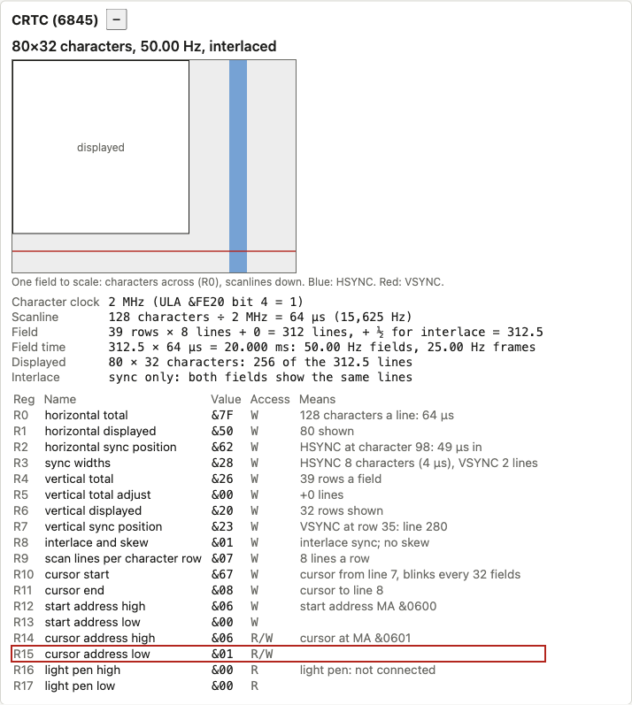
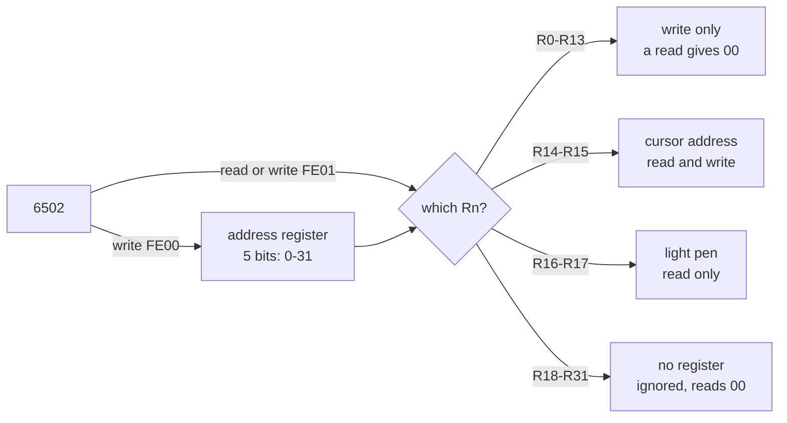
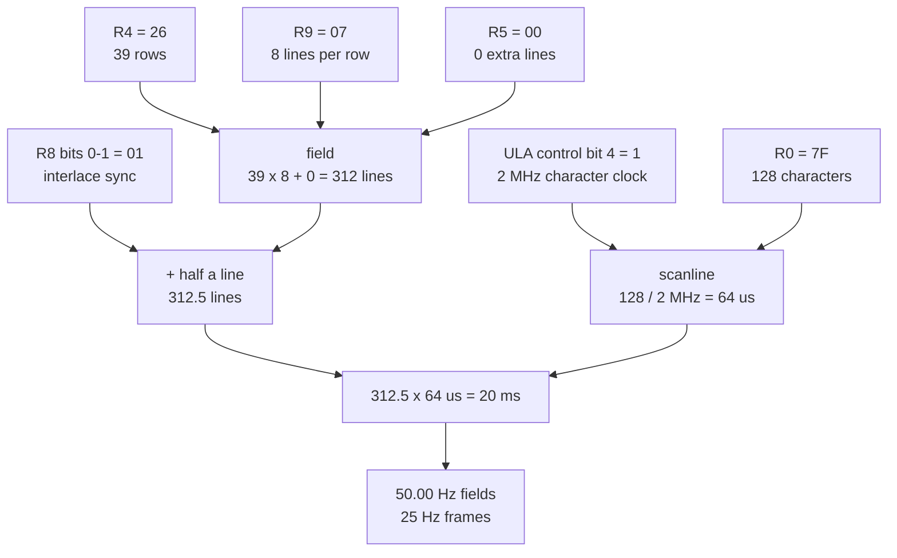
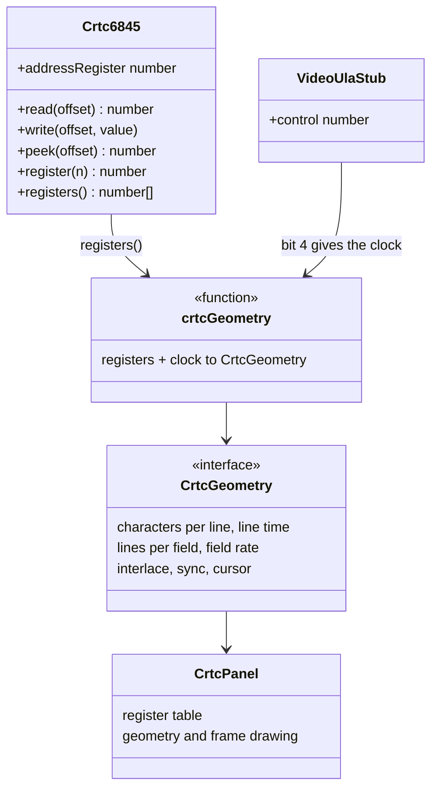

# Stage 37: CRTC registers & geometry

> **Part:** 8 (The 6845 CRTC) · **Branch:** `stage/37-crtc-registers` · **Needs:** 36
> **Status:** done

## Goal

Replace the Stage 28 CRTC stub with a real **6845 register file**, and work out what a set of register values *means*: how many characters a line has, how long a scanline lasts, how many lines are in a field, and therefore the frame rate.

The 6845 doesn't make pixels. It's a set of counters that time the TV picture and hand out memory addresses. Every one of those counters is compared against a register. So before we build the counters (Stage 38) and the addresses (Stage 39), we need the registers and an understanding of what each one controls. Nothing on screen changes yet. What changes is that the emulator can now *explain* the screen it's about to draw.

## What you can now see

**In the browser:**

```bash
npm run dev     # then open http://localhost:5173/?machine=mos
```

1. Find the **CRTC (6845)** panel in the workbench column. After boot it reads **`40×25 characters, 50.00 Hz, interlaced (sync and video)`**, which is MODE 7, with R8 = `&93` and R7 = `&1C` (VSYNC at row 28: line 280).
2. Under the summary is **one field drawn to scale**: the white box is the displayed area, the blue stripe is HSYNC and the red line is VSYNC. Below that, the geometry is **worked through with the real numbers** (`64 characters ÷ 1 MHz = 64 µs`, `31 rows × 10 lines + 2 = 312 lines, + ½ for interlace = 312.5`, …).
3. Click the screen and type `MODE 0` ↵. The panel changes to **`80×32 characters, 50.00 Hz, interlaced`**: R0 `&7F`, a 2 MHz clock, *still* 64 µs a line. The box widens (80 of 128 characters) and the VSYNC line stays at the same height (line 280). The changed registers flash yellow for one refresh.
4. Try `*TV 0,1` ↵ then `MODE 0` ↵: **`50.08 Hz, non-interlaced`**, 312 lines. Or `*TV 2` ↵ `MODE 0` ↵: R7 goes to `&25`, and VSYNC moves down 16 lines (the picture moves *up* on a real TV).
5. The row outlined in red is the register `&FE01` reaches now. After a MODE change it's usually R15: the last thing the MOS wrote was the cursor address.

What the panel showed after `MODE 0` (Playwright MCP screenshot):



The screen itself is still drawn as MODE 7: the bitmap modes need the Video ULA (Part 9). Type `MODE 7` to get your text back.

**Headless, from the real MOS:** `npx jest src/machine/crtc-modes` types `MODE 0` to `MODE 7` into BASIC and checks every register the MOS sends (it skips without ROMs):

```
7: 3F 28 33 24 1E 02 19 1C 93 12 72 13 | 40×25 characters, 50.00 Hz, interlaced (sync and video)
0: 7F 50 62 28 26 00 20 23 01 07 67 08 | 80×32 characters, 50.00 Hz, interlaced
1: 7F 50 62 28 26 00 20 23 01 07 67 08 | 80×32 characters, 50.00 Hz, interlaced
2: 7F 50 62 28 26 00 20 23 01 07 67 08 | 80×32 characters, 50.00 Hz, interlaced
3: 7F 50 62 28 1E 02 19 1C 01 09 67 09 | 80×25 characters, 50.00 Hz, interlaced
4: 3F 28 31 24 26 00 20 23 01 07 67 08 | 40×32 characters, 50.00 Hz, interlaced
5: 3F 28 31 24 26 00 20 23 01 07 67 08 | 40×32 characters, 50.00 Hz, interlaced
6: 3F 28 31 24 1E 02 19 1C 01 09 67 09 | 40×25 characters, 50.00 Hz, interlaced
7: 3F 28 33 24 1E 02 19 1C 93 12 72 13 | 40×25 characters, 50.00 Hz, interlaced (sync and video)
```

## The real hardware

The **6845 CRTC** (Cathode Ray Tube Controller) sits at **SHEILA `&FE00`–`&FE07`**. It has only one register-select line (RS), wired to address bit 0, so the eight addresses are four copies of a pair:

| Address | RS | What it is |
|---|---|---|
| `&FE00` | 0 | **Address register**: which of R0-R17 the next `&FE01` access reaches. Write-only. |
| `&FE01` | 1 | **Data register**: the register that the address register picks. |

To set R0 to `&7F`, the MOS writes two bytes:

```
LDA #&00 : STA &FE00     \ address register := 0
LDA #&7F : STA &FE01     \ R0 := &7F
```

This is the "address/data pair" pattern. A chip with eighteen registers needs only two bus addresses, at the cost of a second write. Many chips of the period work this way (the AY-3-8910 sound chip is another). It saves pins: the 6845 has one RS pin instead of five.

### The eighteen registers

From the 6845 data sheet's register table and the *Advanced User Guide*'s 6845 chapter. "Bits" is how many bits the chip actually stores. Anything above them is lost on the write.

| Reg | Name | Bits | Access | Unit | What it sets |
|---|---|---|---|---|---|
| R0 | Horizontal total | 8 | write | characters | total characters per scanline, **minus 1** |
| R1 | Horizontal displayed | 8 | write | characters | characters shown per line |
| R2 | Horizontal sync position | 8 | write | characters | the character at which HSYNC starts |
| R3 | Sync widths | 4 + 4 | write | chars / lines | bits 0-3: HSYNC width (characters); bits 4-7: VSYNC width (scanlines) |
| R4 | Vertical total | 7 | write | character rows | total rows per field, **minus 1** |
| R5 | Vertical total adjust | 5 | write | scanlines | extra scanlines after the last row |
| R6 | Vertical displayed | 7 | write | character rows | rows shown |
| R7 | Vertical sync position | 7 | write | character rows | the row at which VSYNC starts |
| R8 | Interlace & skew | 2 + 4 | write | | bits 0-1: interlace mode; bits 4-5: display enable skew; bits 6-7: cursor skew |
| R9 | Max scan line address | 5 | write | scanlines | scanlines per character row, **minus 1** |
| R10 | Cursor start | 7 | write | | bits 0-4: first cursor scanline; bits 5-6: blink mode |
| R11 | Cursor end | 5 | write | scanlines | last cursor scanline |
| R12 | Start address (high) | 6 | write | | top 6 bits of the 14-bit address of the first character |
| R13 | Start address (low) | 8 | write | | bottom 8 bits |
| R14 | Cursor address (high) | 6 | **read/write** | | top 6 bits of the cursor's 14-bit address |
| R15 | Cursor address (low) | 8 | **read/write** | | bottom 8 bits |
| R16 | Light pen (high) | 6 | **read only** | | latched when the light pen strobe fires |
| R17 | Light pen (low) | 8 | **read only** | | |

**The read rules.** Only R14-R17 can be read. Reading any other register, or the address register at `&FE00`, gives `&00`. This is how the data sheet and the *Advanced User Guide* describe it.

> ⚠️ **Unconfirmed: which 6845.** BeebWiki says Model Bs were fitted with either a Hitachi HD6845SP or a Motorola MC6845P. The variants differ in small ways: some let R12/R13 be read, some fix the VSYNC width at 16 lines, and they treat an HSYNC width of 0 differently. The MOS never reads R12/R13 and always programs a VSYNC width of 2, so we follow the *Advanced User Guide*'s table and note the differences here rather than modelling a particular variant.

## Key concepts

### 1. "Minus 1" registers

R0, R4 and R9 hold *one less* than the count they set. The 6845's counters start at 0 and compare against the register: "when the character counter **equals** R0, the next character is character 0 again". A counter that goes 0, 1, …, 127 and then wraps has 128 steps, so R0 = 127 = `&7F`.

R1, R6, R2 and R7 are compared the same way, but they mark a *position*, not an end. "Display characters while the counter is less than R1" means R1 = 80 = `&50` shows characters 0-79, which is 80 of them. No minus 1 is needed.

That's why MODE 0 has R0 = `&7F` (128 characters in total) but R1 = `&50` (80 shown).

### 2. The 6845 doesn't know its own speed

Every 6845 register is counted in **characters**, **scanlines** or **character rows**. None of them is in microseconds. The time comes from the clock fed to the chip's CLK pin, one tick per character.

On the BBC, the **Video ULA** chooses that clock. Bit 4 of its control register at `&FE20` selects **2 MHz** (the "high-frequency" 80-column modes 0-3) or **1 MHz** (modes 4-7), according to the *Advanced User Guide*'s Video ULA section. So the same R0 means different times:

| MODE | ULA control | Bit 4 | Character clock | R0 | Characters per line | Line time |
|---|---|---|---|---|---|---|
| 0 | `&9C` | 1 | 2 MHz | `&7F` | 128 | 128 ÷ 2 MHz = **64 µs** |
| 4 | `&88` | 0 | 1 MHz | `&3F` | 64 | 64 ÷ 1 MHz = **64 µs** |
| 7 | `&4B` | 0 | 1 MHz | `&3F` | 64 | 64 ÷ 1 MHz = **64 µs** |

Every MODE comes out at **64 µs per scanline**. That isn't a coincidence. 64 µs is the **PAL line period** (15,625 lines a second), and a UK television needs it within a few percent or the picture won't lock. The MOS halves R0 whenever it halves the clock, so the line time never changes.

So the geometry calculator has to be given the character clock: it can't work it out from the CRTC alone. We read the clock from the Video ULA stub's control byte (bit 4 only). The rest of the ULA is Stage 40's job.

### 3. A field, line by line

Vertically, the 6845 counts **scanlines** inside a **character row** (R9 + 1 of them), then **rows** inside a field (R4 + 1 of them), then adds R5 extra scanlines (the "adjust") before starting again:

```
lines per field = (R4 + 1) × (R9 + 1) + R5
```

**MODE 0:** R4 = `&26` (38), R9 = `&07` (7), R5 = `&00`:

```
(38 + 1) × (7 + 1) + 0 = 39 × 8 = 312 lines
```

**MODE 3:** R4 = `&1E` (30), R9 = `&09` (9), R5 = `&02`:

```
(30 + 1) × (9 + 1) + 2 = 31 × 10 + 2 = 312 lines
```

**R5 exists for MODE 3's case.** PAL wants about 312 lines. With 10-line rows you can have 31 rows (310 lines) or 32 (320), but neither is 312. The adjust register makes up the 2-line difference. With 8-line rows, 39 × 8 is exactly 312, so the adjust is 0.

Then the field time is just lines × line time:

```
312 × 64 µs = 19,968 µs   →   1 ÷ 19.968 ms = 50.08 Hz
```

### 4. Interlace and the half line

A PAL picture is really **two fields** of 312½ lines, drawn alternately. The second field's lines fall *between* the first field's, giving 625 lines in a 25 Hz **frame**. The half line is what makes the fields interleave: the second field's VSYNC starts half a line later than the first's, so the TV's beam lands half a line lower.

R8 bits 0-1 choose what the 6845 does:

| R8 bits 1-0 | Mode | What happens |
|---|---|---|
| `00` or `10` | **Non-interlaced** | every field is identical: 312 lines, 50.08 Hz |
| `01` | **Interlace sync** | VSYNC moves by half a line on alternate fields, but both fields show the *same* scanlines. On average 312½ lines, so exactly **50.00 Hz** |
| `11` | **Interlace sync and video** | as `01`, but the odd field shows the odd scanlines of each character and the even field shows the even ones. That doubles the vertical resolution. |

The MOS uses `01` in MODEs 0-6 (R8 = `&01`) and `11` in MODE 7 (R8 = `&93`, bottom 2 bits `11`). `*TV 0,1` turns interlace off (*User Guide*, `*TV`).

**MODE 7's character rows.** In interlace sync and video mode, the scanline counter goes up in **twos**: 0, 2, 4, … on one field and 1, 3, 5, … on the other. MODE 7 has R9 = `&12` (18), so each field draws a row in **10 scanlines**, and both fields together give the **20-line** teletext character that Stage 31's font was built for (10 dot rows doubled to 20 by the rounding). The field total checks out:

```
(R4 + 1) × 10 + R5 = 31 × 10 + 2 = 312 lines, plus ½ for interlace = 312½
```

> ⚠️ **Our reading.** We treat a row as ⌊R9 ÷ 2⌋ + 1 scanlines per field in this mode. That's 10 for R9 = 18, and it's the only reading that gives MODE 7 the 312½-line field a 50 Hz TV needs. What the counter does with an *odd* R9, and exactly which field starts on which line, is for Stage 38 to settle when we build the counters.

### 5. The sync pulses and the picture position

The TV doesn't know where a line or field starts until the sync pulse arrives. So **R2 and R7 position the picture**. Moving HSYNC later makes the picture move *left*, because everything before the pulse is now further from the left edge of the next line.

In MODE 0, the line looks like this, one character = ½ µs:

```
char:  0                          80        98      106                  127
       |<----- displayed (R1) ---->|<-border->|<HSYNC>|<-- back porch -->|
       |       80 chars = 40 µs    |  9 µs    | 4 µs  |      11 µs       |
                                              ^ R2 = &62      R3 bits 0-3 = 8
```

And the field (scanlines):

```
line:  0                          256       280  282                  312
       |<----- displayed rows ---->|<border>->|VSYNC|<--- top border -->|
       |     R6 × (R9+1) = 256     |  24      |  2  |       30          |
                                              ^ R7 = &23 (row 35 × 8 lines)
```

(The "top border" is the lines after VSYNC: once the TV's beam has flown back to the top, they're the first lines it draws, above the displayed area. Some of them are hidden in the TV's own blanking time.)

MODEs 4-6 put HSYNC at character `&31` (49) at 1 MHz, which is 49 µs, the same instant as MODE 0's character 98 at 2 MHz. **MODE 7 puts it at `&33` (51)**, 2 µs later. MODE 7 also sets R8's **display skew** (bits 4-5 = `01`, one character) and **cursor skew** (bits 6-7 = `10`, two characters). Skew delays the display-enable and cursor outputs by whole characters. MODE 7 needs this because the SAA5050 teletext chip takes time to turn a byte into dots, so the 6845's signals have to be held back to stay in step with its output. Exactly how these shifts line up the MODE 7 picture with the others is for Stages 39 and 42.

### 6. The cursor and the start address

These registers don't change the geometry, but they belong to the register file, and the panel shows them:

- **R10 bits 5-6** set the blink: `00` steady, `01` no cursor, `10` blink every 16 fields, `11` blink every 32 fields. The MOS uses `11` (R10 = `&67` in MODE 0, `&72` in MODE 7). 50 ÷ 32 ≈ 1.6 blinks a second, the BBC's familiar slow flash.
- **R10 bits 0-4 / R11** are the first and last scanlines of the cursor within the row. MODE 0 uses 7 to 8 (only line 7 exists, because R9 = 7). MODE 7 uses 18 to 19, the bottom two of its 20 lines.
- **R12/R13** and **R14/R15** are 14-bit **character addresses** (MA), not CPU addresses. At the BASIC prompt in MODE 7, R12/R13 = `&28 &00`, so MA = `&2800`, and the screen is at `&7C00`. Turning MA into a CPU address is Stage 39's subject.

R14/R15 are **readable** because a program may want to know where the cursor is. R16/R17 are **read only** because the *chip* writes them: when the light pen sees the beam, the 6845 copies its current address into them. The BBC's light pen input isn't connected to anything we emulate, so they stay `&00`.

### 7. Where the MOS keeps the values

MOS 1.20 doesn't calculate any of this. It has **five 12-byte tables** at `&C46E` in the ROM, one per CRTC shape, and on a `MODE` change it copies the right one into R11 down to R0. We read these straight out of `os12.rom`:

| Table | MODEs | R0 | R1 | R2 | R3 | R4 | R5 | R6 | R7 | R8 | R9 | R10 | R11 |
|---|---|---|---|---|---|---|---|---|---|---|---|---|---|
| `&C46E` | 0, 1, 2 | `7F` | `50` | `62` | `28` | `26` | `00` | `20` | `22` | `01` | `07` | `67` | `08` |
| `&C47A` | 3 | `7F` | `50` | `62` | `28` | `1E` | `02` | `19` | `1B` | `01` | `09` | `67` | `09` |
| `&C486` | 4, 5 | `3F` | `28` | `31` | `24` | `26` | `00` | `20` | `22` | `01` | `07` | `67` | `08` |
| `&C492` | 6 | `3F` | `28` | `31` | `24` | `1E` | `02` | `19` | `1B` | `01` | `09` | `67` | `09` |
| `&C49E` | 7 | `3F` | `28` | `33` | `24` | `1E` | `02` | `19` | `1B` | `93` | `12` | `72` | `13` |

**But R7 isn't quite what the table says.** The tests found it: after `MODE 0`, R7 holds `&23`, not `&22`. The MOS sends every register through one routine, and at `&C95E` it does this (disassembled from `os12.rom`):

```
C95E  CPY #&07        \ is this R7?
C960  BCC &C985       \ R0-R6: write it as it is
C962  BNE &C967       \ R8 and up: skip the next instruction
C964  ADC &0290       \ R7: add the *TV vertical offset ... and the carry
...
C985  STY &FE00       \ address register := Y
C988  STA &FE01       \ Rn := A
```

`CPY #&07` with Y = 7 sets the carry (Y ≥ 7), and `ADC` adds the carry. So R7 = table + `*TV` offset + **1**. The default offset (`&0290`) is 0, so `&22` becomes `&23` and `&1B` becomes `&1C`. `*TV 255` (−1) gives exactly the table's value. Whether Acorn meant it or not, the effect is tidy: with the +1, **VSYNC starts on scanline 280 in every MODE** (row 35 × 8 lines, or row 28 × 10). Without it, VSYNC would be at line 272 in MODE 0 but 270 in MODE 3, and the picture would jump 2 lines between them. R8 gets similar treatment at `&C967`: unless bit 7 is set (MODE 7's `&93`), it's EORed with `&0291`, the `*TV` interlace flag. That's how `*TV 0,1` turns interlace off.

The CRTC has only five shapes because the *colour depth* isn't the CRTC's business. MODEs 0, 1 and 2 have the same timing and the same 80 bytes per row. The Video ULA decides whether a byte is 8, 4 or 2 pixels (Stages 40-41).

## Diagrams

The register file: how two addresses reach eighteen registers.



From register values to a frame rate (MODE 0's numbers):



How the TypeScript pieces relate:



## Our design

**`src/devices/crtc6845.ts`** replaces `devices/stubs/crtc-stub.ts`. It keeps the stub's API (`register(n)`, `registers()`, `addressRegister`), so `main.ts` and the tests that read R12/R13 for the MODE 7 screen don't change. What's new:

- **Register widths.** `CRTC_REGISTER_BITS` holds each register's mask. A write stores `value & mask`, so `R12 := &FF` stores `&3F`, as the chip would.
- **Read rules.** `CRTC_REGISTER_ACCESS` is `'write' | 'read-write' | 'read'` per register. `read()` returns the value only for the readable ones, and `&00` otherwise. Writes to R16/R17 are ignored.
- **The hardware log** still records every data write as written. The trace shows what the MOS *sent*, even if the chip dropped some bits.
- **No `tick()` yet.** The counters are Stage 38. The 6845 isn't in the machine's clocked list, and the fake vsync stays.
- `peek()` is the same as `read()`, because no 6845 read has a side effect.

**`src/devices/crtc-geometry.ts`** is pure. `crtcGeometry(registers, characterClockHz)` returns a `CrtcGeometry` of plain numbers (characters per line, line time, lines per field, field rate, interlace mode, sync positions, cursor). `describeCrtcGeometry()` turns it into `"80×32 characters, 50.00 Hz, interlaced"`. `characterClockHz(ulaControl)` reads the one ULA bit it needs.

**The CRTC panel** (`web/workbench/crtc-view-model.ts` + `crtc-panel.ts`) shows the eighteen registers (value, access, and what the value means in that register's own units), the derived geometry, and a to-scale drawing of one field with the displayed area and the two sync pulses. Following the parking-lot lessons from Stages 24 and 26, it builds its elements once and only updates their text on refresh.

**Alternative considered:** computing geometry inside `Crtc6845` (`crtc.geometry()`). We kept it outside because the CRTC really doesn't know its clock. Passing the clock in makes the dependency on the ULA visible, and it lets the tests check geometry from a bare table of numbers without building a chip.

## Code walkthrough

**[`src/devices/crtc6845.ts`](../../src/devices/crtc6845.ts)**: the chip. All the rules live in two tables, so `read()` and `write()` stay short:

```ts
export const CRTC_REGISTER_BITS: readonly number[] = [
  0xff, 0xff, 0xff, 0xff, // R0-R3
  0x7f, 0x1f, 0x7f, 0x7f, // R4-R7
  0xf3, 0x1f, 0x7f, 0x1f, // R8-R11
  0x3f, 0xff, 0x3f, 0xff, // R12-R15
  0x3f, 0xff, //             R16-R17
];
```

`write()` on `&FE01` checks `CRTC_REGISTER_ACCESS[address]`. A `'write'` or `'read-write'` register stores `v & CRTC_REGISTER_BITS[address]`, and a `'read'` one (the light pen) ignores the CPU. Either way the **hardware log gets the byte as sent**, so the boot trace still says `CRTC R12=&FF` if that's what the MOS wrote. `read()` answers only `'read-write'` and `'read'` registers. Everything else, the address register included, gives `&00`. The register-number constants (`CRTC_R0_HORIZONTAL_TOTAL` … `CRTC_R17_LIGHT_PEN_LOW`) are named after the data sheet.

**[`src/devices/crtc-geometry.ts`](../../src/devices/crtc-geometry.ts)**: the arithmetic of Key concepts 2-5. Two details are worth seeing:

```ts
// Multiply first, so 128 × 1,000,000 ÷ 2,000,000 is exactly 64, with no rounding error.
const lineMicroseconds = (charactersPerLine * 1_000_000) / clockHz;
// Interlace sync and video: the scanline counter steps by 2 (Stage 37 doc, "our reading").
const scanlinesPerRow = interlace === 'sync-and-video' ? (r9 >> 1) + 1 : r9 + 1;
```

Doing the multiplication first keeps every MODE's numbers exact (64 µs, 20,000 µs, 50 Hz), so the tests can use `toEqual` rather than "close to". `characterClockHz(ulaControl)` is a one-liner on ULA bit 4. It's deliberately outside both the CRTC and the ULA stub, because it's the *wire* between them.

**[`src/machine/bbc-model-b.ts`](../../src/machine/bbc-model-b.ts)**: `crtc` is now a `Crtc6845`. Nothing else changed. It isn't ticked (no counters yet), and the fake vsync still drives CA1.

**[`src/web/workbench/crtc-view-model.ts`](../../src/web/workbench/crtc-view-model.ts)**: turns registers + ULA byte into rows (`R7 … &23 W "VSYNC at row 35: line 280"`), six geometry lines, and three boxes in percent of a field. `percent()` clamps to 0-100 and rounds to 4 places, so an unprogrammed chip (all `&00`, 1 character × 1 line) still draws.

**[`src/web/workbench/crtc-panel.ts`](../../src/web/workbench/crtc-panel.ts)**: builds its 18 rows and the geometry list once, then only sets text, classes and the boxes' `left/top/width/height`. Wired in [`src/main.ts`](../../src/main.ts) with `ulaControl: () => machine.videoUla.control`. `workbench.crtc` is on the console handle too.

## Tests

| Test file | What it proves |
|---|---|
| `src/devices/crtc6845.test.ts` | Address/data pair; 5-bit address register; RS = address bit 0 (mirrors); R18-R31 ignored; every register's width (R12 `&FF` → `&3F`, …); R0-R13 and `&FE00` read `&00`; R14/R15 read back (masked); R16/R17 ignore CPU writes; `peek` = `read` with no side effects; the hardware log records the byte as sent. |
| `src/devices/crtc-geometry.test.ts` | Geometry for each of the five MOS register sets: characters, rows, lines per row, 312.5-line fields, HSYNC/VSYNC positions; 64 µs lines in every MODE; HSYNC 49 µs in (51 in MODE 7); VSYNC on line 280 everywhere; interlace off → 312 lines, 50.08 Hz; `%10` is off too; MODE 7's 10 lines per field; skew; VSYNC width 0 = 16; cursor lines and blink modes; 14-bit MA; all-zero chip is finite; ULA bit 4 → clock for all 8 MODEs. |
| `src/machine/crtc-modes.test.ts` | **Needs ROMs** (skips without them). Types `MODE 0`-`7` into BASIC: R0-R11 match the MOS's tables except R7 (+1); every MODE is 64 µs a line; R7 = table + `*TV` + 1 (`*TV 255` → `&22`, `*TV 2` → `&25`); `*TV 0,1` → R8 `&00`, 50.08 Hz; R12/R13 read `&00` through `&FE01` while R14/R15 read back. |
| `src/web/workbench/crtc-view-model.test.ts` | Summary, 18 rows with access letters, every R0-R17 "means" text for MODE 0, MODE 7's R8/R9 wording, the selected register, changed marks, the six worked geometry lines (interlaced and not), the frame boxes in percent, and no NaN/overflow for an empty chip. |
| `e2e/crtc.spec.ts` | (real-time project, skips without ROMs) After boot the panel shows MODE 7 with R8 `&93` and VSYNC on line 280; typing `MODE 0` on the PC keyboard changes it to 80×32 at 2 MHz, still 64 µs. |

The old `src/devices/stubs/crtc-stub.{ts,test.ts}` are deleted. Their tests live on in `crtc6845.test.ts`, with the stub's "reads give `&00`" test replaced by the real read rules.

## Gotchas & hardware quirks

- **R7 is one more than the MOS's table.** `CPY #&07` leaves the carry set and `ADC &0290` adds it (`&C95E`). So the AUG-style table values (`&22`, `&1B`) are never in the chip unless you type `*TV 255`. Our first ROM test expected the table and failed: that's how we found it.
- **The CRTC doesn't know its clock.** The same R0 = `&3F` is 64 µs at 1 MHz and would be 32 µs at 2 MHz. Any geometry needs the ULA's bit 4. Writing the ULA control and the CRTC aren't atomic, so for a moment during a MODE change the "geometry" can be nonsense (e.g. 2 MHz with MODE 7's R0 = 32 µs lines). The panel only refreshes at 10 Hz, so you won't usually see it.
- **"Minus 1" vs "position" registers.** R0, R4 and R9 are counts − 1. R1, R2, R6 and R7 are positions compared against a counter that starts at 0. R5 is a plain count.
- **50.00 Hz, not 50.08.** With interlace on (the MOS default), the average field is 312½ lines = exactly 20 ms. BUILD-PLAN's example "50.08 Hz, interlaced" mixes the two; 50.08 Hz is the *non*-interlaced rate.
- **MODE 7's rows in interlace sync and video** are counted as ⌊R9 ÷ 2⌋ + 1 = 10 lines per field. This is our reading, chosen because it's the only one that gives 312½ lines. Stage 38 builds the counter and will have to settle odd R9 and which field starts where.
- **Variant differences not modelled:** some 6845s let R12/R13 be read, fix the VSYNC width at 16 lines, or treat HSYNC width 0 differently. We follow the AUG; the MOS never depends on them.
- **R8 bits 2-3** are taken as non-existent (mask `&F3`). Unconfirmed, and harmless: the MOS writes only `&00`, `&01` and `&93`.
- **Power-on contents** are `&00` in our chip. A real 6845's registers are random until written: its /RESET only resets the counters. The MOS writes all of R0-R11 before the screen matters.
- **R16/R17** stay `&00`: nothing in our machine strobes the light pen.
- **Simplified:** nothing counts yet, so nothing on screen depends on these registers except R12/R13 (used since Stage 30 for the MODE 7 start address). The fake vsync is still what interrupts the MOS. Stage 38 replaces it.

## Playwright verification

- **MCP, interactive:** opened `/?machine=mos`, read the CRTC panel after boot (MODE 7 values as above), clicked the screen, held keys to type `MODE 0` ↵ (instant presses are lost, the known Stage 35 issue, so each key was held 60 ms) and saw the panel change to `80×32 characters, 50.00 Hz, interlaced`. Screenshot: `docs/stages/img/37-crtc-mode0.png`.
- **Durable:** `e2e/crtc.spec.ts`, 2 tests, added to the `real-time` project in `playwright.config.ts` (typing needs a running machine).

## Check your understanding

1. MODE 0 has R0 = `&7F` but R1 = `&50`. Why is one "minus 1" and the other not?
2. MODE 4's R0 is half of MODE 0's, but both lines take 64 µs. What else changed, and why must the line stay at 64 µs?
3. Work out MODE 6's lines per field from R4 = `&1E`, R9 = `&09`, R5 = `&02`. What would go wrong without R5?
4. The MOS's table says R7 = `&22` for MODE 0, but the chip holds `&23`. Where does the extra 1 come from, and what does it achieve across the MODEs?
5. Why can a program read R14/R15 and R16/R17, but not R0-R13?

<details>
<summary>Answers</summary>

1. R0 is a **total**. The character counter runs 0…R0 and then wraps, which is R0 + 1 = 128 steps. R1 is a **position**: display is on while the counter is below R1, so characters 0-79 are shown, which is exactly 80.
2. The **character clock** halved too: the Video ULA's control bit 4 is 1 in MODE 0 (2 MHz) and 0 in MODE 4 (1 MHz). 128 ÷ 2 MHz = 64 ÷ 1 MHz = 64 µs. That's the PAL line period (15,625 Hz). A TV's horizontal oscillator only locks near it, so every MODE must produce it.
3. (30 + 1) × (9 + 1) + 2 = 312 lines (312½ with interlace). With 10-line rows, 31 rows give 310 and 32 give 320. Neither is the ~312 a 50 Hz PAL TV needs. R5 adds the odd 2 lines.
4. The MOS's register writer does `CPY #&07` (Y = 7, so the carry is set) and then `ADC &0290`, adding the `*TV` offset **and the carry**. With `*TV 0`, R7 is table + 1. That puts VSYNC at scanline 280 in every MODE (35 × 8 = 28 × 10), so the picture doesn't jump vertically between 8-line and 10-line MODEs.
5. R0-R13 are set by the CPU and never change by themselves, so the CPU already knows them. The chip saves the pins and logic to read them back. R14/R15 are read/write so software can ask where the cursor is. R16/R17 are written *by the chip* (when the light pen fires), so reading is the only way to find out.

</details>

## Further reading

- **Motorola MC6845 / Hitachi HD6845S data sheets**: the register table, the interlace modes (R8) and the timing diagrams.
- ***Advanced User Guide for the BBC Microcomputer*** (Bray, Dickens, Holmes): the 6845 CRTC chapter (register meanings and the MODE values) and the Video ULA section (control register bit 4, the CRTC clock).
- **BeebWiki**: "6845 CRTC" and "Video ULA". Which 6845 variants were fitted.
- *BBC Micro User Guide*: `*TV` (vertical offset and interlace).
- MOS 1.20 disassembly, from our own `os12.rom` with Stage 18's disassembler: the tables at `&C46E` and the register writer at `&C95E`-`&C98B`.
