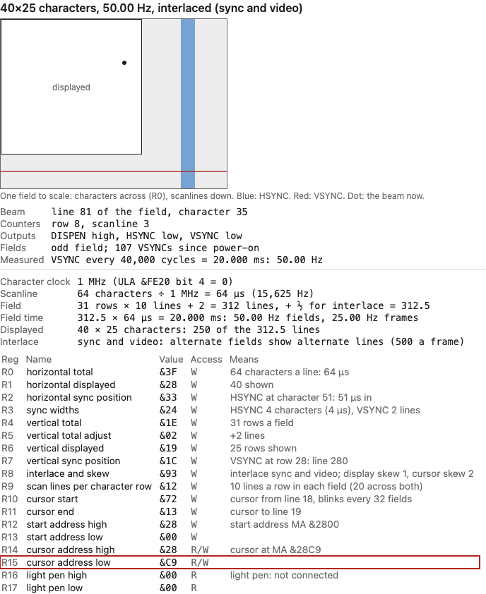
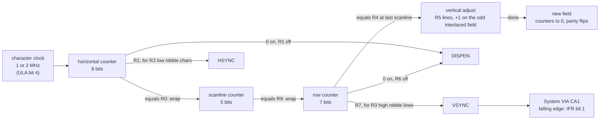
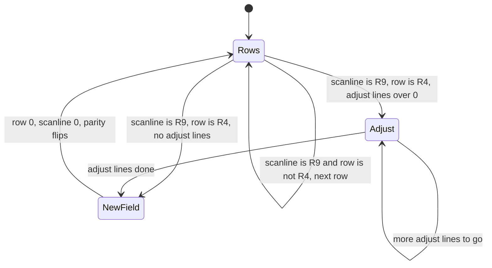
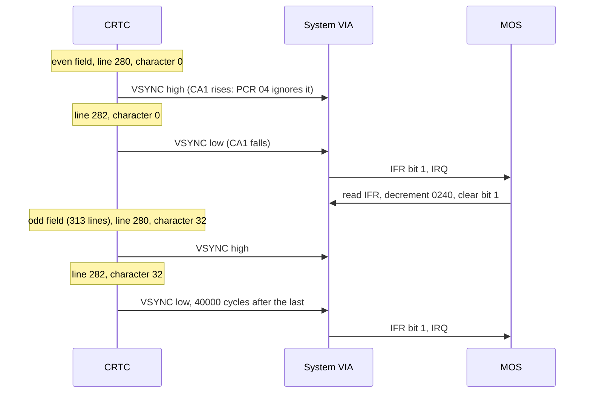

# Stage 38: CRTC counters & sync

> **Part:** 8 (The 6845 CRTC) · **Branch:** `stage/38-crtc-counters-sync` · **Needs:** 37
> **Status:** done

## Goal

Make the 6845 **count**. Stage 37 gave it registers and worked out on paper what they mean. This stage builds the counters that the real chip runs: a character counter, a scanline counter, a row counter and the vertical adjust. From them come the chip's three timing outputs: **HSYNC**, **VSYNC** and **display enable**.

The payoff is that **the real VSYNC replaces the fake 50 Hz pulse from Stage 29**. From now on, the MOS's 50 Hz interrupt happens because the CRTC has counted 312½ scanlines, and not because a stub counted 40,000 cycles. Change the registers (`*TV 0,1` and a `MODE` change) and the interrupt rate changes with them, just as on the real machine.

## What you can now see

**Headless, from the real MOS** (skips without ROMs):

```bash
npm run demo:crtc
```

Part 1 clocks a copy of the MOS's MODE 7 CRTC one character (1 µs) at a time, across one scanline:

```
  character  0123456789012345678901234567890123456789012345678901234567890123
  DISPEN     ████████████████████████████████████████························
  HSYNC      ···················································HHHH·········
```

Part 2 runs three whole fields and prints only the moments where something changes. The even field is 312 lines with VSYNC at character 0; the odd one is 313 lines with VSYNC half a line (32 characters) later; the gap between VSYNCs is the same either way:

```
  even field:
    line 250, character  0 (row 25, scanline  0): display enable off for the rest of the field: row = R6 (&19 = 25)
    line 280, character  0 (row 28, scanline  0): VSYNC rises: row = R7 (&1C = 28)
    line 282, character  0 (row 28, scanline  4): VSYNC falls, 2 lines later (R3 bits 4-7): CA1 falls, the MOS's IRQ
    line 310, character  0: row 30 (= R4) is done; vertical adjust, R5 = 2 lines
    312 lines.
  odd field:
    line 250, character  0 (row 25, scanline  1): display enable off for the rest of the field: row = R6 (&19 = 25)
    line 280, character 32 (row 28, scanline  1): VSYNC rises: row = R7 (&1C = 28), 40,000 cycles after the last
    line 282, character 32 (row 28, scanline  5): VSYNC falls, 2 lines later (R3 bits 4-7): CA1 falls, the MOS's IRQ
    line 310, character  0: row 30 (= R4) is done; vertical adjust, R5 = 2 lines + 1 (odd field)
    313 lines.
```

(Notice the scanline column: 0, 4 in the even field and 1, 5 in the odd one. MODE 7's counter steps by 2, Key concept 5.)

Part 3 types every MODE into BASIC and compares the rate **measured** between two VSYNCs with Stage 37's **formula**. They agree everywhere, including the non-interlaced case:

```
  MODE             R8  cycles between VSYNCs  measured   Stage 37's formula
  0                01                 40,000  50.00 Hz   50.00 Hz
  ...
  7                93                 40,000  50.00 Hz   50.00 Hz
  *TV 0,1: MODE 0  00                 39,936  50.08 Hz   50.08 Hz
  *TV 0,1: MODE 7  93                 40,000  50.00 Hz   50.00 Hz
```

Part 4: 50 VSYNCs in a second, the MOS counts `&0240` down by 50, and `PRINT 6*7` still prints `42`. `npm run demo:boot`'s Part 5 now cuts the real VSYNC-to-CA1 wire: the CRTC still counts 50 fields, but `&0240` stands still and `*FX19` hangs.

**In the browser:**

```bash
npm run dev     # then open http://localhost:5173/?machine=mos
```

1. The status line under the screen ends **`· VSYNC 50.00 Hz`**. That number is measured from the CRTC's counters, not assumed.
2. The **CRTC (6845)** panel has a new **counters** block above the geometry: where the beam is (`line 81 of the field, character 35`), the row and scanline counters, the three outputs (DISPEN, HSYNC, VSYNC), the field parity and VSYNC count, and **`Measured: VSYNC every 40,000 cycles = 20.000 ms: 50.00 Hz`**. A dot in the field drawing marks the beam. Pause and press **Step frame** a few times: the field parity flips each time, and the beam stays on the same line but jumps 32 characters back and forth (give or take an instruction). A step is 40,000 cycles, which is half a line more than an even field (312 lines) and half a line less than an odd one (313).
3. Type `MODE 0` ↵: still 40,000 cycles, 50.00 Hz.
4. In the console: `workbench.crtc.write(0, 8); workbench.crtc.write(1, 0)` (R8 := `&00`, interlace off). In MODE 0 the measurement goes to **39,936 cycles, 50.08 Hz**, and so does the status line. Try the same in MODE 7 and you get **75,648 cycles, 26.44 Hz**: with sync and video off, R9 = `&12` means 19-line rows (31 × 19 + 2 = 591 lines). That's why the MOS's `*TV` never touches MODE 7's R8 (Gotchas).
5. Booting, typing and the teletext flash all work as before: they run on the real VSYNC now.

The panel in MODE 7, paused (Playwright MCP screenshot):




## The real hardware

The 6845's registers are only half of the chip. The other half is a set of **counters** clocked by the character clock on its CLK pin (1 or 2 MHz, chosen by the Video ULA, Stage 37). Each counter is compared against a register, and the comparisons switch three output pins (6845 data sheet, block diagram and "Horizontal and vertical timing"):

| Pin | Name | What it does on the Model B |
|---|---|---|
| 39 | **HSYNC** | Horizontal sync. Combined with VSYNC by a NOR gate (IC41) into the composite sync for the TV, and fed to the SAA5050 (*Hardware Guide for the BBC Microcomputer*, ch. 3). |
| 40 | **VSYNC** | Vertical sync. Also combined into composite sync, and **wired to the System VIA's CA1**: the MOS's 50 Hz interrupt (*Advanced User Guide*, System VIA). |
| 18 | **DISPEN** | Display enable: high while the beam is inside the displayed area. The Video ULA blanks everything else (Stages 40-42). |

There are also the memory address (MA0-MA13) and row address (RA0-RA4) outputs. These say *which bytes* to show, and they're Stage 39's subject. Here we only count.

| Counter | Width | Counts | Compared with |
|---|---|---|---|
| **Horizontal** (character) | 8 bits | characters along a scanline | R0 (end of line), R1 (display off), R2 (HSYNC on) |
| **HSYNC width** | 4 bits | characters while HSYNC is high | R3 bits 0-3 |
| **Scanline** (raster) | 5 bits | scanlines inside a character row | R9 (end of row) |
| **Row** (vertical) | 7 bits | character rows in the field | R4 (last row), R6 (display off), R7 (VSYNC on) |
| **Vertical adjust** | 5 bits | extra scanlines after the last row | R5 |
| **VSYNC width** | 4 bits | scanlines while VSYNC is high | R3 bits 4-7 (0 = 16) |

### Which edge reaches CA1

> ⚠️ **Checked against another emulator's behaviour.** Stage 29 left this open. Neither the *Advanced User Guide* nor the *Hardware Guide* says whether VSYNC is inverted on its way to CA1, and I couldn't check the circuit diagram. jsbeeb drives CA1 at **the same level as VSYNC** (consulted for behaviour only; no code taken). We do the same.

VSYNC is active **high**. The MOS sets the System VIA's PCR to `&04`, and PCR bit 0 = 0 means CA1 interrupts on a **falling** edge (6522 data sheet, PCR). So the MOS's vsync interrupt comes at the **end** of the VSYNC pulse, two scanlines (128 µs) after it starts. Stage 29's fake pulse was the other way up (it fell at the start). The MOS can't tell the difference: the gap between interrupts is still exactly 20 ms.

## Key concepts

### 1. Three counters, like the hands of a clock

The 6845 counts the picture the way the beam draws it: along a scanline, then down a row, then down the field. Each counter only steps when the one below it wraps, like the hands of a clock:

```
character clock tick
   └─▶ horizontal counter  0, 1, 2 … R0 → 0           (one scanline)
          └─▶ scanline counter  0, 1 … R9 → 0          (one character row)
                 └─▶ row counter  0, 1 … R4            (one field, then…)
                        └─▶ vertical adjust  0 … R5−1  (…a few extra scanlines)
                               └─▶ new field: everything back to 0
```

Every comparison is **equality**. The chip doesn't ask "is the counter past R0?". It asks "is it *equal to* R0?". That matters in two ways:

- It explains the "minus 1" registers from Stage 37. The counter is compared with R0 = `&3F` (63) and wraps *after* character 63, so a line is 64 characters.
- If a program lowers R0 while the counter is already past it, the counter never matches. It counts on up to 255, wraps to 0 through its own 8 bits, and only then matches again. That gives one very long line, and the TV loses sync for a moment. You'll see it on real hardware during some `MODE` changes. We model it because it costs nothing: the counters are masked to their real widths (`& 0xff`, `& 0x1f`, `& 0x7f`), and the compares are `===`.

### 2. The horizontal signals, in MODE 7

MODE 7 runs the 6845 at 1 MHz with R0 = `&3F`, R1 = `&28`, R2 = `&33` and R3 = `&24`. One character is 1 µs, so the counter *is* a clock in µs:

```
character:  0                   40         51  55          63 | 0
            |<- display (R1=40) ->|<-------->|HS |<--------->| |
DISPEN      ‾‾‾‾‾‾‾‾‾‾‾‾‾‾‾‾‾‾‾‾‾\______________________________/‾‾
HSYNC       ______________________________/‾‾‾\_________________
                                           R2   R3 low nibble = 4 characters
```

- **Display enable** goes high at character 0 and low when the counter equals R1 (40).
- **HSYNC** goes high when the counter equals R2 (51) and stays high for R3's low nibble, 4 characters (4 µs).
- At character 63 (= R0) the line ends and the next character is 0 again. That's 64 µs in all.

MODE 0 has the same shape at 2 MHz: R1 = 80, R2 = `&62` (98), 8 characters of HSYNC and 128 characters a line, so it's still 64 µs.

### 3. The vertical signals, in MODE 0

At the end of each scanline (when the horizontal counter wraps), the **scanline counter** steps. When it equals R9 (7 in MODE 0), it goes back to 0 and the **row counter** steps.

The row counter drives the vertical comparisons, made **at the start of each row**:

| Row counter becomes… | MODE 0 value | What happens |
|---|---|---|
| R6 | 32 (`&20`) | vertical display enable goes **low**: no more displayed rows |
| R7 | 35 (`&23`) | **VSYNC** goes high, for R3's top nibble (2) scanlines |
| R4, at its last scanline | 38 (`&26`) | the field's rows are done: into the **adjust** (R5 scanlines), or straight to a new field if R5 is 0 |

In scanlines: display is on for lines 0-255 (32 rows × 8), VSYNC is high for lines 280-281 (row 35 × 8) and the field ends after line 311 (39 × 8 = 312). With R5 = `&00` there's no adjust. MODE 3 and MODE 7 have R5 = `&02`, so two extra scanlines come after row 30's last one.

**What does "display enable" mean when there's an adjust?** The adjust scanlines belong to no row, so they're always in the border (R6 is always less than R4 + 1 in practice).

### 4. Interlace: one field gets an extra line

Stage 37 said that an interlaced field is 312**½** lines long. But the counters count whole scanlines. How can a field have half a line?

It can't. What the 6845 does instead (in both interlace modes, R8 bits 0-1 = `01` or `11`) is alternate two kinds of field:

| Field | Scanlines | VSYNC starts |
|---|---|---|
| **even** (field 0) | (R4 + 1) × lines per row + R5 = **312** | at the **start** of line 280 |
| **odd** (field 1) | the same **+ 1** (one more adjust line) = **313** | **half a line later**, in the middle of line 280 |

Now measure from one VSYNC to the next (MODE 0, 64 µs lines):

```
even field (312 lines)     odd field (313 lines)              even field …
|------------------- 312 lines -----------------|-------------------- 313 lines --------------------|
          ▲ VSYNC at 280                                   ▲ VSYNC at 312 + 280.5 = 592.5          ▲ 625 + 280 = 905
          |<-------------- 312.5 lines ------------------->|<---------------- 312.5 lines --------->|
```

**Both gaps are 312.5 lines = 20,000 µs = 40,000 CPU cycles.** The fields have different lengths, but the VSYNCs are evenly spaced, and VSYNC is what the TV (and the MOS) locks to. The half-line delay is what puts the odd field's scanlines *between* the even field's on the screen. Two fields make one 625-line, 25 Hz frame.

> ⚠️ **Our reading, checked against another emulator.** The data sheets give the result (a 312½-line field, half-line VSYNC shift) but not how the counters produce it. The extra line has to be in the field whose VSYNC is late, or the two gaps come out as 313.5 and 311.5 lines. jsbeeb (consulted for behaviour only) also gives the odd field the extra line and the late VSYNC. "Half a line" for us is ⌊(R0 + 1) ÷ 2⌋ characters: 32 in MODE 7, 64 in MODE 0. Which field the chip starts with after /RESET is unknown, and we start with the even one.

Non-interlaced (R8 bits 0-1 = `00` or `10`, e.g. after `*TV 0,1`): every field is 312 lines with VSYNC at the start of line 280. The gap is 312 × 64 µs = 19,968 µs = **39,936 cycles = 50.08 Hz**.

### 5. Interlace sync and video: the scanline counter steps by 2

MODE 7 uses R8 = `&93`: bits 0-1 = `11`, **interlace sync and video**. Here the two fields don't just shift; they show *different* scanlines of each character. The even field shows lines 0, 2, 4, …, 18 of the 20-line teletext character, and the odd field shows 1, 3, 5, …, 19.

The way to get that with one counter:
- The scanline counter steps by **2**: 0, 2, 4, … 18.
- The row address the chip *outputs* (RA, for Stage 39) is that count with the **field's parity in bit 0**: 0, 2, … 18 in the even field, 1, 3, … 19 in the odd field.
- The row ends when the count matches R9 **ignoring bit 0**. MODE 7's R9 = `&12` (18), so the count runs 0, 2, …, 18: **10 scanlines per row, per field**.

That's the ⌊R9 ÷ 2⌋ + 1 that Stage 37 assumed, now built: 31 rows × 10 + 2 adjust = 312 lines (313 on the odd field). Ignoring bit 0 also settles Stage 37's "what about an odd R9?": `&13` (19) behaves exactly like `&12`. That's our reading; jsbeeb's counter steps by 2 the same way.

### 6. Counting at 1 MHz from a 2 MHz CPU

Everything in our machine is ticked in **2 MHz CPU cycles** (BUILD-PLAN §3). At 2 MHz each cycle is one character. At 1 MHz it takes two cycles, so the CRTC keeps a **half-cycle carry**, exactly like the VIAs do:

```
tick(7) at 1 MHz:  carry 0 + 7 = 7 → 3 characters, carry 1
tick(5) at 1 MHz:  carry 1 + 5 = 6 → 3 characters, carry 0
```

The clock rate comes from the Video ULA's control register bit 4 (Stage 37), read at every tick, so a `MODE` change that switches the clock takes effect at once.

### 7. Measuring the frame rate

The CRTC records the **CPU cycle count at each VSYNC rising edge**. The gap between the last two is the field period, and 2,000,000 ÷ gap is the measured field rate. This is a *measurement*: it comes from the counters running, not from Stage 37's formula. When the two agree (40,000 cycles = 50.00 Hz in every interlaced MODE, 39,936 = 50.08 Hz with `*TV 0,1`), the counters are right.

## Diagrams

The counters as a chain. Each counter steps when the one before it wraps, and the comparisons drive the three outputs:



What the counters do at the end of every scanline:



One frame of VSYNCs, CRTC to MOS (MODE 7, interlaced):



## Our design

**`Crtc6845` gets a `tick()`** and joins the machine's clocked list. Its new state is a handful of numbers: the four counters, the HSYNC and VSYNC width counters, the field parity, the half-cycle carry, and the measurement (cycles so far, the last VSYNC's cycle, the last gap, the VSYNC count). All of it is plain fields: no allocation in `tick()`.

```ts
crtc.connectClock(() => (videoUla.control & ULA_CONTROL_FAST_CLOCK) !== 0);  // 2 MHz?
crtc.connectVsync((level) => { systemVia.setControlLine('ca1', level); });   // pin 40 → CA1
crtc.tick(cpuCycles);   // every step, with the VIAs
```

Both callbacks are made **once**, in the machine's constructor, so the hot path only calls them (the Stage 20 lesson: never *create* a closure in `step()`). This is the same pattern as Stage 35's `keyboard.connectCa2`. Like that one, `connectVsync` drives the current level at once.

**One character at a time.** `tick()` turns CPU cycles into characters, and runs a small `character()` method once per character. At most that's 2 million calls per emulated second. That's the simplest code that's obviously right, and Stage 20's numbers say it's affordable. We measure it rather than guess (see Code walkthrough). Skipping ahead to the next event would be faster but harder to read.

**What's read-only for tools:** `character`, `scanline` (the RA output, parity included), `row`, `fieldLine` (scanlines since the field began: not a 6845 counter, but what the tests and the panel want), `inAdjust`, `oddField`, `hsync`, `vsync`, `displayEnable`, `vsyncCount`, `vsyncPeriodCycles`. The panel and the tests read these. `reset()` is the chip's /RESET: counters to 0, registers kept (6845 data sheet).

**The fake vsync goes.** `devices/stubs/fake-vsync.ts` and its test are deleted. Two things used it:
- The **playground** switched it off, so the VIA panel's CA1 button could be clicked (Stage 26's example). The real CRTC in the playground has all-zero registers, which hold VSYNC high for ever. So the machine gets a switch, `vsyncWired`, that cuts the wire from VSYNC to CA1. The playground cuts it, and MOS mode leaves it on. `demo:boot`'s "with and without vsync" comparison uses the same switch.
- The **teletext flash** (Stage 33) counted the fake pulses. It now counts `crtc.vsyncCount`, the real fields.

**Not built (later stages):** the MA/RA addresses and the start address (Stage 39), the cursor and its blink (Stage 39), the display and cursor **skew** in R8 (Stages 39/42), and the light pen. HSYNC isn't wired to anything yet: nothing we emulate listens to it until the renderer (Stage 42).

## Code walkthrough

**[`src/devices/crtc6845.ts`](../../src/devices/crtc6845.ts)**: the counters live below the register file, in four small methods that mirror the chain in the diagram.

`tick(cpuCycles)` turns CPU cycles into characters. It asks the clock callback once per tick: at 2 MHz each cycle is a character, and at 1 MHz it adds the cycles to a 1-bit carry and runs `halves >> 1` characters. `elapsed` counts CPU cycles for the measurement.

`clockCharacter()` is one character clock: the horizontal counter either matches R0 (the line ends: `endOfLine()`) or steps, masked to 8 bits. Then the horizontal comparisons:

```ts
if (hc === 0) this.hDisplay = true;
if (hc === r[CRTC_R1_HORIZONTAL_DISPLAYED]) this.hDisplay = false;
if (this.hsyncOn && --this.hsyncLeft === 0) this.hsyncOn = false;
if (hc === r[CRTC_R2_HSYNC_POSITION]) { /* start HSYNC for R3 & &0F characters, if not 0 */ }
if (hc === this.vsyncCharacter) this.vsyncPoint();
```

`endOfLine()` is the vertical half of the chain: in the adjust it counts adjust lines; otherwise it asks "does the row end?" (`ra === R9`, or `ra >> 1 === R9 >> 1` in sync and video, where `ra` steps by 2), then "was that the last row?" (`vc === R4`), and works out the adjust length, **+ 1 on an odd interlaced field**. `newField()` flips the parity. `rowStart()` makes the two row comparisons (R6 → display off; R7 → VSYNC pending), and `lineStart()` decides where on the coming line VSYNC may change: character 0, or ⌊(R0 + 1) ÷ 2⌋ in an odd interlaced field.

`vsyncPoint()` runs once a line at that character. A pending start raises VSYNC (counting it and timing the gap since the last rise, then calling the listener with 1); otherwise a high VSYNC counts a line down and drops when it reaches 0. A width of 0 in R3's top nibble means 16 lines.

**[`src/machine/bbc-model-b.ts`](../../src/machine/bbc-model-b.ts)**: the fake vsync is gone. The CRTC joins the clocked list (`[systemVia, userVia, crtc, keyboard]`), and the constructor connects it once:

```ts
this.crtc.connectClock(() => (this.videoUla.control & ULA_CONTROL_FAST_CLOCK) !== 0);
this.crtc.connectVsync((level) => {
  if (this.vsyncToCa1) this.systemVia.setControlLine('ca1', level);
});
```

`powerOn()` resets the CRTC's counters **before** the VIAs. If VSYNC was high, CA1 falls then and the VIA's reset clears the flag it made. `vsyncWired` (get/set) is the wire: cut, CA1 floats high.

**[`src/web/workbench/crtc-view-model.ts`](../../src/web/workbench/crtc-view-model.ts)**: `CrtcCounters` is the shape the panel needs; `Crtc6845` has it, so the panel passes the chip itself. `counterLines()` words it (`row 28, scanline 1`, `DISPEN low, HSYNC low, VSYNC high`, …) and `vsyncRateText(period)` turns 40,000 cycles into `"50.00 Hz"`. The panel and the run controls both use it. **[`crtc-panel.ts`](../../src/web/workbench/crtc-panel.ts)** gains the counters list (built once, like the geometry list, through a shared `fillList`) and the beam dot. **[`src/web/run-controls.ts`](../../src/web/run-controls.ts)**'s `update()` takes the rate as an optional fourth argument. [`src/main.ts`](../../src/main.ts) calls it through one `showStatus()`, cuts `vsyncWired` in the playground, and times the teletext flash from `crtc.vsyncCount`.

**[`scripts/demo-crtc.ts`](../../scripts/demo-crtc.ts)**: copies the booted machine's registers into a bare `Crtc6845` so it can be clocked a character at a time. The machine can't do that, because it only ticks between whole instructions.

**What it costs.** Measured with `tsx` on the booted machine at the MODE 7 prompt: the bare CRTC takes 10 ms per emulated second at 1 MHz and 18 ms at 2 MHz. The whole machine went from 1.09 s to 1.42 s per 10 emulated seconds, which is still about 7× real time. That's more than the bare numbers suggest (the extra call in the device loop, probably), but it's affordable. Skipping ahead to the next event on the line would win most of it back if we ever need it.

## Tests

| Test file | What it proves |
|---|---|
| `src/devices/crtc6845-counters.test.ts` | **Horizontal:** 64 characters in MODE 7, 128 in MODE 0; DISPEN for characters 0 to R1 − 1; HSYNC from R2 for R3's low nibble (MODE 7, 0 and 4); width 0 = no HSYNC; lowering R0 under the counter makes a 220-character line (on to 255, wrap, up to the new R0). **Vertical:** scanlines 0-7 then the row steps; 312-line non-interlaced fields; MODE 3's 2 adjust lines; interlaced fields alternate 312/313 in all five shapes; vertical DISPEN for lines 0-255 (MODE 0) and 0-249 (MODE 7); the 7-bit row counter wraps past a lowered R4. **Sync and video:** scanline output 0, 2 … 18 then 1, 3 … 19; R9 `&13` same as `&12`; sync-only shows 0-9 in both fields. **VSYNC:** edges at line 280/282, character 0 (even) and 64 or 32 (odd, MODE 0 or 7); non-interlaced always character 0; width 0 = 16 lines; rises 40,000 cycles apart in all five interlaced shapes and 39,936 non-interlaced; count and period from reset; listener told the level on connecting. **Clock:** 1 MHz carry across odd ticks, 2 MHz, the clock asked every tick, one big tick = many small. **/RESET:** counters back, registers kept; an all-zero chip holds VSYNC high. |
| `src/machine/crtc-vsync.test.ts` | **Needs ROMs** (skips without them). After boot, VSYNCs 40,000 cycles apart, measured = geometry = 50.00 Hz; every MODE measures 50.00 Hz and `*TV 0,1` + `MODE 0` measures 39,936 cycles, 50.08 Hz; 50 VSYNCs a second, each counted down at `&0240`; PCR is `&04` and CA1 follows VSYNC, so IFR bit 1 is set at the **end** of the pulse, 256 ± a few cycles after the start; typing `PRINT 6*7` still works; cutting the wire stops `&0240`, and joining it again is one edge. |
| `src/machine/bbc-model-b.test.ts` | The Stage 29 vsync tests now use `crtc.vsyncCount` and `vsyncWired`: unchanged behaviour (`&0240`, `*FX19`, flashing every 25 VSYNCs). |
| `src/web/workbench/crtc-view-model.test.ts` | The five counter lines (MODE 7, odd field, at VSYNC); non-interlaced has no parity and reads 50.08 Hz; the adjust line; "waiting for two VSYNCs"; the beam at 50%, 89.6%; none without counters. |
| `e2e/crtc.spec.ts` | (real-time project, skips without ROMs) The status line says `VSYNC 50.00 Hz` and the panel `VSYNC every 40,000 cycles = 20.000 ms: 50.00 Hz`; R8 := `&00` in MODE 7 from the console measures 75,648 cycles, 26.44 Hz, and the geometry agrees. |
| `e2e/boot.spec.ts` | The paused status line now ends `· VSYNC 50.00 Hz`. |

`src/devices/stubs/fake-vsync.{ts,test.ts}` are deleted.

## Gotchas & hardware quirks

- **The vsync interrupt is at the *end* of VSYNC.** CA1 follows VSYNC (checked against jsbeeb's behaviour), and the MOS's PCR `&04` picks the falling edge. Stage 29's fake pulse interrupted at the start. The interval is the same 20 ms, so nothing in the MOS notices.
- **A field never has half a line.** The "+½" of interlace is one extra line every other field, plus a VSYNC half a line late on that field. If you put the extra line in the wrong field, the VSYNC gaps come out as 313.5 and 311.5 lines: the average is right but the TV would see a jittering picture.
- **Turning interlace off in MODE 7 halves the frame rate.** R9 = `&12` means "10 lines a row" only in sync and video, where bit 0 is ignored and the counter steps by 2. Without that, it's 19 lines a row, 591 lines a field, 26.44 Hz. This is why the MOS's CRTC writer skips the `*TV` EOR for any R8 with bit 7 set (`&C967`, Stage 37). Only MODE 7's `&93` has it.
- **Equality compares.** Lowering R0, R4 or R9 below its counter mid-frame makes that counter run right round (8, 7 or 5 bits) before it matches again. Real 6845s do this, and you'd see the picture roll during some MODE changes. We model it for free; the tests prove it.
- **Joining the cut wire is an edge.** A cut CA1 floats high (our assumption), and VSYNC is usually low, so `vsyncWired = true` makes one falling edge and one extra interrupt.
- **Reset state.** After /RESET the counters sit at character 0 of line 0 *without* that character's comparisons having happened. So an R7 of 0 would get its first VSYNC one field late. The MOS never uses it, and real power-on contents are unknown anyway.
- **Which field comes first** after /RESET (we say even), and whether the Model B's board wires the 6845's /RESET to power-on at all, are unconfirmed. We reset the counters in `powerOn()`, not on BREAK.
- **The teletext flash still restarts at power-on** (it counts `crtc.vsyncCount`, which `reset()` zeroes). A real SAA5050 keeps its own counter. It's now from real fields, though.
- **Not built:** MA/RA addresses, the start address and the cursor (Stage 39); R8's display and cursor **skew** (DISPEN here is un-skewed: Stages 39/42); HSYNC and DISPEN aren't wired to anything yet (the renderer, Stage 42); the light pen.
- **Variants:** HSYNC width 0 gives no pulse (the MC6845 reading; some HD6845s treat it as 16). The MOS never writes 0.

## Playwright verification

- **MCP, interactive:** opened `/?machine=mos`. After boot the status line read `Running: 50 frames/s (101%), display 59 Hz · VSYNC 50.00 Hz`, and the panel's counters showed the beam moving and `VSYNC every 40,000 cycles = 20.000 ms: 50.00 Hz`. Typed `MODE 0` (keys held 60 ms) and got `80×32 characters, 50.00 Hz`. Then `workbench.crtc.write(0, 8); workbench.crtc.write(1, 0)` gave `39,936 cycles = 19.968 ms: 50.08 Hz` in the panel and `VSYNC 50.08 Hz` in the status line. The first screenshot showed the beam dot missing: `place()` had set its width and height to 0%. Fixed so it only sets left/top, then re-shot: `docs/stages/img/38-crtc-counters.png`.
- **Durable:** two new tests in `e2e/crtc.spec.ts` (real-time project), and `e2e/boot.spec.ts`'s status pattern updated. The full e2e suite passes (132).

## Check your understanding

1. In MODE 7 the horizontal counter runs 0-63. At which characters are DISPEN and HSYNC high, and which registers say so?
2. The odd field has 313 lines and the even one 312. Why are the VSYNCs still exactly 40,000 cycles apart? What goes wrong if the extra line is put in the even field instead?
3. MODE 7 sets R9 = `&12`. How many scanlines does a row take in each field, and why? What happens if R8 is set to `&00` in MODE 7?
4. The MOS's PCR is `&04`. Does its vsync interrupt come at the start or the end of the VSYNC pulse? Why didn't swapping from Stage 29's fake pulse change anything the MOS does?
5. A program lowers R0 from `&7F` to `&3F` while the horizontal counter is at 100. How long is that line, and why?

<details>
<summary>Answers</summary>

1. DISPEN is high for characters 0-39: on at 0, off when the counter equals R1 = `&28` (40). HSYNC is high for 51-54: on when the counter equals R2 = `&33` (51), for R3's low nibble (4) characters.
2. The extra line is matched by the odd field's VSYNC starting half a line late. Even VSYNC at line 280 → odd VSYNC at 312 + 280.5 = 592.5 → next even VSYNC at 312 + 313 + 280 = 905. Both gaps are 312.5 lines × 64 µs = 20,000 µs = 40,000 cycles. With the extra line in the even field, the gaps would be 313 + 0.5 = 313.5 and 312 − 0.5 = 311.5 lines: alternately long and short.
3. 10. In interlace sync and video (R8 bits 0-1 = `11`) the scanline counter steps by 2 and the end-of-row compare ignores bit 0: 0, 2, …, 18 is ten values. The odd field outputs 1, 3, …, 19, so the two fields together draw all 20 lines of a teletext character. With R8 = `&00` the counter steps by 1 and runs 0-18: 19-line rows, 31 × 19 + 2 = 591 lines, 26.44 Hz. That's why the MOS's `*TV` leaves MODE 7's R8 alone.
4. At the end. CA1 follows VSYNC (active high), and PCR bit 0 = 0 selects a falling edge, so the interrupt is when VSYNC drops, 2 lines (128 µs) after it rose. The MOS only counts interrupts (`&0240`) and waits for the next one (`*FX19`). The gap between them is the same 20 ms either way, so it can't tell.
5. 220 characters. The counter only ends a line when it *equals* R0. At 100 it's already past 63, so it counts on to 255 (155 characters), wraps to 0 through its 8 bits (1), counts 0 to 63 (63), and then matches R0 (1). At 2 MHz that's 110 µs: the TV loses horizontal sync for that line.

</details>

## Further reading

- **Motorola MC6845 / Hitachi HD6845S data sheets**: the block diagram (counters and comparators), "Horizontal and vertical timing", the interlace modes (R8) and the sync width rules.
- ***Advanced User Guide for the BBC Microcomputer***: the 6845 chapter, and the System VIA (CA1 = vertical sync).
- ***A Hardware Guide for the BBC Microcomputer***, chapter 3: how HSYNC and VSYNC are combined into composite sync and fed to the SAA5050.
- 6522 data sheet: PCR bit 0 (CA1 edge).
- jsbeeb (`video.js`, `via.js`), consulted for **behaviour only** (CA1 follows VSYNC; the odd field gets the extra line and the late VSYNC; sync-and-video steps by 2). No code was taken.
