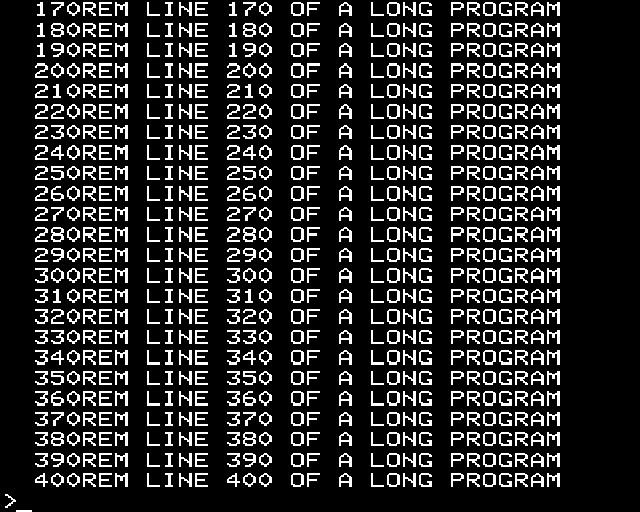
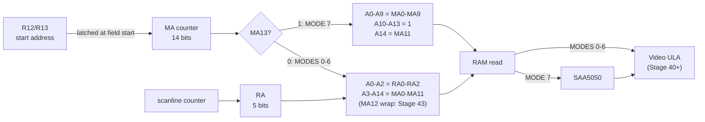
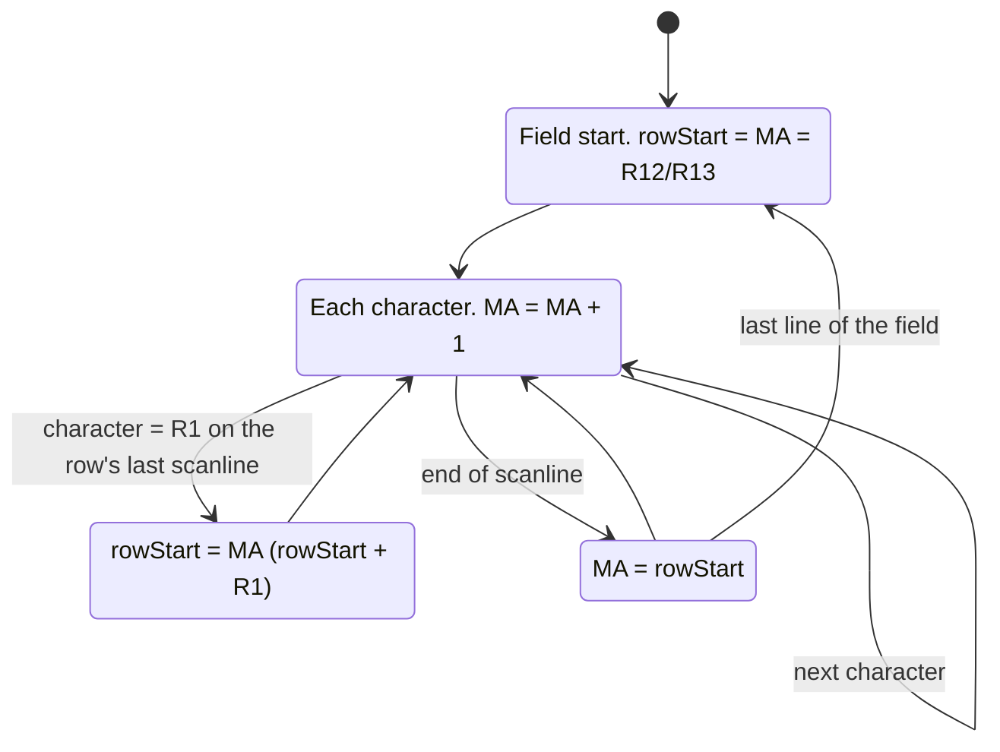
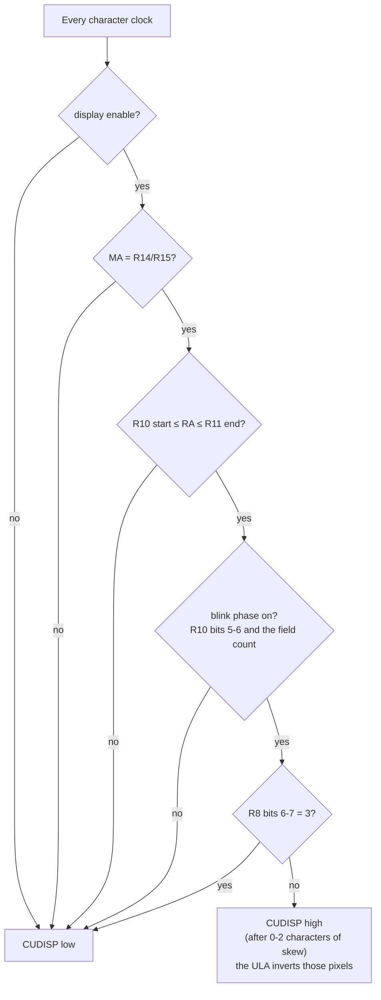

# Stage 39: CRTC addressing, scrolling & cursor

> **Part:** 8 (The 6845 CRTC) · **Branch:** `stage/39-crtc-addressing-cursor` · **Needs:** 38
> **Status:** done

## Goal

Stage 38 made the 6845 count *time*: characters, scanlines, rows and fields. This stage makes it count *memory*. Alongside its timing counters, the real chip runs a 14-bit **memory address** counter (MA) and puts out the scanline counter as a **row address** (RA). The Model B's board turns those two numbers into the RAM address the screen is read from. Then two things come for free from the same counter:

- **Hardware scrolling.** The MOS scrolls the screen by moving the CRTC's start address (R12/R13) on by one row. It doesn't copy 1,000 bytes (or 20K in MODE 0).
- **The cursor.** The 6845 compares MA with R14/R15 on every character, and raises its cursor output when they match on the right scanlines. It also blinks the cursor itself, by counting fields.

From now on the MODE 7 screen is drawn from the start address **the CRTC latched at the top of the field**. It is no longer read from R12/R13 whenever the browser happens to draw. The flashing cursor appears for the first time.

## What you can now see

**In the browser** (needs `roms/os12.rom` and `roms/basic2.rom`):

```bash
npm run dev     # then open http://localhost:5173/?machine=mos
```

1. At the `>` prompt, **the cursor flashes**: a white underline under the cell after the `>`, about 1½ times a second. Nothing on the CPU side turns it on and off. The 6845 counts fields.
2. Click the screen and type `VDU 23,1,0;0;0;0;` RETURN, and the cursor goes. `VDU 23,1,1;0;0;0;` brings it back.
3. Type any long program (or `FOR I=1 TO 100:PRINT I:NEXT`) and `LIST` it. The screen **scrolls**: each new line moves R12/R13 on by &28, and the whole screen moves up without a byte of it being copied. The cursor follows down to the bottom row.
4. Open the **CRTC (6845)** panel. Under the beam's position there are three new lines:

   ```
   Address   MA &2CFD, RA 3 → &7CFD (teletext: MA13 = 1)
   Start     &2B98 → &7F98, latched at this field's start
   Cursor    MA &2F59 (row 24, column 1), lines 18-19, blinks every 32 fields: on now
   ```

   That's after a long `LIST`. Notice that MA &2CFD reads &7CFD: the counter has gone past &2BFF, and MA10 isn't wired, so the screen wraps. Notice too that the cursor's MA (&2F59) is past &2BFF as well.

What the browser showed after `LIST` of a 40-line program (row 0 is line 170, the prompt is on row 24, and the cursor is under it):



**Headless:**

```bash
npm run demo:addressing
```

Part 1 clocks a bare 6845 with the MOS's MODE 7 and MODE 4 settings, and shows MA and RA as they come out, with the address the board makes of them:

```
  MODE 7 (R12/R13 = &2800, MA13 = 1: one byte a character, RA unused):
    row  0 char  0  MA &2800  RA  0  → &7C00   top-left: the latched start
    row  0 char 39  MA &2827  RA  0  → &7C27   the last displayed character (R1 = 40)
    row  0 char 63  MA &283F  RA  0  → &7C3F   still counting in the blanking (R0 = 63)
    row  0 char  0  MA &2800  RA  2  → &7C00   next scanline: back to the row start
    row  1 char  0  MA &2828  RA  0  → &7C28   next row: R1 = &28 further on
  MODE 4 (R12/R13 = &0B00, MA13 = 0: 8 bytes a character, RA is the bottom 3 bits):
    row  0 char  0  MA &0B00  RA  0  → &5800   top-left: &0B00 × 8 = &5800
    row  0 char  0  MA &0B00  RA  7  → &5807   scanline 7: the cell's last byte
    row  0 char  1  MA &0B01  RA  0  → &5808   the next character
    row  1 char  0  MA &0B28  RA  0  → &5940   row 1: 40 characters × 8 bytes = &140 on
```

Part 2 boots the MOS, prints past the bottom, and logs every scroll the MOS writes beside the moment the 6845 takes it:

```
  field +0  line 208:  MOS writes R12/R13 = &2828
  field +1  line   0:      6845 latches &2828: the screen now starts at &7C28
  field +1  line  56:  MOS writes R12/R13 = &2850
  field +1  line 216:  MOS writes R12/R13 = &2878
  field +2  line   0:      6845 latches &2878: the screen now starts at &7C78
```

The writes land anywhere in the field. The new start only ever takes effect at line 0. When the MOS scrolls twice in one field, the start in between (&2850) is never drawn: the screen jumps two rows in one go.

Part 3 is the blink, one mark per field (`#` drawn), then with `VDU 23,1,0`:

```
  .............################................################................################...
  ................................................................................................
```

## The real hardware

### The 6845's address outputs

The 6845 has 14 **refresh memory address** pins, MA0-MA13, and 5 **raster address** pins, RA0-RA4 (6845 data sheet, pin description).

- **MA** is a character counter that runs through memory. It is loaded from **R12/R13 (the start address)** at the start of every field, goes up by one each character clock, and goes back to the start of the current row at the end of each scanline. After a row's last scanline it moves on to the next row, which starts **R1 characters** further on.
- **RA** is the scanline counter from Stage 38: which line of the character row is being drawn (0 to R9). In MODE 7, with interlace sync and video, it steps by 2 and the odd field adds 1 (Stage 38, Key concept 5).

The chip doesn't know what memory looks like. It just puts out a 14-bit number and a 5-bit number on every character clock. What they *mean* is up to the board.

### What the Model B does with them

The Model B's address logic uses MA13 to choose between two quite different schemes. The details are in the Advanced User Guide (6845 CRTC, and the R12/R13 table for each MODE) and on BeebWiki. They agree with what we measure from the MOS below.

**MA13 = 0: the bitmap modes (0-6).** Each character cell is **8 consecutive bytes**, one per scanline, so the scanline number is the bottom 3 address bits:

```
RAM address = MA0-MA11 shifted up 3 bits, with RA0-RA2 below them
            = MA × 8 + (RA AND 7)
```

MODE 4's screen starts at &5800. The MOS writes R12 = &0B, R13 = &00 (we saw it do so: `MODE 4` → `R12=0B R13=00`), and &0B00 × 8 = &5800. ✓

MA12 is the **wrap-around** bit. The MOS sets it when the screen has scrolled past &7FFF, and the board then subtracts the screen's size (chosen by IC32's C0/C1 latch bits) to bring the address back into screen memory. That is **Stage 43**. Here MA12 is ignored, as if it weren't wired.

**MA13 = 1: teletext (MODE 7).** Each character is **one byte**, so RA isn't used at all: the SAA5050 counts its own 10 lines per row. The address is:

```
A0-A9   = MA0-MA9     (1,024 bytes, enough for 40 × 25 = 1,000)
A10-A13 = 1           (forced high)
A14     = MA11
```

So MODE 7's 1K lives at &3C00-&3FFF if MA11 = 0, or &7C00-&7FFF if MA11 = 1. A 16K machine has no RAM above &3FFF, so its MOS uses MA11 = 0. Our 32K MOS writes R12 = &28 = %0010 1000, which sets MA13 (teletext) and MA11 (top 16K). That gives &2800 → **&7C00**. ✓

The AUG gives the MOS's formula as `R12/R13 = (start − &7400) EOR &2000`. Check it: &7C00 − &7400 = &0800 (MA11). EOR &2000 sets MA13: &2800.

**MA10 isn't wired in MODE 7.** That is what makes the screen wrap. The counter can go past &2BFF to &2C00, but the RAM address only sees MA0-MA9, so &2C00 reads &7C00 again. The MODE 7 screen is a 1K ring.

### Where the cursor comes from

Four registers control the cursor (6845 data sheet, R10-R11 and R14-R15):

| Register | Bits | Meaning |
|---|---|---|
| R10 | 0-4 | First scanline of the cursor (RA value) |
| R10 | 5-6 | Blink: %00 steady, %01 **no cursor**, %10 blink every 16 fields, %11 every 32 fields |
| R11 | 0-4 | Last scanline of the cursor |
| R14/R15 | 14 bits | The MA the cursor sits at (the only registers besides R16/R17 the CPU can read back) |

The chip raises its **cursor output (CUDISP, pin 19)** while all of these hold:

- display enable is on,
- MA equals R14/R15,
- RA is between R10's start and R11's end,
- the blink phase is on.

R8 bits 6-7 can delay the output by 0, 1 or 2 characters, and %11 turns it off (Key concept 6).

On the Model B, CUDISP goes to the **Video ULA**. The ULA draws the cursor by **inverting** the colour on those pixels. It also decides how wide the cursor is, from bits 5-7 of its control register. That is Stage 40, so for now our cursor is one character wide.

What MOS 1.20 writes (measured, `MODE 7` at power-on):

| Register | Value | Meaning |
|---|---|---|
| R10 | &72 = %0111 0010 | blink %11 (every 32 fields), first line &12 = 18 |
| R11 | &13 | last line 19 |
| R8 | &93 | interlace sync and video, display skew 1, **cursor skew 2** |
| R14/R15 | &28C9 at the `>` prompt | MA &28C9 → &7CC9 = row 5, column 1 (&C9 = 201 = 5 × 40 + 1) |

In MODES 0-6 it writes R10 = &67 (32-field blink, first line 7) and R11 = &08.

`VDU 23,1,0;0;0;0;` (cursor off) writes **R10 = &20**, the "no cursor" blink mode with start line 0. `VDU 23,1,1;0;0;0;` puts &72 back. The MOS moves the cursor (R14 then R15) after **every character it prints**.

## Key concepts

### 1. The MA counter: three numbers and one latch

Think of the counter as a pen that walks through memory, with a bookmark for the start of the current row:

- **Field start:** bookmark = pen = R12/R13.
- **Each character:** pen + 1.
- **End of a scanline:** pen goes back to the bookmark. Every scanline of a character row reads the **same** run of R1 addresses, and RA tells the board which line of each character to fetch.
- **Last scanline of the row, at character R1:** bookmark = pen. Since the pen started at the bookmark and has moved R1 times, the next row starts R1 characters on.

Worked example, MODE 7 from power-on (R12/R13 = &2800, R1 = 40 = &28, R0 = 63):

| Row | Scanlines | MA along the line (characters 0 … 39) | RAM (MA13 = 1) |
|---|---|---|---|
| 0 | all 10 | &2800 … &2827 | &7C00 … &7C27 |
| 1 | all 10 | &2828 … &284F | &7C28 … &7C4F |
| 24 | all 10 | &2BC0 … &2BE7 | &7FC0 … &7FE7 |

The counter keeps going past R1, through the blanking part of the line (characters 40-63), up to &2800 + 63 = &283F. But display enable is off there, so nobody reads those addresses for the picture. (On many 6845 systems the DRAM refresh rides on them. That doesn't matter to us.)

### 2. Why scroll in hardware?

Scrolling MODE 7 by one line in software means moving 960 bytes and clearing 40. A tight 6502 copy loop takes about 14 cycles a byte, so that's around 14,000 cycles: 7 ms, a third of a frame. MODE 0's screen is 20K, and moving it would take roughly 280,000 cycles, **seven frames**. Text would crawl.

The hardware way is to write two registers, then clear the one new line:

```
before:  R12/R13 = &2800  → top row is &7C00
after:   R12/R13 = &2828  → top row is &7C28 (old row 1); the bottom row is &7C00 + &3C0 + &28 … wrapped
```

The old top row (&7C00-&7C27) is now the *bottom* row, because of the wrap. The MOS clears it, and the scroll is done. We measured this: `FOR I=1 TO 30:PRINT I:NEXT` moves R13 by &28 each line (&28, &50, &78, &A0, …), with about 50 screen writes in between (40 to clear the new line, plus the digits).

### 3. Why the start address is latched

The 6845 copies R12/R13 into the counter **once per field**, at the top (data sheet: the refresh address counter is loaded from the start address register at the start of each field). Writing R12/R13 halfway down the screen changes nothing until the next field.

That matters because the MOS doesn't wait for the vertical blank before it scrolls. We measured the R13 writes landing on scanlines 208, 56, 215, 65, …, all mid-screen. If the change took effect at once, the bottom half of that field would be drawn one row further on than the top half, and one line would appear twice. Latched, a field is always drawn from one consistent start address.

The R12 and R13 writes are separate instructions, so there is a window of a few microseconds where the counter could latch a mix: the new R12 with the old R13. That's a real-hardware glitch too, and it only matters if a field starts in exactly that window.

### 4. The cursor matches MA, not the RAM address

R14/R15 is compared with the **counter**, before the board's MA10 and MA12 tricks. So the MOS must write the MA the counter *will reach*, which can be past the "end" of screen memory. We measured exactly that: after scrolling, R12/R13 = &2A30 and R14/R15 = **&2DF1**. &2DF1 isn't a sensible-looking screen address, but the counter does reach it (&2A30 + 961) and the board wraps it to &7DF1. If the MOS wrapped the cursor address itself, the cursor would vanish once the screen had scrolled far enough.

The same rule tells us where to draw the cursor: its cell is `(R14/R15 − start) mod &4000` characters from the top left. That's row = offset ÷ R1 and column = offset mod R1.

### 5. Blinking is done by the 6845, by counting fields

The CPU never turns the cursor on and off. The 6845 keeps a field counter, and R10's blink bits choose a period:

| R10 bits 5-6 | Cursor | At 50 Hz |
|---|---|---|
| %00 | always on | — |
| %01 | never | — |
| %10 | 8 fields on, 8 off (period 16) | 3.125 Hz |
| %11 | 16 fields on, 16 off (period 32) | 1.5625 Hz |

The MOS uses %11, so the BBC's cursor flashes about 1½ times a second. We assume a 50% duty cycle and that the phase starts "on" at reset (the data sheet gives the rates but not the phase).

### 6. Skew: lining the cursor up with a slow pipeline

In MODE 7 the address goes out on MA, the RAM answers, the byte is latched, and only then does the SAA5050 start working on it. The character's dots come out on the screen a couple of microseconds *after* the CRTC sent its address. If CUDISP came out at the same moment as MA, the cursor would sit a character or two to the left of the character it belongs under.

R8's skew bits fix this by delaying the 6845's own outputs to match:

| R8 | Display enable delayed | Cursor delayed |
|---|---|---|
| MODE 7: &93 = %10 01 00 11 | bits 4-5 = %01: 1 character | bits 6-7 = %10: 2 characters |
| MODES 0-6: &01 | 0 | 0 |

Skew %11 means **no cursor at all** (or no display, for bits 4-5).

The skews exist so that the cursor ends up under the right character. So we draw it on the cell whose MA matched, and we model only the %11 "off" case. (Pixel-exact positioning belongs to the scanline renderer in Stage 42.)

### 7. The cursor in MODE 7 is an underline on two half-lines

MODE 7's cursor scanlines are 18-19 (R10 = &72, R11 = &13). With interlace sync and video, RA runs 0, 2, … 18 in the even field and 1, 3, … 19 in the odd one (Stage 38). So the cursor is on RA 18 in the even field and RA 19 in the odd one. Together they make the **bottom dot line** of the 10-line character cell. That's the familiar MODE 7 underline cursor, and it lands on our pixel rows 18 and 19 of the 20-row cell.

In MODES 0-2 and 4-5, R9 = 7, so RA only reaches 7 and the cursor's "last line 8" (R11 = &08) is never reached: the cursor is the cell's bottom scanline. In MODES 3 and 6, R9 = 9, and the cursor covers lines 7-9.

## Diagrams

How MA and RA become a RAM address on the Model B:



The MA counter's life over one field. The bookmark (row start) only moves on the row's last scanline:



When the cursor output is on:



## Our design

**`Crtc6845` grows an MA counter** (`src/devices/crtc6845.ts`):

```ts
private ma = 0;          // the MA0-MA13 pins
private rowStart = 0;    // the bookmark
private fieldStart = 0;  // R12/R13 as latched at this field's start
private lastLine = false;  // is this scanline the row's last? (set at each line start)
private fields = 0;      // for the blink
```

In `clockCharacter()` there's one add and one compare per character (no allocation): `ma = hc === 0 ? rowStart : (ma + 1) & 0x3fff`, and `if (hc === R1 && lastLine) rowStart = ma`. `newField()` latches R12/R13.

The new read-outs for tools, tests and the renderer:

- `memoryAddress`: the MA pins.
- `displayStart`: the start address this field is being drawn from.
- `fieldsSinceReset`.
- `cursor`: CUDISP now, before skew. It's a getter, so it costs nothing per tick.
- `cursorAddress`: R14/R15 as one 14-bit number.

Two pure helpers, `cursorBlinkOn(r10, fields)` and `cursorOnScanline(r10, r11, ra)`, are shared by the getter and the renderer.

**`src/video/screen-address.ts`** (new, pure): the Model B's board logic. It isn't part of the 6845, so it lives outside it.

```ts
teletextAddress(ma): number      // MA13 = 1
bitmapAddress(ma, ra): number    // MA13 = 0, no MA12 wrap yet (Stage 43)
screenAddress(ma, ra): number    // picks by MA13
```

`mode7StartAddress(r12, r13)` (Stage 30) becomes `teletextAddress` of the 14-bit value. For the MOS's values it gives the same answers as before. `mode7CellAddress` now wraps inside whichever 1K the start is in, so &3C00 works too.

**The MODE 7 renderer takes a `Mode7Screen`** instead of a RAM start address:

```ts
interface Mode7Screen {
  readonly start: number;    // MA of the top-left cell: crtc.displayStart
  readonly columns: number;  // R1: MA moves on by this much a row
  readonly rows: number;     // R6
  readonly cursor: number;   // MA of the cursor cell, or -1 (blink off, "no cursor", skew 3)
  readonly cursorFirstLine: number; // R10 bits 0-4
  readonly cursorLastLine: number;  // R11
}
```

`mode7ScreenFrom(crtc)` builds one from the CRTC. Cell (row, column) is read from `teletextAddress(start + row × R1 + column)`, exactly the address the counter produces (Key concept 1, and tested against the real counter). Cells past R1 or R6 are black, because display enable is off there. The cursor cell's pixel rows `cursorFirstLine…cursorLastLine` are inverted (colour EOR 7).

**Decisions and alternatives:**

- *Record the addresses as the counter makes them, and draw from the record?* That is what Stage 42's scanline renderer does. For MODE 7, every scanline of a row reads the same 40 addresses, and the latched start plus R1 gives them exactly. So the renderer still draws the whole frame at once, from the CRTC's own latched start, and a test checks the formula against the counter. Memory is still read at draw time, not as the beam passes (Stage 42).
- *Keep reading R12/R13 directly?* No. That is the bug Key concept 3 describes. The renderer and the text layer now use `displayStart`.
- *The playground:* no MOS programs its CRTC, and with R1 = R6 = 0 nothing would be displayed. On a real BBC that's true too: no picture until the MOS sets the 6845 up. `main.ts` now writes the MOS's MODE 7 values into the playground's CRTC once, standing in for the MOS, so the teletext test pages still show. The playground's VSYNC wire stays cut (Stage 38).
- *Cursor width and colour:* that's the Video ULA's job (Stage 40). For now the cursor is one character wide and inverts.

## Code walkthrough

**[`src/devices/crtc6845.ts`](../../src/devices/crtc6845.ts)**: the counter is four fields and a few lines in `clockCharacter()`:

```ts
if (hc === 0) {
  this.hDisplay = true;
  this.ma = this.rowStart;              // a new scanline: back to the bookmark
} else {
  this.ma = (this.ma + 1) & MA_MASK;    // one character on, 14 bits
}
if (hc === r[CRTC_R1_HORIZONTAL_DISPLAYED]) {
  this.hDisplay = false;
  if (this.lastLine) this.rowStart = this.ma;  // the row's last line: next row starts here
}
```

- `lastLine` is worked out once per scanline in `lineStart()`. It's the same "has RA reached R9?" test (halved in interlace sync and video) that `endOfLine()` makes when the line ends, so the two can't disagree.
- `latchStart()` is the only place R12/R13 are read, and it's called from `newField()` and `reset()`. That one fact is Key concept 3.
- The `cursor` getter is CUDISP. `cursorBlinkOn()` and `cursorOnScanline()` are exported pure functions, so the renderer and the panel ask the same questions the chip does.

**[`src/video/screen-address.ts`](../../src/video/screen-address.ts)**: the board, not the chip. It's three one-line functions, `teletextAddress`, `bitmapAddress` and `screenAddress`. The teletext one is the interesting one:

```ts
return TELETEXT_BASE | ((ma & MA11) << 3) | (ma & TELETEXT_MA_MASK);
//       &3C00         MA11 → A14 (&4000)   MA0-MA9
```

**[`src/video/mode7-renderer.ts`](../../src/video/mode7-renderer.ts)**:

- `mode7ScreenFrom(crtc)` reads the latched start, R1, R6 and the cursor (with blink and skew applied) into a small `Mode7Screen`.
- `renderMode7` computes each row's MA as `start + row × columns`, the arithmetic the counter test proves, and reads `teletextAddress(rowStart + column)`.
- `drawCursor` finds the cursor's cell from `(cursor − start) & &3FFF` and EORs 7 into its pixel rows.

**[`src/main.ts`](../../src/main.ts)**: `drawScreen()` passes `mode7ScreenFrom(machine.crtc)` to the canvas, and `teletextAddress(machine.crtc.displayStart)` to the text layer and the test page. The playground calls `programMode7NoCursor` ([`src/mos/mos-crtc.ts`](../../src/mos/mos-crtc.ts)) once, standing in for the MOS.

**[`src/web/workbench/crtc-view-model.ts`](../../src/web/workbench/crtc-view-model.ts)**: three new counter lines (Address, Start, Cursor). If R12/R13 differ from the latched start, Start says "R12/R13 = &xxxx from the next".

**[`scripts/demo-addressing.ts`](../../scripts/demo-addressing.ts)**: `npm run demo:addressing`.

## Tests

| Test file | What it proves |
|---|---|
| `src/devices/crtc6845-addressing.test.ts` | MA starts at R12/R13 and counts per character, through the blanking. Every scanline of a row restarts at the row start. A row moves on by R1 (MODE 4, and MODE 7 with interlace sync and video). **For every MOS table, every displayed character of a whole field reads start + row × R1 + character.** MA wraps at 14 bits. Mid-field R12/R13 writes wait for the next field. Reset reloads. Cursor: only at MA = R14/R15 on lines R10-R11; MODE 7's RA 18 in the even field and 19 in the odd; matched against the unwrapped counter (&2DF1); never outside display enable; R10 %01 and R8 skew %11 turn it off; the 16-on/16-off blink. `cursorBlinkOn` and `cursorOnScanline` pure tests. |
| `src/video/screen-address.test.ts` | Teletext: &2800 → &7C00, &2000 → &3C00, MA10 wraps, the AUG's formula round-trips for every row. Bitmap: MA × 8 + RA, every MODE's start, RA3/RA4 not address bits, MA12 ignored (Stage 43). |
| `src/video/mode7-renderer.test.ts` | (Existing tests now pass a `Mode7Screen`.) Start MA through teletext addressing, &3C00 with MA11 = 0, rows R1 apart, black past R1/R6, the cursor inverting exactly pixel rows 18-19 of its cell, the MOS's &2DF1-from-&2A30 case, off-screen cursors drawing nothing. `mode7ScreenFrom` from a real `Crtc6845`: MOS values, the latched (not current) start, the blink's off phase, R10 &20 and skew %11. |
| `src/video/mode7-text.test.ts` | `mode7StartAddress` now honours MA11 (&2000 → &3C00); the cell wrap stays inside the start's 1K. |
| `src/machine/crtc-addressing.test.ts` | **Needs ROMs** (skips without). At the prompt the cursor is &28C9 = row 5, column 1. It blinks 32 of 64 fields with no CPU writes to the CRTC. `VDU 23,1,0` writes R10 = &20 (no cursor for 64 fields) and `VDU 23,1,1` writes &72. Printing 40 lines moves the start by multiples of &28 and leaves the cursor on row 24. While scrolling, the latched start changes only at field line 0. |
| `src/web/workbench/crtc-view-model.test.ts` | The Address, Start and Cursor lines: teletext and bitmap translation, "from the next" for a pending R12/R13, the on/off phase, "none" for R10 %01 and skew %11, "not on the screen". |
| `e2e/scroll-cursor.spec.ts` | **Needs ROMs** (skips without). Real-time project. The canvas's cursor cell is seen both lit and dark at row 5, column 1. A poked 40-line program `LIST`s with line 400 on row 23 and `>` on row 24, the start moved by whole rows, and the cursor flashing at row 24, column 1. |

## Gotchas & hardware quirks

- **The cursor register holds the counter's MA, not a RAM address.** After a scroll the MOS writes values like &2DF1, past MODE 7's &2BFF. Wrap the cursor yourself and it disappears (Key concept 4).
- **The start address is latched once per field.** A renderer that reads R12/R13 at draw time can show a start that the 6845 never used. Two scrolls in one field are drawn as one jump of two rows (demo Part 2).
- **R12 and R13 are two separate writes.** If a field started between them, that field would use the new R12 with the old R13. Real hardware has the same window. It's a few microseconds long, and it's harmless unless R12 changes.
- **Before the MOS programs the 6845, every register is 0,** so each "field" is one character long, and `fieldsSinceReset` races to about 260,000 during the first instant after power-on. That's what the chip does. It just means the blink phase at the prompt is effectively arbitrary.
- **The blink phase and duty cycle are assumptions:** 50%, "on" first from reset. The data sheet gives only the rates.
- **Cursor start after end** (R10 > R11): we show nothing. 6845 variants differ, with some drawing a split cursor. Parked.
- **Skew is modelled only as "%11 = off".** We assume the MOS's skews line the cursor up with its character, which is their purpose. Pixel-exact delays belong with the scanline renderer (Stage 42).
- **The cursor is one character wide and inverts.** The Video ULA's cursor-width bits (control bits 5-7) are Stage 40.
- **Memory is read at draw time,** not as the beam passes. A program that changes screen memory mid-field (raster effects) won't show it yet. Stage 42 renders by scanline.
- **The text layer is always 40 × 25 and has no cursor.** It's for reading and copying. The canvas follows R1/R6.
- **MA12 (bitmap wrap) and RA3/RA4 (MODE 3/6 gap lines) do nothing yet.** Both are Stage 43.
- **The playground now programs its own CRTC** (MODE 7, no cursor), because a 6845 nobody has programmed displays nothing. Its VSYNC wire stays cut.

## Playwright verification

- **MCP, interactive:** at `/?machine=mos` the cursor cell's two bottom pixel rows were sampled every 50 ms: `##.....#####.......######.....`, so it blinks. A 40-line program was poked in at PAGE, then `OLD` and `LIST` were typed with held keys. The screen showed lines 170-400 with the cursor under the `>` on row 24 (screenshot above). The CRTC panel read `Address MA &2CFD, RA 3 → &7CFD`, `Start &2B98 → &7F98` and `Cursor MA &2F59 (row 24, column 1) … on now`.
- **Durable:** `e2e/scroll-cursor.spec.ts` (2 tests, real-time project, skip without ROMs). The whole suite passes: 134 tests. `e2e/teletext.spec.ts`'s direct `screen.draw` call now passes a `Mode7Screen`.

## Check your understanding

1. In MODE 7 the 6845's MA reaches &2C05 near the bottom of a scrolled screen. Which RAM address does the board read, and why doesn't the screen run off into &8000?
2. The MOS writes R12/R13 = &2850 on scanline 56. On which scanline does the screen start being drawn from &7C50?
3. After scrolling, R12/R13 = &2A30 and R14/R15 = &2DF1. Which row and column is the cursor on, and why would writing R14/R15 = &29F1 (the "wrapped" value) lose the cursor?
4. MODE 4's R12/R13 is &0B00. What RAM address does the 6845 read for row 0, character 2, scanline 5?
5. MODE 0's R10 is &67 and R11 is &08. On which scanlines of a character is the cursor drawn, and how often does it blink?

<details>
<summary>Answers</summary>

1. Teletext addressing uses only MA0-MA9, with A10-A13 high and A14 = MA11. &2C05 has MA11 set, and its low 10 bits are &005, so the address is **&7C05**. MA10 isn't wired, so the screen is a 1K ring and never leaves &7C00-&7FFF.
2. **Line 0 of the next field.** The 6845 copies R12/R13 into its counter only at the start of a field, so the rest of the current field (lines 56-311) is still drawn from the old start.
3. The offset is &2DF1 − &2A30 = &3C1 = 961, so it's **row 24, column 1** (961 = 24 × 40 + 1). The 6845 compares R14/R15 with its MA *counter*, which counts &2A30, &2A31, … and reaches &2DF1, never &29F1: in this field it starts above &29F1 and only goes up. Only the RAM address wraps, and that happens after the comparison.
4. Character 2 has MA &0B02, so the address is &0B02 × 8 + 5 = &5810 + 5 = **&5815**.
5. R10's start line is 7 and R11's end line is 8. But in MODE 0 R9 = 7, so RA only goes 0-7, and the cursor is drawn on **scanline 7 only**, the bottom line of the cell. The blink bits are %11 (&67 = %0110 0111), so it blinks **every 32 fields**: 16 on and 16 off, 1.5625 Hz at 50 Hz.

</details>

## Further reading

- *HD6845 / MC6845 CRT Controller* data sheets: refresh memory addressing (MA0-MA13), raster address (RA0-RA4), R10/R11 cursor start, end and blink, R12-R15, R8 skew.
- *BBC Microcomputer Advanced User Guide*, chapter on the 6845 CRTC: the R12/R13 formula `(start − &7400) EOR &2000` for MODE 7, and start ÷ 8 for the others.
- BeebWiki: "6845 CRTC" and the Model B's screen address translation (MA13 teletext, MA12 wrap-around).
- Stage 38's doc for the counters this one builds on, and Stage 43 (to come) for MA12 and C0/C1.
