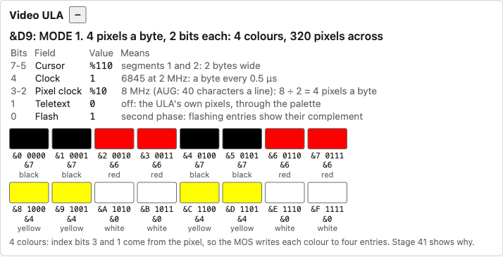
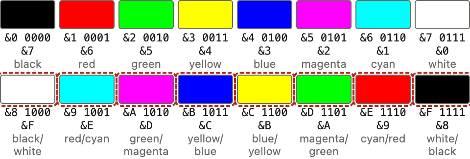
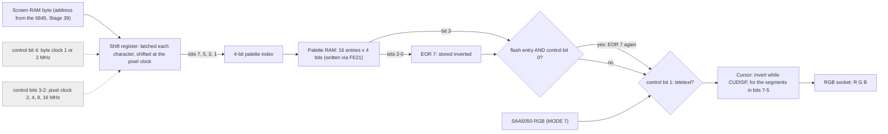
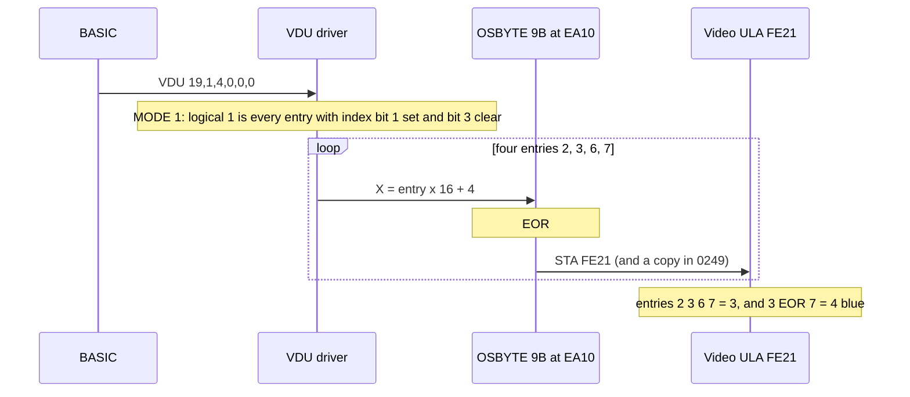
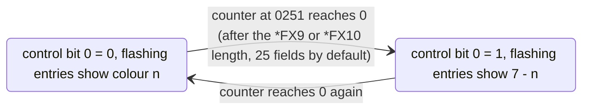

# Stage 40: ULA control & palette

> **Part:** 9 (Video ULA & bitmap modes) · **Branch:** `stage/40-ula-palette` · **Needs:** 39
> **Status:** done

## Goal

The 6845 decides *when* each screen byte is fetched and *which* byte it is (Stages 37–39). It has no idea what the byte looks like. The **Video ULA** at &FE20 turns that byte into coloured pixels. Since Stage 28 it has been a stub that kept the two bytes the MOS wrote and decoded nothing (only bit 4, the 6845's clock, was used, from Stage 37).

This stage builds the ULA's two registers properly:

- The **control register** (&FE20): how fast pixels come out, so how many there are to a byte, plus teletext on or off, the cursor's width and the flash phase.
- The **palette** (&FE21): sixteen 4-bit entries that turn a pixel's bits into one of eight colours, some of which flash.

We still don't draw a bitmap MODE. That needs the pixel decoding of Stage 41 and the renderer of Stage 42. What we can do now is watch the palette change as the MOS sets up each MODE, and blank the screen when the ULA says "not teletext".

## What you can now see

**In the browser** (needs `roms/os12.rom` and `roms/basic2.rom`):

```bash
npm run dev     # then open http://localhost:5173/?machine=mos
```

1. Open the new **Video ULA** panel, under the CRTC panel. After boot it reads:

   ```
   &4B: MODE 7. Teletext: the SAA5050 colours the screen, and the palette is not used
   ```

   (or &4A: bit 0 flips every half second). The five control fields are decoded below it. Bit 1, teletext, is 1.
2. Click the screen and type `MODE 1` RETURN. **The screen goes black**: the ULA has left teletext, and we have no bitmap renderer until Stage 42. The panel changes to:

   

   Read the swatches in binary. Logical colour 3 (white) sits in entries %1010, %1011, %1110 and %1111, which are the four with index bits 3 and 1 set (Key concept 3).
3. Type `VDU 19,1,4,0,0,0` RETURN. Entries &2, &3, &6 and &7 turn **blue** and show `&3` stored, which is 4 EOR 7.
4. Type `MODE 2` RETURN. Sixteen colours. The second row has dashed outlines: entries 8–F flash, and while the machine runs they swap to their complements every ½ s, all at once:

   

5. Type `MODE 7` RETURN, and the teletext screen comes back.

Hover a swatch to see the arithmetic, e.g. `Entry &9 (1001): stored &E, flashing: 6 EOR 7 = 1 red, then cyan. Now cyan`.

**In Jest**, the measured MOS writes for each MODE:

```bash
npx jest src/machine/ula-modes.test.ts
```

```
0: &9C 7777777700000000 (16 writes)
1: &D8 7766776644004400 (16 writes)
2: &F4 76543210FEDCBA98 (16 writes)
...
7: &4A 7777777700000000 (0 writes)
```

## The real hardware

The Video ULA is Acorn's own chip: a Ferranti uncommitted logic array, IC6 on the Model B board. It sits between screen RAM and the RGB socket. Its jobs:

1. **Make the clocks.** It divides the 16 MHz crystal down to the 2 MHz CPU/RAM clock and the 6845's character clock (1 or 2 MHz).
2. **Shift out pixels.** It latches each screen byte the 6845 addresses and shifts it out at a pixel clock of 2, 4, 8 or 16 MHz.
3. **Look up colours.** Each pixel's bits pick one of 16 palette entries, and the entry gives the colour.
4. **Choose teletext.** In MODE 7 it passes the SAA5050's RGB through instead of its own pixels.
5. **Draw the cursor.** It inverts the colour while the 6845's CUDISP output is high, for up to four characters' width.

It has **two write-only registers**. Only address line A0 is decoded, so they repeat through &FE20–&FE2F (Stage 21's memory map already shows this):

| Address | Register | Advanced User Guide |
|---|---|---|
| &FE20 (even) | Video control register | §19.3, "Video ULA" |
| &FE21 (odd) | Palette | §19.3, and VDU 19 in §8 |

Neither register can be read back. A read of &FE20 finds nothing driving the data bus, so it sees whatever byte last crossed it (the floating bus, Stage 21). That is why the MOS keeps its own copies in RAM: **&0248** holds the last control byte and **&0249** the last palette byte.

### The control register (&FE20)

| Bits | Field | Values |
|---|---|---|
| 7–5 | Cursor segments | bit 7 = segment 1, bit 6 = segment 2, bit 5 = segments 3 and 4 |
| 4 | Clock rate | 0: 6845 at 1 MHz · 1: 6845 at 2 MHz |
| 3–2 | "Characters per line" (the pixel clock) | %00 = 10 (2 MHz) · %01 = 20 (4 MHz) · %10 = 40 (8 MHz) · %11 = 80 (16 MHz) |
| 1 | Teletext select | 0: the ULA's own pixels · 1: the SAA5050's RGB |
| 0 | Flash select | which phase flashing colours show: 0 the first colour, 1 the second |

The MOS keeps one control byte for each MODE, in a table at **&C3F7** in MOS 1.20. Measured from the ROM:

| MODE | Control | Cursor bits 7–5 | Bit 4 | Bits 3–2 | Bit 1 | Pixels a byte | Colours |
|---|---|---|---|---|---|---|---|
| 0 | &9C | %100 | 1 (2 MHz) | %11 (16 MHz) | 0 | 16 ÷ 2 = 8 | 2 |
| 1 | &D8 | %110 | 1 | %10 (8 MHz) | 0 | 8 ÷ 2 = 4 | 4 |
| 2 | &F4 | %111 | 1 | %01 (4 MHz) | 0 | 4 ÷ 2 = 2 | 16 |
| 3 | &9C | %100 | 1 | %11 | 0 | 8 | 2 |
| 4 | &88 | %100 | 0 (1 MHz) | %10 (8 MHz) | 0 | 8 ÷ 1 = 8 | 2 |
| 5 | &C4 | %110 | 0 | %01 (4 MHz) | 0 | 4 ÷ 1 = 4 | 4 |
| 6 | &88 | %100 | 0 | %10 | 0 | 8 | 2 |
| 7 | &4B | %010 | 0 | %10 | **1** | (teletext) | — |

MODE 3 shares MODE 0's byte and MODE 6 shares MODE 4's. The ULA can't tell them apart. The difference (the gaps between text rows) is all in the 6845's registers (Stage 37's table), and Stage 43 draws it.

The MOS writes the table entry with bit 0 = 0, except MODE 7's &4B. After that, the vsync interrupt flips bit 0 every 25 fields (see Key concept 5). So you'll see &D8 and &D9 alternate in MODE 1, even though MODE 1 has no flashing colours by default.

### The palette (&FE21)

One byte written to &FE21 sets one entry:

```
  bit:   7 6 5 4   3     2 1 0
        [ entry ] [F] [ B G R ] EOR 7
         0-15     flash  colour, stored inverted
```

- The **top nibble** says which of the 16 entries to set. (The Advanced User Guide calls it the "logical colour". That is only true in MODE 2: see Key concept 3.)
- **Bit 3** marks the entry as flashing.
- **Bits 2–0** are the physical colour, **inverted**. Physical colours are numbered as on the RGB socket: bit 0 red, bit 1 green, bit 2 blue. So 0 black, 1 red, 2 green, 3 yellow, 4 blue, 5 magenta, 6 cyan, 7 white.

The inversion is real, and you can see it in the MOS. OSBYTE &9B (155, "write to the palette") is at **&EA10** in MOS 1.20:

```
EA10  TXA
EA11  EOR #&07      ← invert the colour bits
EA13  PHP
EA14  SEI
EA15  STA &0249     ← the MOS's copy (the chip can't be read)
EA18  STA &FE21
EA1B  PLP
EA1C  RTS
```

So VDU 19 hands it "entry in the top nibble, physical colour in the bottom", and it stores colour EOR 7. Writing &07 to an entry gives **black** and &00 gives **white**. The usual explanation is that the chip's colour outputs are active low, and the MOS does the inverting so that VDU 19 can use the normal colour numbers. That is the documented behaviour. I haven't seen the ULA's internals, so take the "why" as the common explanation rather than something measured.

The control writer, OSBYTE &9A (154), is right next to it at **&E9FF**: `TXA`, `STA &0248`, `STA &FE20`, then it reloads the flash counter. Every ULA write the MOS makes goes through one of these two routines. I checked this by recording the PC of every write while booting and typing MODE 0, 1, 2 and 7.

## Key concepts

### 1. The ULA's two clocks, and what "characters per line" really means

Two clocks matter, and **pixels per byte = pixel clock ÷ byte clock**:

- **The byte clock** is the 6845's character clock, set by bit 4: 1 or 2 MHz. One screen byte is fetched per character, so this is the rate bytes arrive.
- **The pixel clock** is set by bits 3–2: 2, 4, 8 or 16 MHz. Each tick, the ULA shifts the latched byte along by one pixel.

The AUG labels bits 3–2 "number of characters per line" (10/20/40/80). That's the number of 8-pixel characters that fit across the standard 40 µs of displayed line at that pixel rate: 80 × 8 pixels ÷ 16 MHz = 40 µs. It's a useful name, but the hardware only knows a clock rate.

Worked through for MODE 1 (&D8 = %1101 1000):

- Bit 4 = 1: bytes arrive at 2 MHz, so 80 bytes in the 40 µs of displayed line (the 6845's R1 = &50).
- Bits 3–2 = %10: pixels at 8 MHz, so 320 pixels across.
- 8 MHz ÷ 2 MHz = **4 pixels per byte**, so each pixel has 8 ÷ 4 = **2 bits**, which is **4 colours**.

MODE 5 (&C4) has the same 4 pixels a byte, but 4 MHz ÷ 1 MHz: half as many bytes and pixels per line, each pixel twice as wide. **The trade-off is fixed by memory.** MODE 0, 1 and 2 all read 80 bytes a line (20K a screen), so more colours means fewer pixels: 640 × 2 colours, 320 × 4 or 160 × 16.

The two combinations the MOS never uses are 16 MHz pixels from a 1 MHz byte (16 pixels per byte, more than a byte has) and 2 MHz pixels from a 2 MHz byte (1 pixel per byte). We decode them honestly and label them "not a MOS MODE". What the real chip draws for them is the business of Stage 41.

### 2. The palette is a 16-entry lookup table

Without a palette, a 2-bit pixel could only mean four fixed colours. With one, it means "entry *n*", and the program chooses what entry *n* looks like. The palette is a 16 × 4-bit RAM inside the ULA. A 4-bit **index** goes in, and 4 bits come out: the flash bit and three colour bits.

That's why `VDU 19,1,4,0,0,0` (logical colour 1 → blue) re-colours everything already drawn in colour 1 at once. No screen byte changes. Only the lookup does. Games used this for instant effects: flash a colour, hide sprites by making them the background colour, or cycle colours to fake animation.

### 3. Sixteen entries, but MODE 1 has four colours: the index is always 4 bits

The ULA doesn't change how it builds the index for each MODE. It always takes **four bits of its shift register** (bits 7, 5, 3 and 1) and uses them as the index. In MODE 2 those four bits are exactly one pixel's four bits, so entry = logical colour. In MODE 1 and MODE 0, the four bits include bits from the *next* pixels as well. Stage 41 works through exactly which, all 256 bytes of it.

The MOS's answer is to **write all 16 entries in every MODE**, so that every index that can mean "logical colour 1" holds the same colour. You can see it in what the MOS writes for `MODE 1` (measured, in the order written):

```
&A0 &B0 &E0 &F0   entries A B E F = &0 → 0 EOR 7 = 7 white   (logical 3)
&84 &94 &C4 &D4   entries 8 9 C D = &4 → 4 EOR 7 = 3 yellow  (logical 2)
&26 &36 &66 &76   entries 2 3 6 7 = &6 → 6 EOR 7 = 1 red     (logical 1)
&07 &17 &47 &57   entries 0 1 4 5 = &7 → 7 EOR 7 = 0 black   (logical 0)
```

Look at the entries in binary: logical colour 3 is written to %1010, %1011, %1110 and %1111. All four have **index bits 3 and 1 set**. Logical 2 is index bit 3 only, logical 1 is bit 1 only, and logical 0 is neither. So in MODE 1, **index bit 3 is the logical colour's high bit, index bit 1 its low bit**, and bits 2 and 0 don't matter. The palette swatches show this as a pattern: `black black red red black black red red yellow yellow white white yellow yellow white white`.

The 2-colour MODEs are simpler. Entries 8–F hold logical 1 (white, &x0) and entries 0–7 hold logical 0 (black, &x7). Only index bit 3 matters.

This is also why `VDU 19,1,…` in MODE 1 makes **four** palette writes, not one. Measured: `VDU 19,1,10,0,0,0` writes &2D &3D &6D &7D.

### 4. Physical colours and the EOR 7

There are only eight colours, because the RGB socket has three wires and each is on or off. The colour number is those three wires as bits: **R = bit 0, G = bit 1, B = bit 2**. Stage 31's screen canvas already uses this numbering, which is also the SAA5050's.

So the palette stores 3 colour bits, but **inverted** (concept above, &EA11). To decode an entry:

```
colour = (entry AND 7) EOR 7
```

| Written (bits 2–0) | EOR 7 | Colour |
|---|---|---|
| %111 (&7) | %000 | 0 black |
| %110 (&6) | %001 | 1 red |
| %100 (&4) | %011 | 3 yellow |
| %000 (&0) | %111 | 7 white |

### 5. Flashing is a palette bit, a control bit, and a timer in the MOS

Physical colours 8–15 are the **flashing** colours: 8 is black/white, 9 red/cyan, 10 green/magenta, 11 yellow/blue, and so on. Each one alternates between colour *n* and its **complement** (7 − *n*, every bit inverted).

The ULA does this with two bits:

- **Palette bit 3** marks an entry as flashing.
- **Control bit 0** says which phase it's in. When it is 1, every flashing entry's colour is inverted.

```
colour = (entry AND 7) EOR 7, then EOR 7 again if (entry AND 8) and (control AND 1)
```

The ULA doesn't time anything. The **MOS** does, in the vsync interrupt at &DD23. It counts &0251 down once a field, and at zero it flips bit 0 of its copy &0248 and calls the OSBYTE &9A writer above. Then it reloads the counter from &0252 or &0253 (the two phase lengths, set by *FX9 and *FX10: 25 fields each by default, so each colour shows for ½ s). Stage 29 already saw these writes as `&4B ↔ &4A` in MODE 7.

Two consequences:

- Every flashing colour on the screen changes **at the same instant**, because there is one bit.
- Flashing costs no CPU time per pixel, and no screen byte changes.

MODE 7 flashes differently. The SAA5050 times its own flash from the fields it counts (Stage 33), and the ULA's palette isn't used in teletext.

### 6. Teletext select is a switch on the RGB wires

In MODE 7, bit 1 = 1, and the ULA's RGB output comes from the SAA5050 instead of its own palette. The palette is ignored, but the 6845 and the ULA's clocks still run at the rates bit 4 and R0 say. The ULA's cursor (concept 7) still works on top of teletext. That's how the MODE 7 cursor is drawn.

For us, bit 1 is the switch that says which renderer applies. With it clear, nothing can be drawn yet (Stage 42), so the screen goes **black**. That is more honest than showing bitmap memory decoded as teletext.

### 7. The cursor's width comes from the ULA, not the 6845

The 6845's CUDISP is one character clock wide: one byte. A MODE 1 character is **2 bytes** wide (8 pixels at 4 a byte) and a MODE 2 character is **4 bytes**. So the ULA stretches the cursor across up to four byte-times, which it calls **segments**:

- bit 7: segment 1, the byte CUDISP is on
- bit 6: segment 2, the next byte
- bit 5: segments 3 and 4, the two after that

The MOS picks enough segments for **one text character in every MODE**: MODE 0 and 4 use %100 (1 byte = 8 pixels), MODE 1 and 5 use %110 (2 bytes), and MODE 2 uses %111 (4 bytes). MODE 7's &4B is %010, **segment 2 only**: the teletext cursor is one character wide but one character *late*. That lines it up with the SAA5050, which delivers each character's dots a character time after the 6845 addressed it (Stage 39's skew discussion).

The AUG (§19.3) describes these bits differently: bit 7 as "master cursor size" and bits 6–5 as "width of cursor in bytes". Read that way, MODE 7's %010 would mean a 2-byte cursor, which doesn't match a one-character teletext cursor. BeebWiki's segment description fits all eight MOS values, so we use that. This stage only **decodes** the bits and shows them. The bitmap cursor is drawn in Stage 42, and that's where the description gets tested against the real screen.

## Diagrams

The data path from a screen byte to the RGB socket. Control register bits are shown in grey.



What `VDU 19,1,4,0,0,0` (logical colour 1 → blue) does in MODE 1, from BASIC to the chip:



The flash cycle, which the MOS drives from the vsync interrupt (MOS 1.20, &DD23):



## Our design

**`src/devices/video-ula.ts`** replaces `src/devices/stubs/video-ula-stub.ts`. It keeps the stub's interface (an `IoDevice`, write-only, floating-bus reads, hardware-log records) and adds decoding:

```ts
export class VideoUla implements IoDevice {
  read(): number;                    // the floating bus: nothing drives it
  write(offset: number, value: number): void;
  get control(): number;             // the last byte written to &FE20
  get teletext(): boolean;           // control bit 1
  get flash(): boolean;              // control bit 0
  paletteEntry(index: number): number;    // the nibble as written, 0-15
  physicalColour(index: number): number;  // 0-7 now: EOR 7, then the flash
}

export function decodeUlaControl(control: number): UlaControl;
export function paletteColour(entry: number, flashPhase: boolean): number;
```

- **Constants are named after the chip.** `ULA_CONTROL_FLASH = 0x01`, `ULA_CONTROL_TELETEXT = 0x02`, `ULA_CONTROL_PIXEL_RATE = 0x0c`, `ULA_CONTROL_FAST_CLOCK = 0x10` (moved here from `crtc-geometry.ts`, where Stage 37 put it), the three cursor bits, and `ULA_PALETTE_FLASH = 0x08`.
- **`decodeUlaControl` is pure** and returns a plain object: cursor segments, both clocks, pixels per byte, bits per pixel (or `undefined` for the two combinations no MOS MODE uses), teletext and flash. It allocates, so it's for the workbench and tests. Stage 42's renderer will read the few bits it needs straight from `control`.
- **No cached colour table.** `physicalColour()` is two XORs and a test, cheap enough to do per pixel. A precomputed 16-entry table would have to be rebuilt on every control write (25 times a second) and every palette write. That's a fair optimisation for Stage 42 if profiling ever asks for it, but not before.
- **"Entry", not "logical colour".** In the code and the panel, the top nibble is an *entry* (the palette index), because concept 3 shows it is only a logical colour in MODE 2. The hardware log says "entry" too.
- **Power-on palette = all zeros.** The real chip's palette RAM powers up holding whatever it holds, and the MOS doesn't write it until the first bitmap MODE (it never writes it for MODE 7). Zeros decode as white, which is fine: nothing looks at the palette in MODE 7.
- **The MOS's table** goes in `src/mos/mos-video-ula.ts` (`MOS_ULA_CONTROL`, &C3F7). The panel uses it to say which MODE a control byte belongs to. The playground uses it to write MODE 7's &4B at start-up. That stands in for the MOS, as Stage 39's `programMode7NoCursor` does for the CRTC. Without it, the playground's ULA would say "not teletext" and its screen would go black.
- **The screen** (`main.ts`) draws teletext only when `videoUla.teletext` is set, and otherwise draws black (`ScreenCanvas.clear()`). The text layer empties too.
- **The Video ULA panel** (`video-ula-view-model.ts` + `video-ula-panel.ts`) has a summary line, the control fields decoded bit by bit, and 16 swatches. Each swatch shows the entry in hex and binary, the byte the MOS stored, and the colour *now*. Flashing entries are marked and change colour with the flash bit while the machine runs.


## Code walkthrough

- [`src/devices/video-ula.ts`](../../src/devices/video-ula.ts): the chip.
  - `write()` is the whole bus interface. An even offset stores the control byte. An odd offset stores the bottom nibble in entry `value >> 4`. Both report to the hardware log, as the stub did.
  - `paletteColour(entry, flashPhase)` is the colour arithmetic in two lines. It inverts the stored bits with `^ 0x07`, then inverts them again if the entry has bit 3 set and the phase is on.
  - `decodeUlaControl()` turns a control byte into fields. Pixels per byte is literally `pixelClockHz / characterClockHz`, and bits per pixel follows from it.
- [`src/devices/crtc-geometry.ts`](../../src/devices/crtc-geometry.ts): now imports `ULA_CONTROL_FAST_CLOCK` from the ULA, where that bit belongs.
- [`src/mos/mos-video-ula.ts`](../../src/mos/mos-video-ula.ts): the MOS's table at &C3F7 and `mosModesFor()`, which ignores bit 0 so that &D9 is still MODE 1.
- [`src/web/workbench/video-ula-view-model.ts`](../../src/web/workbench/video-ula-view-model.ts): the words. `summaryOf` works out "4 colours, 320 pixels across" from the clocks: 8 MHz × 40 µs = 320. `swatchOf` builds each swatch's title, showing the EOR.
- [`src/web/workbench/video-ula-panel.ts`](../../src/web/workbench/video-ula-panel.ts): built once. Refresh only sets text, `background` and the `flashing` class, so a swatch changes colour in place.
- [`src/main.ts`](../../src/main.ts): `drawScreen` checks `videoUla.teletext`. The playground writes `MOS_MODE7_ULA_CONTROL` next to its CRTC set-up.
- [`src/web/screen-canvas.ts`](../../src/web/screen-canvas.ts) `clear()` blits black once and then remembers it's blank, so a bitmap MODE costs nothing per frame.
- [`src/devices/hardware-log.ts`](../../src/devices/hardware-log.ts): palette writes now read `ULA palette=&26 (entry &2 = red)`.

## Tests

| Test file | What it proves |
|---|---|
| `src/devices/video-ula.test.ts` | Control and palette storage. Only A0 decoded. Each MOS MODE's byte decoded into clocks, pixels per byte and bits per pixel. Cursor segments. EOR 7 for all eight colours. Flash inverts only flashing entries, all at once. Floating-bus reads. Hardware log. |
| `src/mos/mos-video-ula.test.ts` | The table at &C3F7 matches `MOS_ULA_CONTROL` (**skips without `os12.rom`**). MODE 3/0 and 6/4 share bytes. The flash bit is ignored. |
| `src/machine/ula-modes.test.ts` | With the real ROMs (**skips without them**): power-on writes no palette. MODE 0–7 give the measured control bytes and 16 palette writes each (none for MODE 7). The decoded colours in MODE 0, 1 and 2, including MODE 2's flash after 25 fields. `VDU 19,1,4,0,0,0` writes &23 &33 &63 &73. |
| `src/web/workbench/video-ula-view-model.test.ts` | Summary, field meanings, swatch labels and titles, flashing names, and the note for 2, 4 and 16 colours and teletext. |
| `src/devices/hardware-log.test.ts` | Updated: palette writes are described as an entry and its colour. |
| `e2e/video-ula.spec.ts` | (real-time project, **skips without ROMs**) The panel at boot. MODE 1 swatches plus a black screen and an empty text layer. MODE 2's eight flashing entries actually alternate. MODE 7 brings teletext back. |

The old `src/devices/stubs/video-ula-stub.{ts,test.ts}` are deleted. Their tests live on in `video-ula.test.ts`.

## Gotchas & hardware quirks

- **The palette stores colours inverted.** &x7 is black and &x0 is white. If you poke &FE21 yourself without the MOS's `EOR #&07`, every colour comes out as its complement.
- **The top nibble is not the logical colour** except in MODE 2. In 2- and 4-colour MODEs, one logical colour lives in 8 or 4 entries. Writing just one of them changes only some pixels: Stage 41 shows which.
- **The ULA can't be read.** The MOS's copies at &0248 and &0249 are the only record. A program that pokes &FE20 directly leaves &0248 stale, and the next flash flip (which works from &0248) undoes it.
- **The flash bit flips in every MODE**, even where nothing flashes. That's why the control byte alternates &D8/&D9 in MODE 1. A MODE change writes the table byte (bit 0 clear, except MODE 7) and reloads the counter at &0251, so a new MODE always starts in the first phase.
- **MODE 7 doesn't write the palette.** After `MODE 2` then `MODE 7`, the entries still hold MODE 2's colours. That's harmless, because teletext bypasses them.
- **Power-on palette is unknown on real hardware.** We use zeros (white). Nothing reads it before the MOS's first bitmap MODE writes all 16.
- **Simplified:** a palette or control write takes effect for the whole frame we draw. On the real chip it takes effect from the next pixel. Split-palette raster effects need a renderer that draws as the beam goes (Stage 42 decides).
- **Not yet used:** the cursor segments (Stage 42 draws the bitmap cursor), and the pixel-rate combinations no MOS MODE uses (Stage 41).
- **Uncertain:** the cursor-segment reading of bits 7–5 follows BeebWiki, because the AUG's wording doesn't fit MODE 7's &4B (Key concept 7). The colour inversion's cause ("active-low outputs") is the common explanation, not something I could check. I didn't consult any emulator source for this stage.

## Playwright verification

- **MCP, interactive:** booted `?machine=mos`, and the panel read `&4B: MODE 7. Teletext…`. Typed `MODE 1` on the BBC keyboard: the summary changed to `&D9: MODE 1. 4 pixels a byte, 2 bits each: 4 colours, 320 pixels across`, the swatches read `black black red red black black red red yellow yellow white white yellow yellow white white`, the canvas was all black and the text layer empty. In `MODE 2`, entry 9 sampled every 150 ms read `111661111666` (red, cyan). Screenshots are above.
- **Durable:** `e2e/video-ula.spec.ts`, 3 tests, added to the real-time project in `playwright.config.ts`. Full e2e suite: 137 passed.

## Check your understanding

1. MODE 4 (&88) and MODE 1 (&D8) have the same pixel clock. How many pixels a byte does each have, and which control bit makes the difference?
2. In MODE 2 you poke `?&FE21=&16`. Which entry changes, what colour does it show, and what would you poke to make it cyan (6)?
3. In MODE 1, `VDU 19,2,…` changes four palette entries. Which four, and what do they have in common?
4. Why does the control byte keep changing in MODE 0 when nothing on the screen flashes, and why can't the MOS simply read &FE20 to find out the current flash phase?
5. MODE 7's control byte enables only cursor segment 2. What would go wrong if it enabled segment 1 instead?

<details>
<summary>Answers</summary>

1. MODE 4 (&88) has 8 pixels a byte: pixel clock 8 MHz (bits 3–2 = %10) ÷ byte clock 1 MHz (bit 4 = 0). MODE 1 (&D8) has 4 a byte: 8 MHz ÷ 2 MHz (bit 4 = 1). The same pixel rate from twice as many bytes gives each pixel twice the bits. MODE 5 (&C4) is the one that matches MODE 1's 4 pixels a byte: 4 MHz ÷ 1 MHz.
2. Entry 1 (the top nibble) now stores &6, and 6 EOR 7 = **1, red**. To get cyan you must store 6 EOR 7 = 1, so `?&FE21=&11`. Writing `&16` because "6 is cyan" gives the complement, red. The MOS's `EOR #&07` at &EA11 is what lets VDU 19 use the normal colour numbers.
3. Entries &8, &9, &C and &D (%1000, %1001, %1100, %1101). In MODE 1 the logical colour's high bit is index bit 3 and its low bit is index bit 1. Logical 2 = %10, so bit 3 is set and bit 1 is clear. Bits 2 and 0 can be anything, which gives four entries.
4. The MOS's vsync handler flips bit 0 every 25 fields in every MODE. It doesn't check whether any palette entry has its flash bit set. The ULA is write-only: a read of &FE20 sees the floating data bus, not the register. So the MOS keeps its own copy at &0248 and flips that.
5. The cursor would be inverted one character too early. The SAA5050 delivers each character's dots a character time after the 6845 addresses it, so the 6845's CUDISP (already delayed by R8's skew) must be delayed one more byte-time by using segment 2. With segment 1, the cursor block would sit over the character to the left of the real cursor position.

</details>

## Further reading

- *The BBC Microcomputer Advanced User Guide*, §19.3 "Video ULA" (control and palette registers), and the VDU 19 entry in §8. OSBYTE &9A/&9B (154/155) in the OSBYTE chapter. OSBYTE 9/10 for the flash periods.
- BeebWiki, "Video ULA": register layout, cursor segments, and the flash bit.
- BeebWiki, "Palette": physical colour numbers and VDU 19.
- MOS 1.20, disassembled here: &C3F7 (control table), &CBA3 (MODE sets the control byte), &E9FF (OSBYTE &9A), &EA10 (OSBYTE &9B with `EOR #&07`), &DD23 (the flash timer in the vsync handler).
