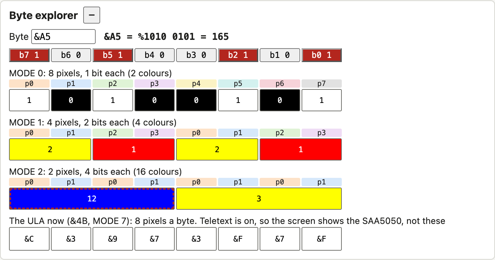
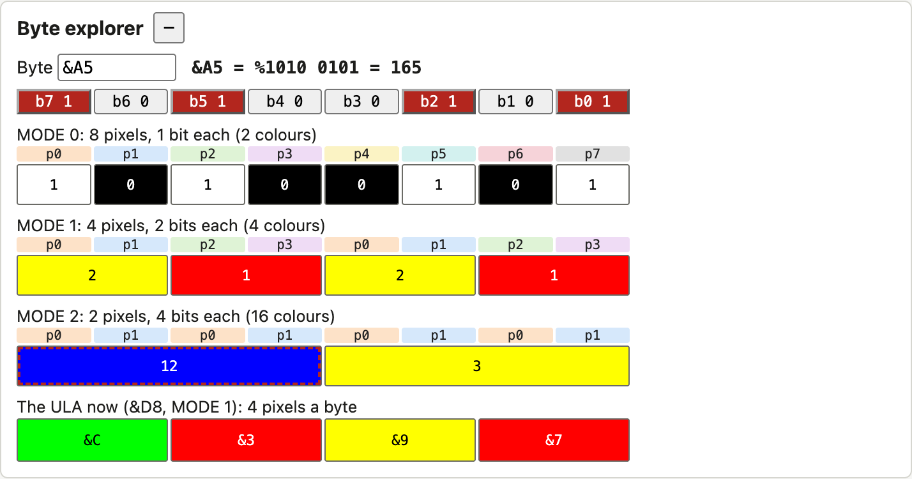
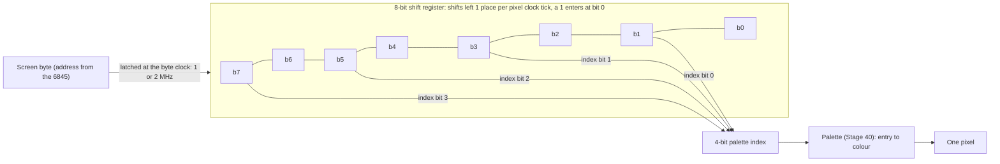
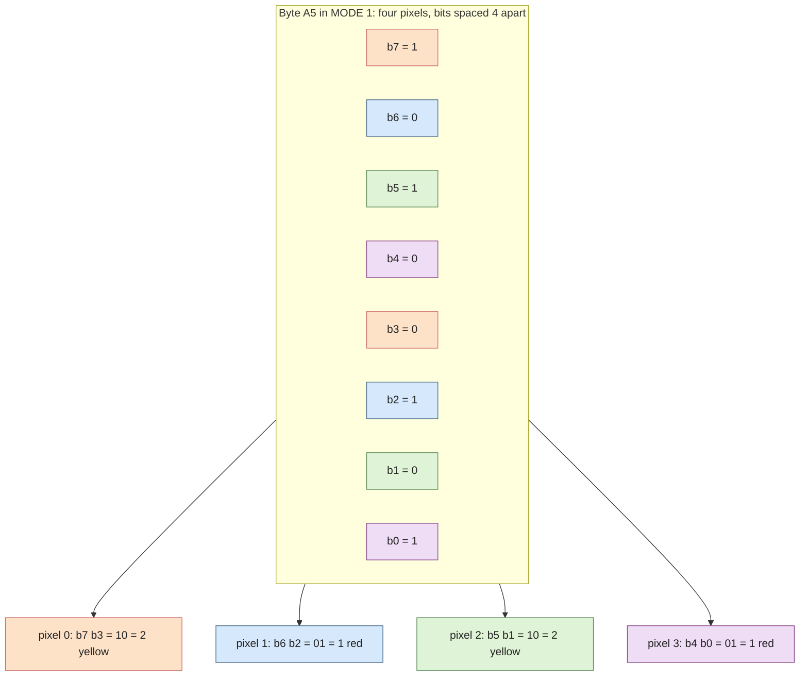
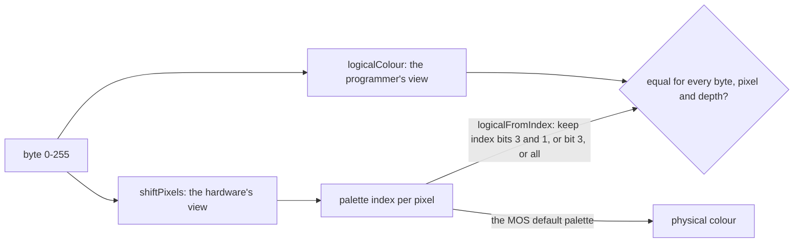

# Stage 41: Pixel decoding

> **Part:** 9 (Video ULA & bitmap modes) · **Branch:** `stage/41-pixel-decoding` · **Needs:** 40
> **Status:** done

## Goal

Stage 40 gave us the Video ULA's registers: how many pixels come out of each byte, and what colour each of the 16 palette entries gives. It left open the question in the middle: **which bits of a screen byte belong to which pixel?**

The answer is surprising the first time you see it. A pixel's bits are not next to each other. In MODE 1 the leftmost pixel is bits 7 and 3. This stage explains why: the ULA has **one** fixed piece of hardware for every MODE. It then builds that piece as pure functions, tested over all 256 byte values. Stage 42's renderer will call them for every byte on the screen.

## What you can now see

**In the browser** (no ROMs needed):

```bash
npm run dev     # then open http://localhost:5173/
```

Open the new **Byte explorer** panel, under the Video ULA panel. It starts on &A5:



- The **bit buttons** show the byte. Click one to flip that bit.
- Each MODE row has a strip of **owners** (`p0`, `p1`…), lined up under the bits. It says which pixel each bit belongs to. That's the interleave: MODE 1 reads `p0 p1 p2 p3 p0 p1 p2 p3`.
- Under it are the **pixels**, drawn with the MOS's default palette for that MODE and labelled with their logical colour. Every row is one byte wide, so a MODE 2 pixel is four MODE 0 pixels wide, as on the real screen. Hover for the arithmetic, e.g. `Pixel 0: b7 b3 = %10 = logical 2. The ULA reads index &C (%1100), which the MOS sets to yellow`. **Click a pixel** to move it to its next logical colour, and the byte updates.
- Try `&0F` and `&F0` in MODE 1 (every pixel colour 1, then every pixel colour 2), and `&3F` and `&FF` in MODE 2 (white, then flashing white).

The last row, **The ULA now**, decodes the byte with the machine's live control byte and palette, so it shows palette *indices*. With the ROMs (`/?machine=mos`), type `MODE 1` and it reads `&C &3 &9 &7`. Then, in the DevTools console, write one palette entry the MOS never would:

```js
workbench.machine.videoUla.write(1, 0xc5)   // entry &C = 5 EOR 7 = 2, green
```

Only pixel 0 turns green. Pixel 2 is also logical colour 2, but it reads entry &9 (Key concept 3):



**In Jest**, the exhaustive checks:

```bash
npx jest src/video/pixel-decode.test.ts
```

```
Tests: 30 passed
```

## The real hardware

Stage 40's diagram had a box labelled "shift register". This stage opens it up.

Once per character clock (1 or 2 MHz, control bit 4), the ULA **latches** the byte the 6845 has addressed into an 8-bit **shift register**. Then, at every tick of the pixel clock (2, 4, 8 or 16 MHz, control bits 3–2), it does two things:

1. It reads **bits 7, 5, 3 and 1** of the shift register as a 4-bit number. That is the **palette index** for this pixel: bit 7 becomes index bit 3, bit 5 index bit 2, bit 3 index bit 1, and bit 1 index bit 0.
2. It **shifts the register left by one**. Bit 6 moves into bit 7, and so on. A **1** is shifted in at the bottom.

BeebWiki ("Video ULA") states this directly: "Bits 1, 3, 5 and 7 are then used as an address to look up in a fast, 16 × 4 bit array of palette memory", and "the lowest bits are filled up with 1s, or random values on some machines". The Advanced User Guide doesn't describe the shift register. It gives only the result: the pixel layouts for each MODE (§8, the "screen memory" layouts, and the VDU 19 description).

That's the whole mechanism. The ULA never knows which MODE it's in. It knows only how fast to tick, and **pixels per byte = pixel clock ÷ byte clock** (Stage 40, Key concept 1) is just how many ticks fall between one latch and the next.

| MODE | Control | Pixel clock ÷ byte clock | Ticks per byte | Bits per pixel |
|---|---|---|---|---|
| 0, 3 | &9C | 16 ÷ 2 MHz | 8 | 1 |
| 1 | &D8 | 8 ÷ 2 MHz | 4 | 2 |
| 2 | &F4 | 4 ÷ 2 MHz | 2 | 4 |
| 4, 6 | &88 | 8 ÷ 1 MHz | 8 | 1 |
| 5 | &C4 | 4 ÷ 1 MHz | 4 | 2 |

## Key concepts

### 1. Four fixed taps, one shift per pixel

Follow MODE 2's byte &12 (%0001 0010) through the shift register. There are 2 ticks per byte, so there are two pixels:

```
tick  shift register   bits 7 5 3 1   index
 0    0 0 0 1 0 0 1 0    0 0 0 1      %0001 = 1   → left pixel
 1    0 0 1 0 0 1 0 1    0 1 0 0      %0100 = 4   → right pixel
            (shifted left, a 1 came in at bit 0)
```

So &12 in MODE 2 is a red (1) pixel followed by a blue (4) one. Read back the other way, the left pixel's colour bits 3, 2, 1, 0 are byte bits **7, 5, 3, 1**, and the right pixel's are the bits one place lower, **6, 4, 2, 0**. That is exactly the AUG's MODE 2 layout.

### 2. Why the bits are interleaved

Imagine Acorn had packed each pixel's bits together, so MODE 2's left pixel was bits 7–4 and the right pixel bits 3–0. Then the ULA would need to shift by **4** places per pixel in MODE 2, by **2** in MODE 1 and by **1** in MODE 0. Each MODE would need a different shift stride, and some way to pick it.

With the bits interleaved, the hardware is the same in every MODE: four fixed taps and a shift of one place each tick. The only thing that changes is the clock. Spreading a pixel's bits across the byte is the price of that simplicity, and programmers pay it instead of the chip. (That's an engineering reading of the design, not something Acorn documented. It does explain every layout below.)

A useful way to say it: **pixel *p*'s bits are spaced by the pixels-per-byte count.** For *n* pixels a byte, pixel *p*'s bits, from most to least significant, are at positions 7 − *p*, 7 − *p* − *n*, 7 − *p* − 2*n*, and so on:

| Bits per pixel | Pixels a byte (*n*) | Pixel 0 | Pixel 1 | Pixel 2 | Pixel 3 | Pixels 4–7 |
|---|---|---|---|---|---|---|
| 4 (MODE 2) | 2 | 7 5 3 1 | 6 4 2 0 | | | |
| 2 (MODE 1, 5) | 4 | 7 3 | 6 2 | 5 1 | 4 0 | |
| 1 (MODE 0, 3, 4, 6) | 8 | 7 | 6 | 5 | 4 | 3, 2, 1, 0 |

Only MODE 0's layout is the one you'd guess.

### 3. Index bits and logical colours: where Stage 40's palette came from

Every tick reads **four** bits, but a MODE 1 pixel has only two. Follow MODE 1's &A5 (%1010 0101), 4 ticks:

```
tick  shift register   bits 7 5 3 1   index   MOS MODE 1 entry   colour
 0    1 0 1 0 0 1 0 1    1 1 0 0      &C        &4 → 3 yellow     logical 2
 1    0 1 0 0 1 0 1 1    0 0 1 1      &3        &6 → 1 red        logical 1
 2    1 0 0 1 0 1 1 1    1 0 0 1      &9        &4 → 3 yellow     logical 2
 3    0 0 1 0 1 1 1 1    0 1 1 1      &7        &6 → 1 red        logical 1
```

At tick 0, index bit 3 is byte bit 7 (pixel 0's high bit) and index bit 1 is byte bit 3 (pixel 0's low bit). That's the pixel. Index bits 2 and 0 are byte bits 5 and 1, which belong to **pixel 2**. They're along for the ride. By tick 2 and 3, some of the taps are reading the 1s that were shifted in.

The ULA can't ignore those extra bits, so the MOS makes them not matter. It writes the **same colour to every entry that shares index bits 3 and 1**. That's the pattern Stage 40 measured, `7766776644004400`: entries &8, &9, &C and &D all hold logical colour 2, whatever their bits 2 and 0 are. In general:

| Bits per pixel | Index bits that are this pixel | Logical colour from the index | Entries per logical colour |
|---|---|---|---|
| 1 | bit 3 | index bit 3 | 8 |
| 2 | bits 3 and 1 | index bit 3, then index bit 1 | 4 |
| 4 | all four | the index itself | 1 |

So there are **two equally correct ways** to decode a byte:

- **The programmer's view (logical colours):** take pixel *p*'s bits from the table in concept 2. This is what the AUG documents, and what VDU 19 and GCOL talk about.
- **The hardware's view (palette indices):** run the shift register and read the taps. This is what the ULA really does, and it's the only one that's right when a program writes the palette in some way the MOS wouldn't. For example, in MODE 1, poking only entry &C to green turns pixel 0 of &A5 green but leaves pixel 2 yellow, although both are logical colour 2 (pixel 2 reads entry &9).

They agree whenever the palette follows the MOS's rule. Proving that for all 256 bytes is this stage's main test.

### 4. Worked bytes

Using the MOS's default palettes (MODE 0 black/white; MODE 1 black, red, yellow, white; MODE 2 colour *n* = *n*):

| Byte | MODE 0 (8 pixels) | MODE 1 (4 pixels) | MODE 2 (2 pixels) |
|---|---|---|---|
| &FF | all white | 3 3 3 3 (white) | 15 15 (flashing white/black) |
| &0F | 0000 1111 | 1 1 1 1 (red) | 3 3 (yellow) |
| &F0 | 1111 0000 | 2 2 2 2 (yellow) | 12 12 (flashing blue/yellow) |
| &A5 | 1010 0101 | 2 1 2 1 | 12 3 |
| &12 | 0001 0010 | 0 0 1 2 | 1 4 (red, blue) |
| &3F | 0011 1111 | 1 1 3 3 | 7 7 (white) |

Two things are worth noticing:

- **&0F is "colour 1 everywhere" in MODE 1**, and **&F0 is "colour 2 everywhere"**. The low nibble holds every pixel's low bit, and the high nibble every pixel's high bit. That's why MODE 1 sprite code is full of `AND #&0F` and `AND #&F0`.
- **MODE 2 white is &3F, not &FF.** Colour 7 is bits 2, 1 and 0 of each pixel, and bit 3 is the flash bit (palette entries 8–15 flash). &FF is colour 15 in both pixels: flashing.

### 5. The two pixel rates no MOS MODE uses

The same mechanism predicts what happens when control bits 3–2 and bit 4 don't match any MOS MODE (Stage 40 labelled these "not a MOS MODE"):

- **16 pixels a byte** (16 MHz pixels, 1 MHz bytes). The register is shifted 16 times between latches. After 8 shifts it holds nothing but the 1s that came in, so pixels 8–15 all read index **&F**. Each byte is drawn as 8 real pixels and then 8 pixels of entry &F. BeebWiki describes exactly this: "every other text column will be 'blank', filled with logical colour 15".
- **1 pixel a byte** (2 MHz pixels, 2 MHz bytes). One tick, so one pixel, whose index is bits 7, 5, 3 and 1. Bits 6, 4, 2 and 0 never reach the taps. BeebWiki: "only the odd bits of each byte will affect the display".

We decode both, because the model gives them for free. The "1s, or random values on some machines" caveat applies here: we shift in 1s.

## Diagrams

The shift register and its taps. The ULA does the same thing in every MODE. Only the two clocks change.



Which byte bits make each pixel, coloured by pixel. MODE 1's byte &A5 = %1010 0101 gives logical colours 2, 1, 2, 1:



The two views of a byte, and the test that ties them together:



## Our design

A new pure module, **`src/video/pixel-decode.ts`**. No DOM, no state, and the function Stage 42 will call on its hot path doesn't allocate.

```ts
/** Bits 7, 5, 3, 1 of the shift register → palette index bits 3, 2, 1, 0. */
export function paletteIndex(shiftRegister: number): number;

/** The hardware's view: runs the shift register, filling out[0..n-1] with palette indices. */
export function shiftPixels(byte: number, pixelsPerByte: number, out: Uint8Array): void;

/** The programmer's view: pixel p's logical colour at 1, 2 or 4 bits per pixel. */
export function logicalColour(byte: number, pixel: number, bitsPerPixel: BitsPerPixel): number;

/** Which index bits are the pixel: 1 bpp → bit 3; 2 bpp → bits 3 and 1; 4 bpp → all four. */
export function logicalFromIndex(index: number, bitsPerPixel: BitsPerPixel): number;

/** The byte positions of pixel p's bits, most significant first: MODE 1 pixel 0 → [7, 3]. */
export function pixelBitPositions(pixel: number, bitsPerPixel: BitsPerPixel): readonly number[];

/** The inverse of logicalColour: the byte that draws these logical colours. */
export function encodePixels(colours: readonly number[], bitsPerPixel: BitsPerPixel): number;
```

- **Two views on purpose.** `shiftPixels` is what Stage 42 will draw with, because it gives the right answer for any palette. `logicalColour` and `encodePixels` are the programmer's view, which the explorer uses to say "logical colour 2" and to build a byte from pixels you click. The exhaustive test proves they agree.
- **`shiftPixels` writes into a caller's `Uint8Array`** rather than returning an array. Stage 42 will call it 20,000 times a field, so it must not allocate (`CLAUDE.md`). The shift-in value is a named constant, `ULA_SHIFT_FILL = 1`.
- **`BitsPerPixel` is `1 | 2 | 4`**, the type Stage 40's `UlaControl.bitsPerPixel` already uses.
- **The MOS's default palettes** for MODE 0, 1 and 2 (the 16 nibbles Stage 40 measured) become a constant in `src/mos/mos-video-ula.ts`, `MOS_DEFAULT_PALETTE`. Stage 40's ROM test now checks the measured writes against it, so it can't drift. The explorer and the tests use it without needing the ROMs.
- **The Byte explorer panel** (`byte-explorer-view-model.ts`, `byte-explorer-panel.ts`) is a workbench tool like the number converter. It doesn't need the machine except for one row, "the ULA now", which decodes the byte with the machine's live control byte and palette.

## Code walkthrough

- [`src/video/pixel-decode.ts`](../../src/video/pixel-decode.ts): the whole stage in about 60 lines.
  - `paletteIndex` gathers the four taps with shifts and masks: `(s >> 4) & 0x08` moves bit 7 to bit 3, and so on.
  - `shiftPixels` is the ULA. It reads the taps, then `s = ((s << 1) | ULA_SHIFT_FILL) & 0xff`, once per pixel. It writes into a caller's `Uint8Array` and allocates nothing, ready for Stage 42.
  - `logicalColour` and `encodePixels` use one formula, positions `7 - p - k × pixelsPerByte`, in opposite directions.
  - `logicalFromIndex` is the bridge. It's a `switch` on the depth that keeps index bit 3, bits 3 and 1, or all four.
- [`src/mos/mos-video-ula.ts`](../../src/mos/mos-video-ula.ts): `MOS_DEFAULT_PALETTE`, the 16 nibbles after each bitmap MODE, as Stage 40 measured them.
- [`src/web/workbench/byte-explorer-view-model.ts`](../../src/web/workbench/byte-explorer-view-model.ts): the words and colours. MODE rows colour each pixel from the **hardware's** index through the MOS palette, and label it with the **programmer's** logical colour. Both views appear in each tooltip. `parseByte`, `toggleBit` and `cyclePixel` are the editing operations, all pure.
- [`src/web/workbench/byte-explorer-panel.ts`](../../src/web/workbench/byte-explorer-panel.ts): built once. Pixel widths are `flex-grow` = bits per pixel, so every row is one byte wide. The live row adds or removes pixel elements only when the ULA's pixels-per-byte changes.
- [`src/main.ts`](../../src/main.ts): adds the panel after the Video ULA panel, for both the playground and the MOS machine.

## Tests

| Test file | What it proves |
|---|---|
| `src/video/pixel-decode.test.ts` | The taps (7, 5, 3, 1 → index 3, 2, 1, 0). The shift with 1s coming in: MODE 2 &12 = 1 then 4, MODE 1 &A5 = &C &3 &9 &7, 16 pixels a byte ends in eight &F, and at 1 pixel a byte only the odd bits count. Bit layouts for each depth, with every bit owned by exactly one pixel. **Exhaustive over all 256 bytes at 1, 2 and 4 bpp:** encode(decode(b)) = b, and all 256 colour sequences are different. The hardware index, cut down by `logicalFromIndex`, equals the AUG's logical colour. With the MOS default palette for MODE 0, 1 and 2, the hardware draws every pixel of every byte in its logical colour's default colour. The worked bytes from this doc. |
| `src/machine/ula-modes.test.ts` | New test: `MOS_DEFAULT_PALETTE` equals what MOS 1.20 writes for MODE 0–6 (**skips without ROMs**). |
| `src/web/workbench/byte-explorer-view-model.test.ts` | Summary, bit owners, pixel labels, colours, widths and titles. The live row's indices in MODE 1, a changed entry changing only the pixels that read it, MODE 7's teletext note, and 16 pixels a byte. `parseByte` forms, `toggleBit` and `cyclePixel`. |
| `e2e/byte-explorer.spec.ts` | (chromium project, no ROMs) Opens on &A5 with the right labels and colours. The owner strips for MODE 1 and 2. Typing &0F and 3F. A bit flip and a pixel click rewrite the byte (&A5 → &25 → &2D). The live row follows the playground ULA's &4B. |

## Gotchas & hardware quirks

- **The leftmost pixel is always the top bit**, but its other bits are spread through the byte. In MODE 1 the low bit of pixel 0 is **bit 3**, not bit 6.
- **MODE 2 white is &3F.** &FF is colour 15, which flashes, because a MODE 2 pixel's top bit picks palette entries 8–F.
- **Two views can disagree.** The logical colour and the colour on the screen match only while every entry with the same "own" index bits holds the same colour. The MOS always does that, but a program poking &FE21 may not. Stage 42 will draw from `shiftPixels`, the hardware's view, so such programs come out right.
- **The shifted-in bits are 1s on most machines.** BeebWiki says "or random values on some machines". We use 1s. It only shows in MODE 1/0 with an unusual palette, or at 16 pixels a byte.
- **Unused pixel rates fall out of the model.** At 16 pixels a byte the second half of every byte is entry &F. At 1 pixel a byte the even bits are invisible. Both are the model's predictions, matching BeebWiki's descriptions. I haven't seen them on real hardware.
- **Not yet:** drawing any of this on the screen (Stage 42), the cursor's segments (Stage 42), and the timing of a palette change mid-line (Stage 42 decides).
- **Sources:** BeebWiki "Video ULA" for the taps and the 1s. The AUG for the per-MODE layouts. I didn't consult any emulator source for this stage.

## Playwright verification

- **MCP, interactive:** on the playground, the panel opened on &A5 with MODE 0 `1 0 1 0 0 1 0 1`, MODE 1 `2 1 2 1` (yellow red yellow red), MODE 2 `12 3`, and the live row on &4B with teletext noted. On `?machine=mos`, after typing `MODE 1`, the live row read `The ULA now (&D9, MODE 1): 4 pixels a byte`, `&C &3 &9 &7`. After `videoUla.write(1, 0xc5)` the live colours were green, red, yellow, red, while the MODE 1 row (MOS defaults) stayed yellow, red, yellow, red. Screenshots are above. (I first tried typing `?&FE21=&C5` into BASIC through the MCP. With MODE 1 not drawn yet I couldn't see what was typed, and the poke didn't land, so I used the console handle.)
- **Durable:** `e2e/byte-explorer.spec.ts`, 5 tests, in the chromium project. Full e2e suite: 142 passed. In the first run, `via-interrupts.spec.ts` "Timer 1 interrupts 100 times a second" failed once while my MCP browser was also running a real-time machine. It passed alone (4/4, plus 12/12 with `--repeat-each=3` on `main`'s code) and in a clean full run.

## Check your understanding

1. In MODE 1, which two bits of a byte make pixel 2, and which is the high bit?
2. What MODE 2 byte draws a green (2) pixel on the left and a black (0) pixel on the right?
3. Why does the ULA read *four* bits for every pixel, even in MODE 0, where a pixel has one bit?
4. In MODE 1 the MOS writes logical colour 1 into entries 2, 3, 6 and 7. Using the shift register, explain why it has to write all four, not just one.
5. With control byte &8C (16 MHz pixels, 1 MHz bytes), what does the screen show for byte &00 in a MOS MODE 1 palette, and why?

<details>
<summary>Answers</summary>

1. Bits **5** (high) and **1** (low). Pixel *p*'s bits are 7 − *p* and 3 − *p* when there are 4 pixels a byte.
2. **&08.** The left pixel's colour bits 3, 2, 1, 0 are byte bits 7, 5, 3, 1. Colour 2 = %0010 is colour bit 1, which is byte bit 3 = &08. The right pixel is all zeros.
3. The ULA has one design for every MODE: four fixed taps (bits 7, 5, 3, 1) and a one-place shift per pixel. It doesn't know the MODE. In MODE 0 the other three taps read the next pixels' bits and the shifted-in 1s, and the MOS's palette (entries 0–7 black, 8–F white) makes only index bit 3 matter.
4. A logical-1 pixel has index bit 3 = 0 and index bit 1 = 1. Index bits 2 and 0 come from byte bits 5 and 1 at tick 0. Those are pixel 2's bits, or 1s that have been shifted in at later ticks, so they can be anything: %0010, %0011, %0110 or %0111. That's entries 2, 3, 6 and 7. Missing one would make some colour-1 pixels the wrong colour, depending on their neighbours.
5. 16 ticks per byte. Ticks 0–7 read the byte as it shifts. In MODE 1's palette, &00's first four indices are 0, 0, 1, 1, and the rest pick up more 1s. By tick 8 the register is all 1s, so pixels 8–15 read entry &F, which is white in the MOS's MODE 1 palette. So half of each byte-time is a blank strip of entry &F, as BeebWiki says: "filled with logical colour 15".

</details>

## Further reading

- BeebWiki, "Video ULA": the shift register, the taps at bits 1, 3, 5, 7, the shifted-in 1s, and the unused clock combinations.
- *The BBC Microcomputer Advanced User Guide*: the screen memory layouts for each MODE, the VDU 19 entry in §8, and §19.3 "Video ULA".
- Stage 40's doc ([40-ula-palette.md](40-ula-palette.md)), Key concept 3, for the MOS's palette pattern this stage explains.
