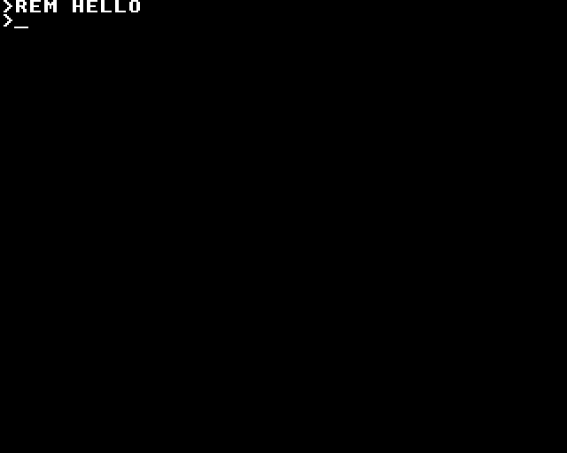
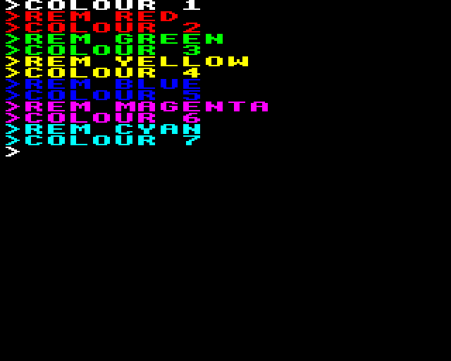
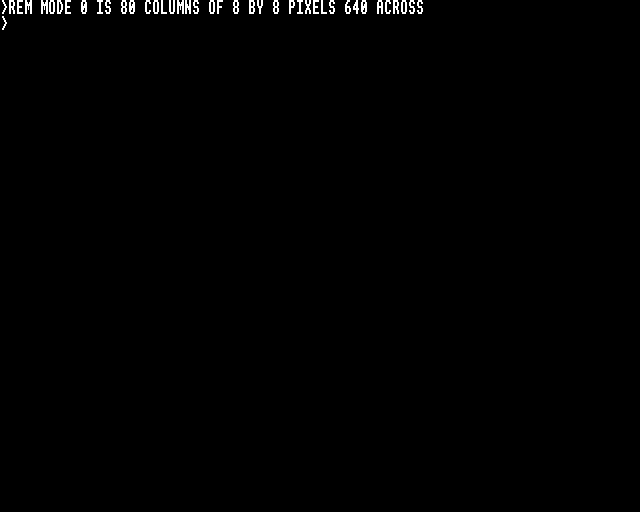
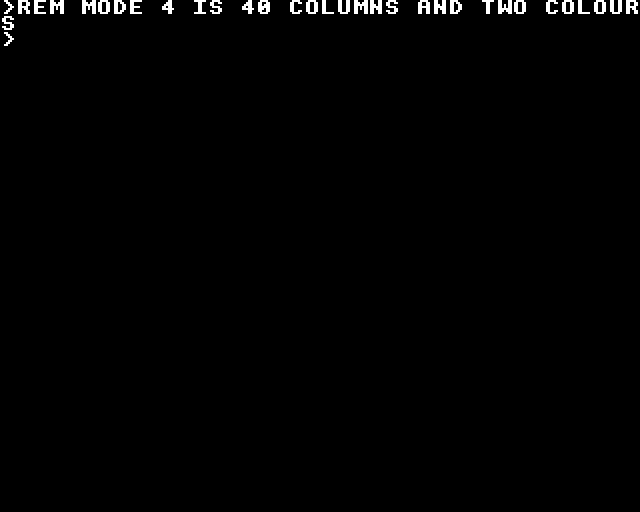
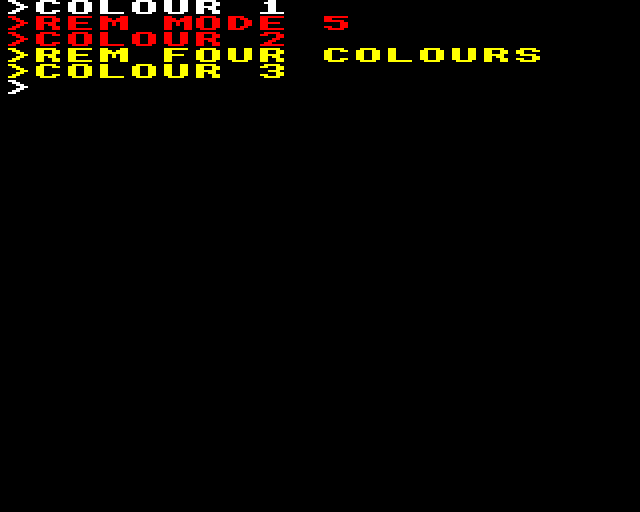
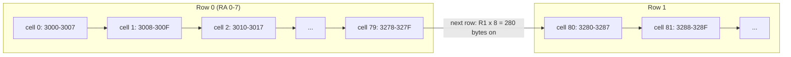
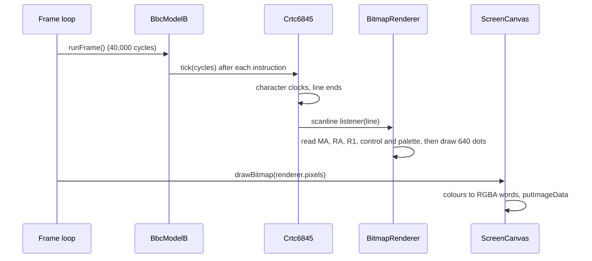

# Stage 42: Rendering modes 0–6

> **Part:** 9 (Video ULA & bitmap modes) · **Branch:** `stage/42-bitmap-rendering` · **Needs:** 41
> **Status:** done

## Goal

Since Stage 40, typing `MODE 1` turns the screen black. The ULA has left teletext, and we had nothing to draw its pixels with. All the parts now exist: the 6845 counts out addresses (Stages 38–39), the board turns them into RAM addresses (Stage 39), and the ULA turns each byte into palette indices and colours (Stages 40–41). This stage joins them into a **bitmap renderer**. When it's done, MODE 0, 1, 2, 4 and 5 show their text.

There are two new ideas. The first is the **character-cell layout** of screen memory: why the 8 bytes after &3000 are the top-left *character*, not the top-left line. The second is a renderer that the **6845 drives one scanline at a time**, as the beam does, instead of one that works the picture out afterwards.

## What you can now see

**In the browser** (needs `roms/os12.rom` and `roms/basic2.rom`):

```bash
npm run dev     # then open http://localhost:5173/?machine=mos
```

Click the screen and type `MODE 1`, then anything (`REM HELLO`). The text appears in the MOS's font with the underline cursor blinking after the prompt:



Try `MODE 2` and `COLOUR 1` … `COLOUR 7` for the eight colours. BASIC prints its `>` prompt in the current colour too:



MODE 0 is 80 columns of 1-dot pixels. MODE 4 is the same letters at 40 columns, each pixel 2 dots wide. MODE 5 is 20 columns and 4 colours:





`MODE 7` brings teletext back: the canvas goes back to 480 × 500 and the text layer refills.

**At the command line:**

```bash
npm run demo:bitmap
```

Part 1 prints the table in "The real hardware" from the live machine. Part 2 shows MODE 0's top-left cell next to the font:

```
 addr   byte  pixels    font &C0F0+
 &3000  &30     ██      &30
 &3001  &18      ██     &18
 &3002  &0C       ██    &0C
 &3003  &06        ██   &06
 &3004  &0C       ██    &0C
 &3005  &18      ██     &18
 &3006  &30     ██      &30
 &3007  &00             &00
```

Part 3 types `PRINT "BBC MICRO"` in MODE 0, 1, 2, 4 and 5 and prints the top three rows of `machine.bitmap.pixels`, one character per pixel (`R` = red, `█` = white). MODE 1, for example:

```
  │  ██      ████    ████   ██       ████   ██  ██  █████             ██            █████   █████   ██████  ██  ██  ██████
  │   ██    ██  ██  ██  ██  ██      ██  ██  ██  ██  ██  ██           ███            ██  ██  ██  ██    ██    ██  ██    ██
  …
  │ RRRRR   RRRRR    RRRR           RR   RR RRRRRR   RRRR   RRRRR    RRRR
  │ RR  RR  RR  RR  RR  RR          RRR RRR   RR    RR  RR  RR  RR  RR  RR
  …
  │        ████████
```

The last line is the cursor: one letter (8 pixels) on scanline 7, after the `>`.

## The real hardware

Three chips are involved, and none of them knows the whole picture:

- **The 6845** (Stages 38–39) counts. On each scanline it puts out a run of character addresses on **MA0–MA13**: it starts at the row's start and adds 1 per character clock for R1 characters. It also puts out the scanline within the character row on **RA0–RA4**. It knows nothing about memory or pixels.
- **The board's address logic** (Stage 39, `screen-address.ts`) makes a RAM address from MA and RA. In the bitmap MODEs (MA13 = 0) the wiring is:

  | RAM address bits | come from |
  |---|---|
  | A0–A2 | RA0–RA2 |
  | A3–A14 | MA0–MA11 |

  So the address is `MA × 8 + RA` (Advanced User Guide, 6845 chapter; BeebWiki "6845 CRTC"). RA3 and RA4 aren't wired to RAM. That's why MODE 3 and 6's 10-line rows need extra handling, which is Stage 43.
- **The Video ULA** (Stages 40–41) latches each byte as it arrives, one per character clock (1 or 2 MHz, control bit 4). It then shifts the pixels out at the pixel clock. Each pixel's 4-bit index goes through the palette to a physical colour on the RGB pins. Where the 6845's display enable (DISPEN) is low, it outputs black. Where the 6845's cursor output (CUDISP) is high, it inverts the colour for the number of byte-times its cursor segments say.

Here's what the MOS sets up, measured from the real ROM after typing each MODE (`npm run demo:bitmap` prints these):

| MODE | R1 | R6 | R9 | R12/R13 (MA) | RAM start | ULA control | Cursor MA after `MODE n` |
|---|---|---|---|---|---|---|---|
| 0 | &50 (80) | &20 (32) | &07 | &0600 | &3000 | &9C | &0601 |
| 1 | &50 (80) | &20 | &07 | &0600 | &3000 | &D8 | &0602 |
| 2 | &50 (80) | &20 | &07 | &0600 | &3000 | &F4 | &0604 |
| 3 | &50 (80) | &19 (25) | &09 | &0800 | &4000 | &9C | &0801 |
| 4 | &28 (40) | &20 | &07 | &0B00 | &5800 | &88 | &0B01 |
| 5 | &28 (40) | &20 | &07 | &0B00 | &5800 | &C4 | &0B02 |
| 6 | &28 (40) | &19 | &09 | &0C00 | &6000 | &88 | &0C01 |

Every bitmap MODE has R8 = &01 (interlace sync, not interlace video), R10 = &67 and R11 = &08 (MODE 3 and 6: &09).

## Key concepts

### 1. Screen memory is laid out in character cells

Most people's first guess at a bitmap screen is **linear**: the first 80 bytes are the top line, the next 80 the second line, and so on. The BBC's isn't. Take the address wiring above and count the way the 6845 does, in MODE 0 (start MA &0600, R1 = 80):

| Scanline | RA | MA run | RAM addresses read |
|---|---|---|---|
| 0 | 0 | &0600, &0601, &0602 … &064F | &3000, &3008, &3010 … &3278 |
| 1 | 1 | &0600 … &064F (back to the row start) | &3001, &3009, &3011 … &3279 |
| … | | | |
| 7 | 7 | &0600 … &064F | &3007, &300F … &327F |
| 8 | 0 | &0650 … &069F (the next row) | &3280, &3288 … |

Read the table down a column instead of across a row. **&3000–&3007 are the 8 scanlines of the top-left character cell**, &3008–&300F the cell to its right, and so on along the row. A row of 80 cells is 80 × 8 = 640 = **&280** bytes, so row 1 starts at &3280. In MODE 4 (40 cells) a row is 40 × 8 = &140 bytes: &5800, &5940, &5A80…

**Why lay it out like this?** The 6845 was designed for text terminals. MA picks a character and RA picks the line of it, and the board maps RA onto the *lowest* address bits. The payoff is that one character's 8 lines are 8 consecutive bytes. To print a letter in MODE 0, the MOS copies the 8 bytes of its font glyph to 8 consecutive addresses. Measured after `MODE 0`: the prompt's `>` at &3000–&3007 is `30 18 0C 06 0C 18 30 00`, byte for byte the MOS font's glyph for `>` at &C0F0. In a linear layout the same copy would need an add of 80 between every byte.

The cost falls on graphics. Moving one pixel down usually means the next byte, but every eighth line it means jumping &280 bytes on to the next row. This is why BBC games write clever plotting routines.

### 2. A 6845 "character" is a byte column, not a letter

In MODE 1 and 2, R1 is still 80. The 6845 still puts out 80 addresses a line, at 2 MHz. Each MA is a column of 8 bytes, and MODE 1 fits only 4 pixels in a byte. So a 6845 "character" there is 4 pixels wide, and a text letter (8 × 8 pixels) takes **2** cells side by side. In MODE 2 (2 pixels a byte) a letter takes **4** cells.

The measured cursor addresses show this: after `MODE n` the cursor sits one letter to the right of the prompt. That's MA &0601 in MODE 0 (1 cell on), &0602 in MODE 1 (2 cells) and &0604 in MODE 2 (4 cells). And MODE 1's `>` starts `33 11 00 00 00 11 33 00` at &3000. Stage 41's 2 bpp interleave puts pixels 2 and 3 of `>`'s first line (&30 = %0011 0000) in bits 5/1 and 4/0: %0011 0011 = &33.

### 3. The picture is drawn by the beam, a scanline at a time

The real BBC has no frame buffer. The picture exists only as the beam draws it. On each scanline the 6845 runs MA across, the ULA turns each byte into pixels **at that moment**, and the bytes come from RAM **as they are then**. Three consequences show up later:

- If the CPU changes the palette halfway down the screen, the top half and the bottom half are different colours. Games do this ("raster splits").
- If the start address R12/R13 changes mid-field, nothing happens until the next field, because the 6845 latches it only at the top (Stage 39).
- When the machine stops, the beam stops too. A byte poked into screen memory while paused appears on the next field, not before.

So our renderer copies that. **The 6845 calls it at the start of every scanline**, and it draws that one line from that line's MA and RA. It uses the RAM, ULA control byte and palette as they are at that moment. It never works out "what the frame should look like". It does exactly what the counters say. That's the difference from Stage 39's MODE 7 renderer, which reads the latched start, R1 and R6 and re-derives the rows itself.

Why per scanline, and not per character, which is what the hardware really does? Calling into the renderer 2 million times a second from the CRTC's `tick()` would cost a lot on the hot path. Once per line is 15,625 calls a second. That's enough for raster splits that change between lines, which is what almost all software does. Changes in the middle of a line are a Part 12 cycle-exact refinement.

### 4. One unit across: 16 MHz dots

Every MOS MODE shows **40 µs** of each 64 µs line: 80 characters at 2 MHz, or 40 at 1 MHz. The ULA's fastest pixel clock is 16 MHz, so 40 µs is **640 dots** at 16 MHz. We measure everything across in those dots. A pixel then lasts 16 MHz ÷ its pixel clock:

| MODE | Pixel clock | Pixels a byte | Dots a pixel | Dots a byte | Bytes a line | Dots a line |
|---|---|---|---|---|---|---|
| 0 | 16 MHz | 8 | 1 | 8 | 80 | 640 |
| 1 | 8 MHz | 4 | 2 | 8 | 80 | 640 |
| 2 | 4 MHz | 2 | 4 | 8 | 80 | 640 |
| 4 | 8 MHz | 8 | 2 | 16 | 40 | 640 |
| 5 | 4 MHz | 4 | 4 | 16 | 40 | 640 |

Dots a byte is always 16 MHz ÷ byte clock: 8 at 2 MHz, 16 at 1 MHz. The renderer never asks "which MODE?". It reads the two clocks from the control byte, as the ULA does, so a pixel width the MOS never uses still comes out right.

Down the screen we count **scanlines**: R6 rows × (R9 + 1) lines = 32 × 8 = **256** in MODE 0–2, 4 and 5. Our frame buffer is 640 × 256. The CSS stretches it into the same 5:4 box as MODE 7's 480 × 500. Both are the same 40 µs × about 256 lines of a TV picture, so the two line up.

### 5. Interlace sync without interlace video

The bitmap MODEs set R8 = &01: **interlace sync** only. Stage 38 showed that the odd field's VSYNC comes half a line late, so the TV draws it half a line lower. But RA doesn't change between fields (that's interlace *video*, R8 = &03, MODE 7 only). So both fields draw the **same 256 lines**, each line shown twice, half a line apart. That's the "640 × 512" the TV seems to show. We keep one field's 256 lines and let the CSS double them.

### 6. Black where display enable is low

DISPEN is low outside R1 characters and R6 rows (Stage 38). The ULA puts out black there: that's the border. If a program shrinks R1 to 64, the right-hand 16 MODE 0 cells go black. The renderer clips anything wider than its 640 dots, because we don't draw the border or place the picture by HSYNC/VSYNC.

### 7. The cursor: CUDISP stretched by the ULA's segments

The 6845's CUDISP output is high for one character clock: the character at MA = R14/R15, on scanlines R10 bits 0–4 to R11, in the blink's on phase (Stage 39). The ULA **inverts the colour** (physical colour EOR 7) for up to four byte-times from then. Its control bits 7–5 say which (Stage 40, Key concept 7, BeebWiki's reading):

| MODE | Control | Segments | Bytes inverted | Pixels |
|---|---|---|---|---|
| 0 | &9C = %100… | 1 | 1 | 8 |
| 1 | &D8 = %110… | 1, 2 | 2 | 8 |
| 2 | &F4 = %111… | 1, 2, 3, 4 | 4 | 8 |
| 4 | &88 = %100… | 1 | 1 | 8 |
| 5 | &C4 = %110… | 1, 2 | 2 | 8 |

Every MODE's cursor is **one text letter wide**. That's the real test of Stage 40's reading: the AUG's ("bit 7 master size, bits 6–5 width in bytes") gives a 3-byte cursor for MODE 2's %11, which would be 6 pixels.

Which lines? R10 = &67: bits 0–4 = 7, so the cursor starts on line 7. R11 = 8, so it ends on line 8, but an 8-line row has only lines 0–7. So it's **one line, the bottom one**: the BBC's underline cursor. Bits 5–6 of &67 are %11, the 32-field blink: 16 fields on, 16 off, 0.64 s a cycle.

R8's bits 6–7 (cursor skew) delay CUDISP by 0–2 characters, and %11 turns it off. The bitmap MODEs set skew 0, but the renderer applies it anyway, because it's one add.

## Diagrams

How one scanline is made. The 6845 calls the renderer once at the line's start, and the renderer does what the three chips do along the line:

```mermaid
flowchart LR
    subgraph CRTC["6845 (once a scanline)"]
        LS["line start: MA = row start, RA = scanline"]
    end
    subgraph BOARD["Board"]
        ADDR["RAM address = MA x 8 + RA"]
    end
    subgraph ULA["Video ULA (per byte)"]
        SR["shift register: bits 7,5,3,1 = index"]
        PAL["palette: index to physical colour"]
        CUR["cursor: EOR 7 for its segments"]
    end
    LS -->|"for c = 0 .. R1-1: MA + c"| ADDR
    ADDR -->|"byte from RAM now"| SR
    SR -->|"pixels a byte, each 16 MHz / pixel clock dots"| PAL
    PAL --> CUR
    CUR --> FB["frame buffer line: 640 dots"]
    FB -->|"each browser frame"| CANVAS["canvas 640 x 256"]
```



MODE 0's memory, seen as the screen. Each box is a character cell of 8 bytes, one per scanline:



Who calls whom, over time. The renderer runs inside the machine's tick, and the browser only copies the frame buffer:



## Our design

- **`Crtc6845` gains a scanline hook.** `connectScanline(listener)` is called at the start of every scanline with the line number in the field (0–311). Two new getters give the renderer what the chip has at that moment. `lineStartAddress` is the MA the line begins at. `rowDisplayed` is the vertical half of display enable. The listener is made once by whoever connects it, so `tick()` still allocates nothing. It costs one test per scanline when unconnected.
- **`src/video/bitmap-renderer.ts`** is new. It holds a `BitmapRenderer` with a `pixels` buffer (`Uint8Array`, 640 × 256, one physical colour 0–7 per dot) and a `drawLine(line)` method. It reads the 6845 and ULA through two small interfaces (`BitmapCrtc` and `BitmapUla`), and memory through a `peek` function, so the tests can give it a fake of each. It makes no allocations per line. The 16-entry palette lookup and the shift-register output are `Uint8Array`s made once.
- **It does nothing while the ULA is in teletext** (control bit 1). MODE 7's pixels come from the SAA5050, which Stage 39's renderer draws.
- **`BbcModelB` owns one** (`machine.bitmap`) and wires it to its CRTC, ULA and memory map at construction. So Jest tests and CLI demos get a picture too, not only the browser.
- **The browser side:** `ScreenCanvas` gains `drawBitmap(pixels)`. The canvas becomes 640 × 256 in a bitmap MODE and goes back to 480 × 500 for MODE 7. The CSS box stays 5:4. `clear()` goes, because black is now just what the renderer draws when nothing is displayed. The invisible text layer is cleared in a bitmap MODE: reading text back from pixels is not this stage.
- **Not built (Stage 43):** the MA12 screen wrap and the blank gap lines of MODE 3 and 6. A MODE 3 row's lines 8 and 9 repeat lines 0 and 1 for now, because RA3 isn't decoded. The display-enable skew (R8 bits 4–5) is ignored too, because it's 0 in every bitmap MODE.

**Alternatives considered:**
- *Render the whole field at draw time* from R12/R13, R1, R6 and R9, as the MODE 7 renderer does. It's simpler, and a paused poke shows at once. But it re-derives the counters instead of following them, and it can't show a mid-field palette or MODE change.
- *Render per character* from inside the CRTC's character clock. That's exact, but it adds a call to every one of 2 million character clocks a second. Keep it for Part 12, if ever.

## Code walkthrough

- [`src/devices/crtc6845.ts`](../../src/devices/crtc6845.ts): `connectScanline()`, and `lineStart()` now ends with `this.scanlineListener?.(this.line)`. By then `rowStart` and `ra` are already this line's, so the listener sees the right MA and RA. `reset()` announces line 0 the same way, so the first line after power-on is drawn too. The two new getters, `lineStartAddress` and `rowDisplayed`, are plain reads of existing fields.
- [`src/video/bitmap-renderer.ts`](../../src/video/bitmap-renderer.ts): `drawLine(line)` is the whole stage in about 30 lines:
  1. It returns if the ULA is in teletext or the line is past 256. It fills the line black if the row isn't displayed.
  2. It gets `dotsPerByte` from control bit 4 and `dotsPerPixel` from bits 3–2. `pixelsPerByte` is their ratio, so it's never looked up by MODE.
  3. It copies the 16 palette colours into `colours` once for the line.
  4. For each of R1 columns (clipped to 640 dots): `screenAddress(MA + column, RA)` → `peek` → `shiftPixels` → `colours[index]` → `dotsPerPixel` writes.
  5. It fills the rest of the line black (DISPEN low), then calls `drawCursor`.
- `drawCursor` checks the skew (%11 = off), the scanline and the blink, using the helpers Stage 39 wrote. It finds the cursor's column from `(R14/R15 − line start) & &3FFF`, then calls `invertByte` once for each segment bit that's set.
- [`src/machine/bbc-model-b.ts`](../../src/machine/bbc-model-b.ts): `bitmap` is built with `map.peek` as its memory and connected to the CRTC. The closure is made once, in the constructor.
- [`src/web/screen-canvas.ts`](../../src/web/screen-canvas.ts): two `Surface`s (ImageData + word view), one per picture kind. `show()` resizes the canvas only when the kind changes, then maps colour numbers to RGBA words. `drawBitmap` is just `show(bitmap, pixels)`.
- [`src/main.ts`](../../src/main.ts): `drawScreen` calls `drawBitmap(machine.bitmap.pixels)` when the ULA isn't in teletext. The renderer has already done the work during `runFrame()`.
- [`scripts/demo-bitmap.ts`](../../scripts/demo-bitmap.ts): the CLI demo.

## Tests

| Test file | What it proves |
|---|---|
| `src/devices/crtc6845-scanline.test.ts` | The listener hears every line once: 0–311 in an even MODE 0 field and 0–312 in an odd one, with line 0 from `reset()`. At each line start the MA and RA are that line's (row n at &0600 + 80n). `rowDisplayed` covers exactly lines 0–255. It can be disconnected. |
| `src/video/bitmap-renderer.test.ts` | Using a real 6845 and ULA programmed with the MOS's values, plus RAM patterns: the character-cell layout (&3000 = cell 0's line 0, &3008 the next cell, &3280 row 1, MODE 4's &140 rows). Pixel widths of 1, 2 and 4 dots. MODE 1's &A5 through the MOS palette. MODE 2 flashing. A palette write after line 128 starts changes only lines 129+. Start-address scroll. R1 and R6 blanking. Teletext leaves the buffer alone. The cursor: one letter wide in each MODE, line 7 only, inverting, a 16-field blink, R8 skew and off. |
| `src/machine/bitmap-modes.test.ts` | **Skips without ROMs.** With MOS 1.20 and BASIC II in MODE 0, 1, 2, 4 and 5: the `>` prompt and `PRINT "HELLO"` read back off `machine.bitmap.pixels` match the ROM font at &C000. `COLOUR 1` in MODE 1 draws red. The cursor is an 8-pixel underline after the prompt that blinks on and off within 32 fields. |
| `e2e/bitmap-modes.spec.ts` | **Skips without ROMs** (real-time project). For each of MODE 0, 1, 2, 4 and 5, typed on the PC keyboard: the canvas is 640 × 256, and `>REM BBC` read off it matches os12.rom's glyphs. A screenshot of each is attached to the report. |
| `e2e/video-ula.spec.ts` | Updated. MODE 1 now makes the canvas 640 × 256 instead of black, and MODE 7 puts it back to 480 × 500. |

## Gotchas & hardware quirks

- **Paused means the beam stopped.** The picture is drawn by the 6845 as the machine runs. A byte poked into screen memory while paused shows only after **Step frame** or Run. MODE 7 is different, because it still re-renders from memory every draw. This is deliberate (Key concept 3), but the two can surprise you side by side.
- **A line is drawn all at once at its start.** A palette or memory change in the middle of a line shows from the next line, not from the next character. Mid-line effects need the per-character version (Part 12).
- **The browser may show a field that's partly drawn.** `runFrame()` is 40,000 cycles, which isn't aligned with the 6845's field. The frame buffer can hold the top of this field and the bottom of the last one. Each field is normally the same, so you can't see it. It would show as tearing only if something changed every field.
- **Not yet (Stage 43):**
  - The MA12 wrap. Once MODE 0 scrolls past the bottom, the MOS moves the start address and MA runs past &0FFF. The picture will be wrong until the board's wrap is added. Keep text short for now.
  - MODE 3 and 6's 10-line rows. Their lines 8 and 9 show copies of lines 0 and 1, because RA3 isn't decoded. The real board blanks them. (That's why the stage's "see it" list leaves out MODE 3 and 6.)
- **No border and no sync position.** The buffer starts at the first displayed character of the first displayed row. R2 (HSYNC position) and R7 (VSYNC row) move the picture on a real TV, and `*TV` shifts it vertically. We ignore both. Anything wider than 640 dots or taller than 256 lines is clipped.
- **The display-enable skew** (R8 bits 4–5) is ignored. It's 0 in every bitmap MODE. The cursor skew (bits 6–7) is applied.
- **Cursor segments: BeebWiki's reading held.** It gives a one-letter cursor in all five MODEs (MODE 2: 4 bytes = 8 pixels), and the ROM test confirms it against the MOS's own cursor. The AUG's reading would make MODE 2's cursor 6 pixels. The "EOR 7" inversion is the common description. I couldn't check it against a schematic.
- **The cost:** measured with `tsx` at the prompt, a 10-emulated-second run went from 1.52 s to 2.10 s in MODE 0, from 1.51 s to 1.90 s in MODE 1, and stayed at 1.3 s in MODE 7 (the renderer returns at once). That's about 1.2 ms a field to draw 256 × 640 dots, still about 5× real time.
- I didn't consult any emulator source for this stage.

## Playwright verification

- **MCP, by hand:** at `/?machine=mos` I typed MODE 1, 2, 0, 5 and 4 with lines of `REM` and `COLOUR`, and took the screenshots above (`docs/stages/img/42-mode*.png`). I checked MODE 2's prompt pixels: row 0's `>` is (255,255,255), and rows 1–2 are (255,0,0), which is BASIC's current colour.
- **Durable:** `e2e/bitmap-modes.spec.ts` (5 tests, real-time project) and the updated `e2e/video-ula.spec.ts`. The full suite gives 147 passed.

## Check your understanding

1. In MODE 4 (screen at &5800), which address holds the 3rd scanline of the 2nd letter of the 2nd text row?
2. Why does the MOS print a MODE 0 letter faster than it could if the screen were laid out linearly?
3. In MODE 1, R1 is 80, but the screen is 40 letters wide. What's the difference between a 6845 "character" and a text letter here?
4. The renderer reads the palette once at the start of each scanline. What would you see if a program changed palette entry &8 at exactly line 128 of a MODE 0 screen full of &FF bytes? What would be different if we rendered the whole frame at draw time instead?
5. Why is MODE 2's cursor 4 bytes wide but MODE 4's only 1, and why are both one letter?

<details>
<summary>Answers</summary>

1. A text row is 40 cells × 8 bytes = &140 bytes. Row 1 starts at &5800 + &140 = &5940, letter 1 (the 2nd) at &5940 + 8 = &5948, and scanline 2 (the 3rd) at **&594A**.
2. A letter's 8 scanlines are 8 consecutive bytes (RA is the low address bits), so the MOS copies the font's 8 bytes straight in with one index. In a linear layout each line of the letter would be 80 bytes further on.
3. A 6845 character is one MA, which is one byte column (8 bytes down a row). At 4 pixels a byte, a text letter (8 pixels) is 2 of them, so 80 bytes make 40 letters.
4. Lines 0–128 keep the old colour and lines 129–255 show the new one, because line 128 had already started (and been drawn) when the write happened. That's a raster split. A whole-frame renderer would show the whole screen in whichever colour was current when it drew, and the split would vanish.
5. A MODE 2 byte holds 2 pixels, so a letter is 4 bytes, and the MOS sets all three segment bits (&F4: segments 1–4). A MODE 4 byte holds 8 pixels, so 1 byte is a letter (&88: segment 1). The ULA stretches the 6845's one-character CUDISP over as many byte-times as the segments say.

</details>

## Further reading

- Advanced User Guide: the 6845 CRTC chapter (MA and RA, the R12/R13 table) and §19.3 (Video ULA registers).
- BeebWiki, "Video ULA": the shift register, palette and cursor segments. BeebWiki, "6845 CRTC": address generation on the Model B.
- Motorola MC6845 data sheet: refresh memory addressing, cursor skew (R8), and the cursor control (R10/R11).
- Stage docs [39](39-crtc-addressing-cursor.md) (MA/RA), [40](40-ula-palette.md) (control byte and cursor segments) and [41](41-pixel-decoding.md) (the shift register).
