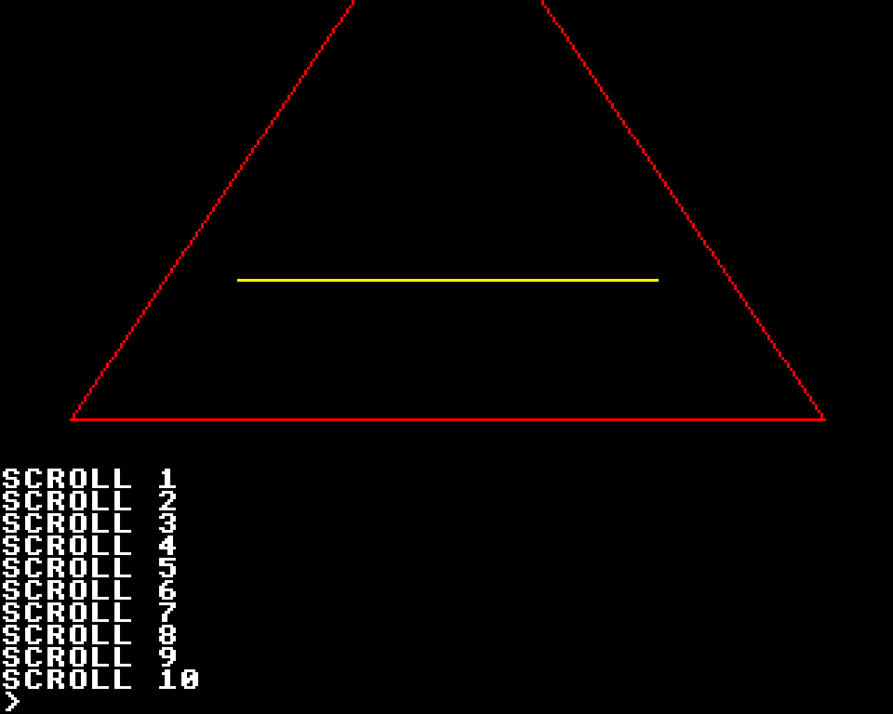
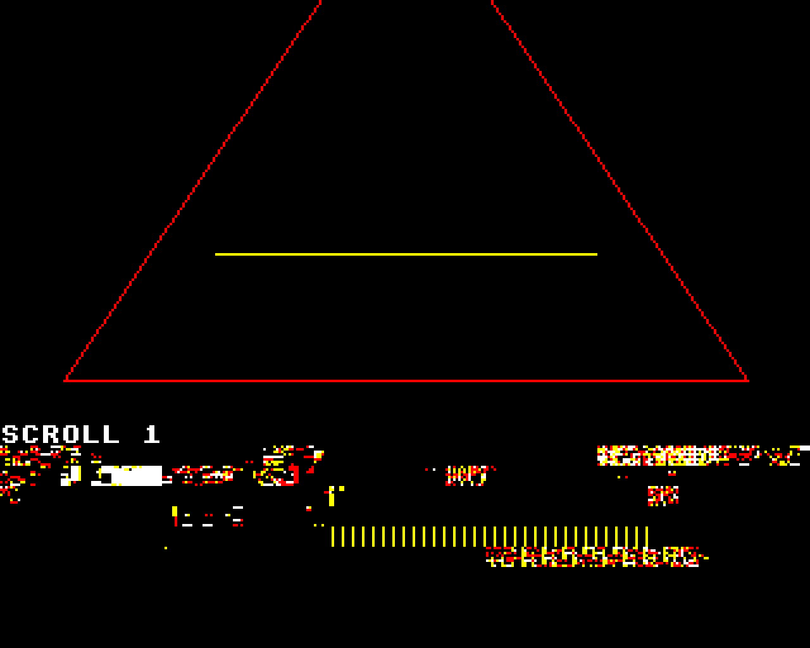
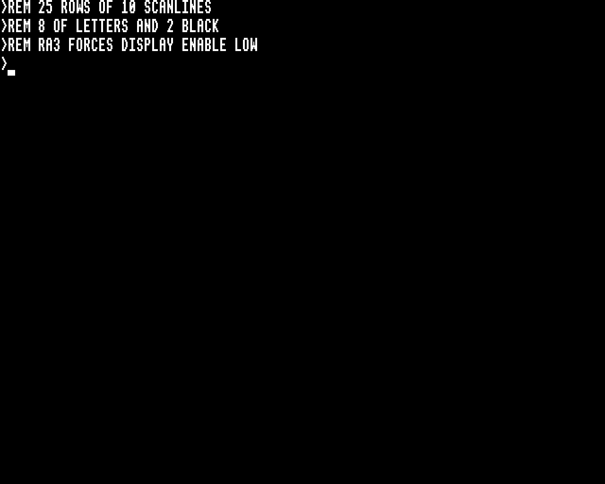
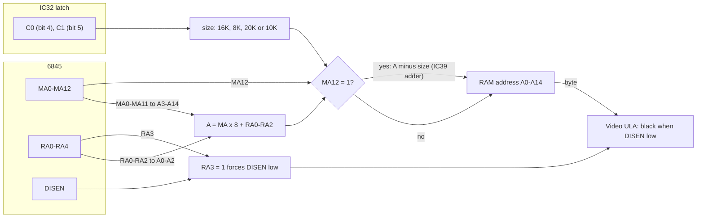
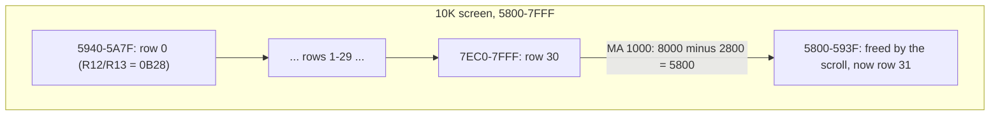
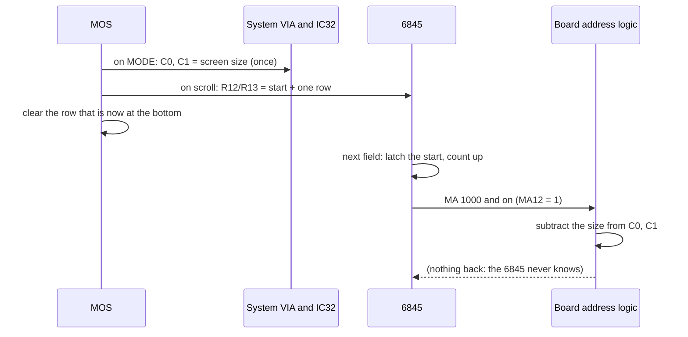

# Stage 43: Wrap-around & graphics

> **Part:** 9 (Video ULA & bitmap modes) · **Branch:** `stage/43-wraparound-graphics` · **Needs:** 42
> **Status:** done

## Goal

Stage 42 drew the bitmap MODEs, but only until the text **scrolls**. After the first scroll, the bottom row of the screen shows garbage. This stage adds the last two pieces of board logic between the 6845 and RAM:

- **Hardware wrap-around.** When the 6845's address runs off the end of memory, the board folds it back to the start of the screen. Two bits of the IC32 latch, **C0** and **C1**, say how big the screen is.
- **The blank gap lines of MODE 3 and 6.** Their 10-line text rows show 8 lines of pixels and 2 lines of black. The board does this using the 6845's **RA3** output.

With both in place, every bitmap MODE scrolls cleanly, MODE 3 and 6 look right, and `MOVE`/`DRAW`/`GCOL` graphics can be drawn and scrolled.

## What you can now see

**In the browser** (needs `roms/os12.rom` and `roms/basic2.rom`):

```bash
npm run dev     # then open http://localhost:5173/?machine=mos
```

Click the screen and type this program. It draws a triangle, moves the text cursor to the bottom row, and prints until the screen has scrolled 10 rows. (On the PC keyboard, `"` is Shift+2 and `=` is Shift+-, because keys map by position.)

```
10 MODE 1
20 GCOL 0,1
30 MOVE 100,100
40 DRAW 1180,100
50 DRAW 640,900
60 DRAW 100,100
70 GCOL 0,2
80 MOVE 340,300
90 DRAW 940,300
100 VDU 31,0,31
110 FOR I=1 TO 10
120 PRINT "SCROLL ";I
130 NEXT
RUN
```

The triangle moves up and the text underneath is clean:



Here's the same program with the wrap switched off (taken by disabling one line of `screen-address.ts` for the screenshot). Every row below "SCROLL 1" counts MA past &0FFF, so it shows zero page, the stack and BASIC's workspace as pixels. This is what Stage 42 did:



`MODE 3` (or `MODE 6`) shows 25 rows with a black two-line gap under each. The cursor covers lines 7–9, reaching into the gap (see Gotchas):



The **CRTC panel**'s Address line now shows the wrap whenever MA12 is set, for example `MA &1000, RA 2 → &5802 (bitmap, MA12 = 1: wrapped, − &2800 (10K screen))`.

**At the command line:**

```bash
npm run demo:wrap
```

Part 1 is the measured table in "The real hardware" (C0/C1 for each MODE). Part 2 scrolls MODE 4 and follows one address through the board:

```
After 40 lines: R12/R13 = &0CB8 (&65C0). The 6845 counts MA &0CB8-&11B7: past &0FFF, so MA12 = 1.
MA &1000 is row 21, character 0:
  MA × 8 = &8000; only A0-A14 reach RAM, so with no wrap it would read &0000 (zero page).
  The board: &8000 − &2800 = &5800, the bottom of the screen.
```

It then prints the last three rows (`LINE39`, `LINE40`, `>`) from `machine.bitmap.pixels`. Part 3 prints MODE 3's first 30 lines with their RA numbers, so you can see RA 8 and 9 come out black. Part 4 draws the triangle in MODE 1 as text art (`R` red, `█` white), then scrolls it 12 rows and plots a yellow line at y = 40, which lands in the wrapped part of memory (from &3000 on).

## The real hardware

### Why wrap-around is needed: the MOS scrolls by moving the start

When text reaches the bottom of a bitmap screen, the MOS doesn't copy 20K of memory up by one row. That would take about a tenth of a second on a 2 MHz 6502. Instead it does two cheap things:

1. It moves the 6845's **start address** (R12/R13) on by one text row. The picture now starts one row further into memory.
2. It clears the row that has just become the bottom of the screen.

Stage 39 did this for MODE 7. There, MA10 isn't wired, so the 1K screen is a ring by accident. The bitmap MODEs have no such luck. Take MODE 4, a 10K screen at &5800–&7FFF (MA &0B00–&0FFF). After one scroll the start is &5940 (MA &0B28). The 6845 now counts 32 rows of 40 from &0B28, so the last row runs MA **&1000–&1027**. MA × 8 is **&8000**, past the end of the 32K of RAM. That row's bytes are meant to come from &5800, the row the scroll has just freed.

The **board** fixes this, not the 6845 or the MOS. The rule is: whenever MA12 is 1, subtract the screen size from the address.

```
  MA &1000, RA 0  →  MA × 8 + RA = &8000  →  MA12 = 1, so  &8000 − &2800 = &5800
```

So the screen is a **ring** of exactly its own size. Its start can be anywhere in the ring, and the 6845 never needs to know.

### C0 and C1: the board doesn't know the MODE

The board can't tell which MODE you're in, so the MOS tells it the screen size on two outputs of IC32, the addressable latch on the System VIA's port B (Stage 28): bit 4 is **C0** and bit 5 is **C1**. On an overflow, "four logic gates decode the state into a one's-complemented number of 2K units", and a quad adder (IC39) subtracts that from the address lines (BeebWiki, "Address translation"):

| C1 | C0 | Screen size | Subtract on MA12 | Screen starts at | MODEs |
|---|---|---|---|---|---|
| 0 | 0 | 16K | &4000 | &4000 | 3 |
| 0 | 1 | 8K | &2000 | &6000 | 6 |
| 1 | 0 | 20K | &5000 | &3000 | 0, 1, 2 |
| 1 | 1 | 10K | &2800 | &5800 | 4, 5 |

**Measured from MOS 1.20** (latch writes to bits 4 and 5 after typing each MODE; `npm run demo:wrap` prints this):

| MODE | Latch after | C1 | C0 | R12/R13 | Agrees with the table |
|---|---|---|---|---|---|
| 0, 1, 2 | &AF | 1 | 0 | &0600 (&3000) | ✓ 20K |
| 3 | &8F | 0 | 0 | &0800 (&4000) | ✓ 16K |
| 4, 5 | &BF | 1 | 1 | &0B00 (&5800) | ✓ 10K |
| 6 | &9F | 0 | 1 | &0C00 (&6000) | ✓ 8K |
| 7 | &8F | 0 | 0 | &2800 | not used: teletext addressing ignores MA12 |

Look at the "subtract" and "starts at" columns. In every row they add up to **&8000**. Every screen ends at the top of RAM, so the screen size is &8000 minus the start. Subtracting the size is the same as *adding the start* and then dropping bit 15:

```
  &8000 − &2800 = &5800    and    (&8000 + &5800) AND &7FFF = &5800
```

Either way of describing it gives the same address. The hardware is a 4-bit adder working in 2K units, and its carry out goes nowhere.

### The gap lines in MODE 3 and 6

MODE 3 and 6 are the "text-only" MODEs. The MOS gives them **10 scanlines a row** (R9 = &09) and **25 rows** (R6 = &19), and so 250 lines. The font is still 8 lines tall, so each row has a 2-line gap below the letters. That makes text easier to read, and it's why these MODEs are 25 rows and not 32.

The address wiring from Stage 42 is `A0–A2 = RA0–RA2`. **RA3 and RA4 don't reach RAM.** So on scanlines 8 and 9 (RA = %01000 and %01001), the board reads the same bytes as scanlines 0 and 1. Stage 42's renderer drew exactly that: each row's top two lines again, underneath it.

The real board uses **RA3** for something else: "In MODEs 3 and 6, RA3 going high forces DISEN low and so the bottom two scanlines of each text row are black" (BeebWiki, "Address translation"). The ULA sees display enable low and outputs black, just as it does in the border. This is not specific to MODE 3 or 6. It applies to any bitmap scanline with RA3 = 1, whatever the MODE, but only MODE 3 and 6 ever count that far.

The memory layout of MODE 3 is still 8 bytes a cell. Its rows are 80 × 8 = &280 bytes apart, the same as MODE 0. 25 rows × &280 = &3E80, a little under the 16K (&4000) the screen size says. So MODE 3 leaves 384 bytes (&180) unused. MODE 6 does the same in its 8K: 25 × &140 = &1F40, leaving &C0.

## Key concepts

### 1. A ring buffer in hardware

Software people know the trick: a fixed-size buffer, a start index, and `index mod size` on every access, so that "scrolling" just moves the start. The BBC builds that `mod` into the address path. The 6845's counter only ever goes *up*, from the start address for (rows × characters) steps. The board subtracts the size whenever the count has passed the end. A scroll costs the MOS one CRTC register write and one row clear, whatever the MODE.

The wrap rule only needs MA12 because **every screen ends at &7FFF**. MA × 8 passes &7FFF exactly when MA reaches &1000, and that's MA12. The counter never gets far enough to reach MA13: the most it can count past the end is one screen's worth (&A00 characters for 20K), so it stays below &2000.

### 2. Worked example: MODE 0 scrolled once

MODE 0 is 80 × 32 cells = &A00 MA, which is &5000 bytes, 20K. At power-on, the start MA is &0600 (&3000). The MOS scrolls once and writes R12/R13 = &0650, one row (80 cells) on.

| Row | MA run | MA × 8 + RA (RA = 0) | MA12? | Address read |
|---|---|---|---|---|
| 0 | &0650–&069F | &3280–&34F8 | no | &3280… |
| … | | | | |
| 30 | &0FB0–&0FFF | &7D80–&7FF8 | no | &7D80… |
| 31 | &1000–&104F | &8000–&8278 | **yes** | **&3000**–&3278 |

Without the wrap, row 31 would read &0000–&0278 (only A0–A14 reach RAM). That's zero page, the stack and page 2 on the screen. With it, row 31 reads the row the MOS has just cleared, which is where the new line of text is printed.

### 3. The cursor wraps too, but in the 6845

The cursor (R14/R15) is compared with the 6845's **counter**, not with a RAM address. So the MOS has to give it in the counter's terms, MA12 and all. Measured: after 40 lines of output in MODE 4, R12/R13 = &0DA8 and the cursor is at **&1281**. That's below the end of RAM in counter terms, but its RAM address is &1281 × 8 − &2800 = **&6C08**. The renderer already compares the cursor with the counter, so it needs no change.

### 4. Graphics are just bytes in the same layout

`MOVE`, `DRAW`, `PLOT` and `GCOL` (VDU 25 and VDU 18) are entirely the MOS's job. It converts the graphics coordinates (0–1279 across, 0–1023 up) to pixels, finds the byte and bit for each pixel in the character-cell layout of Stage 42, and sets them with the GCOL rule (OR, AND, EOR, invert) in the colour's bit pattern from Stage 41. Our hardware has nothing new to do: the renderer draws whatever bytes are there. That's why graphics are this stage's *demo* and not its *build*. The one thing they need from us is the wrap, because the MOS plots relative to the *current* screen start. After a scroll, the bottom of a drawing can sit past the end of RAM in counter terms.

## Diagrams

The address path from the 6845 to RAM in the bitmap MODEs, with this stage's two additions (the MA12 wrap and the RA3 blank):



The MODE 4 screen as a ring after one scroll. The 6845 counts up from the start; the board folds the last row back to the bottom of the screen:



What the MOS does for a scroll, and what the hardware does with it:



## Our design

- **`screen-address.ts` takes the screen size.** `bitmapAddress(ma, ra, screenSize)` and `screenAddress(ma, ra, screenSize)` gain a third argument, a 2-bit **`ScreenSize`** code: `(C1 << 1) | C0`, as the latch holds it. A `WRAP_SUBTRACT` table maps the code to the amount to subtract (BeebWiki's table). When MA12 is set, the address is `(MA × 8 + RA − subtract) & &7FFF`. Teletext addressing ignores MA12 and the size. We keep the size as the latch's code rather than as a MODE number, because the board doesn't know MODEs either.
- **`AddressableLatch.screenSize`** is a new getter that reads bits 4 and 5 as that code. It's the latch's business which bit is which.
- **`BitmapRenderer` gets a third source**: something with a `screenSize` (in the machine, the latch). It reads it once per scanline, as it reads the control byte and the palette. A line is drawn all at once (Stage 42), so a change in the middle of a line shows from the next one.
- **RA3 blanking goes in the renderer**, next to the R6 check: if RA3 is 1, the line's DISEN is low and the line is black. The cursor is still drawn on such lines (see Gotchas).
- **The CRTC panel** passes the screen size to `screenAddress` too, so its Address and Start lines show the wrapped RAM address.
- **No change to the 6845.** The wrap is board logic, and the 6845 counts on regardless.

**Alternatives considered:**
- *Mask MA to the screen size inside the 6845 model.* That's wrong: the 6845's counter really does go past &0FFF (the cursor test in Key concept 3 depends on it), and its MA pins can be read in the CRTC panel.
- *Pass the MODE (or the start address) to the renderer and work out the size from it.* The board can't do that. If a program sets C0/C1 by hand (`?&FE40` writes), the real machine wraps at the size the latch says, whatever MODE it's in. So we follow the latch.
- *Add the start instead of subtracting the size.* It's the same number mod &8000. We subtract because that's how BeebWiki describes IC39, and the table reads more naturally.

## Code walkthrough

- [`src/video/screen-address.ts`](../../src/video/screen-address.ts): the board. `ScreenSize` is the latch's 2-bit code, and `WRAP_SUBTRACT` is BeebWiki's table, indexed by it. `bitmapAddress(ma, ra, size)` now keeps MA12 (`BITMAP_MA_MASK = 0x1fff`), so MA × 8 can reach &8000–&FFFF. If MA12 is set, it subtracts the size and masks to A0–A14 (`& 0x7fff`). That's the whole of the wrap: three lines. `teletextAddress` is unchanged, because MODE 7 never looks at MA12.
- [`src/devices/addressable-latch.ts`](../../src/devices/addressable-latch.ts): the `screenSize` getter reads bits 4 (C0) and 5 (C1). It's written as two branches rather than `(c1 << 1) | c0 as ScreenSize`, because `as` casts are only for I/O boundaries.
- [`src/video/bitmap-renderer.ts`](../../src/video/bitmap-renderer.ts): `drawLine` gains a fourth source (`ScreenSizeSource`), read once per line next to the palette. Two changes:
  1. `screenAddress(…, ra, size)` in the byte loop.
  2. Before the loop, `if ((ra & RA3_BLANK) !== 0)` fills the line black, still draws the cursor, and returns. It sits after the R6 check, so a row that isn't displayed stays fully black.
- [`src/machine/bbc-model-b.ts`](../../src/machine/bbc-model-b.ts): passes `this.latch` as the renderer's size source. The latch already follows the System VIA's port B (Stage 28), so the MOS's `MODE` writes reach the renderer with no new wiring.
- [`src/web/workbench/crtc-view-model.ts`](../../src/web/workbench/crtc-view-model.ts) and [`crtc-panel.ts`](../../src/web/workbench/crtc-panel.ts): `screenSize` is a new required input, and `schemeText()` adds the "MA12 = 1: wrapped" note. [`src/main.ts`](../../src/main.ts) passes `machine.latch.screenSize`.
- [`scripts/demo-wrap.ts`](../../scripts/demo-wrap.ts): the CLI demo. `scripts/demo-addressing.ts` (Stage 39) passes MODE 4's size now that `screenAddress` needs one.

## Tests

| Test file | What it proves |
|---|---|
| `src/video/screen-address.test.ts` | The four codes and their subtract values. Every size plus its start is &8000. MA &1000 wraps to each screen's start, and RA still picks the byte. Below MA12 the size makes no difference. Worked example: MODE 0 scrolled once, row 31 = &3000–&3278. **Ring test:** for every size, and every start in steps of &40, each cell of the screen maps to `start + (offset mod size)`. Teletext ignores the size. |
| `src/devices/addressable-latch.test.ts` | All four C0/C1 combinations, written through PB0–PB3 as the MOS writes them, give the right code. |
| `src/video/bitmap-renderer.test.ts` | With a real 6845 and ULA programmed as the MOS programs them: MODE 4 scrolled one row shows &5800 on row 31 (and not &0000). MODE 0 scrolled one row shows all 80 cells of &3000–&327F there. MODE 1 started at &7D80 wraps mid-screen. The size is read from the source per line (the same MA reads &5800 at 10K and &3000 at 20K). MODE 3 and 6: 25 rows of `########..`, and row 1 is one row of bytes on but 10 lines down. RA 8/9 are black even when RA 0/1 are lit. RA3 blanks in MODE 0 too if R9 = 15. The cursor covers lines 7–9 in MODE 3. |
| `src/web/workbench/crtc-view-model.test.ts` | The Address line at MA &1000 in a 10K screen reads `→ &5802 (bitmap, MA12 = 1: wrapped, − &2800 (10K screen))`. |
| `src/machine/screen-wrap.test.ts` | **Skips without ROMs.** MOS 1.20 sets C0/C1 to BeebWiki's sizes for MODE 0–6. In **every** bitmap MODE, after `FOR I=1 TO 40:PRINT "LINE"+STR$(I):NEXT`, the start has moved, the frame counts past MA &0FFF, and the bottom three rows read `LINE39`, `LINE40`, `>` in the MOS font. MODE 3 and 6: `HELLO` on row 1 (lines 10–17), lines 18–19 black. MODE 1: `GCOL 0,1:MOVE 0,500:DRAW 1279,500` is red across exactly scanline 130. **Checked against a broken build:** with the wrap and the blank switched off, 9 of these 11 fail. |
| `e2e/screen-wrap.spec.ts` | **Skips without ROMs** (real-time project). The MODE 1 triangle program typed key by key: `SCROLL 9`, `SCROLL 10` and `>` read off the canvas match os12.rom's glyphs, and the triangle's base (542 dots) is on line 150, 10 rows up. MODE 3: `>REM BBC` in 10-line rows, with lines 8 and 9 black. Screenshots are attached. |

## Gotchas & hardware quirks

- **The cursor on the gap lines is our reading.** BeebWiki says RA3 forces DISEN low. It doesn't say whether CUDISP is gated too. We assume it isn't: the 6845 gates CUDISP with its *own* display enable, but the RA3 gate is on the board, after the 6845. So MODE 3 and 6's cursor (R10 = &67, R11 = &09: lines 7–9) is a 3-line block reaching into the gap. Parked to check against a real machine.
- **The size comes from the latch, not the MODE.** A program that pokes C0/C1 through `&FE40` without changing MODE gets the wrap it asked for, wrong or not. That's deliberate: the board can't know the MODE.
- **The cursor address is in counter terms.** After a scroll the MOS writes R14/R15 values like &1281 (MA12 set), because the 6845 compares the cursor with its counter. Anything that turns R14/R15 into a RAM address has to apply the wrap too, like the CRTC panel now does for MA.
- **The wrap is per line, like everything else in the renderer.** A program that changes C0/C1 in the middle of a scanline would see the change from the next line. No software does that.
- **MODE 3 and 6 waste memory.** 25 rows × &280 = &3E80 in a 16K slot, and 25 × &140 = &1F40 in an 8K slot. The spare &180 and &C0 bytes are still part of the ring. They're just the part not on screen at the moment, and as the start moves they pass through the bottom row, which the MOS clears.
- **The MOS's software wrap.** The MOS keeps R12/R13 inside the screen itself: when a scroll would take the start past &7FFF, it subtracts the size before writing R12/R13. So MA12 only ever comes from the *counter* running on past the end during a field, never from the start address. Measured in MODE 6 over 60 lines of scrolling: R12/R13 stays within &0C00–&0FE8, and the scroll after &0FE8 writes &0C10 (&0FE8 + &28 − &400), not &1010.
- **Teletext is untouched.** MODE 7 sets C0 = C1 = 0 (16K) as a side effect, but its addressing ignores MA12 (Stage 39).
- **Speed:** MODE 0 runs at 1.87–1.96 s per 10 emulated seconds under `tsx`, against 2.10 s measured in Stage 42. There's no measurable cost.
- **Sources:** BeebWiki, "Address translation", for the subtract table and the RA3 blank. The C0/C1 values are measured from MOS 1.20 and agree with it. I didn't consult any emulator source.

## Playwright verification

- **MCP, by hand:** at `/?machine=mos` I typed the MODE 1 triangle program above and screenshotted it (`img/43-graphics-scrolled.png`). Then I disabled the wrap for a moment, took the same screenshot to show the bug (`img/43-no-wrap.png`), and restored it. I also took MODE 3 with three `REM` lines (`img/43-mode3.png`, canvas 640 × 256).
- **Durable:** `e2e/screen-wrap.spec.ts` (2 tests, real-time project, added to its `testMatch` in `playwright.config.ts`). The full suite gives 149 passed.

## Check your understanding

1. MODE 6's screen is &6000–&7FFF. After some scrolling, R12/R13 = &0F80. Which RAM address does the 6845's MA &1000, RA 3 read?
2. Why does the board only need to look at MA12, and not compare MA with the screen's end?
3. Where in our model does a byte at RAM address &0000 show up on screen after one scroll, if the board has no wrap logic? And why can't the real machine just use A15 for that?
4. MODE 3's rows are 10 scanlines, but only RA0–RA2 reach RAM. Without RA3 blanking, what would lines 8 and 9 of each row show?
5. After a scroll in MODE 4 the MOS writes R14/R15 = &1281. Why not the RAM address &6C08 ÷ 8 = &0D81?

<details>
<summary>Answers</summary>

1. MA &1000 × 8 + 3 = &8003. MA12 is set and the latch says 8K (C1 = 0, C0 = 1), so subtract &2000: **&6003**, scanline 3 of the first cell of the screen.
2. Every screen ends at &7FFF, and MA × 8 passes &7FFF exactly when MA reaches &1000. So "has the count run off the end?" is just "is MA12 set?". Only the *size* (what to subtract) depends on the MODE, and that's what C0/C1 give.
3. With only A0–A14 wired, &8000 + n reads n. So MA &1000 onwards (the last row after one scroll, in MODE 0 or 4) shows zero page, the stack and page 2 as pixels. There is no RAM above &7FFF on a Model B: &8000–&BFFF is the sideways ROM and &C000 up is the MOS. A15 selects ROM, not more screen.
4. RA 8 = %01000 has RA0–RA2 = 0, and RA 9 has 1. So they'd repeat the row's scanlines 0 and 1: a copy of the top two lines of each letter under it. That's what Stage 42 drew.
5. The 6845 compares R14/R15 with its **counter**, which runs on past &0FFF. The cursor's row is counted as MA &1280 or so, never &0D80, so the cursor must be given in counter terms. The board's wrap happens after the 6845 and is invisible to it.

</details>

## Further reading

- BeebWiki, "Address translation": the MA12 wrap, the C0/C1 table, IC39, and the RA3 blank.
- Advanced User Guide: the System VIA's addressable latch (IC32 bits 4 and 5, "screen wrap-around"), and the 6845 chapter (R12/R13 and hardware scrolling).
- Motorola MC6845 data sheet: the refresh memory address counter (14 bits, counting from R12/R13), and the cursor compare against MA.
- Stage docs [28](28-latch-stubs.md) (IC32), [39](39-crtc-addressing-cursor.md) (MA/RA and MODE 7's ring) and [42](42-bitmap-rendering.md) (the renderer).
