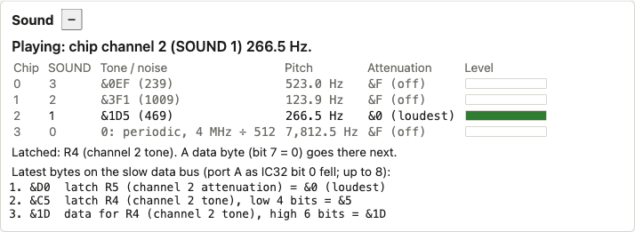
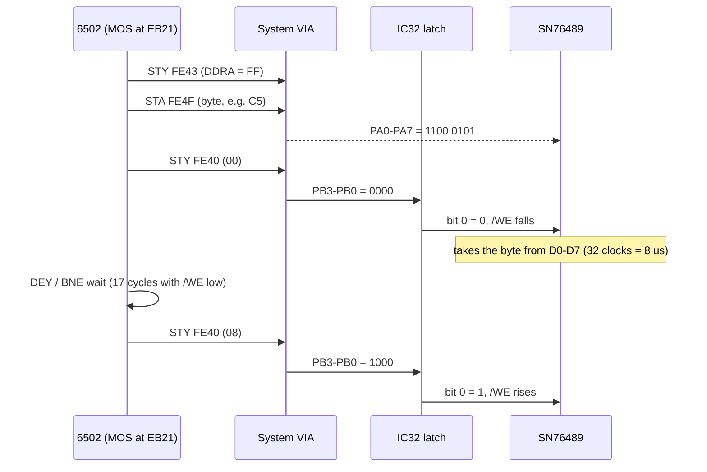
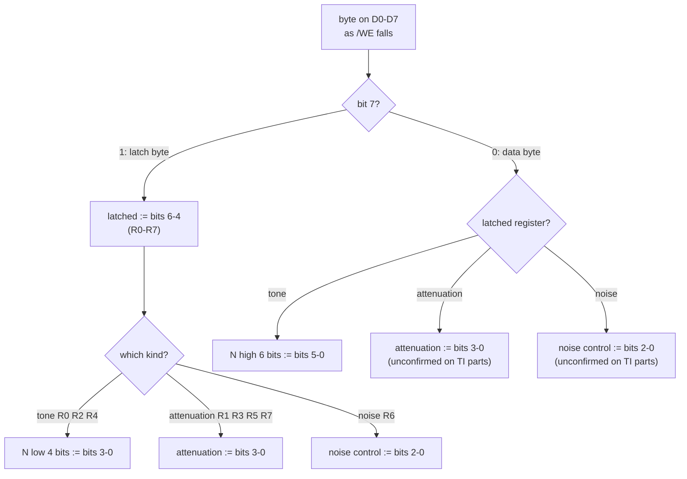
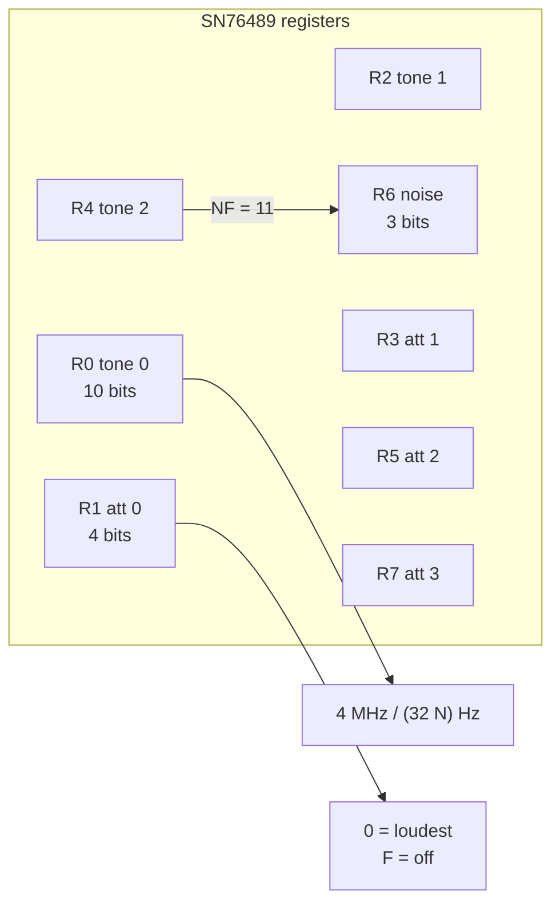

# Stage 44: SN76489 register protocol

> **Part:** 10 (Sound) · **Branch:** `stage/44-sn76489-registers` · **Needs:** 36
> **Status:** done

## Goal

Give the machine its sound chip, the **Texas Instruments SN76489**, as a **register file**: the eight numbers that say what each of its four voices should be playing. This stage covers how a byte reaches the chip (the "slow data bus") and what the chip does with it (the latch/data byte format). It makes no sound yet. Stage 45 turns the registers into a waveform, and Stage 46 plays it.

Why start here? The register file is the whole interface between the 6502 and the chip. Once we can see `SOUND 1,-15,53,20` land as "channel 2: tone &1D5, full volume", the sound generator only has to read those numbers.

Getting the bytes through also turned up a bug in the keyboard wiring from Stage 28. The keyboard and the sound chip share port A, and our keyboard was holding PA7 low while the MOS was trying to talk to the sound chip on it. See "The slow data bus is shared".

## What you can now see

**In the browser** (needs `roms/os12.rom` and `roms/basic2.rom`):

```bash
npm run dev     # then open http://localhost:5173/?machine=mos
```

Find the **Sound** panel. After boot it says `Silent: all four attenuations are &F.` Click the screen and type:

```
SOUND 1,-15,53,20
```

For one second, chip channel 2 (the row labelled SOUND 1) shows tone `&1D5 (469)`, 266.5 Hz, attenuation `&0 (loudest)` and a full level bar. Below are the three bytes that did it, decoded. Then the MOS writes `&DF` and the row greys out again. (Use a duration of 255 to get 12.75 seconds of looking time.)



Try `SOUND 2,-10,100,20` (chip channel 1, attenuation `&5`, −10 dB), `SOUND 3,...` (chip channel 0), and `SOUND 0,-15,6,20` (noise: `6: white, 4 MHz ÷ 2048`). `SOUND 0,-15,7,20` while a `SOUND 1` note is playing shows the noise row's pitch as `follows channel 2 (…)`.

**At the command line:**

```bash
npm run demo:sound-regs
```

```
Part 1: power-on. The chip has no reset pin, so the MOS silences it itself (via &EB21):
  cycle    512176  &9F  latch R1 (channel 0 attenuation) = &F (off)
  cycle    512453  &82  latch R0 (channel 0 tone), low 4 bits = &2
  cycle    512546  &3F  data for R0 (channel 0 tone), high 6 bits = &3F
  ...
  cycle    513823  &E0  latch R6 (noise control) = 0 (periodic, 4 MHz ÷ 512)
  cycle    550232  &92  latch R1 (channel 0 attenuation) = &2 (-4 dB)
  cycle    550835  &8F  latch R0 (channel 0 tone), low 4 bits = &F
  cycle    550928  &0E  data for R0 (channel 0 tone), high 6 bits = &0E
  cycle   1112610  &9F  latch R1 (channel 0 attenuation) = &F (off)
  ...
Part 2: SOUND 1,-15,53,20 (BASIC channel 1 is chip channel 2):
  cycle   6772751  &D0  latch R5 (channel 2 attenuation) = &0 (loudest)
  cycle   6773334  &C5  latch R4 (channel 2 tone), low 4 bits = &5
  cycle   6773427  &1D  data for R4 (channel 2 tone), high 6 bits = &1D
  N = (&1D << 4) | &5 = &1D5 = 469;  4,000,000 / (32 × 469) = 266.5 Hz
```

It ends with the noise bytes for `SOUND 0,-15,6,5` and the whole register file.

## The real hardware

### The chip

The SN76489 (the Model B has an SN76489AN, IC18) is a **programmable sound generator**:

- **Three tone channels**, each a square wave whose frequency comes from a 10-bit divider.
- **One noise channel**: a shift register making white noise or a buzzy "periodic" noise.
- **Four attenuators**, one per channel, each 4 bits wide: 0 is full volume and 15 is off.

It has no address lines. There's one 8-bit data input (D0-D7), a chip enable (/CE), a write enable (/WE), a clock input and a READY output. You can't read anything back from it: it's write-only.

On the Model B (Advanced User Guide, "The sound generator"; BeebWiki "SN76489"):

| Chip pin | Wired to | So |
|---|---|---|
| D0-D7 | System VIA **port A**, PA0-PA7 | The CPU writes the byte to `&FE4F` (or `&FE41`) |
| /WE | IC32 latch **bit 0** | The CPU strobes it with `&00`/`&08` to `&FE40` |
| /CE | tied low | Always selected |
| Clock | **4 MHz** (the 16 MHz crystal ÷ 4) | Frequency = 4,000,000 ÷ (32 × N) |
| READY | not used by the MOS | The MOS times the strobe itself (below) |

### Why "slow data bus"?

The SN76489 can't keep up with the 6502's 2 MHz bus. The TI datasheet says that once /WE goes low, the chip needs **32 of its clock cycles** to take the byte in (it pulls READY low until it's done). At 4 MHz that's **8 µs**, or 16 CPU cycles. A 6502 store holds the data bus for just 0.5 µs.

So Acorn didn't put the chip on the CPU's bus at all. They hung it off the System VIA, where a byte can sit on port A for as long as the CPU likes. Port A is also the keyboard's port (Stage 34), and the speech chip would sit there too, so the Advanced User Guide calls PA0-PA7 the **slow data bus**.

### What the MOS does, measured

The MOS has one routine that writes a byte to the sound chip, at `&EB21`. Every sound byte in this stage went through it (each strobe below was caught with PC = `&EB2F`, just after the `STY &FE40`):

```
EB21  PHP
EB22  SEI              ; nothing may interrupt between the steps
EB23  LDY #&FF
EB25  STY &FE43        ; DDRA = &FF: all eight port A lines are outputs
EB28  STA &FE4F        ; the byte onto PA0-PA7 (ORA, no handshake)
EB2B  INY              ; Y = &00
EB2C  STY &FE40        ; latch: bit 0 := 0   → /WE low, the chip starts reading
EB2F  LDY #&02
EB31  DEY              ; a short wait...
EB32  BNE &EB31
EB34  LDY #&08
EB36  STY &FE40        ; latch: bit 0 := 1   → /WE high again
EB39  LDY #&04
EB3B  DEY              ; ...and a gap before the next byte
EB3C  BNE &EB3B
EB3E  PLP
EB3F  RTS
```

Measured, /WE stays low for **17 CPU cycles (8.5 µs)**. That's just over the chip's 8 µs, and it's the reason for the `DEY`/`BNE` loop. The MOS doesn't look at READY: it simply waits long enough.

Two of the latch writes are worth decoding (IC32 from Stage 28: PB0-PB2 is the bit number and PB3 the value):

| Write to `&FE40` | PB3 | PB2-PB0 | Meaning |
|---|---|---|---|
| `&00` | 0 | 000 | bit 0 := 0: sound /WE **active** |
| `&08` | 1 | 000 | bit 0 := 1: sound /WE inactive |

## Key concepts

### 1. Eight registers, picked by three bits

Inside the chip there are eight registers:

| Reg | Bits 6-4 of a latch byte | What | Width |
|---|---|---|---|
| R0 | `000` | Channel 0 tone (N) | 10 bits |
| R1 | `001` | Channel 0 attenuation | 4 bits |
| R2 | `010` | Channel 1 tone | 10 bits |
| R3 | `011` | Channel 1 attenuation | 4 bits |
| R4 | `100` | Channel 2 tone | 10 bits |
| R5 | `101` | Channel 2 attenuation | 4 bits |
| R6 | `110` | Noise control | 3 bits |
| R7 | `111` | Channel 3 (noise) attenuation | 4 bits |

So bits 6-5 pick the channel (0-3), and bit 4 picks **tone** (0) or **volume** (1). For channel 3, the "tone" slot is the noise control.

### 2. Two kinds of byte: latch and data

A tone needs 10 bits, but one write carries 8. So the chip has two byte formats, told apart by **bit 7**:

```
Latch byte:  1 c c t d d d d     cc = channel, t = 1 volume / 0 tone, dddd = 4 data bits
Data byte:   0 x d d d d d d     dddddd = 6 more data bits (x is ignored)
```

A **latch** byte does two things. It *remembers* which register it named (the chip "latches" that register), and it writes its low 4 bits into it:

- tone register: the **low 4 bits** of N;
- attenuation: all 4 bits;
- noise control: the low 3 bits.

A **data** byte writes into whichever register was latched last. For a tone register its 6 bits become the **high 6 bits** of N. Together:

```
N = (data byte & &3F) << 4  |  (latch byte & &0F)
```

Here's the worked example, `SOUND 1,-15,53,20`, measured off port A:

| Byte | Binary | Kind | Meaning |
|---|---|---|---|
| `&D0` | `1 10 1 0000` | latch | channel 2, volume, attenuation 0 (loudest) |
| `&C5` | `1 10 0 0101` | latch | channel 2, tone, low bits = `&5` |
| `&1D` | `0 0 011101` | data | high bits = `&1D` → N = `&1D` << 4 \| `&5` = **`&1D5`** = 469 |

Frequency = 4,000,000 ÷ (32 × 469) ≈ **266.5 Hz**. The User Guide calls pitch 53 middle C, which is 261.6 Hz, so the BBC's middle C is about a third of a semitone sharp. (This is our arithmetic, assuming the 4 MHz clock is exact.)

Why can the low and high halves come in either order? They can't, quite. Each write changes the register at once, so between the two bytes the channel briefly plays a mixture: new low bits with old high bits. The MOS sends the latch byte first. A 6502 sends the next byte about 47 µs later (the measured gap between `&C5` and `&1D`), far too short to hear.

### 3. A data byte for a 4-bit register

What does a data byte do when the latched register is an attenuation or the noise control? The TI datasheet only describes data bytes for tone registers. The common reading (from tests of the chip by the Sega Master System community; see Further reading) is that the data byte's low bits go into the narrower register: `&0F`'s 4 bits for an attenuation, 3 bits for noise. We follow that. **The MOS never does it** (it always sends a latch byte for volume and noise), so it can't be checked here, and it's unconfirmed for the BBC's SN76489AN.

### 4. Attenuation, not volume

The 4-bit number is how much to **turn down**, in 2 dB steps: bit 0 is 2 dB, bit 1 is 4 dB, bit 2 is 8 dB, bit 3 is 16 dB. So:

- `&0` is 0 dB, the loudest;
- `&1` is −2 dB, … `&E` is −28 dB;
- `&F` is **off** (a special case, not −30 dB).

BASIC's `SOUND` volume runs from −15 (loudest) to 0 (silent). Measured, the MOS turns it into attenuation by adding 15: −15 → `&0`, −10 → `&5`, −5 → `&A`. (Stage 45 turns the dB into amplitudes.)

### 5. The noise control

R6's three bits (TI datasheet, "Noise generator"):

| Bits | Meaning |
|---|---|
| bit 2 (FB) | 1 = **white** noise, 0 = **periodic** noise |
| bits 1-0 (NF) | shift rate: `00` = clock ÷ 512, `01` = ÷ 1024, `10` = ÷ 2048, `11` = **follow channel 2's tone** |

With a 4 MHz clock, the three fixed rates are 7,812.5 Hz, 3,906.25 Hz and 1,953.125 Hz. BASIC's `SOUND 0,v,p,d` puts `p` (0-7) straight into these bits. Measured: `SOUND 0,-15,6,5` sends `&F0` (channel 3, attenuation 0) then `&E6` (noise control `110`: white, ÷ 2048).

**Why does noise 3 or 7 follow BASIC channel 1?** It's in the wiring. NF = `11` follows the chip's **channel 2**, and the MOS maps BASIC channel 1 to chip channel 2 (next section). The User Guide's "noise frequency determined by channel 1" is the chip's channel 2 seen through that mapping.

### 6. BASIC's channel numbers are backwards

The MOS keeps a 4-byte table at `&EB40`, indexed by the BASIC channel number (X = 4-7 inside the MOS):

| BASIC `SOUND` channel | Table byte | Chip channel |
|---|---|---|
| 0 (noise) | `&E0` | 3 |
| 1 | `&C0` | 2 |
| 2 | `&A0` | 1 |
| 3 | `&80` | 0 |

It's measured too: `SOUND 3,-5,200,5` sends `&9A` (chip channel 0, attenuation `&A`), and the boot "bleep" (VDU 7, BASIC channel 3) also uses chip channel 0.

### 7. The slow data bus is shared

Our first measurement of `SOUND 1,-15,53,20` gave `&50 &45 &1D`, not `&D0 &C5 &1D`. Every latch byte had lost bit 7, so the chip would have read every one as a data byte.

The culprit was the keyboard. On the keyboard PCB, PA7 is driven by a 74LS251 multiplexer: the "is the key on PA0-PA6 down?" answer (Stage 34). Since Stage 28 we'd modelled it as pulling PA7 **low whenever autoscan is on**, on the grounds that the MOS never reads PA7 then.

But the MOS does *write* PA7 then. The sound routine runs with IC32 bit 3 = 1 (latch `&AE` in the measurements: autoscan on) and DDRA = `&FF`, and every latch byte needs PA7 = 1. If the '251 were driving PA7 in autoscan, a real Beeb's VIA and keyboard would fight over the line on every sound write, and sound wouldn't work.

So the '251's output must be **switched off (high impedance) while autoscan is on**. The 74LS251 has a strobe input that does exactly this (74LS251 datasheet: strobe high → outputs off). We believe it's wired to the keyboard-enable line, IC32 bit 3, but we haven't checked that against the circuit diagram. The argument above is our evidence: it's the only wiring under which the MOS's sound writes work. The fix:

| | Autoscan on (IC32 bit 3 = 1) | Autoscan off (bit 3 = 0) |
|---|---|---|
| Before | keyboard pulls PA7 low | keyboard drives the key's state |
| Now | keyboard **lets go** of PA7 | keyboard drives the key's state (unchanged) |

This also settles a parking-lot item from Stage 28/35 ("PA7 in autoscan would show a row of the counter's column"): it doesn't, because the '251 isn't driving at all.

### 8. No reset pin

The SN76489 has **no reset input**. When the power comes on, its registers hold whatever they settled to, which can be a tone at full volume. That's why the very first thing the MOS does with sound (measured at cycle 512,176, about 0.26 s after power-on) is to silence everything and set known tones:

```
&9F            channel 0 attenuation &F (off)
&82 &3F        channel 0 tone &3F2
&BF            channel 1 off
&A1 &3F        channel 1 tone &3F1
&DF            channel 2 off
&C0 &3F        channel 2 tone &3F0
&FF            channel 3 (noise) off
&E0            noise control 0: periodic, ÷ 512
```

Then comes the start-up bleep, `&92 &8F &0E` (chip channel 0, attenuation 2, tone `&0EF` ≈ 523 Hz), and about 0.28 s later, `&9F` to end it.

BREAK resets the 6502 only (Stage 36), so it doesn't touch the sound chip, and nothing else would anyway.

## Diagrams

How one byte gets from the 6502 to the chip:



What the chip does with a byte:



The register file, and the numbers the panel shows:



## Our design

### `Sn76489`: the register file

`src/devices/sn76489.ts`. The chip as the CPU sees it: one method that takes a byte, and getters for what's inside.

```ts
export class Sn76489 {
  constructor(log?: HardwareLog);
  /** /WE has fallen: the byte on D0-D7 goes in (a latch or a data byte). */
  write(value: number): void;
  /** Channel 0-2's 10-bit divider N. */
  tone(channel: number): number;
  /** Channel 0-3's attenuation: 0 loudest, &F off. */
  attenuation(channel: number): number;
  /** R0-R7 by number. */
  register(r: number): number;
  /** R6: bit 2 white/periodic, bits 1-0 the shift rate. */
  get noise(): number;
  /** The register the next data byte goes to, R0-R7. */
  get latched(): number;
  /** Our power-on state (the chip has no reset pin): silent. */
  powerOn(): void;
}
```

The eight registers are a `Uint16Array(8)`, indexed by the same three bits a latch byte carries. So `R = (byte >> 4) & 7`, the channel is `R >> 1`, and "volume or tone" is `R & 1`. There are no per-channel objects: the datasheet's numbering *is* the data structure.

Pure helpers, shared by the panel, the hardware log and the demo:

- `describeSoundByte(byte, latchedBefore)`: e.g. `"latch: channel 2 tone, low 4 bits = &5"`.
- `toneFrequency(n)`: `4,000,000 / (32 × n)`.
- `NOISE_RATE_NAMES`, `chipChannelForSound(basicChannel)`: the MOS's mapping from `&EB40`.

### Wiring: a falling edge on IC32 bit 0

The chip isn't on the memory map. The machine already hears every change to the System VIA's port B (Stage 28's `pinsChanged`), so it watches latch bit 0 there:

```ts
pinsChanged(port, pins) {
  if (port === 'b') {
    const weWas = this.latch.bit(LATCH_SOUND_WRITE_ENABLE);
    this.latch.drive(pins);
    if (weWas === 1 && this.latch.bit(LATCH_SOUND_WRITE_ENABLE) === 0) this.sound.write(this.systemVia.pins('a'));
  }
  ...
}
```

It takes the byte **when /WE falls**. The chip really samples D0-D7 at some point during the 8 µs that /WE is low, but the MOS holds port A steady throughout, so the moment doesn't matter (see Gotchas). It's `pins('a')`, the levels on the wires, not ORA: whatever else pulls a line low (the keyboard, a VIA panel button) reaches the chip too.

This isn't the hot path. `pinsChanged` runs only when the CPU writes a VIA port register, not on every instruction.

### The keyboard lets go of PA7

`Keyboard.pa7(key, autoscan)` now returns `undefined` with autoscan on: "not driving". The machine turns that into "not pulling low" on port A's outside byte. With autoscan off it answers 0 or 1 as before.

### Power-on

`powerOn()` sets all four attenuations to `&F` and every tone and the noise control to 0. A real chip has **no** defined state. We choose silence so the emulator doesn't start with a random tone (which Stage 46 would play). BREAK leaves the chip alone, as the hardware does.

### The hardware log and the Sound panel

Each write is recorded in the hardware log as device `'sound'`, with the byte and the register it ended up in, so the log reads `sound &C5: latch R4 (channel 2 tone), low 4 bits = &5`.

The **Sound** panel (`src/web/workbench/sound-panel.ts`, decisions in `sound-view-model.ts`) shows one row per chip channel: the BASIC channel that drives it, N in hex and decimal, the frequency, the attenuation and a volume bar. The noise row shows its control bits decoded. Underneath are the latched register and the last few bytes the chip received, decoded.

### Not built here

- No waveforms, no LFSR, no sample output: Stage 45. (A noise-control write resets the LFSR on the real chip, and Stage 45 will hook that.)
- READY isn't modelled, because the MOS doesn't use it.
- The chip isn't ticked (it isn't in the machine's `clocked` list yet): it has no time-dependent state until Stage 45.

## Code walkthrough

- [`src/devices/sn76489.ts`](../../src/devices/sn76489.ts): the chip. `write()` is the whole protocol. Bit 7 picks the branch. A latch byte sets `latch = (byte >> 4) & 7` and then writes into that register. A data byte writes into `latch`. `isTone(r)` (R0, R2, R4) decides between "a nibble or 6 bits of a 10-bit value" and "the whole narrow register". Every write ends with `log.record('sound', latch, byte)`. Below the class are the pure helpers: `toneFrequency`, `noiseShiftRate` (`4 MHz / (512 << NF)`, or `undefined` for NF = 3), `chipChannelForSound` (the `&EB40` table), and the `describe…` functions that the log, the panel and the demo share.
- [`src/machine/bbc-model-b.ts`](../../src/machine/bbc-model-b.ts): `pinsChanged` reads IC32 bit 0 before and after `latch.drive(pins)`. 1 → 0 is the /WE strobe, and it calls `sound.write(systemVia.pins('a'))`. `powerOn()` calls `sound.powerOn()`; `reset()` (BREAK) doesn't. `answerKeyboard` now asks "does the keyboard pull PA7 low?" rather than "is the key down?", because with autoscan on the answer is neither 0 nor 1.
- [`src/devices/keyboard.ts`](../../src/devices/keyboard.ts): `pa7()` returns `undefined` with autoscan on: the '251 is switched off.
- [`src/devices/hardware-log.ts`](../../src/devices/hardware-log.ts): a fifth device, `'sound'`. `register` is the SN76489 register the byte reached, and that's exactly what `describeSoundByte` needs for a data byte.
- [`src/web/workbench/sound-view-model.ts`](../../src/web/workbench/sound-view-model.ts) and [`sound-panel.ts`](../../src/web/workbench/sound-panel.ts): four rows (three tone, one noise), the latched register, and the recent bytes from the hardware log. The elements are built once, and refresh changes only text, classes and the bar width.
- [`scripts/demo-sound-regs.ts`](../../scripts/demo-sound-regs.ts): `npm run demo:sound-regs`.

## Tests

| Test file | What it proves |
|---|---|
| `src/devices/sn76489.test.ts` | Latch bytes: volume (`&D0` → channel 2 attenuation 0, R5 latched), channels by bits 6-5, a tone latch changes only N's low 4 bits, noise keeps 3 bits, other registers untouched. Data bytes: `&D0 &C5 &1D` → `&1D5`; the high 6 bits with bit 6 ignored; a second data byte changes only the high bits; data goes to the last latched register; after a volume or noise latch the low bits go in (the common reading). The MOS's power-on sequence. Our silent power-on. `register(r)`. Hardware log entries and their descriptions. Clock 4 MHz, frequencies, noise rates, the `&EB40` channel mapping, `describeSoundByte`. |
| `src/machine/sound-wiring.test.ts` | The MOS's write sequence as register writes reaches the chip. The byte goes in as /WE falls, never on a rise or while it's held low. Other latch bits don't strobe. With autoscan on and a key held, latch bytes keep bit 7. The chip sees the pins, not ORA. Power-on silences, BREAK doesn't. Each byte is in the hardware log. **With ROMs:** the 15 boot bytes `9F 82 3F BF A1 3F DF C0 3F FF E0 92 8F 0E 9F`; `SOUND 1,-15,53,20` → `D0 C5 1D`, then silent after 1.1 s; `SOUND 0,-15,6,5` → `F0 E6`. |
| `src/machine/bbc-model-b.test.ts` | Changed: with autoscan on, an input PA7 floats high (it used to read low), and an output PA7 carries the VIA's bit (`&D0` stays `&D0`). |
| `src/devices/keyboard.test.ts` | Changed: with autoscan on, `pa7()` is `undefined` even with the key down. (The old "PA7 is driven low in autoscan" test is gone.) |
| `src/web/workbench/sound-view-model.test.ts` | Silent after boot; `SOUND 1` row (`&1D5 (469)`, `266.5 Hz`, `&0 (loudest)`, level 15); the BASIC labels 3, 2, 1, 0; the noise row (`6: white, 4 MHz ÷ 2048`, `1,953.1 Hz`); rate 3 follows channel 2; −10 dB → level 10; N = 0; the last 8 bytes decoded. |
| `e2e/sound-panel.spec.ts` | (real-time) Silent after boot with BASIC labels `3 2 1 0`; typing `SOUND 1,-15,53,20` shows `&1D5 (469)` and `266.5 Hz` on chip channel 2 and `&1D` as the last byte, then goes silent. |

The ROM tests skip with a message if `roms/os12.rom` or `roms/basic2.rom` is missing.

## Gotchas & hardware quirks

- **The keyboard bug was hiding in plain sight.** Every test up to Stage 43 passed with PA7 pulled low in autoscan, because nothing *listened* to port A while autoscan was on. A shared bus breaks the assumption "nobody reads it then, so it doesn't matter what we drive". Driving a line is a claim on it, whoever reads it.
- **Which /WE edge?** We take the byte on the falling edge. The real chip samples D0-D7 at some point during the 32 clocks that /WE is low. If a program changed port A *while* /WE was low, real hardware might take the new value (or a mixture), and we'd take the old one. The MOS never does that.
- **/WE held low.** IC32 starts at `&00` in our model (Stage 28), so /WE is low from power-on until the MOS's first latch writes. No falling edge, no write. What a real chip does with /WE held low for a long time (does it take bytes over and over?) isn't modelled.
- **Data bytes after a volume or noise latch** follow the common reading, unconfirmed for the BBC's chip. The MOS never sends one.
- **TI numbers its bits backwards.** The datasheet calls the most significant bit D0. Our code and this doc use bit 7 = MSB throughout, matching port A's PA7.
- **The MOS writes "off" three times when a note ends** (`&DF` at cycles 8,752,648, 8,772,659 and 8,772,944: once as the note ends, then twice about 10 ms later). We record what it does; why it does that is the MOS's business, and it's harmless.
- **N = 0** has no frequency here. Whether the TI chip treats 0 as 1024 is a Stage 45 question, so the panel shows `—`.
- **Tone frequencies assume an exact 4 MHz.** This is how we get "pitch 53 is 266.5 Hz", a third of a semitone above 261.6 Hz.
- **The panel's byte list** looks back through the last 512 hardware log entries. Typing logs a lot of latch writes (the keyboard scan), so older sound bytes drop out of the list sooner than you might expect. The registers are always exact.

## Playwright verification

- **MCP:** opened `/?machine=mos`, typed `SOUND 1,-15,53,20`, and read the panel: `Playing: chip channel 2 (SOUND 1) 266.5 Hz.`, row 2 `&1D5 (469)`, `&0 (loudest)`, and the three bytes decoded. Typed `SOUND 1,-15,53,255` for the screenshot above.
- **Durable:** `e2e/sound-panel.spec.ts` (2 tests, in the real-time project). The full e2e suite (151) passes, including the typing and BASIC specs that exercise the keyboard change.

## Check your understanding

1. Why isn't the SN76489 on the 6502's data bus like the VIAs are?
2. The MOS sends `&8F` then `&0E`. Which register changes, and to what value? What frequency is that?
3. You send `&A3` then `&C7` then `&15`. What are channel 1's and channel 2's tones afterwards (assume they were 0)?
4. Why did `&D0` arrive at the chip as `&50` before this stage, and why does the fix say something about the keyboard's circuit, not just our code?
5. `SOUND 0,-15,7,20` makes noise whose pitch follows "channel 1". Which chip channel is that really, and why?

<details>
<summary>Answers</summary>

1. It's too slow. Once /WE goes low it needs 32 of its 4 MHz clocks (8 µs) to take a byte, and a 6502 store holds the bus for 0.5 µs. On port A the byte can stay put as long as the CPU likes. The MOS holds /WE low for 17 cycles (8.5 µs) with a `DEY`/`BNE` loop.
2. `&8F` = `1 00 0 1111`: a latch byte for R0 (channel 0 tone), low bits `&F`. `&0E` is a data byte: high 6 bits `&0E`. N = `&0E` << 4 | `&F` = `&0EF` = 239, and 4,000,000 ÷ (32 × 239) ≈ 523 Hz. That's the start-up bleep.
3. `&A3` latches R2 (channel 1 tone), so its low bits are 3. `&C7` latches R4 (channel 2 tone), so its low bits are 7. `&15` is a data byte for the *last* latched register, R4. Channel 1 = `&003`, channel 2 = `&157`.
4. The keyboard model pulled PA7 low whenever autoscan was on, and the MOS writes sound bytes with autoscan on, so bit 7 was always 0. On real hardware the same wiring would mean the VIA and the keyboard's 74LS251 fighting over PA7 on every sound write. Sound works on a real Beeb, so the '251 must be switched off in autoscan. That's a claim about the circuit, which we've reasoned to but not yet checked against the schematic.
5. Noise rate 3 (NF = `11`) clocks the noise from the chip's **channel 2** tone. The MOS's table at `&EB40` maps BASIC channel 1 to chip channel 2, so in BASIC terms it's "channel 1".

</details>

## Further reading

- Texas Instruments, *SN76489AN Sound Generator* data sheet: "Data transfer" (/WE, READY, 32 clocks), "Register address field", "Tone generators", "Noise generator", "Attenuator".
- Advanced User Guide, "The sound generator" (port A, IC32 bit 0, the 4 MHz clock) and "System VIA" (the addressable latch).
- BeebWiki, "SN76489" and "System VIA".
- SMS Power, *SN76489 notes* (Maxim): the latch/data protocol as tested on real chips, including data bytes for the narrow registers. These were tests of the Sega parts and of discrete chips, so read them as the common reading, not as the BBC's datasheet.
- 74LS251 data sheet: the strobe input that switches the output off (high impedance).
