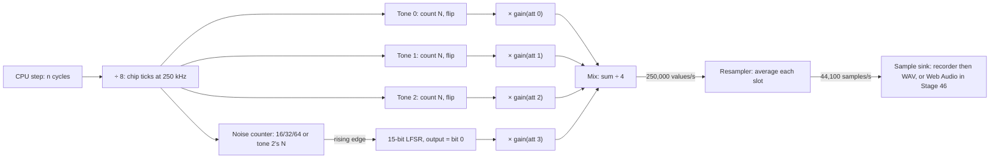
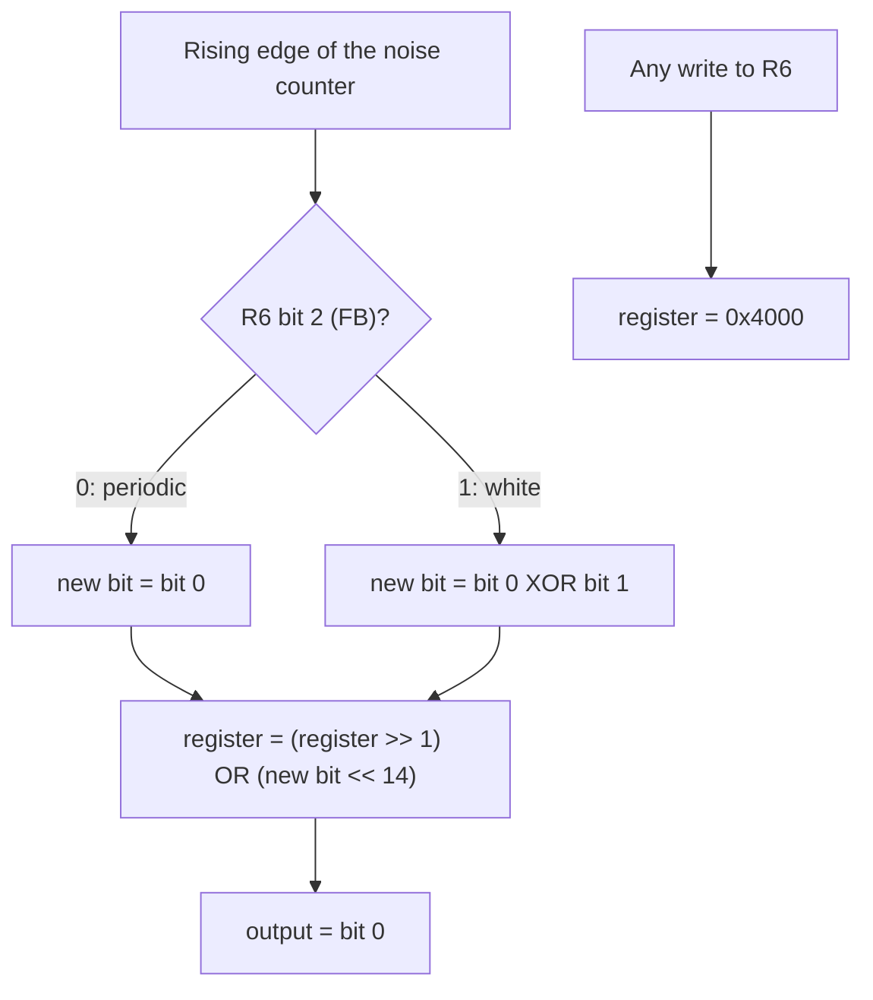
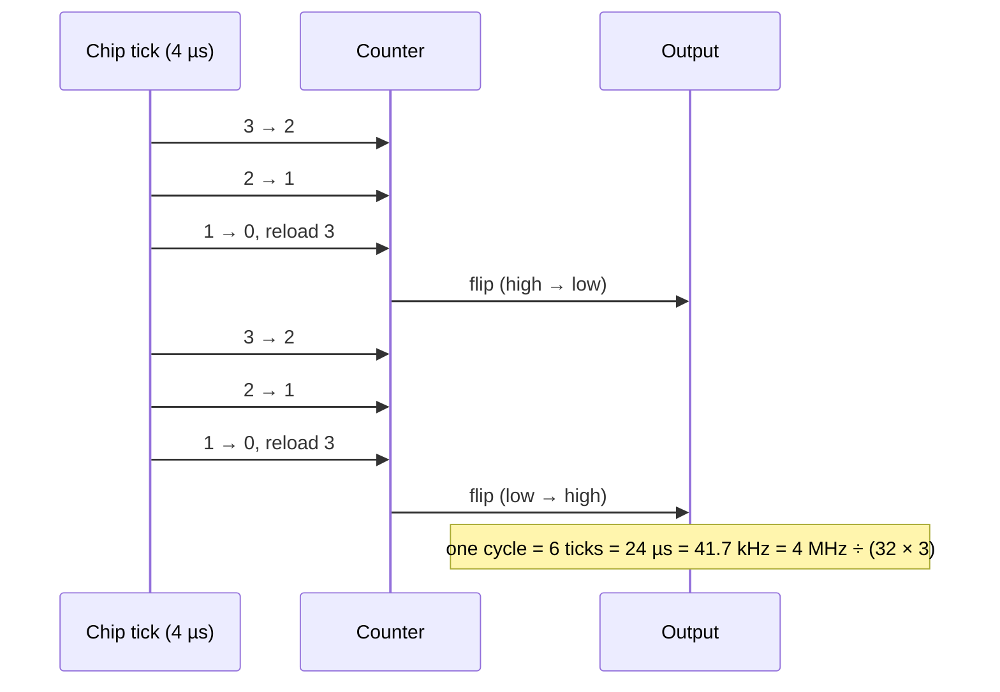

# Stage 45: Tone & noise generation

> **Part:** 10 (Sound) · **Branch:** `stage/45-tone-noise` · **Needs:** 44
> **Status:** done

## Goal

Turn the SN76489's eight register values (Stage 44) into **sound**: a stream of numbers that, played through a speaker, is what a Model B would make. This stage builds the chip's four generators (three square-wave tones and a noise generator), its attenuators and mixer, and a **resampler** that turns the chip's 250,000 values a second into the 44,100 a sound card plays. A small **WAV writer** saves the result as a file you can play.

Why now? Stage 44 gave us the numbers, and Stage 46 will stream audio to the browser. Between the two sits the part that makes the waveform, and it's pure arithmetic, so it can be tested and heard without a browser.

## What you can now see

**Hear it:**

```bash
npm run demo:sound
afplay out/sound-tour.wav     # macOS; or open the files in any audio player
afplay out/sound-basic.wav    # needs roms/os12.rom and roms/basic2.rom
```

`out/` is gitignored. The demo makes two files.

**`out/sound-tour.wav`** (10.1 s) is the chip on its own, driven with register bytes and no ROMs needed. It prints a timeline as it goes:

```
   0.00 s  C4: N = &1DE (478) → 261.51 Hz (wanted 261.63)
             &8E latch R0 (channel 0 tone), low 4 bits = &E
             &1D data for R0 (channel 0 tone), high 6 bits = &1D
   ...
   2.10 s  C5: N = &0EF (239) → 523.01 Hz (wanted 523.25)

  The attenuation steps on A4 (2 dB each, &F off):
   2.40 s  attenuation &0: 0 dB
   2.55 s  attenuation &1: -2 dB
   ...
   4.80 s  white noise, NF = 0 (shifts at 7,812.5 Hz)
   ...
   6.60 s  periodic noise, NF = 0: a 1-in-15 pulse at 7,812.5 ÷ 15 = 520.8 Hz
   ...
   7.80 s  channel 2 N = &0D5, noise R6 = 3 (periodic, follows channel 2) → 39.1 Hz
   ...
  → wrote out/sound-tour.wav: 10.10 s, 445410 samples at 44100 Hz
```

What to listen for:

- **The scale** (0-2.4 s): each note slightly out of tune, because N must be a whole number (C4 is 0.12 Hz flat).
- **The fade** (2.4-4.8 s): A4 stepping down 2 dB at a time. The steps sound even, which is the point of a log scale.
- **The noise** (4.8-7.8 s): white noise hiss getting duller as the shift rate halves, then periodic noise, which is a buzzy *note* rather than a hiss.
- **The bass** (7.8-9.8 s): 39-59 Hz notes from periodic noise clocked by a *silent* channel 2, far below the 122 Hz a tone channel can reach.

**`out/sound-basic.wav`** (18.7 s) is the whole emulated machine: MOS 1.20 boots and BASIC is typed into it, with the chip ticked by the CPU and recorded. You hear:

- **0.28 s**: the **start-up bleep**, 523 Hz for 0.28 s.
- **5.5 s**: `FOR P=53 TO 117 STEP 4:SOUND 1,-15,P,3:NEXT`, a rising chromatic run (266 to 672 Hz).
- **11.5 s**: a three-note chord at volume −10.
- **14.3 s and 17.2 s**: `SOUND 0,-15,6,15` and `SOUND 0,-15,4,15`, white noise slow then fast.

The gaps between are the emulated typing (12 characters a second). I checked the file numerically (I can't listen to it): the sounding stretches start at the times above, the pitches match, and the peak levels are what the attenuation table predicts (bleep 0.158 = 0.631 ÷ 4; chord 0.237 = 3 × 0.316 ÷ 4).

## The real hardware

### The clock and the ÷16

The chip's clock pin gets **4 MHz** (the 16 MHz crystal ÷ 4; Advanced User Guide, "The sound generator"). Inside, the chip divides that by **16** before anything else happens (SN76489 datasheet, "Tone generators": "the input clock is divided by 16"). So every generator moves on at:

```
4,000,000 ÷ 16 = 250,000 times a second   (one "chip tick" every 4 µs)
```

Our CPU runs at 2 MHz, so one chip tick is exactly **8 CPU cycles**. That's a convenient number: the machine already tells every device how many CPU cycles each instruction took (BUILD-PLAN §3), and the chip just counts them off in eights.

### A tone generator: divide by N, flip

Each tone channel is a **10-bit down-counter** and a **flip-flop** (an output that is either high or low):

1. Every chip tick, the counter goes down by one.
2. When it reaches zero, it reloads from the tone register (N) and the output **flips**.

So the output stays high for N ticks, low for N ticks, and one full cycle of the square wave takes 2N ticks, or 2N × 16 = **32N** clock cycles. That's where Stage 44's formula comes from:

```
frequency = 4,000,000 ÷ (32 × N)
```

| N | Ticks high, then low | Frequency |
|---|---|---|
| &3FF (1023) | 1023 | 122.2 Hz (the lowest a tone channel can go) |
| &1D5 (469) | 469 | 266.5 Hz (`SOUND 1,-15,53,20`) |
| &0EF (239) | 239 | 523.0 Hz (the start-up bleep, a C) |
| &001 (1) | 1 | 125,000 Hz (far above hearing) |

A new N doesn't restart the counter. It's only read at the next reload, so the wave finishes its current half-cycle first. That keeps a melody's notes joining without a click.

**N = 0** isn't in the datasheet's table. On TI's own parts it's reported to act as 1024 (the 10-bit counter wraps from 0 to &3FF and keeps going: one tick more than &3FF), giving 122.1 Hz. Sega's copy of the chip treats 0 differently (a flat output). That's from SMS Power's notes on the chip family, not something I've confirmed on a BBC, and the MOS never writes N = 0, so it rarely matters.

### The noise generator: a shift register

Channel 3 has no tone register. It has a **15-bit linear-feedback shift register** (LFSR): a row of 15 bits that shifts right by one at each step, with a new bit fed in at the top. The bit that falls off the bottom (bit 0) is the output.

```
 bit: 14 13 12 11 10  9  8  7  6  5  4  3  2  1  0
     [ 1  0  0  0  0  0  0  0  0  0  0  0  0  0  0 ]   ← start value &4000
       ↑                                         │  └→ output (bit 0)
       └──────── new bit ←── feedback ←──────────┴── bits 0 (and 1)
```

What goes in at the top depends on R6 bit 2, the **FB** (feedback) bit:

- **Periodic noise** (FB = 0): the new bit is just bit 0. The register **rotates**: the single 1 goes round and comes out once every **15 shifts**. That's a pulse train with a 1-in-15 duty cycle: a buzzy tone, not a hiss.
- **White noise** (FB = 1): the new bit is **bit 0 XOR bit 1**. Now the pattern scrambles. It runs through **32,767 different states** (2¹⁵ − 1, every value but zero) before repeating, which is long enough to sound random.

Writing to R6 **resets** the register to &4000 (datasheet, "Noise generator": the shift register is cleared when the noise control register is written; in practice it's reloaded with a single 1, or it would be stuck at zero forever).

The datasheet doesn't say which bits are tapped or how wide the register is. **15 bits, taps on bits 0 and 1** comes from people measuring real chips: SMS Power's SN76489 page lists the SN76489AN that way (the Sega version is 16 bits with taps 0 and 3). Treat it as measured behaviour, not datasheet fact.

### How fast the noise shifts

R6 bits 1-0 (**NF**) pick the shift rate. The noise generator has its own counter, like a tone channel's, that reloads with 16, 32 or 64 ticks (NF = 0, 1, 2) and flips. The register shifts on each **rising** edge, so once every two flips:

| NF | Counter reload | Shifts per second |
|---|---|---|
| 0 | 16 ticks | 250,000 ÷ 32 = 7,812.5 Hz (4 MHz ÷ 512) |
| 1 | 32 ticks | 3,906.25 Hz (4 MHz ÷ 1024) |
| 2 | 64 ticks | 1,953.125 Hz (4 MHz ÷ 2048) |
| 3 | channel 2's N | channel 2's frequency |

NF = 3 is the famous one. The noise counter reloads with **channel 2's tone value** instead, so the register shifts once per channel 2 cycle. With periodic noise that gives a pulse 15 times lower than channel 2's note: one way BBC games get bass notes below the tone channels' 122 Hz floor. In BASIC that's `SOUND 0,-15,3,d` (periodic) or `SOUND 0,-15,7,d` (white), with the pitch set by SOUND 1.

### The attenuators: 2 dB a step

Each channel's 4-bit attenuation turns its volume down in **2 dB steps** (datasheet, "Attenuator": the bits weigh 2, 4, 8 and 16 dB). **&F is off**, not −30 dB.

A decibel is a ratio on a log scale: −20 dB is a tenth of the amplitude. So −2 dB multiplies the amplitude by 10^(−2/20) ≈ 0.794, and each step multiplies by that again:

| Attenuation | dB | Amplitude |
|---|---|---|
| &0 | 0 | 1.000 |
| &1 | −2 | 0.794 |
| &2 | −4 | 0.631 (the start-up bleep) |
| &3 | −6 | 0.501 (about half) |
| &5 | −10 | 0.316 |
| &A | −20 | 0.100 |
| &E | −28 | 0.040 |
| &F | off | 0 |

Why logarithmic? Our ears hear loudness roughly logarithmically, so equal dB steps *sound* like equal steps. A linear scale would make the top few steps sound almost the same and the bottom ones jump.

BASIC's `SOUND` volume −15…0 maps to attenuation 0…&F (Stage 44 measured v → v + 15), so `-15` is loudest and `-8` is about a quarter of the amplitude (−14 dB).

### The mixer and the speaker

The chip adds its four channels together on one output pin. On the Model B that goes through an amplifier and a **capacitor** to the speaker (Advanced User Guide, "The sound generator"; the circuit diagram shows the coupling capacitor). A capacitor in series blocks steady (DC) voltage and passes changes, so what reaches the speaker is the wave centred on zero.

## Key concepts

### A square wave is just a counter

There's no oscillator, no sine table. A tone is "count to N, flip, repeat". The pitch is entirely in the division: bigger N, slower flips, lower note. This is why the chip's notes aren't exactly in tune: N has to be a whole number. Middle C (261.63 Hz) wants N = 4,000,000 ÷ (32 × 261.63) = 477.8, so the chip plays N = 478, which is 261.5 Hz.

### Pseudo-random from a few XOR gates

The LFSR is the cheapest possible random-number generator: 15 flip-flops and one XOR gate. The sequence is completely determined (the same every time from &4000), but it has no pattern the ear can hear. That's also why it's easy to test: after exactly 32,767 white-noise shifts we must be back at &4000, and never before.

### Two clocks: making samples

The chip changes its output 250,000 times a second. A sound card wants **samples** at its own rate, usually **44,100 a second** (CD rate). 250,000 ÷ 44,100 ≈ 5.67, so each output sample covers five or six chip ticks.

The obvious approach is to take every 5.67th chip value and throw the rest away. That's **point sampling**, and it causes **aliasing**. The rule (Nyquist) is that a sample rate can only represent frequencies up to half of itself: 22,050 Hz at 44.1 kHz. Anything higher doesn't disappear. It folds back down as a false lower tone. A square wave has harmonics far above 22 kHz (and a tone with a tiny N is above it already), so point sampling adds whistles that the real chip never made.

We do something simple and much better: **average** the chip ticks that fall in each sample's slot. That's a **box filter**, the crudest low-pass filter. It isn't perfect (some aliasing leaks through) but it smooths out what's far too high to represent:

```
chip ticks: +1 +1 +1 -1 -1 -1 | -1 -1 +1 +1 +1 | ...
sample:       average = 0.0    |  average = 0.2  | ...
```

~~An N = 1 tone (125 kHz, alternating every tick) averages to almost nothing, which is right: it's silent to the ear on a real machine too.~~ **Corrected after Stage 51:** that was wrong. On the real chip an N = 1 tone doesn't alternate at all: its output **holds at 1** (SMS Power's notes). Software plays samples that way, writing the attenuation thousands of times a second as a 4-bit DAC. Superior Software's *Speech!* does it, and with our 125 kHz square wave it came out almost silent (RMS 0.002 instead of 0.077). The box filter still averages any real 125 kHz flip-flop to nearly nothing; it's just that N = 1 isn't one.

To decide which ticks belong to which sample without fractions, we use a **phase accumulator**: each chip tick adds 44,100 to a counter, and every time the counter passes 250,000 we take 250,000 off and finish a sample. Over one second that's exactly 44,100 samples, with no rounding drift. (It's the same trick as Bresenham's line algorithm.)

### A WAV file is a header and numbers

A `.wav` file is a 44-byte **RIFF** header ("this is 16-bit mono PCM at 44,100 Hz, and here are N bytes of it") followed by the samples, each a signed 16-bit little-endian number. Our samples run from −1 to +1, and we scale them by 32,767. Any audio player can open it.

## Diagrams

The signal path, from CPU cycles to a WAV file:



One shift of the noise register, white versus periodic:



What one tone channel does over time with N = 3:



## Our design

### The chip becomes `Clocked`

`Sn76489` gains a `tick(cpuCycles)`, and the machine ticks it with the VIAs, CRTC and keyboard. It counts CPU cycles off in eights and runs one chip tick per eight:

```ts
tick(cpuCycles: number): void {
  this.cycleRemainder += cpuCycles;
  while (this.cycleRemainder >= SN_CPU_CYCLES_PER_TICK) {
    this.cycleRemainder -= SN_CPU_CYCLES_PER_TICK;
    this.clockOnce();        // counters, flips, LFSR
    this.output?.input(this.level);
  }
}
```

The chip always runs, even with nothing listening, so the noise register's state never depends on whether you're recording. That keeps the machine deterministic.

The generator state is a handful of numbers (three counters and outputs, the noise counter, its edge flip-flop and the LFSR) in typed arrays and plain fields. Nothing is allocated per tick.

### The volume table

`ATTENUATION_GAIN` is a 16-entry `Float32Array` made once: 10^(−2a/20) for a = 0…14, and 0 for &F.

### Bipolar output

Each channel contributes **+gain** when its output is high and **−gain** when low. The real chip's output pin only goes one way (it's 0 or positive), but after the Model B's coupling capacitor the wave is centred on zero anyway, so starting centred skips modelling a DC offset that would be filtered out. Four channels at full volume can reach ±4, so the mixer divides by 4 and stays within ±1.

The simplification: on a real machine, turning a channel on or off makes a small click as the DC level jumps and the capacitor recovers. We don't model that.

### The resampler is separate

`BoxResampler` (in `src/sound/resampler.ts`) takes one value per chip tick and hands averaged samples to a `SampleSink`. The chip only knows it has something with an `input(level)` method. That keeps the chip about chips and the resampler about sample rates. Stage 46 can then plug a ring buffer feeding Web Audio in where the CLI plugs a recorder.

```ts
interface ChipOutput  { input(level: number): void }    // 250 kHz in
interface SampleSink  { write(sample: number): void }   // 44.1 kHz out
```

### Recording and WAV writing

- `SampleRecorder` is a `SampleSink` with a fixed-size `Float32Array`, sized up front (seconds × rate). Samples past the end are counted and dropped, so the hot path never grows an array.
- `encodeWav(samples, rate)` in `src/sound/wav.ts` returns the file as a `Uint8Array`. It's pure: the demo script does the `fs.writeFile`.

### Alternatives considered

- **Generating samples on demand** (compute how many output samples a whole frame needs, then run the generators for that long) would be faster, but writes to the chip mid-frame would land in the wrong place. Ticking with the CPU puts every register change at the right 4 µs tick.
- **A better filter** (a windowed-sinc or a polyphase resampler) would alias less. The box filter is a few lines and good enough to hear; a better one can come later if Stage 46 sounds harsh.

## Code walkthrough

### The chip: [`src/devices/sn76489.ts`](../../src/devices/sn76489.ts)

- **`tick(cpuCycles)`** (line 169) is the `Clocked` interface every device has. It adds the cycles to a remainder and runs one `clockOnce()` per 8, handing the mixed `level` to the connected output each time. A 7-cycle instruction leaves 7 in the remainder, so the next instruction's cycles finish that tick: no time is lost or gained.
- **`clockOnce()`** (line 200) is one 250 kHz tick. The three tone counters go down. At zero each reloads from its register (through `tonePeriod`, which turns N = 0 into 1024) and flips its bit in `flips`. The noise counter does the same with 16 << NF or channel 2's N. When *its* flip goes 0 → 1, `shiftNoise` moves the register on.
- **`shiftNoise(register, white)`** (line 278) is the LFSR in one line: the feedback is bit 0, or bit 0 XOR bit 1, and it goes in at bit 14 as everything shifts right. It's a pure exported function, so the tests can walk 32,767 shifts without ticking a chip.
- **`get level`** (line 179) mixes the channels: each is ±`ATTENUATION_GAIN[att]` (the table at line 105), and the sum is ÷ 4.
- **`write()`** now ends with one more line (159): any write that lands in R6 reloads the shift register with &4000.
- **`powerOn()`** clears the generators along with the registers.

### The machine: [`src/machine/bbc-model-b.ts`](../../src/machine/bbc-model-b.ts)

A one-word change (line 209): `this.sound` joins the `clocked` list, so `tick()` moves it on after every instruction like the VIAs and the CRTC. `m.sound.connectOutput(...)` is how anything listens.

### Samples: [`src/sound/`](../../src/sound/)

- [`resampler.ts`](../../src/sound/resampler.ts): `BoxResampler.input(level)` (line 37) adds the level to a running sum, adds 44,100 to `phase`, and when `phase` passes 250,000 writes `sum / count` to its sink and starts again. The constructor refuses an output rate above the input rate, or one that isn't a whole number.
- [`sample-recorder.ts`](../../src/sound/sample-recorder.ts): a `Float32Array` of fixed size. `samples` is a `subarray` view, so reading it copies nothing.
- [`wav.ts`](../../src/sound/wav.ts): `encodeWav` (line 22) fills a `DataView`: the three ASCII tags, the chunk sizes, the format fields, then each sample clipped to ±1 and scaled by &7FFF.
- [`sample-sink.ts`](../../src/sound/sample-sink.ts): the one-method interface between the resampler and whatever stores or plays the samples.

### The demo: [`scripts/demo-sound.ts`](../../scripts/demo-sound.ts)

Part 1 makes a bare `Sn76489`, writes bytes with `play(label, bytes, seconds)` and ticks it for 2,000,000 × seconds cycles. Part 2 connects a resampler to `m.sound` on a booted machine and uses `typeText` as Stage 35 does.

### The Sound panel

[`sound-view-model.ts`](../../src/web/workbench/sound-view-model.ts) showed N = 0 as "—" because Stage 44 left that question for this stage. It now shows `122.1 Hz (N = 0 counts as 1024)`.

## Tests

| Test file | What it proves |
|---|---|
| [`src/devices/sn76489-generator.test.ts`](../../src/devices/sn76489-generator.test.ts) | 8 CPU cycles a tick with leftovers carried; tones flip every N ticks (N = 3, &1D5, three channels at once); a new N waits for the next reload; N = 0 counts 1024; the LFSR's first values, its 32,767 white period and 15 periodic period; R6 writes reset it; NF = 0/1/2 shift every 32/64/128 ticks, NF = 3 every 2N of channel 2; channel 3 is bit 0; the gain table (&0 = 1 … &F = 0); the mixer's ±¼ per channel and ±1 for all four; power-on clears the generators; one level per tick to the output; the chip runs with nothing connected |
| [`src/sound/resampler.test.ts`](../../src/sound/resampler.test.ts) | 250,000 ticks give exactly 44,100 samples; each averages 5 or 6 ticks; steady input passes through; a 125 kHz flip averages to ≤ 0.2; a bad rate is refused; the chip through the resampler plays 1,000 Hz, the bleep's 523 Hz, and periodic noise at 520.8 Hz |
| [`src/sound/sample-recorder.test.ts`](../../src/sound/sample-recorder.test.ts) | order kept; full means dropped and counted, never grown; `clear()` |
| [`src/sound/wav.test.ts`](../../src/sound/wav.test.ts) | header layout byte by byte (RIFF size, `fmt ` fields, 44,100 = `44 AC 00 00`, `data` size), samples scaled to ±32,767, clipping |
| [`src/machine/sound-wiring.test.ts`](../../src/machine/sound-wiring.test.ts) (3 new) | an emulated second gives 44,100 samples; a tone sent through port A and IC32 plays 1,000 Hz; **with `roms/os12.rom`**: the start-up bleep starts at 0.275 s, lasts 0.281 s and is 523 Hz (skips without the ROM) |

## Gotchas & hardware quirks

- **The datasheet doesn't settle everything.** It gives no tap positions or register width for the noise generator, and nothing for N = 0. We use 15 bits, taps 0 and 1, and N = 0 as 1024, all from SMS Power's notes on the SN76489AN. The BBC version may differ in ways I haven't checked. Comparing against a recording from a real Model B would settle it (parked).
- **N = 1 holds high (fixed after Stage 51).** I modelled N = 1 as a 125 kHz square wave. The real chip holds the output at 1, and sample-playing software depends on it. See the correction in the resampler section, `sn76489.ts`, and `src/machine/speech.test.ts`.
- **Off-by-one in the shift tests (mine).** I first wrote that the single 1 in periodic noise comes out "after 14 shifts, at index 14". It comes out at the 14th shift, which is index 13 when counting from 0. The test caught it.
- **Float32 isn't exact.** The recorder stores `Float32Array` samples, so 0.2 comes back as 0.2000000003. Tests compare with a margin.
- **Counting zero crossings over a fixed window can be one short.** A 1,000 Hz wave over exactly one second can show 999 rising edges, depending on where the first edge falls. Frequency tests allow ±5 Hz.
- **Bipolar output skips the clicks.** A real chip's output is one-sided, and the Model B's coupling capacitor centres it. Turning a channel on or off makes a small DC step on the real machine (a faint click). We start centred, so there's no click. Stage 46 could add a high-pass filter after a unipolar mix if that matters.
- **The box filter is crude.** It reduces aliasing a lot but doesn't remove it. Very high notes (small N) can have faint false undertones. A proper low-pass filter is a possible extra.
- **Cost.** The chip runs 250,000 ticks per emulated second whether or not anyone listens. Measured: 10 emulated seconds of MOS boot went from 1.29 s to 1.40 s (1.49 s while recording), still about 7× real time.
- **The noise counter's first edge.** At power-on every counter is 0, so the first tick reloads and flips straight away. For noise that's a rising edge, so the first shift happens on tick 1. It isn't audible, but the tests depend on it.

## Playwright verification

n/a: this stage's outcome is a WAV file from the CLI. Stage 46 brings the sound to the browser.

## Check your understanding

1. `SOUND 1,-15,53,20` gives N = &1D5. How many CPU cycles does one half of that square wave last, and how did you work it out?
2. Why does periodic noise sound like a *note* while white noise sounds like a hiss, when both come from the same 15-bit shift register?
3. A channel at attenuation &3 and another at &9 are both playing. Roughly how many times louder (in amplitude) is the first? Why do 2 dB steps suit our ears better than equal amplitude steps?
4. Why does the resampler average the chip ticks in each slot instead of taking one tick per sample? What would you hear from an N = 3 tone (41.7 kHz) if it simply took every fifth or sixth value?
5. The chip keeps running even when no output is connected. What would go wrong, for a test or a recording started halfway through a program, if it only ran while someone was listening?

<details>
<summary>Answers</summary>

1. 469 chip ticks × 8 CPU cycles a tick = **3,752 cycles** (1.876 ms). A full cycle is twice that, 7,504 cycles = 3.752 ms, which is 266.5 Hz. The 8 comes from 2 MHz ÷ (4 MHz ÷ 16).
2. Periodic noise **rotates** a single 1 through the register (the feedback is just bit 0), so the output repeats every 15 shifts: a regular pulse train with a pitch. White noise feeds back bit 0 XOR bit 1, which scrambles the pattern so it takes 32,767 shifts to repeat. That's too long a period for the ear to hear a pitch, so it sounds random.
3. The difference is 6 steps = 12 dB, and 10^(12/20) ≈ **4×** in amplitude (0.501 vs 0.126). Hearing is roughly logarithmic: each equal *ratio* sounds like an equal step. Equal amplitude steps would bunch all the audible change at the quiet end.
4. Taking single values (**point sampling**) lets frequencies above 22,050 Hz (half of 44,100) fold back as false lower tones (**aliasing**). A 41.7 kHz tone sampled that way would come out as an audible tone around 2.4 kHz (44.1 − 41.7) plus jitter from the 5/6 pattern, though a real BBC makes nothing you can hear. Averaging smooths it to almost nothing, as the ear would.
5. The noise shift register and the counters' phase would depend on when you started listening, so the same program could produce different noise, and the machine would no longer be **deterministic**. A test comparing samples, or a recording, would change depending on when the output was connected.

</details>

## Further reading

- Texas Instruments, *SN76489AN Complex Sound Generator* datasheet: "Tone generators", "Noise generator", "Attenuator", and the register and frequency tables.
- Advanced User Guide for the BBC Microcomputer, "The sound generator" (the 4 MHz clock, the slow data bus) and the `SOUND` and `ENVELOPE` chapters.
- SMS Power, "SN76489" technical notes: the LFSR width and taps per chip variant, N = 0 behaviour, and the noise counter driven by tone 2. These are measurements of real chips, used here where the datasheet is silent.
- BeebWiki, "SN76489": the Model B wiring.
- Any DSP introduction on **aliasing and the Nyquist rate**, and on **box (moving-average) filters**. Smith, *The Scientist and Engineer's Guide to Digital Signal Processing*, chapters 3 and 15, is free online.
