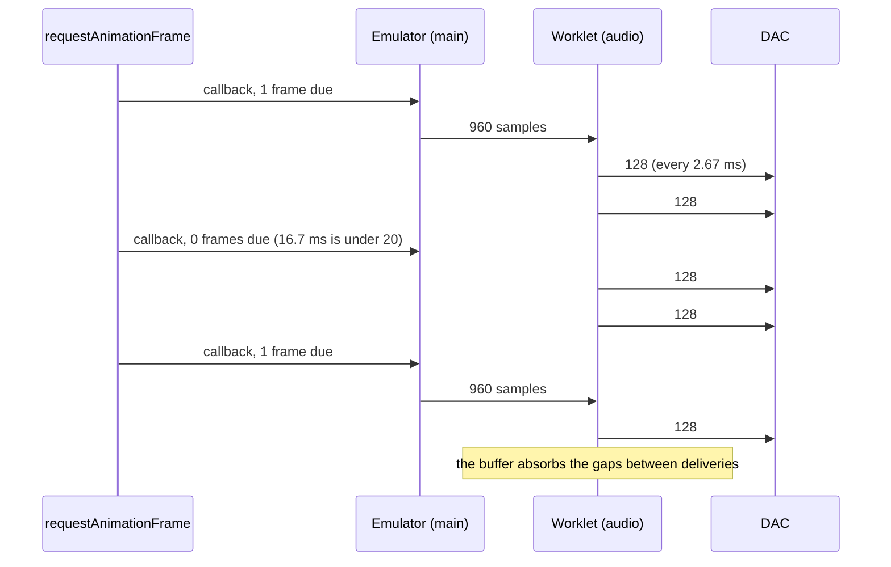
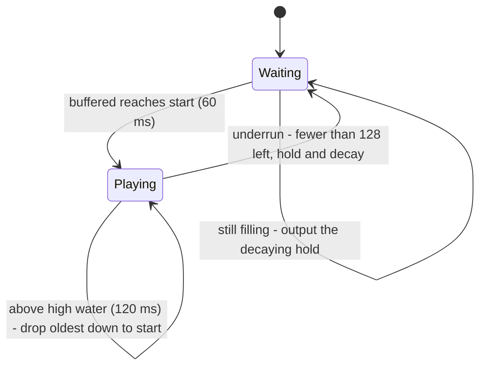

# Stage 46: Web Audio output

> **Part:** 10 (Sound) · **Branch:** `stage/46-web-audio` · **Needs:** 45
> **Status:** done

## Goal

Play the emulated SN76489 **through the browser's speakers, live**. Stage 45 turned register values into a stream of samples and saved them to a WAV file afterwards. Now the samples must reach a sound card *while the machine runs*, without gaps or a growing delay. That needs three things: an **AudioWorklet** (code that runs on the browser's audio thread), a **ring buffer** between the emulator and that thread, and a policy for keeping two clocks in step that never quite agree.

Why now? This is the last sound stage. The chip is done (44, 45), and every piece of software from here on (games especially) expects to be heard.

## What you can now see

**Hear it** (needs `roms/os12.rom` and `roms/basic2.rom`):

```bash
npm run dev     # then open http://localhost:5173/?machine=mos
```

1. Under the screen there's a new **Sound** row. It reads **🔇 Sound off**, *browsers need a click before any sound*.
2. Click **🔇 Sound off**. It becomes **🔊 Sound on**, and the status line starts reporting: `48 kHz · 60 ms buffered · 0 underruns · silent` (your rate may be 44.1 kHz).
3. Click **Power on**. About 0.3 s later you hear the **boot bleep**, and the status line briefly reads `≈523 Hz, peak 0.16`.
4. Click the screen (so it has the keyboard again) and type:
   ```
   SOUND 1,-15,53,20
   ```
   That's a one-second note at 266.5 Hz, the Stage 44 example, at full volume (peak 0.25: one channel of four).
5. Now an **ENVELOPE**, a rising siren:
   ```
   ENVELOPE 1,2,1,0,0,100,0,0,126,0,0,-126,126,0
   SOUND 1,1,100,40
   ```
   The pitch climbs a quarter-semitone every 2 centiseconds for 2 seconds. The MOS does all the work in its 100 Hz interrupt, rewriting channel 2's tone register 50 times a second. We just play what the chip makes.
6. Try `SOUND 0,-15,6,20` (white noise), or a chord: `SOUND 1,-10,53,40:SOUND 2,-10,69,40:SOUND 3,-10,81,40`.


**Measured** through the real worklet in Chromium (the e2e test reads the worklet's reports):

| What | Reported pitch | Theory | Peak |
|---|---|---|---|
| Boot bleep (N = &0EF, attenuation 4) | 523.0 Hz | 4,000,000 ÷ (32 × 239) = 523.01 | 0.158 (0.631 ÷ 4) |
| `SOUND 1,-15,53,20` (N = &1D5) | 266.53 Hz | 4,000,000 ÷ (32 × 469) = 266.52 | 0.25 |
| ENVELOPE siren, every 0.25 s | 540, 605, 725, 870, 1,041, 1,251, 1,500, 1,804, 2,105 Hz | each step × 2^(12.5 quarter-semitones ÷ 48) ≈ ×1.2 | 0.25 |

Steady running gave **no underruns and no drops** over 10 quiet seconds at 50 frames/s. Switching on shows a one-off `1 underrun · 3,520 dropped` in the first moments (see Gotchas), and stalling the page (a screenshot, DevTools) adds an underrun each time, which the buffer recovers from as designed.

## The real hardware

There are two pieces of "hardware" this time: the Model B's own audio path, and the PC's.

**On the Model B**, the SN76489's single audio output pin goes through a small power amplifier to the internal loudspeaker (the circuit diagram shows an LM386-style amp; we don't model it). Nothing buffers anything. The chip's output *is* the speaker's signal, continuously and instantly. Advanced User Guide, "The sound generator", covers the chip side.

**On the PC**, a sound card (or the Mac's built-in audio) has a **DAC** (digital-to-analogue converter) driven by **its own crystal**. It consumes samples at a fixed rate, typically **48,000** a second on a Mac and 44,100 or 48,000 elsewhere, whatever the program is doing. If a sample isn't ready when the DAC needs it, the DAC still plays *something*: silence, or a repeat. You hear that as a click or a crackle.

So the BBC's sound needs no queue and the PC's must have one. That mismatch is the whole stage.

## Key concepts

### 1. The browser's audio thread and AudioWorklet

The Web Audio API ([W3C spec](https://www.w3.org/TR/webaudio/)) is a graph of nodes. An `AudioContext` owns the graph and the link to the sound card. Most nodes are built in (oscillators, gain, filters), but we already *have* the samples, so we need a node that runs **our** code.

That's an **AudioWorklet**. You give the browser a JavaScript module containing a class that extends `AudioWorkletProcessor`, and the browser calls its `process()` method on a **separate, high-priority audio thread**, not the page's main thread. Each call fills one **render quantum** of **128 samples** (spec §1.32, "render quantum").

At 48,000 Hz that's a call every 128 ÷ 48,000 = **2.67 ms**, 375 times a second. The deadline is hard. If `process()` returns late, the DAC runs dry and you hear a click. That is why the worklet must do very little: copy samples out of a buffer, and nothing that could stall (no allocation in the steady state, no waiting on the main thread).

The two threads share no variables. They talk through a **`MessagePort`** (`node.port` on the main side, `this.port` in the processor). A message is either *copied* (structured clone) or, for an `ArrayBuffer`, *transferred*: ownership moves to the other thread, and nothing is copied.

> **Why not the older `ScriptProcessorNode`?** It ran your callback on the *main* thread, sharing it with our emulator and the page. A slow frame meant a click. It's deprecated for exactly that reason.

### 2. Producer and consumer: the ring buffer

The emulator **produces** samples in bursts and the worklet **consumes** them steadily:

| | When | How many (at 48 kHz) |
|---|---|---|
| Emulator | once per BBC frame (20 ms of emulated time), in bursts from `requestAnimationFrame` | **960** samples |
| Worklet | every render quantum, like clockwork | **128** samples |

Something has to sit between a bursty producer and a steady consumer and absorb the difference. That's a **FIFO** (first in, first out). The classic way to build one without moving data around is a **ring buffer**: a fixed array plus a **read index** and a **write index** that chase each other round it and wrap at the end.

```
capacity 8, holding 5 samples (a b c d e), read index 6, write index 3:

  index:   0   1   2   3   4   5   6   7
         [ c | d | e | . | . | . | a | b ]
                       ^           ^
                     write        read
```

- **Write** puts a sample at the write index and moves it on, wrapping from 7 to 0.
- **Read** takes the sample at the read index and moves *it* on.
- **Count** (how many are waiting) is tracked separately. If you only have the two indices, `read === write` could mean empty *or* full.

Nothing is ever shifted or copied up, and the array never grows, so a ring buffer allocates nothing once it's made. That is exactly what the audio thread needs.

It also has two failure cases, and they're the interesting part:

- **Underrun:** the worklet wants 128 samples and fewer are there. The producer fell behind.
- **Overrun:** the emulator wants to write and the buffer is full. The consumer fell behind, or (more likely) the producer is running fast.

### 3. Two clocks: why the buffer drifts

In a perfect world the emulator makes 48,000 samples a second and the worklet takes 48,000 a second, so the buffer's fill level stays put. In reality:

- The emulator's speed comes from `requestAnimationFrame` timestamps (Stage 30's frame loop), which follow the computer's **system clock**.
- The worklet's speed comes from the **sound card's crystal**.

These are two separate oscillators. Crystals are accurate to tens of parts per million (ppm), so they disagree slightly. At a 100 ppm difference:

> 48,000 × 100 ÷ 1,000,000 = **4.8 samples a second** = 1 ms of drift every 10 seconds.

That's tiny, but it never stops. After ten minutes the buffer is 60 ms fuller (or emptier) than it started. A full buffer means **latency** (you press a key and hear the beep later and later). An empty one means **underruns** (clicks).

There are bigger disturbances too. The frame loop delivers 0, 1 or 2 frames per callback at 60 Hz (Stage 30), runs up to 5 at once after a hiccup, and stops entirely when the tab is hidden or the machine is paused.

There are three standard answers:

1. **Let audio be the master clock.** Run emulated frames whenever the audio buffer gets low. Perfect sync, but video then follows the sound card's clock, and the frame loop becomes much more complicated.
2. **Resample dynamically.** Nudge the output rate by a few ppm to steer the fill level towards a target. Smooth, but a control loop to tune.
3. **A jitter buffer with limits.** Keep a target amount buffered. On underrun, wait until the target is back before playing again. Above a high-water mark, throw old samples away to get back down to the target.

**We do (3).** It's the simplest, and it keeps the Stage 30 frame loop in charge. Its cost is that a correction is a *jump*, not a glide: 60 ms skipped when the buffer passes high water, or a 60 ms gap while it refills after running dry. From drift alone that's once every several minutes at most. Options (1) and (2) are noted under Gotchas as possible refinements.

Our numbers (at 48 kHz; all scale with the sample rate):

| Level | Time | Samples | Why |
|---|---|---|---|
| **Start** (target) | 60 ms | 2,880 | Three BBC frames. That covers a 60 Hz display's 33 ms gap between deliveries, with room to spare. |
| **High water** | 120 ms | 5,760 | Above this the delay is noticeable, so we trim back to *start*. |
| **Capacity** | 500 ms | 24,000 | Enough for a 5-frame burst on top of the high-water level. Never reached in normal running. |

60 ms of latency is fine for a BBC: you can't tell that a key's beep is 60 ms late.

### 4. Underrun: hold, don't drop to zero

When the buffer runs dry, what should the worklet output? Silence (0.0) sounds obvious, but if the waveform was at +0.25 when the samples stopped, dropping to 0 is a **step**, and a step is a click. So on underrun we **hold the last sample and let it decay** gently towards zero: multiply by 0.999 per sample. That's a time constant of 1,000 samples, about 21 ms. A paused machine fades out instead of clicking.

(DC, a constant level, is inaudible, so holding it briefly does no harm.)

### 5. Autoplay rules: why there's a button

Browsers don't let a page make noise on its own. Chrome's autoplay policy (2018), and Safari's and Firefox's equivalents, says that an `AudioContext` made before the user has interacted with the page starts in the **`"suspended"`** state. It only starts (`resume()`) in response to a **user gesture**: a click or a keypress.

Our machine boots as soon as the ROMs load, before any click. So:

- Sound is **off at load**. A **🔇 Sound off** button under the screen turns it on (the click is the gesture) and off again.
- The **boot bleep has already happened** by the time you click. To hear it, turn sound on and then press **Power on**. That's the autoplay rule in action, not a bug. (BREAK won't do: on a soft reset, MOS 1.20 silences the channels but doesn't bleep. See Gotchas.)

### 6. Getting samples across: postMessage, not shared memory

The fastest bridge would be a ring buffer in a **`SharedArrayBuffer`** that both threads read and write directly. But since the Spectre attacks (2018), browsers only allow `SharedArrayBuffer` on pages that are **cross-origin isolated**: the server must send `Cross-Origin-Opener-Policy: same-origin` and `Cross-Origin-Embedder-Policy: require-corp` headers. That's possible, but it's server configuration that every host would need.

So instead:

- The **main thread** collects one BBC frame's samples (960 at 48 kHz) in a small batch buffer.
- After each frame it **transfers** them to the worklet in one message.
- The **worklet** pushes them into **its own** ring buffer, which only the audio thread touches.

That's 50 messages a second, each a new `Float32Array` of about 3.8 KB. That's an allocation, but it happens **once per frame, not per instruction**, so it's outside the hot path that CLAUDE.md protects (`step()`/`tick()`). The per-tick path (chip → resampler → batch) still allocates nothing.

## Diagrams

The path of one sample, across two threads:

```mermaid
flowchart LR
    subgraph MainThread["Main thread (page)"]
        FL["Frame loop - runFrame()"] --> SN["Sn76489 - 250,000 levels a second"]
        SN --> RS["BoxResampler - to the context's rate, e.g. 48,000"]
        RS --> FB["FrameBatcher - one frame, 960 samples"]
        FB -->|"postMessage, buffer transferred"| PORT["node.port"]
    end
    subgraph AudioThread["Audio thread"]
        PORT --> PB["PlaybackBuffer - jitter policy"]
        PB --> RING["SampleRing - 24,000 slots"]
        RING -->|"128 at a time"| PROC["process()"]
        PROC --> DAC["Sound card DAC"]
        PROC -->|"stats, 4 times a second"| PORT2["this.port"]
    end
    PORT2 -->|"buffered, underruns, peak"| UI["Sound control - status line"]
```



How the two sides interleave in time (60 Hz display, 48 kHz audio):



The playback buffer's states:



## Our design

Everything lives in `src/web/audio/`. The parts with logic are pure classes with Jest tests. The two files that touch browser APIs are thin.

| File | What | Tested in Jest |
|---|---|---|
| `sample-ring.ts` | `SampleRing`: a fixed `Float32Array` FIFO with read/write indices. `push(samples)` drops the oldest if full; `pull(out, count)` returns how many it gave; `skip(n)`. | ✅ |
| `playback-buffer.ts` | `PlaybackBuffer`: the jitter buffer policy (start, high water, hold-and-decay) plus counters (underruns, samples dropped, peak) for the status line. | ✅ |
| `frame-batcher.ts` | `FrameBatcher`: a `SampleSink` (Stage 45's interface) that collects a frame's samples and hands them over as one array. | ✅ |
| `messages.ts` | The message shapes in each direction, and type guards to narrow `unknown` message data (an I/O boundary). | ✅ |
| `audio-status.ts` | The status line's text from the worklet's latest stats ("48 kHz · 60 ms buffered · 0 underruns · ≈523 Hz, peak 0.16"). | ✅ |
| `bbc-sound.worklet.ts` | The `AudioWorkletProcessor`: receives batches into a `PlaybackBuffer`, fills each quantum, posts stats. | browser only |
| `audio-output.ts` | Main thread: creates the `AudioContext` on the first click, loads the worklet, connects `machine.sound` while on, flushes after each frame. | browser only |
| `sound-control.ts` | The 🔇/🔊 button and its status line: a "Sound" row under the Machine controls. | e2e |

The emulator side is unchanged: `Sn76489.connectOutput()` from Stage 45 takes a `BoxResampler`, which now writes into a `FrameBatcher` instead of a `SampleRecorder`. While sound is **off**, the chip has no output connected, so no resampling work is done at all. The chip still runs, so the Sound panel still updates.

**Decisions:**

- **The frame loop stays the master clock** (concept 3, option 3). The audio adapts to it, not the other way round.
- **Sample rate:** whatever the `AudioContext` picks (the hardware's native rate). Asking for 44,100 would make the browser resample again on a 48 kHz card. The `BoxResampler` is built for `context.sampleRate`.
- **Worklet loading:** Vite's `?worker&url` import compiles the TypeScript worklet into its own module and gives its URL to `audioWorklet.addModule()`.
- **Worklet types:** TypeScript's DOM library describes the *main thread's* side (`AudioWorkletNode`) but not the processor's globals (`AudioWorkletProcessor`, `registerProcessor`, `sampleRate`). Those live in a different global scope. The worklet file declares just the ones it uses, scoped to that file.
- **Not built:** a volume control (the OS has one), stereo, audio-driven timing, and dynamic rate correction. The Model B is mono, and the rest is parked.

## Code walkthrough

**The emulator side didn't change.** The chip already calls `output.input(level)` every 250 kHz tick (Stage 45), and a `BoxResampler` already turns that into samples for any `SampleSink`. This stage adds a new sink and everything downstream of it.

- [`src/web/audio/frame-batcher.ts`](../../src/web/audio/frame-batcher.ts): the new `SampleSink`. `write()` stores into a fixed `Float32Array` (hot path: no allocation). `take()` slices out the frame's samples as a fresh array, because only a fresh array can have its buffer *transferred*: once sent, it's gone from this thread.
- [`src/web/audio/audio-output.ts`](../../src/web/audio/audio-output.ts): `switchOn()` makes the `AudioContext` and calls `resume()` **before its first `await`**. An async function runs synchronously up to its first `await`, so both happen inside the click, and the browser counts them as user-initiated. Then it loads the worklet (`addModule(workletUrl)`), makes an `AudioWorkletNode` with no inputs and one mono output, and only then connects the chip: `source.connectOutput(new BoxResampler(batcher, rate))`. `switchOff()` disconnects the chip and suspends the context. A `generation` counter catches a switch-off that happens while a switch-on is still awaiting. (A plain `on` flag can't: TypeScript, rightly, assumes nothing changed it during the `await`, and lint flags the check as dead code.)
- [`src/main.ts`](../../src/main.ts): one line in the frame loop, `audio.flush()` after each `machine.runFrame()`. So each message is exactly one BBC frame.
- [`src/web/audio/bbc-sound.worklet.ts`](../../src/web/audio/bbc-sound.worklet.ts): `process()` is three lines: find the output channel, `buffer.render(channel)`, report every quarter-second. It declares the audio scope's globals (`sampleRate`, `AudioWorkletProcessor`, `registerProcessor`) itself, scoped to the file, because TypeScript's DOM types describe the page, not the worklet.
- [`src/web/audio/sample-ring.ts`](../../src/web/audio/sample-ring.ts): the ring. Note `push()` when full: it calls `skip()` to drop the oldest first, and if a batch is bigger than the whole ring, only its tail is kept.
- [`src/web/audio/playback-buffer.ts`](../../src/web/audio/playback-buffer.ts): the policy from the state diagram, in `receive()` (trim above high water) and `render()` (wait for start, play, on running dry count an underrun and fall back to the fading hold). It also measures: `peak`, and a `pitch()` taken between the window's **first and last rising zero crossing**. My first version divided crossings by the whole window, and the e2e test caught it: the 0.28 s bleep straddles two 0.25 s windows and read low in both.
- [`src/web/audio/sound-control.ts`](../../src/web/audio/sound-control.ts) + [`audio-status.ts`](../../src/web/audio/audio-status.ts): the button and its text. The control is its own `role="group"` named "Sound", next to (not inside) the "Machine" group. The first version sat inside it, and the boot e2e tests found two `status` lines where they expect one.
- [`src/vite-env.d.ts`](../../src/vite-env.d.ts): Vite's client types, so `import workletUrl from './bbc-sound.worklet.ts?worker&url'` typechecks. A production build emits the worklet as its own 3 kB module.

## Tests

| Test file | What it proves |
|---|---|
| `src/web/audio/sample-ring.test.ts` | FIFO order; a short pull says how many it gave; indices wrap round the array; a full push drops the oldest and counts them; a push larger than the ring keeps its newest; `skip`, offset pulls, `clear`; bad capacities refused. |
| `src/web/audio/playback-buffer.test.ts` | Levels at 48 kHz (2,880 / 5,760 / 24,000) and 44.1 kHz; waits silently until the start level; plays in order; an underrun is counted once, holds the last sample decaying by 0.999 a sample, and waits for the start level again; 1,000 samples of decay ≈ 1/e; above high water it trims to start; a burst beyond capacity; peak, crossings, and a pitch that reads true for a partly filled window; `reset`; levels out of order refused. |
| `src/web/audio/frame-batcher.test.ts` | Takes in order and empties; a new array each time (transferable); nothing → `undefined`; full → drops and counts; one BBC frame (5,000 chip ticks) → exactly 960 samples at 48 kHz. |
| `src/web/audio/messages.test.ts` | The guards accept the real messages and reject wrong types, plain arrays for samples, non-objects, and stats with a missing or mistyped field. |
| `src/web/audio/audio-status.test.ts` | The status line: starting, silent, a tone's pitch and peak, buffering, the singular "1 underrun", dropped counts, 44.1 kHz. |
| `e2e/web-audio.spec.ts` (real-time) | Sound starts off and the button turns the worklet on. **Power on** plays the bleep: some report reads 523 ± 3 Hz at peak 0.158. `SOUND 1,-15,53,20` reads 266.5 ± 2 Hz at peak 0.25; the ENVELOPE siren's pitch rises by over 1.5×. Skips without ROMs. |

All of the Jest tests are pure and never skip. Totals: 2,957 Jest tests passing (1 skipped, as before), and all 154 Playwright tests passing.

## Gotchas & hardware quirks

- **Autoplay.** No sound until a click, and so no boot bleep at page load. Press **Power on** after switching sound on.
- **BREAK doesn't bleep.** On a soft BREAK, MOS 1.20 wrote only the 11 silencing bytes (`9F 82 3F BF A1 3F DF C0 3F FF E0`) and not the bleep's `92 8F 0E`. Only power-on bleeps. That's the MOS's own decision, read from the hardware log. I haven't confirmed it against a real Model B, so it's parked.
- **Start-up transient.** Every switch-on shows `1 underrun · 3,520 dropped` within the first moments, then nothing more. My reading: the audio device's clock lurches while it starts, delivering samples in a burst and then pausing. I haven't proved that. It's about 70 ms of audio at switch-on, before any note you're likely to play.
- **Stalls cause underruns.** Anything that blocks the main thread for more than about 60 ms (DevTools, a screenshot, a slow machine below 100% speed) empties the cushion. You hear a gap, then the buffer refills to 60 ms. Below 100% speed this happens continually and sounds choppy. Making audio the master clock (concept 3, option 1) would fix that, at the cost of a different frame loop.
- **The clocks still drift**, and corrections are 60 ms jumps. Dynamic rate correction (option 2) would glide instead. Neither is needed for now. Both are parked.
- **The workbench's own buttons share the main thread.** Stepping instructions in the Registers panel while sound is on fills the batch without a flush. The samples go at the next frame, or are dropped (and counted) beyond 250 ms. You'll hear nothing useful while single-stepping, which is right.
- **The sound button takes focus** from the screen. Click the screen again before typing.
- **Not modelled:** the Model B's amplifier and speaker (the filtering that makes a real Beeb sound softer), and the chip's one-sided output with its capacitor clicks (Stage 45's gotchas). We play the ideal mix.
- **"Pitch" on the status line** is rising zero crossings. It's right for a single tone, and meaningless for chords and noise.
- **Two status lines.** A page region should have one `role="status"`. The sound control is its own group for that reason (and the boot tests found the clash).

## Playwright verification

- **MCP, interactively:** switched sound on in `/?machine=mos` and watched the worklet's reports. Power on showed peak 0.158 at ≈519-523 Hz for about 0.3 s (the first meter read 64 Hz in a partly filled window, which led to the span-based pitch). Ten quiet seconds showed no new underruns or drops at 50 frames/s and 100% speed. The hardware log after a BREAK showed the MOS writing only silencing bytes. The screenshot above is a held A4 (`&8C &11 &90` written straight to the chip from the console) reading ≈440 Hz, peak 0.25.
- **Durable:** `e2e/web-audio.spec.ts`, 3 tests, in the real-time project. They read the worklet's stats through `window.workbench.audio`, since Playwright can't listen. Run 3 times in a row: stable. The full suite (154) passes, including `boot.spec.ts`, which caught the duplicate `status`.
- **Build:** `vite build` emits `bbc-sound.worklet-*.js` (3 kB) separately from the page's bundle.

## Check your understanding

1. The worklet's `process()` is called 375 times a second at 48 kHz. Where does that number come from, and why must `process()` never allocate or wait?
2. In a ring buffer of capacity 8, the read and write indices are both 3. What two states could that be, and how does `SampleRing` tell them apart?
3. Your sound card and your system clock disagree by 50 ppm, the sound card running faster. Which way does the buffer drift, how many samples a second at 48 kHz, and what does `PlaybackBuffer` eventually do about it?
4. Why does the playback buffer hold the last sample and fade it on an underrun, instead of outputting 0?
5. Why does `switchOn()` call `new AudioContext()` and `resume()` before its first `await`, and why can't the boot bleep at page load ever be heard?

<details>
<summary>Answers</summary>

1. The render quantum is 128 samples, and 48,000 ÷ 128 = 375 calls a second, one every 2.67 ms. Each call has a hard deadline: if it returns late the DAC has nothing to play and you hear a click. Allocation can trigger garbage collection and waiting can block, and either can blow the deadline. So `process()` only copies from a ring that was allocated up front.
2. Empty or full: in both cases the indices have met. `SampleRing` keeps a separate `count` (0 means empty, 8 means full). An alternative is to leave one slot always unused, so that "full" is when write is one behind read.
3. The card consumes faster than the emulator produces, so the buffer **drains**: 48,000 × 50 ÷ 1,000,000 = **2.4 samples a second**. From 2,880 that reaches empty after about 20 minutes. Then there's an underrun: it holds and fades, waits until 2,880 samples (60 ms) are back, and plays on. That's a 60 ms gap once every 20 minutes.
4. A sudden step from, say, +0.25 to 0 is itself a sound: a click, with energy at every frequency. Holding the level and fading it over about 21 ms (×0.999 a sample) moves the output to zero gradually, so a pause or a short underrun is close to silent. A constant level (DC) is inaudible, so holding briefly costs nothing.
5. Autoplay rules: a context only starts if `resume()` comes from a user gesture. An `async` function runs synchronously until its first `await`, so code before it is still "inside" the click handler. Anything after an `await` happens later, and the browser may no longer count it as the user's doing. The boot bleep plays about 0.3 s after power-on, and at page load that's before anyone can have clicked, so the context can't be running yet. Switching sound on first and then pressing **Power on** works.

</details>

## Further reading

- W3C, *Web Audio API*: "AudioWorklet", "AudioWorkletProcessor", "render quantum", and "Allowed to start" (the autoplay hook). <https://www.w3.org/TR/webaudio/>
- MDN, "Using AudioWorklet" and "Autoplay guide for media and Web Audio APIs".
- Chrome Developers, "Audio Worklet design pattern" (Hongchan Choi): the ring-buffer-between-threads pattern this stage follows, including the SharedArrayBuffer version we didn't build.
- MDN, "SharedArrayBuffer: security requirements" (cross-origin isolation, COOP/COEP).
- Advanced User Guide, "The sound generator" and the `SOUND`/`ENVELOPE` chapters of the *User Guide*, for what the MOS does with the chip 100 times a second.
