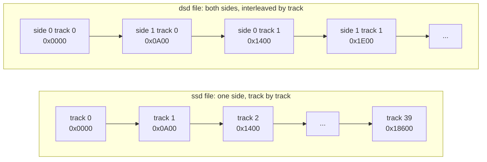
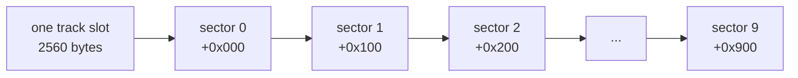
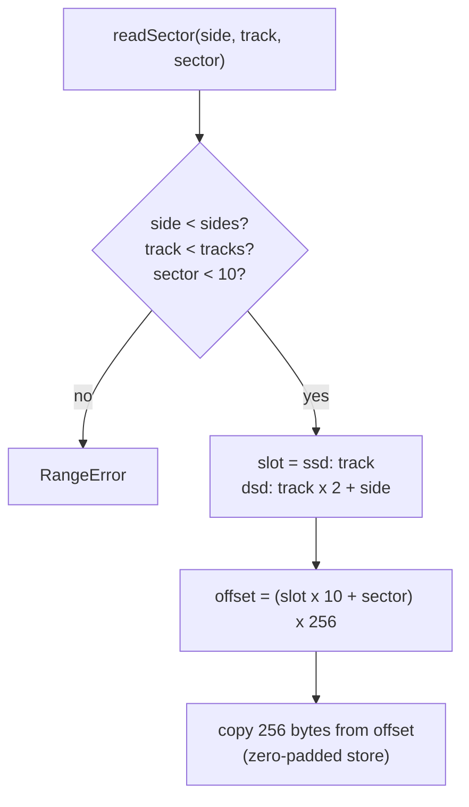

# Stage 47: Disc image geometry

> **Part:** 11 (Disc) · **Branch:** `stage/47-disc-geometry` · **Needs:** 36
> **Status:** done

## Goal

Learn how a floppy disc is laid out (sides, tracks and sectors) and how the two common BBC disc image files, **`.ssd`** and **`.dsd`**, store that layout as a flat run of bytes. We build `DiscImage`, which turns *(side, track, sector)* into a byte offset in the file and hands back that sector's 256 bytes.

Why now? Part 11 builds the disc system from the bottom up. Before the DFS catalogue (Stage 48) or the 8271 controller (Stages 49-50) can mean anything, we need to answer one question reliably: *"where in this file is track 5, sector 3?"* Everything above this stage asks it.

## What you can now see

**A tour, with no files needed:**

```bash
npm run demo:disc
```

It prints the same addresses' offsets in both formats, what each file size means (and which sizes are refused), then dumps side 1, track 5, sector 3 of a generated test `.dsd`:

```
1. The same addresses in each format
   (side, track, sector)     ssd offset   dsd offset
   (0,  0, 0)                &00000       &00000
   (0,  0, 1)                &00100       &00100
   (0,  1, 0)                &00A00       &01400
   (1,  0, 0)                  (none)     &00A00
   (0,  5, 3)                &03500       &06700
   (1,  5, 3)                  (none)     &07100

2. Sizes: what each file length means
   ✓ ssd of 102,400: ssd, 1 side, 40 tracks, 102,400 bytes
   ✓ ssd of 204,800: ssd, 1 side, 80 tracks, 204,800 bytes
   ✓ dsd of 204,800: dsd, 2 sides, 40 tracks, 204,800 bytes
   ✓ dsd of 409,600: dsd, 2 sides, 80 tracks, 409,600 bytes
   ✓ ssd of 20,480: ssd, 1 side, 40 tracks, 20,480 bytes, short: the file stops at &05000
   ✗ the ssd file is 0 bytes: a .ssd image must be 1 to 204800 bytes (80 tracks)
   ✗ the dsd file is 409601 bytes: a .dsd image must be 1 to 409600 bytes (80 tracks)
```

**A sector of a real file** (the plan's command):

```bash
npm run demo:disc -- make-test                         # writes out/geometry.ssd and out/geometry.dsd
npm run demo:disc -- sector out/geometry.dsd 5 3 1     # track 5, sector 3, side 1
```

```
out/geometry.dsd: dsd, 2 sides, 80 tracks, 409,600 bytes
side 1 track 5 sector 3 → file offset &07100
0000  53 49 44 45 20 31 20 54  52 4B 20 30 35 20 53 45  |SIDE 1 TRK 05 SE|
0010  43 20 33 20 53 49 44 45  20 31 20 54 52 4B 20 30  |C 3 SIDE 1 TRK 0|
...
00F0  53 49 44 45 20 31 20 54  52 4B 20 30 35 20 53 45  |SIDE 1 TRK 05 SE|
```

Every test-image sector is filled with its own name, so the text column says whether the arithmetic landed in the right place. Side is optional (default 0); numbers can be decimal or `&hex`. Things to try:

- `sector out/geometry.ssd 79 9`: the last sector of an 80-track `.ssd`, at `&31F00`.
- `sector out/geometry.ssd 5 3 1`: refused, `no side 1 track 5 sector 3 on this 80-track single-sided ssd`.
- Any `.ssd` or `.dsd` of your own in `discs/`: `sector discs/yours.ssd 0 0` shows the first half of the DFS catalogue (Stage 48 reads it).

`out/` is gitignored.

## The real hardware

### The disc itself

A BBC disc drive takes a **5¼-inch floppy disc**: a flexible plastic disc coated with magnetic oxide, spinning at **300 rpm**, so one turn takes **200 ms**. A read/write **head** sits on the surface (two heads, one each side, on a double-sided drive) and a stepper motor moves it in and out between fixed positions.

- **Track:** one ring of the surface under a head at a given position. Tracks are numbered from **0 at the outside edge**. A drive has either **40 or 80** track positions (48 or 96 tracks per inch). The *BBC Microcomputer Disc Filing System User Guide* covers both.
- **Side** (or *surface*, or *head*): **0** or **1**. A single-sided drive only has the head for side 0.
- **Sector:** each track is split into **10 sectors** of **256 bytes** (&100) in Acorn DFS format. On the disc, each sector is an *ID field* (track, head, sector number, size code), a gap, then a *data field* (the 256 bytes plus a CRC). The 8271 controller finds a sector by reading ID fields as they spin past until one matches the number it wants (Intel 8271 data sheet, "Read Data" command). That's Stage 50's business. For now, a sector is simply 256 bytes we can name by *(side, track, sector)*.

### How much fits

Acorn DFS writes **single density (FM)**, at 125,000 bits a second (the standard 5¼-inch single-density rate; BeebWiki's Acorn DFS pages). In one 200 ms turn that's:

```
125,000 bits/s × 0.2 s = 25,000 bits = 3,125 bytes of raw track
```

Only 10 × 256 = **2,560 bytes** (&A00) of it is your data. The other 565 bytes are ID fields, CRCs, sync bytes and the gaps that give the controller time to switch from reading an ID to reading data. The same arithmetic shows why Stage 50 needs NMIs: a data byte arrives every 8 bits ÷ 125,000 = **64 µs**, which is just 128 CPU cycles at 2 MHz.

| Disc | Tracks | Sides | Sectors | Bytes |
|---|---|---|---|---|
| 40-track single-sided | 40 | 1 | 400 (&190) | 102,400 (100K) |
| 80-track single-sided | 80 | 1 | 800 (&320) | 204,800 (200K) |
| 40-track double-sided | 40 | 2 | 800 | 204,800 |
| 80-track double-sided | 80 | 2 | 1,600 | 409,600 (400K) |

### Sides are separate drives to DFS

Acorn DFS doesn't treat a double-sided disc as one 400K volume. Each side is its own **drive number**, with its own catalogue: in the first physical drive, **side 0 is drive 0 and side 1 is drive 2**. Drives 1 and 3 are the two sides of a second physical drive (the *DFS User Guide*'s section on drive numbers). So `*CAT 2` reads the *back* of the disc in drive 0. This is why our addresses are *(side, track, sector)* and not one big sector number: each side is a 200K world of its own.

### Logical vs physical order

On the surface, a formatter can lay sectors out in any order around the ring (for example, starting each track's sector 0 a little later than the last track's, so the head has time to step before it comes round. This is *skew*). A disc **image** doesn't record that. It stores each track's sectors in **sector-number order**, 0 to 9, because that is all software ever asks for. Whether Acorn's own `*FORM` uses skew doesn't matter to us; I haven't confirmed it.

## Key concepts

### 1. A disc image is the sectors, end to end

An image file is the data fields of every sector, concatenated in a fixed order. There's no header, no ID fields, no gaps, no CRCs: just the 256-byte payloads. That makes the file nothing but **geometry plus arithmetic**. Given the order, you can compute where any sector lives.

### 2. `.ssd`: single-sided, track after track

An `.ssd` ("single-sided disc") holds one side. Track 0's ten sectors come first, then track 1's, and so on:

```
offset = (track × 10 + sector) × 256
```

| (track, sector) | Calculation | Offset |
|---|---|---|
| (0, 0) | 0 × 256 | &00000 |
| (0, 1) | 1 × 256 | &00100 |
| (0, 9) | 9 × 256 | &00900 |
| (1, 0) | 10 × 256 | &00A00 |
| (5, 3) | 53 × 256 | &03500 |
| (39, 9) | 399 × 256 | &18F00 (last sector of a 40-track disc) |
| (79, 9) | 799 × 256 | &31F00 (last sector of an 80-track disc) |

Multiplying by 256 is a shift left by 8, so in hex the sector index just gains two zeros: sector index &35 → offset &3500.

### 3. `.dsd`: double-sided, interleaved **by track**

A `.dsd` holds both sides. You might expect "all of side 0, then all of side 1", but it's **interleaved one track at a time**: side 0 track 0, side 1 track 0, side 0 track 1, side 1 track 1, and so on (BeebWiki's disc image format pages; every emulator's `.dsd` reader agrees):

```
offset = ((track × 2 + side) × 10 + sector) × 256
```

| (side, track, sector) | Track slot | Offset |
|---|---|---|
| (0, 0, 0) | 0 | &00000 |
| (1, 0, 0) | 1 | &00A00 |
| (0, 1, 0) | 2 | &01400 |
| (1, 1, 0) | 3 | &01E00 |
| (0, 5, 3) | 10 | &06700 |
| (1, 5, 3) | 11 | &07100 |
| (1, 79, 9) | 159 | &63F00 (very last sector of an 80-track dsd) |

Why interleave? It follows the hardware: both heads sit on the same arm, so "track 5" is one arm position with two surfaces under it. Dumping a disc track by track, reading both heads before stepping, writes exactly this order. Each track slot is 2,560 bytes (&A00), and a whole *cylinder* (both sides of one track) is 5,120 bytes (&1400).

### 4. The size alone can't tell you the format

Look at the size table again: an **80-track `.ssd`** and a **40-track `.dsd`** are both 204,800 bytes. Read the wrong way, track 1 of the `.ssd` (&A00) would be taken for side 1's track 0. So the **file extension is part of the data**. `DiscImage` is always told the format; it never guesses it from the size.

Within a format, the size *does* tell you the track count: an `.ssd` up to 102,400 bytes is a 40-track disc, and one up to 204,800 is an 80-track one (twice those for `.dsd`).

### 5. Short images

Many `.ssd` files are **shorter** than a full disc. The program that made them stopped after the last used sector, because the rest is blank. A 3-file game might be a 20K `.ssd`. That's legal, and common, so we accept it and treat everything past the end of the file as zeros. Sizes we reject:

- **0 bytes**: not a disc.
- **Bigger than 80 tracks** for the format (over 204,800 for `.ssd`, over 409,600 for `.dsd`): no Model B drive could hold it.

A size that isn't a whole number of sectors (say 1,000 bytes) is accepted too, with the last sector's missing tail read as zeros. Is zero the right fill? On a real disc those sectors hold whatever `*FORM` wrote; we don't know that, and it never matters, because a catalogue never points at them. It's our choice, not a hardware fact.

A short image has one real weakness: a 60K `.ssd` of an 80-track disc whose files happen to sit in the first 60K looks like a 40-track disc. Stage 48's catalogue records the disc's true sector count, which could settle it.

## Diagrams

How an `.ssd` and a `.dsd` lay the same tracks out in the file:



Inside any one track slot, the ten sectors are in order, 256 bytes each:



How `DiscImage` turns a request into bytes:



## Our design

New folder `src/disc/` with one module, `disc-image.ts`. It's pure (no `fs`): the CLI demo reads the file with Node, and a later stage will get bytes from a dropped file in the browser, just like the ROM loaders (`rom-image.ts`).

```ts
export const SECTOR_SIZE = 256;          // &100
export const SECTORS_PER_TRACK = 10;
export const TRACK_SIZE = 2560;          // &A00

export type DiscFormat = 'ssd' | 'dsd';
export type TrackCount = 40 | 80;

export interface DiscGeometry {
  readonly format: DiscFormat;
  readonly sides: 1 | 2;
  readonly tracks: TrackCount;
}

/** Pure arithmetic: where (side, track, sector) starts in an image of this format. */
export function sectorOffset(format: DiscFormat, side: number, track: number, sector: number): number;

/** 'ssd' / 'dsd' from a file name (any case), or undefined. */
export function formatFromName(name: string): DiscFormat | undefined;

export class DiscImage {
  static fromBytes(bytes: Uint8Array, format: DiscFormat, name: string): DiscImage; // validates
  readonly geometry: DiscGeometry;
  readonly fileLength: number;            // bytes actually in the file
  hasSector(side: number, track: number, sector: number): boolean;
  readSector(side: number, track: number, sector: number): Uint8Array; // a 256-byte copy
}
```

Decisions:

- **The format is passed in**, never guessed from the size (concept 4). `formatFromName` is a convenience for callers that have a file name.
- **The store is always full size.** `fromBytes` copies the file into a fresh `Uint8Array` of the whole geometry (e.g. 102,400 bytes for a 40-track `.ssd`), so short images (concept 5) need no special case when reading. `fileLength` remembers the real size, so tools can say "past the end of the file".
- **`sectorOffset` is a separate, exported pure function**, so the arithmetic can be tested on its own, with no image.
- **Out-of-range addresses throw `RangeError`**, and `hasSector` lets a caller check first without catching. Stage 50's 8271 will want the check: a real controller reports "sector not found" rather than crashing.
- **`readSector` returns a copy.** Nothing outside can change the disc through it. The 8271 will read a byte at a time in Stage 50, and may want a cheaper accessor then; this stage only needs whole sectors for the demo.
- **Read only.** Writing sectors belongs with `SAVE` in Stage 51, and building whole discs with Stage 48's catalogue writer.

The demo needs a disc to read, and `discs/` is empty. So it can also **make a geometry test image**: every sector filled with its own name (`SIDE 1 TRK 05 SEC 3 ...`). Reading one back and seeing the right label proves the offsets end to end. It's raw sectors only, not a DFS disc; there's no catalogue until Stage 48.

## Code walkthrough

[`src/disc/disc-image.ts`](../../src/disc/disc-image.ts) is the whole stage.

- **`sectorOffset(format, side, track, sector)`** carries the idea. Both formats are one formula with a different number of sides:
  ```ts
  const slot = track * sides + side;          // which &A00-byte run of the file
  return (slot * SECTORS_PER_TRACK + sector) * SECTOR_SIZE;
  ```
  With `sides = 1` the side is always 0 and the slot is the track: the `.ssd` formula. With `sides = 2` it's the `.dsd` interleave. It checks against the largest possible disc (80 tracks), because it has no image to know better.
- **`DiscImage.fromBytes`** validates the size, picks 40 or 80 tracks from it, and copies the file into a full-size, zero-filled store. After that, short files are invisible to the reading code.
- **`hasSector` / `offsetOf` / `readSector`** check against *this* disc's geometry: track 79 is fine for `sectorOffset` but not for a 40-track image. `hasSector` never throws; the other two throw `RangeError` with a message naming the disc.
- **`formatFromName`** reads the extension, any case.

[`scripts/demo-disc.ts`](../../scripts/demo-disc.ts) is the CLI. `geometryTestImage` builds the labelled test discs using `sectorOffset` itself, so the `sector` command reading them back is a round trip through the same arithmetic. The tests' hand-worked offsets are what prove the arithmetic matches the format. The dump reuses Stage 02's `hexdump`, with sector offsets &00-&FF as the addresses.

## Tests

| Test file | What it proves |
|---|---|
| [`src/disc/disc-image.test.ts`](../../src/disc/disc-image.test.ts) | Geometry constants (10 × &100 = &A00 per track; full sizes 100K/200K/200K/400K). `.ssd` offsets worked by hand, from (0, 0) to (79, 9) at &31F00. `.dsd` offsets, side 1 always &A00 after side 0, and all 1,600 sectors of an 80-track `.dsd` landing on distinct sector boundaries that cover the file. The &A00 clash between an 80-track `.ssd` and a 40-track `.dsd`. Bad addresses (side, track, sector, non-integer) are `RangeError`. `formatFromName`. Size validation (empty, over 80 tracks, the 40/80 boundary) and short images. `readSector` from the right offset in each format, zeros past a short file's end, copies in and out. `hasSector`/`offsetOf` against the disc's own track count. |

52 tests, all without ROMs or fixtures. The full suite: 3,009 passed, 1 skipped (the existing `dfs.rom` header test).

## Gotchas & hardware quirks

- **Same size, different discs.** 204,800 bytes is an 80-track `.ssd` *or* a 40-track `.dsd`. Read one as the other and side 1 track 0 turns out to be side 0 track 1. Hence the format is always passed in.
- **`.dsd` interleaves by track, not by side.** "Side 0, then side 1" is the natural guess and it's wrong. The interleave follows the drive: both heads move together, so a track position (a *cylinder*) is read on both sides before stepping.
- **Short `.ssd` files are normal.** We zero-fill past the end. The fill value is our choice (a real disc has whatever `*FORM` wrote), and a short 80-track image can look like a 40-track one. Stage 48's catalogue holds the disc's real sector count, and could correct the track count.
- **40-track discs in 80-track drives.** A real 80-track drive reads a 40-track disc only by *double-stepping* (two steps per track, as its tracks are half as wide). That's a drive matter, not an image one; it may come up in Stage 50's drive model.
- **Sector skew isn't in the image.** Images store sectors in number order. If the order around the physical track ever matters (rotation timing in Stage 50), it has to be modelled separately.
- **Side 1 is DFS drive 2.** Not this stage's business, but it's why later stages pass a side and never a 0-1599 sector number.
- **Not built:** writing sectors (Stage 51, `SAVE`) and the DFS catalogue (Stage 48).

## Playwright verification

n/a: CLI-only stage. The browser gets discs (drag and drop) in Stage 48.

## Check your understanding

1. In an 80-track `.dsd`, where does side 0, track 2, sector 7 start? And in an `.ssd`?
2. A friend sends `game.img`, 204,800 bytes. Why can't `DiscImage` load it, and what two things could it be?
3. Why does the `.dsd` format put side 1 track 0 *before* side 0 track 1, and not after all of side 0?
4. An `.ssd` is 51,200 bytes. How many tracks does it have, and what does reading track 30 give you?
5. A data byte comes off the disc every 64 µs. How many CPU cycles is that at 2 MHz, and why will that matter in Stage 50?

<details>
<summary>Answers</summary>

1. `.dsd`: slot = 2 × 2 + 0 = 4, so (4 × 10 + 7) × 256 = 47 × 256 = **&2F00**. `.ssd`: (2 × 10 + 7) × 256 = 27 × 256 = **&1B00**.
2. The size fits two formats: an **80-track single-sided** disc or a **40-track double-sided** one. Only the extension says which, and `.img` doesn't. It's refused rather than guessed, because a wrong guess quietly gives the wrong sectors.
3. Because both heads are on one arm. A track position (a *cylinder*) has both sides under the heads at once, so imaging software reads both before stepping. The file records the order the drive naturally reads in.
4. 51,200 is under 102,400, so it's a **40-track** disc (20 tracks' worth of file: 51,200 ÷ 2,560). Track 30 is past the end of the file, so it reads as 256 bytes of **&00**. (If it really was an 80-track disc whose files fit in the first 20 tracks, we can't tell from the size; Stage 48's catalogue can.)
5. 64 µs × 2 MHz = **128 cycles**. The CPU must take each byte before the next arrives, whatever else it's doing. A polling loop or a maskable IRQ that's held off could miss one, so the 8271 interrupts with the NMI, which can't be masked.

</details>

## Further reading

- *BBC Microcomputer Disc Filing System User Guide* (Acorn): drive numbers, 40/80-track discs, `*FORM` and `*VERIFY`.
- Intel 8271 Programmable Floppy Disk Controller data sheet: the sector ID field and the FM track format (for Stages 49-50).
- BeebWiki: the disc image file format pages (`.ssd`, `.dsd`) and Acorn DFS disc format.
- *Advanced User Guide*, the SHEILA memory map: the 8271 sits at &FE80 (Stage 49).
