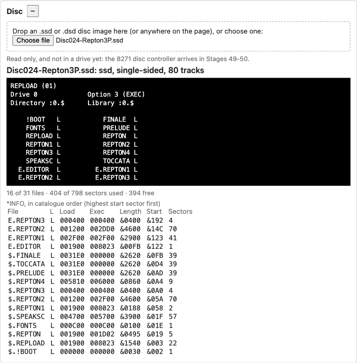
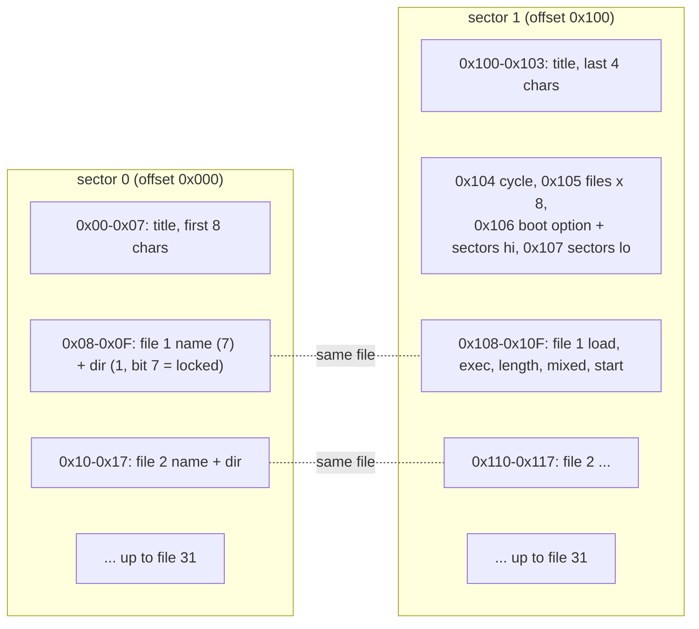
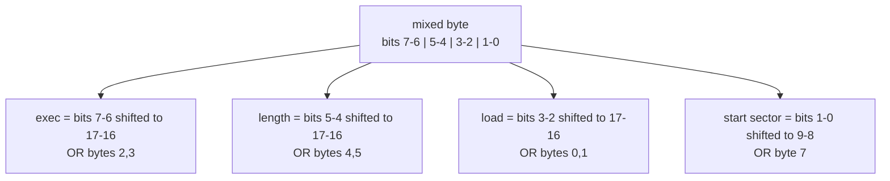
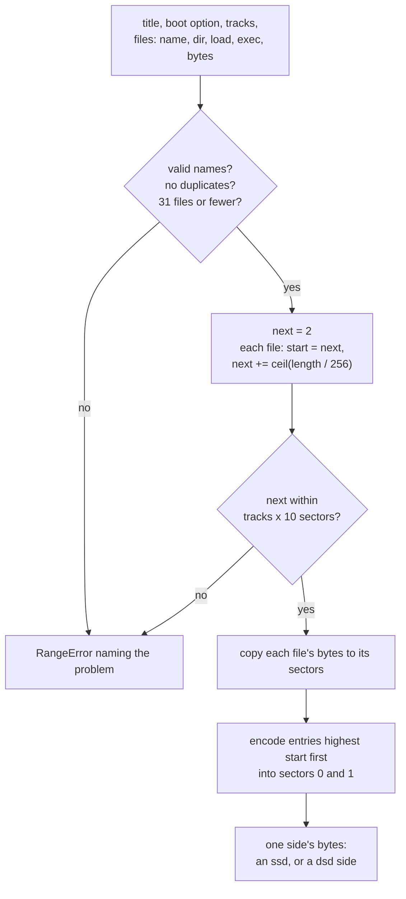
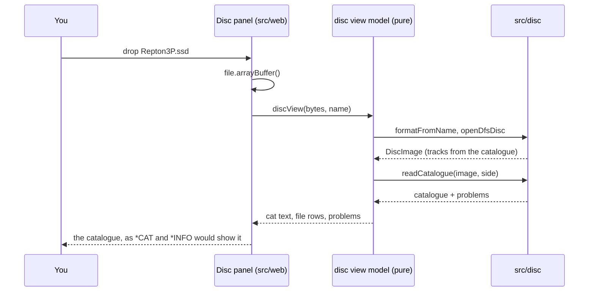

# Stage 48: DFS catalogue

> **Part:** 11 (Disc) · **Branch:** `stage/48-dfs-catalogue` · **Needs:** stage 47
> **Status:** done

## Goal

Stage 47 could find any sector on a disc, but it couldn't tell what any of them *meant*. This stage reads the **Acorn DFS catalogue**, the two sectors at the start of track 0 that list every file on the disc. It also **writes** one, so we can build our own test discs from bytes in memory, including a program from our own assembler. In the browser, you can drop an `.ssd` or `.dsd` on the page and see its catalogue.

Why now? Stages 49-50 make the real DFS ROM read the disc through an emulated 8271. When `*CAT` appears on the BBC's screen, we need to already know what it *should* say, and we need test discs whose every byte we chose. Those are both built here.

## What you can now see

**Make a DFS disc from scratch, then `*CAT` it:**

```bash
npm run demo:disc -- make-disc                 # writes out/stage48.ssd (40 tracks, 102,400 bytes)
npm run demo:disc -- cat out/stage48.ssd
```

```
*CAT 0
------
STAGE 48 (00)
Drive 0             Option 3 (EXEC)
Directory :0.$      Library :0.$

    !BOOT               EMPTY
    HELLO   L           README
  E.DATA

*INFO, in catalogue order (highest start sector first):
  name       L  load   exec   length start
  E.DATA       003000 003000 000258 005
  $.EMPTY      003000 003000 000000 005
  $.README     000000 000000 00004A 004
  $.HELLO   L  FF1900 FF1900 000021 003
  $.!BOOT      000000 000000 00000B 002

5 of 31 files; 6 sectors used by files, 392 of 398 free (sectors 0-1 are the catalogue)
```

**Read a file back through the catalogue.** `HELLO` came from our own assembler (Stage 08), went onto the disc through the writer, and comes back out byte for byte:

```bash
npm run demo:disc -- file out/stage48.ssd HELLO
```

```
$.HELLO   L  FF1900 FF1900 000021 003
33 bytes from sector &003, shown at its load address FF1900:
1900  A2 00 BD 11 19 F0 06 20  EE FF E8 D0 F5 20 E7 FF  |....... ..... ..|
1910  60 48 45 4C 4C 4F 20 46  52 4F 4D 20 44 49 53 43  |`HELLO FROM DISC|
1920  00                                                |.|
```

`A2 00` is `LDX #0`, `BD 11 19` is `LDA &1911,X` (the message), and `20 EE FF` is `JSR &FFEE` (OSWRCH). Try `file out/stage48.ssd '!BOOT'` (`*RUN HELLO` and a `&0D`) and `file out/stage48.ssd E.DATA`.

**Your own discs:**

```bash
npm run demo:disc -- cat discs/Disc024-Repton3P.ssd
```

It shows 16 files, including four in directory `E`, sorted the way `*CAT` sorts them, and `E.REPTON3` starting at sector `&192`.

**In the browser:** `npm run dev`, open http://localhost:5173 (either the Playground or MOS 1.20), and drop an `.ssd` or `.dsd` anywhere on the page, or use **Choose file** in the **Disc** panel. The panel shows the `*CAT` text in white on black, a summary line, and the `*INFO` numbers for every file in catalogue order. A `.dsd` shows drive 0 and drive 2. A file that isn't a disc gets a red message instead.



## The real hardware

There's no new chip in this stage. The catalogue is a **software convention**: the layout Acorn's DFS ROM writes on a disc and expects to find there. A disc formatted by a different filing system (ADFS, Watford DFS's 62-file mode, CP/M) has the same sectors, but they mean something else.

Sources: the *BBC Microcomputer Disc Filing System User Guide* (Acorn, 1982), the *Advanced User Guide*'s DFS chapter, and BeebWiki's "Acorn DFS disc format" page. I checked the layout below against the three real discs in `discs/` (Manic Miner, Castle Quest, Repton 3), and the hex quoted here comes from them.

### Where it lives

The catalogue is **sectors 0 and 1 of track 0** on each side: file offsets `&000`-`&1FF` of an `.ssd`. (In a `.dsd` it's the same for side 0; side 1's catalogue is at `&A00`-`&BFF`, its own track 0.) Each side of a disc is a separate DFS drive (side 0 is drive 0, side 1 is drive 2), so each has **its own catalogue** and its own 31 files.

### Sector 0: titles and names

| Offset | Bytes | Meaning |
|---|---|---|
| `&00`-`&07` | 8 | The first 8 characters of the **disc title** |
| `&08`-`&0F` | 8 | File 1's **name** (7 bytes) and **directory** (1 byte) |
| `&10`-`&17` | 8 | File 2's name and directory |
| ... | | ... up to file 31 at `&F8`-`&FF` |

A name is padded to 7 characters with spaces (`&20`). The 8th byte is the directory character in bits 0-6 (`$` = `&24` normally), and **bit 7 is the "locked" flag**: Manic Miner's entries all end `&A4`, which is `&24` (`$`) with `&80` (locked) added.

### Sector 1: the numbers

| Offset | Bytes | Meaning |
|---|---|---|
| `&100`-`&103` | 4 | The last 4 characters of the disc title |
| `&104` | 1 | The **cycle number**: bumped each time the catalogue is rewritten (it's BCD, so it goes from `&09` to `&10`, BeebWiki) |
| `&105` | 1 | **8 × the number of files**, i.e. the offset of the last entry's end |
| `&106` | 1 | Bits 4-5: the **boot option** (`*OPT 4,n`). Bits 0-1: bits 8-9 of the sector count |
| `&107` | 1 | Bits 0-7 of the **number of sectors** on this side |
| `&108`-`&10F` | 8 | File 1's addresses, length and start sector |
| ... | | ... up to file 31 at `&1F8`-`&1FF` |

Manic Miner's sector 1 starts `00 00 00 00 01 30 33 20`:

- the title's last four characters are `&00` (the title is `MANIC` padded with NULs),
- cycle `&01`,
- `&30` = 48 = 8 × **6 files**,
- `&33` = `%0011 0011`: boot option bits 4-5 = **3** (EXEC), and sector-count bits 8-9 = 3,
- `&20`: the sector count is `&320` = **800**, so it's an 80-track disc.

### Each file's 8 bytes in sector 1

| Byte | Meaning |
|---|---|
| 0, 1 | Load address, bits 0-15 (low byte first) |
| 2, 3 | Execution address, bits 0-15 |
| 4, 5 | Length in bytes, bits 0-15 |
| 6 | The "mixed byte": the top 2 bits of each of the other four numbers |
| 7 | Start sector, bits 0-7 |

The mixed byte packs four 2-bit fields (BeebWiki; the *DFS User Guide* doesn't print the layout):

```
bit:   7   6   5   4   3   2   1   0
      exec b17-16 length b17-16  load b17-16  start sector b9-8
```

So addresses and lengths are **18 bits**, and the start sector is **10 bits**. Repton 3 shows the start sector's two bits in use: its `E.REPTON3` entry is `00 04 00 04 00 04 01 92`, so the mixed byte is `&01` and the start sector is `&192` = 402, past the 256 that one byte could reach.

None of the three discs uses the address or length high bits, so their positions come from BeebWiki alone. **That part is unconfirmed by our own discs.**

## Key concepts

### 1. A file is one unbroken run of sectors

DFS is simple: every file occupies **consecutive sectors**, starting at its start sector, and it takes `⌈length ÷ 256⌉` of them. There's no allocation table and no chain of blocks. The catalogue entry *is* the map. Manic Miner shows the pattern:

| File | Start | Length | Sectors | Next free |
|---|---|---|---|---|
| `!BOOT` | `&002` | `&002E` (46) | 1 | `&003` |
| `MANIC` | `&003` | `&0760` | 8 | `&00B` |
| `MINER1` | `&00B` | `&0800` | 8 | `&013` |
| `MINER2` | `&013` | `&2800` | 40 | `&03B` |
| `MINER3` | `&03B` | `&0280` | 3 | `&03E` |
| `MINER4` | `&03E` | `&2A80` | 43 | `&069` |

The first file always starts at sector 2, because sectors 0 and 1 are the catalogue. The price of this simplicity is **fragmentation**. Delete `MINER1` and you get an 8-sector hole that only a file of 8 sectors or fewer can fill. `*COMPACT` exists to slide files down and close the gaps.

A sector number counts across the whole side: sector `n` is on track `n ÷ 10`, sector `n mod 10`. So start sector `&192` (402) is track 40, sector 2.

### 2. The catalogue is kept sorted, newest-highest first

The entries aren't in name order. They're in **descending order of start sector**: the file at the highest sector is entry 1 (Manic Miner lists `MINER4` first and `!BOOT` last). DFS relies on this when it saves a file. To find space, it walks the list from the end, comparing each file's end with the next file's start. A writer must keep the order, or the real DFS will happily save one file on top of another.

`*CAT` doesn't show this order: it sorts the names for display (concept 5).

### 3. Load and execution addresses, and the "FF" in `FF1900`

Every file records where it should be **loaded** (`*LOAD` puts it there) and where to **start running** it (`*RUN` jumps there). BASIC's `SAVE` writes load `&FFFF1900` and execution `&FFFF8023` (BASIC II's entry point). A 32-bit address with `&FFFF` at the top means "the BBC's own memory", rather than a second processor's over the Tube.

The catalogue keeps only 18 of those 32 bits. When bits 16-17 are both 1, DFS treats the address as `&FFFFxxxx`, and `*INFO` prints it as `FF1900`. Our reader keeps the honest 18-bit number (`&31900`) and only shows it as `FF1900`.

Manic Miner's `MANIC` loads at `&001900` and runs from `&00801F`, with the high bits zero. It was saved without the `FFFF`. On a machine with no second processor, that makes no difference.

### 4. Boot option and `!BOOT`

`&106` bits 4-5 hold the **boot option**, set with `*OPT 4,n`. It says what SHIFT-BREAK does with the file `$.!BOOT`:

| Option | Name | SHIFT-BREAK does |
|---|---|---|
| 0 | off | nothing |
| 1 | LOAD | `*LOAD $.!BOOT` |
| 2 | RUN | `*RUN $.!BOOT` |
| 3 | EXEC | `*EXEC $.!BOOT` (type the file in as if from the keyboard) |

All three of your discs use option 3, with a short `!BOOT` text file (46-48 bytes) of commands. Stage 51 makes SHIFT-BREAK use it. Here we just read and write the two bits.

### 5. What `*CAT` shows

`*CAT` prints the title and cycle, the drive and boot option, the current directory and library, then the files in two columns (in MODE 7). It lists files in the **current directory** (normally `$`) first, without their directory, and then the files in other directories with a `D.` prefix. `L` marks a locked file. Something like:

```
REPLOAD (01)
Drive 0             Option 3 (EXEC)
Directory :0.$      Library :0.$

    !BOOT   L         FINALE  L
    FONTS   L         PRELUDE L
    ...
  E.EDITOR  L       E.REPTON1 L
```

I'm confident of the content and the sort order (current directory first, then by directory and name). I'm **not** confident of the exact spacing DFS 1.20 uses, or whether DFS 0.90 sorts the same way. Our `*CAT` text is an imitation for the CLI and the panel. Stage 50 runs the real DFS ROM's `*CAT`, and its test will compare the real screen with what we expect. If the two disagree, the ROM wins and this text gets fixed.

### 6. Directories are a single character

DFS directories aren't folders. They're one character stored with each name, so `$.HELLO` and `E.HELLO` are different files that happen to share 7 characters. There's no nesting, and no directory is ever "created": `*DIR E` just changes the default letter. The 31-file limit is for the whole side, whatever the directories.

### 7. Reading vs writing: lenient in, strict out

The reader has to cope with whatever is on real discs. Castle Quest has a file named `t?data?` (question marks and lower case), which `*SAVE` would never accept. So the reader takes any byte, strips bit 7, and only refuses a catalogue that is structurally impossible: `&105` must be a multiple of 8 and say 31 files or fewer. Softer problems (a file running past the end of the disc, two files overlapping, entries out of order) are *reported*, not thrown, so you can still see the rest of the catalogue.

The writer is strict, because the discs it makes are used as test inputs. It refuses names DFS wouldn't let you type (wildcards `#` and `*`, and `.`, `:`, `"` and spaces), duplicate names, more than 31 files, and files that don't fit.

## Diagrams

The two catalogue sectors and how one file's entry is split between them:



The mixed byte (byte 6 of each entry in sector 1), unpacked into the four numbers:



How the writer builds a disc. Files are laid out from sector 2 in the order given, and then the catalogue is written in reverse, highest start sector first:



What happens when you drop a disc on the page:



## Our design

Three new modules in `src/disc/`, all pure (no `fs`, no DOM), and one panel:

- **`dfs-catalogue.ts`**: the format. `decodeCatalogue(sector0, sector1)` → `DfsCatalogue`, and `encodeCatalogue(catalogue)` → the 512 bytes. Constants named after the layout (`CAT_FILE_COUNT_X8 = 0x05` and so on). Also `catalogueProblems(catalogue)` (the soft checks) and `fileSectors(length)`.
- **`dfs-disc.ts`**: catalogues on a `DiscImage`. `readCatalogue(image, side)`, `readFile(image, side, file)`, `openDfsDisc(bytes, format, name)` (which fixes Stage 47's short-image guess using the catalogue's sector count), and the writer `buildDfsSide(spec)` / `buildDfsImage(format, sides)`.
- **`dfs-text.ts`**: `catLines(catalogue, drive)` for `*CAT`-style text and `infoLine(file)` for `*INFO`-style lines. It's shared by the CLI and the panel.
- **`test-disc.ts`**: the Stage 48 test disc. A `!BOOT`, a program assembled by our own assembler, a locked file and a file in another directory. Used by the demo, the Jest round trip and the e2e test.

```ts
export interface DfsFile {
  readonly directory: string;   // one character, e.g. "$"
  readonly name: string;        // 1-7 characters, trailing spaces removed
  readonly locked: boolean;
  readonly load: number;        // 18 bits, as stored (&31900 shows as FF1900)
  readonly exec: number;        // 18 bits
  readonly length: number;      // 18 bits
  readonly startSector: number; // 10 bits, counted across the whole side
}

export interface DfsCatalogue {
  readonly title: string;       // up to 12 characters
  readonly cycle: number;
  readonly bootOption: BootOption; // 0 | 1 | 2 | 3
  readonly sectorCount: number; // 400 or 800 on a normal disc
  readonly files: readonly DfsFile[]; // in catalogue order: highest start sector first
}
```

Decisions:

- **Decode from two sectors, not from an image.** `decodeCatalogue` takes the two 256-byte arrays, so the format is testable without any disc, and Stage 50 can decode what the DFS reads into RAM with the same function if that's ever useful.
- **The writer builds a side, not a file.** `buildDfsSide` returns `tracks × 2,560` bytes, and `buildDfsImage` puts one side into an `.ssd`, or two into a `.dsd` using Stage 47's `sectorOffset`. So the interleave arithmetic lives in one place.
- **Names keep their case.** DFS compares names without regard to case, and so does our duplicate check, but the catalogue stores what was typed. Castle Quest's `game` stays lower case.
- **Title padding.** Manic Miner pads its title with NULs (`&00`), so the writer does the same. The reader stops at the first NUL and trims trailing spaces.
- **`DiscImage.fromBytes` gains an optional `tracks`.** Stage 47 guessed the track count from the size. `openDfsDisc` first reads the sector count at `&106`/`&107` (the same offset in both formats, since side 0's track 0 comes first), and passes 80 when it says 800. That settles the Stage 47 parking-lot item for DFS discs.
- **The panel only shows.** The disc isn't in any drive yet (there's no 8271 until Stage 49), so the panel says so. Dropping anywhere on the page goes to it, so the browser doesn't navigate away to the file.

## Code walkthrough

- [`src/disc/dfs-catalogue.ts`](../../src/disc/dfs-catalogue.ts): the format alone.
  - `decodeCatalogue` builds the 12-byte title from both sectors (stopping at the first NUL), reads `&105 ÷ 8` entries, and unpacks the mixed byte with shifts: `load = ((mixed >> 2) & 3) << 16 | hi << 8 | lo`.
  - `encodeCatalogue` is its mirror. Every field goes through `checkWidth` first, so a 19-bit length is an error and never silently masked into a wrong but plausible catalogue.
  - `catalogueProblems` does the soft checks: a file inside sectors 0-1, a file past `sectorCount`, entries out of descending order, and overlapping pairs (empty files take no sectors, so they never overlap).
- [`src/disc/dfs-disc.ts`](../../src/disc/dfs-disc.ts): catalogues on discs.
  - `readFile` walks `startSector + i`, turning each into (track, sector) with `÷ 10` and `mod 10`, then trims the last sector to the length.
  - `openDfsDisc` peeks `&106`/`&107` before building the `DiscImage`.
  - `buildDfsSide` validates names, lays files out from sector 2 with `next += ⌈length ÷ 256⌉`, copies the bytes in, and encodes the entries **reversed**, so the highest start sector comes first.
  - `buildDfsImage` copies each side's tracks into the slots `sectorOffset` gives, so the `.dsd` interleave is Stage 47's arithmetic, not new code.
- [`src/disc/dfs-text.ts`](../../src/disc/dfs-text.ts): `dfsAddress` (the `FF` rule), `infoLine`, `sortedForCat` and `catLines`.
- [`src/disc/test-disc.ts`](../../src/disc/test-disc.ts): `HELLO_SOURCE` (assembly text, with the message spelled out as `.byte` values since our assembler has no strings yet) and `testDiscSide()`.
- [`src/disc/disc-image.ts`](../../src/disc/disc-image.ts): `fromBytes` takes an optional `tracks`.
- [`src/web/workbench/disc-view-model.ts`](../../src/web/workbench/disc-view-model.ts) (pure) and [`disc-panel.ts`](../../src/web/workbench/disc-panel.ts) (DOM). The panel's `load(file)` is also called by the page-wide `drop` handler in [`src/main.ts`](../../src/main.ts). The `dragover` handler calls `preventDefault()` only when files are being dragged, which is what tells the browser "this page accepts the drop".
- [`scripts/demo-disc.ts`](../../scripts/demo-disc.ts): new `make-disc`, `cat` and `file` commands. `sector` now opens files through `openDfsDisc` too.

## Tests

| Test file | What it proves |
|---|---|
| `src/disc/dfs-catalogue.test.ts` | Manic Miner's real catalogue bytes decode (title, cycle, option 3, 800 sectors, `&A4` = locked `$`) and re-encode to the identical 512 bytes; every mixed-byte field; Repton's sector `&192`; lenient names (`t?data?`); `&105` validation; `&106`/`&107` packing; too-wide values refused; `fileSectors`; each kind of catalogue problem |
| `src/disc/dfs-disc.test.ts` | Layout from sector 2, highest-first order, **round trip** of names, flags, addresses and bytes; `&FFFF1900` → `&31900`; side sizes; name rules; case-insensitive duplicates; disc full; 32 files refused; `.dsd` side 1's catalogue at `&A00`; short-image track count from the catalogue; reading past the disc. Plus every disc in `discs/`: no problems, every file readable (**skips** if `discs/` has none) |
| `src/disc/dfs-text.test.ts` | `FF` addresses, `*CAT` sort order, header lines, two-column layout, drive 2, option names, 40-column fit, `*INFO` lines |
| `src/disc/test-disc.test.ts` | `HELLO` is our assembler's bytes; whole test disc round-trips; its exact `*CAT` and `*INFO` text |
| `src/disc/disc-image.test.ts` | (added) an explicit track count, and its size check |
| `src/web/workbench/disc-view-model.test.ts` | Panel view: rows, summary, `.dsd` drives 0 and 2, short-file heading, bad files as messages, a broken side shown on its own |
| `e2e/disc-panel.spec.ts` | In Chromium: the test disc (built in Node by our writer) chosen in the panel shows the exact `*CAT` text and `HELLO`'s row; a `.txt` gets a message; a drop on the page body lands in the panel |

## Gotchas & hardware quirks

- **The catalogue isn't in name order.** It's in descending start-sector order. `*CAT` sorts for display, and the catalogue itself must stay sorted by sector or the real DFS can save over a file.
- **18-bit addresses.** `FF1900` on screen is `&31900` in the catalogue, which is short for `&FFFF1900`. Comparing a decoded load address with `0x1900` fails for any file saved from BASIC.
- **The mixed byte's address/length bits aren't confirmed by our discs.** None of the three real discs sets them, so those positions come from BeebWiki only. Only the start sector's bits (Repton) were seen in real data.
- **Empty files share a start sector** with the next file (`$.EMPTY` and `E.DATA` both start at `&005`). That's legal: they own no sectors. The order between equal start sectors doesn't matter.
- **Lenient reader, strict writer.** `t?data?` reads fine but our writer would refuse it. The writer's character rules are our reading of the User Guide. Acorn DFS itself may accept a few characters we refuse.
- **`*CAT` spacing is an imitation.** The content and sort order are documented, but the exact columns are a guess until Stage 50 shows the real ROM's output. DFS 0.90 might not sort at all.
- **Title padding.** Real discs use NULs (Manic Miner) or spaces. The reader handles both; the writer uses NULs.
- **The cycle number is BCD** (BeebWiki). We only read and write it (always `&00` on our discs), so BCD never matters yet. Stage 51's `SAVE` would have to count `&09` → `&10`.
- **Drops need two handlers.** Without `preventDefault()` on `dragover`, the browser never fires `drop` on the page. It opens the file instead and the emulator is gone.

## Playwright verification

- MCP: opened `/?machine=mos`, chose `discs/Disc024-Repton3P.ssd` with the panel's file chooser, and took the screenshot above. All 16 files show, `E.` entries are sorted after `$`, and the `*INFO` rows match the CLI.
- Durable: `e2e/disc-panel.spec.ts` (3 tests, chromium project). It needs no disc files: the test disc is built by `src/disc/test-disc.ts` inside the spec.

## Check your understanding

1. A catalogue's sector 1 begins `00 00 00 00 05 18 21 90`. How many files are there, what's the boot option, and how many tracks does the disc have?
2. An entry in sector 1 is `00 19 23 80 40 15 0C 03`. What do `*INFO`'s load, exec, length and start-sector columns show?
3. A file starts at sector `&03E` and is `&2A80` bytes long. Which track and sector hold its last byte, and where does the next file start?
4. Why must the catalogue stay in descending start-sector order, when `*CAT` doesn't even show that order?
5. Why can `openDfsDisc` tell that a 20K `.ssd` is an 80-track disc when Stage 47's `DiscImage.fromBytes` couldn't?

<details>
<summary>Answers</summary>

1. `&18` = 24 = 8 × **3 files**. `&21` = `%0010 0001`: boot option bits 4-5 = **2** (RUN), and sector-count bits 8-9 = 1. With `&90` that makes `&190` = 400 sectors: **40 tracks**. (The cycle number is `&05`.)
2. Mixed byte `&0C` = `%00 00 11 00`: load bits 16-17 = 3, everything else 0. So load = `&31900`, shown **FF1900**; exec **008023**; length **001540**; start **003**. (It's Repton's `REPLOAD` with its load address made "BBC-side".)
3. `&2A80` bytes = 42.5 sectors, so 43 sectors: `&03E` to `&03E + 42` = `&068` (104), which is **track 10, sector 4**. The next file starts at `&069`. That's Manic Miner's `MINER4`, and its end is the disc's first free sector.
4. DFS finds free space for a save by walking the catalogue and comparing each file's end with its neighbour's start. That only works if neighbours in the list are neighbours on the disc. Out of order, it can find a "gap" that's really inside another file.
5. Size can't distinguish them: a short file is short either way. The catalogue's own sector count (`&106`/`&107` = `&320`, 800 sectors) records how the disc was formatted, whatever the file length.

</details>

## Further reading

- *BBC Microcomputer Disc Filing System User Guide* (Acorn, 1982): `*CAT`, `*INFO`, `*OPT 4`, drive numbers, file names.
- *Advanced User Guide*, the DFS chapter: OSFILE's load/exec/length block (the same numbers the catalogue holds).
- BeebWiki, "Acorn DFS disc format": the byte layout, including the mixed byte.
- Stage 47's doc, for how `(side, track, sector)` becomes a file offset.
