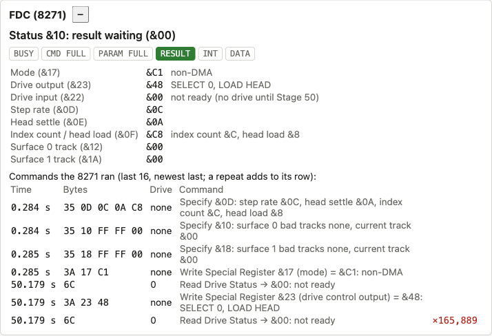
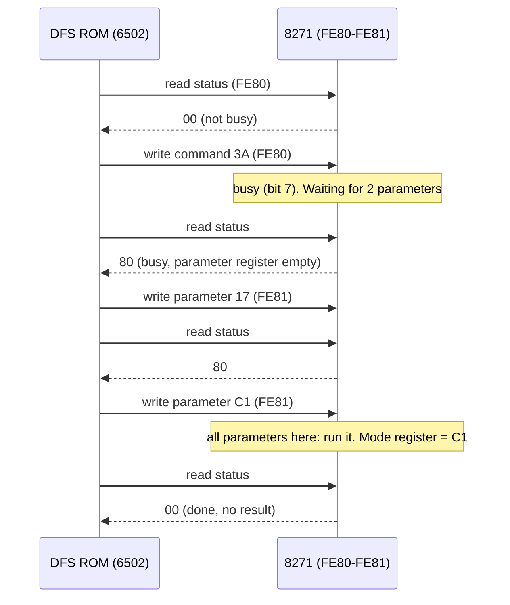
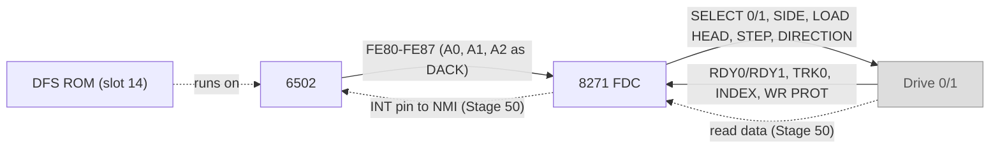

# Stage 49: 8271 registers & commands

> **Part:** 11 (Disc) · **Branch:** `stage/49-fdc-commands` · **Needs:** stage 48
> **Status:** done

## Goal

The DFS ROM never touches a disc directly. It asks a separate chip, the **Intel 8271 floppy disc controller**, to do the work, and talks to it through four registers at `&FE80`-`&FE81`. This stage builds that conversation: the 8271's registers, the **command/parameter handshake**, and the commands that don't move any data (Specify, Seek, Read Drive Status, Read/Write Special Register). Reading sectors waits until Stage 50.

Why now? The moment `roms/dfs.rom` is fitted, the machine stops booting. DFS 0.98 prints `Acorn DFS` and then waits forever for an 8271 that isn't there. This stage gets it past that, and lets you watch every command the DFS sends.

## What you can now see

You'll need `roms/dfs.rom`: an **8271** DFS such as Acorn DFS 0.98 or 0.90. (A Master's DFS 2.x drives a different chip, the WD1770 at `&FE28`, and won't work. The file I checked first was one of those.)

**In the terminal:**

```bash
npm run demo:fdc
```

Part 1 needs no ROMs. It does the handshake by hand and shows the status register after each byte:

```
  write &FE80 ← &7A  (Write Special Register)           status &80
  write &FE81 ← &17  (register: mode)                   status &80
  write &FE81 ← &C1  (value: non-DMA)                   status &00
  write &FE80 ← &6C  (Read Drive Status)                status &10
  read  &FE81        (the result)                → &00  status &00
  write &FE80 ← &69  (Seek, drive 0)                    status &80
  write &FE81 ← &05  (track 5)                          status &18
  read  &FE81        (the result)                → &10  status &00
```

Parts 2-4 boot MOS 1.20 + BASIC II + DFS 0.98, and show the log after each event:

```
Part 2: power-on with the DFS in slot 14. What it told the 8271:
    0.284 s  35 0D 0C 0A C8  none  Specify &0D: step rate &0C, head settle &0A, index count &C, head load &8
    0.284 s  35 10 FF FF 00  none  Specify &10: surface 0 bad tracks none, current track &00
    0.285 s  35 18 FF FF 00  none  Specify &18: surface 1 bad tracks none, current track &00
    0.285 s  3A 17 C1        none  Write Special Register &17 (mode) = &C1: non-DMA
  (screen: BBC Computer 32K / Acorn DFS / BASIC / >)

Part 3: *CAT, then 2 seconds. No drive, so RDY0 (bit 2 of Read Drive Status) never comes up:
    2.339 s  6C              0     Read Drive Status → &00: not ready
    2.339 s  3A 23 48        none  Write Special Register &23 (drive control output) = &48: SELECT 0, LOAD HEAD
    2.339 s  6C              0     Read Drive Status → &00: not ready  ×37,215

Part 4: Escape. The DFS gives up: resets the 8271 through &FE82, sets it up again, and says so:
    2.339 s  6C              0     Read Drive Status → &00: not ready  ×37,482
    4.417 s                        Reset (&FE82 bit 0 = 1)
    4.418 s  35 0D 0C 0A C8  none  Specify &0D: ...
    4.418 s  35 10 FF FF 00  none  Specify &10: ...
    4.418 s  35 18 FF FF 00  none  Specify &18: ...
    4.418 s  3A 17 C1        none  Write Special Register &17 (mode) = &C1: non-DMA
  (screen: >*CAT / Escape / >)
```

37,215 polls in 2 seconds is one every 54 µs (107 cycles): the DFS's loop runs flat out.

**In the browser:**

1. `npm run dev`, and open http://localhost:5173/?machine=mos. The screen shows `BBC Computer 32K`, `Acorn DFS`, `BASIC`, `>`, the real Model B banner with a DFS fitted.
2. Open the **FDC (8271)** panel. It lists the four set-up commands. The mode register shows `&C1 non-DMA`, and the timings `&0C`, `&0A`, `&C8`.
3. Click the screen and type `*CAT` (`*` is Shift + `'` on a PC keyboard) and Return. The panel adds Read Drive Status, then Write Special Register `&23` = `&48`, then a Read Drive Status row whose **×count climbs** about 18,000 a second. The status chips flicker as you catch it busy or with a result waiting.
4. Press **Escape**. The panel shows `Reset (&FE82 bit 0 = 1)` and the four set-up commands again, and the screen says `Escape`.



**Before this stage**, fitting `dfs.rom` made the machine hang after `Acorn DFS`. Try `git stash` on this branch to see it, if you like.

`?machine=mos&roms=mos,basic` gives the machine without the DFS, as earlier stages had it.

## The real hardware

### Where it sits

The 8271 is a 40-pin chip next to the DFS ROM socket, and it fills SHEILA's `&FE80`-`&FE9F` slot (*Advanced User Guide*, the SHEILA address list). Our SHEILA table (Stage 21) already names its registers. The 8271 only sees A0 and A1, and the board wires A2 to its **DACK** ("DMA acknowledge") pin, so the slot divides like this:

| Address | Read | Write |
|---|---|---|
| `&FE80` | **status** register | **command** register |
| `&FE81` | **result** register | **parameter** register |
| `&FE82` | (nothing) | **reset** register (bit 0) |
| `&FE83` | illegal | illegal |
| `&FE84`-`&FE87` | **data** register | **data** register |

These repeat every 8 bytes up to `&FE9F`.

One address is two registers: reading `&FE80` gives the status and writing it gives a command. The chip tells them apart by its /RD and /WR pins, not by the address. The VIAs do the same with IRA/ORA.

The data register is Stage 50's job. In this stage it reads `&00` and ignores writes.

### What it is inside

The 8271 isn't a simple register file like the 6845. It's a small **microcontroller with its own program in ROM** (Stardot's 2020 decap thread read that program out of the silicon). When you write a command, firmware in the chip decides what it means, waits for the parameters, steps the drive's head, waits for the right sector to come round, and finally hands back a **result** byte. That's why there's a handshake, and why the CPU has to wait between bytes.

### The status register (`&FE80`, read)

| Bit | Name | Meaning when set |
|---|---|---|
| 7 | **Command busy** | A command has been accepted and isn't finished. Don't send another. |
| 6 | Command register full | The chip hasn't picked up the command byte yet. |
| 5 | **Parameter register full** | The chip hasn't picked up the last parameter yet. Don't send another. |
| 4 | **Result register full** | A result is waiting at `&FE81`. Reading it clears this bit. |
| 3 | Interrupt request | The chip wants attention (the **INT** pin). On the BBC that pin drives the 6502's **/NMI**: Stage 50. |
| 2 | Non-DMA data request | A data byte is ready, or wanted, at `&FE84`: Stage 50. |
| 1-0 | (not used) | Read as 0. |

The bit layout is from my reading of the Intel 8271 data sheet. DFS 0.98's own code confirms bits 7 and 5 (see below).

### The command byte

```
  bit:   7   6   5   4   3   2   1   0
       ┌───┬───┬───────────────────────┐
       │ S1│ S0│     command code      │
       └───┴───┴───────────────────────┘
```

- **Bits 7-6** select a drive: `01` is drive 0 and `10` is drive 1. The 8271 copies them to its SELECT 0 and SELECT 1 output pins.
- **Bits 5-0** say which command.

So a Read Drive Status (code `&2C`) for drive 0 is `&40 + &2C = &6C`. For drive 1 it's `&80 + &2C = &AC`. DFS 0.98 flips one into the other with `EOR #&C0` at `&8C83`.

| Code | Command | Parameters | Result? |
|---|---|---|---|
| `&35` | **Specify** (load 3 special registers) | 4 | no |
| `&3A` | **Write Special Register** | 2 (register, value) | no |
| `&3D` | **Read Special Register** | 1 (register) | yes: the value |
| `&2C` | **Read Drive Status** | 0 | yes: the drive's input lines |
| `&29` | **Seek** | 1 (track) | yes, with an interrupt |
| `&12` / `&13` | Read Data (128-byte single record / multi-record) | 2 / 3 | yes, with an interrupt (Stage 50) |
| `&16` / `&17` | Read Data and Deleted Data | 2 / 3 | Stage 50 |
| `&0A` / `&0B` | Write Data | 2 / 3 | out of scope until Stage 51's optional `SAVE` |
| `&0E` / `&0F` | Write Deleted Data | 2 / 3 | 〃 |
| `&1E` / `&1F` | Verify Data and Deleted Data | 2 / 3 | Stage 50 |
| `&1B` | Read ID | 3 | Stage 50 |
| `&23` | Format Track | 5 | not planned |
| `&00` / `&04` | Scan Data (/ and Deleted) | 5 | not planned |

This table is from my reading of the Intel data sheet's command summary. DFS 0.98 actually uses `&35`, `&3A`, `&2C`, `&29`, `&1F`, `&13` (Read, at `&8BDA`: `LDA #&53`) and `&0B` (Write, at `&8BE8`: `LDA #&4B`). The rest are in its command table at `&8CBF`.

The "multi-record" forms take a third parameter that packs the **sector size** (bits 7-5: 128 × 2ⁿ bytes) and the **sector count** (bits 4-0). For example, `&21` means 256-byte sectors, 1 of them, and `&2A` means 256-byte sectors, 10 of them (a whole DFS track). We only decode this byte here. Stage 50 acts on it.

### The special registers

The 8271 keeps its settings in internal registers, reached by Specify and Read/Write Special Register. Each has a one-byte **address**:

| Address | Register |
|---|---|
| `&06` | Scan sector number |
| `&0D` | Step rate |
| `&0E` | Head settling time |
| `&0F` | Index count (high nibble) / head load time (low nibble) |
| `&10`, `&11` | Surface 0 bad track 1, bad track 2 |
| `&12` | Surface 0 **current track** |
| `&13`, `&14` | Scan count, low and high |
| `&17` | **Mode register** |
| `&18`, `&19` | Surface 1 bad track 1, bad track 2 |
| `&1A` | Surface 1 **current track** |
| `&22` | **Drive control input port** (lines from the drive) |
| `&23` | **Drive control output port** (lines to the drive) |

The map is confirmed by the Stardot decap thread, which lists `&0D`-`&0F`, `&10`-`&12`, `&17`, `&18`-`&1A`, `&22` and `&23` exactly like this. It also matches DFS 0.98, which writes `&23` to pick a drive.

**Specify is "load three special registers".** Its first parameter is a special register address, and the next three go there, one after another:

- `35 0D 0C 0A C8`: step rate `&0C`, head settle `&0A`, index count `&C` and head load `&8` (`&0D`, `&0E`, `&0F`).
- `35 10 FF FF 00`: surface 0 has bad tracks `&FF`, `&FF` (none), and the head is on track `&00` (`&10`, `&11`, `&12`).
- `35 18 FF FF 00`: the same for surface 1 (`&18`, `&19`, `&1A`).

**Bad tracks** are a 1970s trick. An 8-inch disc with a damaged track could still be used: the 8271 skips that track and renumbers the ones after it. The DFS uses `&FF` to mean "none".

**The mode register** (`&17`). DFS 0.98 writes `&C1`. Bit 0 = 1 picks **non-DMA mode**: each data byte goes through the CPU, with an interrupt per byte, rather than a DMA controller writing memory directly. The BBC has no DMA controller, which is why every disc byte will be an **NMI** in Stage 50. From my reading of the data sheet, bits 7-6 must be written as 1, and bits 1-5 choose single/double actuator and are 0 here. I haven't checked those against a second source.

**The drive control output port** (`&23`). These are the lines to the drive: bit 0 WRITE ENABLE, bit 1 SEEK/STEP, bit 2 DIRECTION, bit 3 LOAD HEAD, bit 4 LOW HEAD CURRENT, bit 5 WRITE FAULT RESET, bit 6 SELECT 0, bit 7 SELECT 1 (data sheet, from my reading). The BBC uses bit 5 to choose the disc **side**. DFS 0.98's table at `&8B8C` proves it: `48 88 68 A8` for drives 0, 1, 2, 3, where drives 2 and 3 are the *other side* of 0 and 1, and differ only in bit 5 (`&20`).

**The drive control input port** (`&22`), which Read Drive Status also returns. These are the lines from the drive: bit 0 COUNT/OPI, bit 1 TRK0 (the head is on track 0), bit 2 **RDY0** (drive 0 ready), bit 3 WRITE PROTECT, bit 4 INDEX (the hole in the disc is passing), bit 5 WRITE FAULT, bit 6 **RDY1**. Bit 2 is confirmed by DFS 0.98, which tests `AND #&04` after Read Drive Status (`&8B89`). The rest are from the data sheet.

### Results

A result byte is a **completion code**. `&00` is "all good". The others are errors (from the data sheet):

| Code | Meaning |
|---|---|
| `&00` | Completed OK |
| `&08` | Clock error |
| `&0A` | Late DMA (the CPU didn't take a byte in time) |
| `&0C` | ID CRC error |
| `&0E` | Data CRC error |
| `&10` | **Drive not ready** |
| `&12` | **Write protect** |
| `&14` | Track 0 not found |
| `&16` | Write fault |
| `&18` | **Sector not found** |

Bit 5 (`&20`) is added if a sector with a "deleted data" mark was found. The DFS prints these as `Disc fault 18 at 00/02`. DFS 0.98 special-cases `&12` as "read only" (`CMP #&12` at `&8ADE`).

### Reset

Writing `&01` to `&FE82` holds the 8271 in reset, and writing `&00` lets it go. The data sheet asks for at least 11 of its clock cycles in between. DFS 0.98 does `LDA #1 : STA &FE82 : LDA (&00,X) : LDA #0 : STA &FE82` at `&8B5C`. The `LDA (&00,X)` is there only to waste 6 cycles. It does this when you press **Escape** while it's waiting for a drive, to abandon the command.

## Key concepts

### 1. A handshake, because the other side is a computer too

The CPU and the 8271's internal processor run their own programs at their own speeds. The 8271 might take a few microseconds to notice a parameter byte, so if the CPU wrote the next one at once, it would overwrite the first. The status bits are the two sides agreeing to take turns:

1. **Wait until not busy** (bit 7 = 0), then write the **command**.
2. For each parameter: **wait until parameter-full is clear** (bit 5 = 0), then write it.
3. **Wait until not busy again** (the command has finished), then **read the result**.

This is DFS 0.98's code for those three steps:

```
&8C85  BIT &FE80     ; N = status bit 7 (busy)
&8C88  BMI &8C85     ;   still busy: ask again
&8C8A  STA &FE80     ; the command

&8C70  LDA &FE80
&8C73  AND #&20      ; parameter register full?
&8C75  BNE &8C70     ;   yes: wait
&8C78  STA &FE81     ; the parameter

&8C95  CLI
&8C96  BIT &FE80     ; busy?
&8C99  BMI &8C96
&8C9B  BIT &FE80     ; ...and still not busy on a second look
&8C9E  BMI &8C96
&8C91  LDA &FE81     ; the result
```

`BIT` is the right instruction for bit 7: it copies bit 7 of memory into N without touching A, so `BMI` can branch on "busy".

**This is also why the machine hangs without an 8271.** Nothing answers at `&FE80`, so the read gets the floating bus. The last byte on the bus was the `&FE` of `BIT &FE80`'s own operand, and `&FE` has bit 7 set. "Busy", forever.

### 2. Commands, parameters, results: a little protocol

Every command is the same shape: one command byte, 0-5 parameter bytes, then maybe a result byte. The chip knows how many parameters each command takes, and it doesn't start until it has them all. Here's Write Special Register `&17` = `&C1` (set the mode register) as the bytes on the bus:

```
write &FE80 ← &3A    command: Write Special Register, drive bits 00; status → &80 busy
write &FE81 ← &17    parameter 1: the register address
write &FE81 ← &C1    parameter 2: the value. All here: run it. Status → &00
```

Notice the drive bits are `00`. Write Special Register and Specify don't involve a drive, and DFS 0.98 sends them straight from its table through `&8C85`, skipping the `EOR #&C0` at `&8C83` that picks drive 1. That's why the panel says "none" in the Drive column for them.

Read Drive Status has no parameters, so it runs at once, and it has a result:

```
write &FE80 ← &6C    command; no parameters, so it runs at once. Status → &10 result full
read  &FE81 → &00    the input lines: no RDY0, no RDY1. Status → &00
```

### 3. What DFS 0.98 does with them

From the ROM's tables (and confirmed in the "What you can now see" section below):

- **At power-on or BREAK** it configures the chip with four commands, and nothing touches a drive:
  `Specify &0D` (timings), `Specify &10` (surface 0), `Specify &18` (surface 1), `Write Special Register &17 = &C1` (non-DMA mode).
  The timing set is one of four, picked by keyboard links 3 and 4 (the *Advanced User Guide* says these set the disc drive timings). The table at `&8CBF` has four 6-byte entries: `0D 02 08 C0`, `0D 03 08 C0`, `0D 03 19 C4` and `0D 0C 0A C8`. `&8CA1` reads the links (`AND #&30`) and multiplies by 6. With all links open, which is our keyboard's default (`&FF` at `&028F`), it takes the last set: `&0C`, `&0A`, `&C8`. I haven't checked which physical drives each set was meant for.
- **On `*CAT`** it selects the drive (`Write Special Register &23 = &48`: SELECT 0 + LOAD HEAD), then **polls Read Drive Status** until RDY0 comes up. A real drive raises READY once the disc is spinning at speed. Then it seeks and reads.

### 4. Our model has no drive yet

This stage has the controller but **no drives**. Every line on the input port reads 0, so RDY0 never comes up, and the DFS polls forever. That's exactly what a real BBC does with no disc in the drive: `*CAT` sits there until you press Escape. Escape makes the DFS reset the 8271 through `&FE82` and print `Escape`.

Commands that need a drive (Seek, and the data commands) end straight away with result `&10` "drive not ready" and the interrupt bit set. DFS 0.98 never sends them here, because it waits for RDY0 first, but a program of our own could. Stage 50 adds the drive and its disc, the head's position, and the data.

## Diagrams

The handshake for one command with two parameters (Write Special Register):



The 8271's command state machine, as we model it:

```mermaid
stateDiagram-v2
    [*] --> Idle
    Idle --> Parameters: command written, needs parameters (busy)
    Idle --> Run: command written, needs none
    Parameters --> Parameters: parameter written, more to come
    Parameters --> Run: last parameter written
    Run --> Idle: no result (Specify, Write Special Register)
    Run --> ResultWaiting: result loaded (result full; interrupt for Seek, data)
    ResultWaiting --> Idle: CPU reads result (FE81)
    ResultWaiting --> Parameters: new command written
    Idle --> Reset: FE82 bit 0 = 1
    Parameters --> Reset: FE82 bit 0 = 1
    ResultWaiting --> Reset: FE82 bit 0 = 1
    Reset --> Idle: FE82 bit 0 = 0
```



Where the 8271 sits on the board (the parts in grey arrive in Stage 50):



## Our design

- **`src/devices/fdc8271.ts`**: `class Fdc8271 implements IoDevice`. It holds:
  - the status byte, the command byte, the parameters received so far (a fixed `Uint8Array(5)`), and the result;
  - 256 special registers (`Uint8Array(0x100)`: only about 20 addresses mean anything, but the chip accepts any 8-bit address and we keep what it's given);
  - a "held in reset" flag.

  Commands run **at once** when their last parameter arrives. The real chip takes microseconds (and a seek, milliseconds), but nothing in the DFS depends on how long. Stage 50 adds time, when a sector has to come round under the head.
- **The command table** is an `as const` array indexed by the 6-bit code: name, parameter count, and what kind of command it is (`register`: works now; `drive`/`data`: needs a drive). Constants are named after the data sheet: `FDC_STATUS_COMMAND_BUSY = 0x80`, `FDC_CMD_SPECIFY = 0x35`, `FDC_SPECIAL_MODE = 0x17`, `FDC_RESULT_DRIVE_NOT_READY = 0x10`.
- **No drive.** The input port (`&22`) reads `&00`. Commands that need a drive finish with `&10` and the interrupt bit. The INT line is a getter (`interruptRequest`) that isn't wired to /NMI yet: Stage 50 does that.
- **`src/devices/fdc-log.ts`**: a ring buffer of what the chip ran, like the Stage 28 hardware log. Each entry is typed arrays, with no objects on the hot path: cycles, command byte, up to 5 parameters, result, and a **repeat count**. When the DFS polls Read Drive Status 10,000 times, that's one entry "×10,000", not 10,000 entries. A reset through `&FE82` is an entry too. The describing functions (`describeFdcEntry`: "Specify &0D: step rate &02, head settle &08, ...") run only when someone looks.
- **The machine** gets `readonly fdc`, wired into SHEILA's `fdc` slot. Power-on resets it; BREAK doesn't, because its reset pin isn't on /RES. The DFS resets it itself, through `&FE82`. *(Unconfirmed against the circuit diagram; the DFS's own reset makes it harmless either way.)*
- **ROM loading**: `loadStandardRoms(map, only?)` can now take a list of ROM ids, and the browser has a matching `?roms=mos,basic` option (`parseRomsParam`). Tests and demos from earlier stages are about MOS 1.20 and BASIC II (prompt on row 5, PAGE = `&0E00`), so they now load just those two. Fitting a DFS doesn't move their goalposts. By default the browser fits every ROM it finds, like a real machine.
- **The FDC panel**: the status bits, the special registers that matter (mode, output port decoded, current tracks), and the command log, newest last.
- **`npm run demo:fdc`**: boots with the DFS, types `*CAT`, presses Escape, and prints the log after each.

Alternatives considered:

- **Making the DFS's commands succeed** (a pretend drive that is always ready, with seek just setting a number) would show more commands now. But a ready drive *with no data* would make the DFS read and print `Disc fault 18`, which is a lie about the disc. Not ready is the truthful state for a controller with no drives.
- **Delaying busy** for a few microseconds to be realistic: no code we run can tell the difference, so it waits for Stage 50's timing.

## Code walkthrough

- [`src/devices/fdc8271.ts`](../../src/devices/fdc8271.ts): the chip.
  - The top half is constants named after the data sheet: registers, status bits, command codes, special register addresses, port bits, result codes.
  - `COMMANDS` maps each 6-bit code to a name, a parameter count and a kind.
  - The bus side is `read()`, `peek()` and `write()`, switching on `offset & 7`. Reading `FDC_RESULT` is the only read with a side effect: it clears bits 4 and 3.
  - The handshake is three small methods. `writeCommand()` ignores a command while busy, sets status to `&80`, and looks up how many parameters to wait for. `writeParameter()` counts them in. `writeReset()` acts on bit 0's rising edge.
  - `run()` is one `switch`. Specify stores 3 bytes from the address in parameter 0. Write/Read Special Register and Read Drive Status work. Everything that needs a drive gets `&10` and the interrupt bit.
- [`src/devices/fdc-log.ts`](../../src/devices/fdc-log.ts): the log.
  - `recordCommand()` compares the new command with the last entry (`sameAsLast`), and either bumps its repeat count or opens a new slot. All of this is typed arrays, so nothing is allocated while the DFS polls.
  - The second half turns entries into words: `describeFdcEntry`, `describeOutputPort`, `describeDriveInput`, `describeResult`.
- [`src/machine/bbc-model-b.ts`](../../src/machine/bbc-model-b.ts): `fdc` and `fdcLog` are made in the constructor and passed to the memory map as the `fdc` device. `powerOn()` calls `fdc.powerOn()`; `reset()` (BREAK) doesn't.
- [`src/memory/rom-files.ts`](../../src/memory/rom-files.ts), [`src/memory/standard-roms.ts`](../../src/memory/standard-roms.ts) and [`src/web/rom-fetch.ts`](../../src/web/rom-fetch.ts): the `only` list and `?roms=`.
- [`src/web/workbench/fdc-view-model.ts`](../../src/web/workbench/fdc-view-model.ts) and [`fdc-panel.ts`](../../src/web/workbench/fdc-panel.ts): the panel. Its rows are built once and only their text changes, so the climbing ×count doesn't make it flicker.
- [`scripts/demo-fdc.ts`](../../scripts/demo-fdc.ts): the demo.
- [`src/playground/examples.ts`](../../src/playground/examples.ts): Stage 21's memory-map example read `&FE80` to show the floating bus. A real chip answers there now (`&00`), so it reads the ADC's `&FEC0` instead, a slot that will stay empty.

## Tests

| Test file | What it proves |
|---|---|
| `src/devices/fdc8271.test.ts` | The status bits through the handshake (`&80` while parameters are due, `&10` result, `&18` result + interrupt). Specify loads three registers in a row. Write/Read Special Register. Reading the result clears bits 4 and 3, and `peek` doesn't. With no drive: Read Drive Status `&00`; Seek and Read Data end with `&10`. A command while busy or a stray parameter is ignored. The reset register (hold, ignore, release, bit 0 only). What goes in the log. |
| `src/devices/fdc-log.test.ts` | Entries with parameters, results and times. Repeats fold into one entry with a count; a different result or a reset starts a new one. The ring wraps. Every description, including the drive bits and the output/input port decodes. |
| `src/machine/fdc-wiring.test.ts` | `&FE80`-`&FE87` reach the chip, mirrored to `&FE9F`. Power-on resets it; BREAK doesn't. **With the ROMs:** DFS 0.98's four power-on commands and the banner; `*CAT`'s select and polling; Escape's reset, re-setup and `Escape`. These skip if `os12.rom`, `basic2.rom` or `dfs.rom` is missing. |
| `src/web/workbench/fdc-view-model.test.ts` | The status summary and chips, the register rows, and the log rows (time, bytes, drive, text, ×count, last 16). |
| `src/memory/standard-roms.test.ts`, `src/web/rom-fetch.test.ts` | `loadStandardRoms(map, only)`, `parseRomsParam`, and `fetchStandardRoms(..., only)` asking only for the named files. |
| `e2e/fdc-panel.spec.ts` | In the browser: the four power-on commands and mode `&C1`; `*CAT` → select + polling ×count; Escape → reset and `Escape` on screen. Real-time project; skips without the three ROMs. |

Earlier tests and e2e specs that are about MOS + BASIC now ask for just those two ROMs. That's 12 Jest files and 11 specs.

Totals: 3,124 Jest tests, and 159 Playwright tests (2 new).

## Gotchas & hardware quirks

- **The wrong DFS hangs the same way as no 8271 at all.** A Master's DFS 2.x talks to a WD1770 at `&FE24`/`&FE28`, and also uses 65C02 opcodes. To check a ROM, look for `AD 80 FE` / `2C 80 FE` (`LDA`/`BIT &FE80`) in it.
- **Floating `&FE` looks like "busy".** Before this stage, `BIT &FE80` read back its own operand's high byte, `&FE`, from the floating bus. That has bit 7 set, so the DFS waited forever. A missing chip doesn't look "absent"; it looks like whatever the bus last held.
- **Specify and Write Special Register go out with drive bits `00`.** DFS 0.98 skips its drive-select `EOR` for them. Don't expect every command byte to have bit 6 or 7 set.
- **A real BBC with no disc behaves the same way.** `*CAT` waits for READY until you press Escape. That's not an emulator bug, and it's why the DFS checks Escape inside its wait loop (`BIT &FF` at `&8B58`).
- **Instant commands.** Ours finish the moment the last parameter arrives, so bits 6 (command full) and 5 (parameter full) are never seen set. The DFS still checks them, and would work with a slower chip. Stage 50 needs real time for sectors coming round, and may slow these down too.
- **Our choices, unconfirmed:**
  - An unknown command code takes no parameters and finishes with no result.
  - Reset keeps the special registers.
  - Power-on zeroes them.
  - Seek with no drive gives `&10` rather than trying to step.
  - Read Special Register and Read Drive Status don't raise the interrupt.
  
  None of these is reached by DFS 0.98 except the last, and there its wait loop doesn't care.
- **Not modelled yet:** the INT pin to /NMI, the data register, any drive, head position, timing. All are Stage 50.

## Playwright verification

- With the Playwright MCP, on `/?machine=mos` with all three ROMs:
  - the screen showed `BBC Computer 32K / Acorn DFS / BASIC / >`;
  - the FDC panel listed the four power-on commands, mode `&C1` and timings `&0C &0A &C8`;
  - after `*CAT` it listed `6C`, `3A 23 48` and `6C ×101,163` (climbing; the screenshot above was taken a moment later at ×165,889);
  - after Escape it listed the reset and the four commands, and the screen showed `Escape` and `>`.
- Durable: [`e2e/fdc-panel.spec.ts`](../../e2e/fdc-panel.spec.ts), 2 tests in the real-time project.
- The full Playwright suite passes (159). Before the `?roms=mos,basic` change, 27 older real-time specs failed, because the DFS banner moves BASIC's prompt from row 5 to row 7.

## Check your understanding

1. Without an 8271, why does DFS 0.98 hang instead of reporting an error? What exact byte does it read, and why that one?
2. The DFS writes the command `&6C`. Which command is it, for which drive, and how many parameter bytes follow?
3. After `35 10 FF FF 00`, which special registers hold what, and what does `&FF` mean there?
4. The status register reads `&18`. What happened, and what must the CPU do next to clear it?
5. Why does the DFS write `&C1` to the mode register, and what does that have to do with NMI in the next stage?

<details>
<summary>Answers</summary>

1. Its first step is "wait until not busy": `BIT &FE80 : BMI` loops while bit 7 is set. With nothing driving the bus, the read sees the floating bus, the last byte transferred. That's the `&FE` high byte of the `BIT &FE80` instruction's own operand. `&FE` has bit 7 set, so it looks busy forever. The DFS has no timeout there.
2. `&6C` = `&40` + `&2C`. Bits 7-6 = `01` select drive 0, and bits 5-0 = `&2C` is **Read Drive Status**. It takes 0 parameters, so it runs as soon as it's written, and its result is the drive's input lines.
3. Specify loads three registers starting at the address in its first parameter: `&10` = `&FF` and `&11` = `&FF` (surface 0's two bad tracks), and `&12` = `&00` (surface 0's current track, so the chip believes the head is on track 0). `&FF` means "no bad track", since no disc has a track 255.
4. Bit 4 (result full) and bit 3 (interrupt request) are set. A command that interrupts has finished, such as a Seek that ended with `&10`. The CPU reads the result register at `&FE81`, which clears both bits.
5. Bit 0 = 1 is **non-DMA mode**: data bytes go through the data register, one at a time, with an interrupt for each. The BBC has no DMA controller, so this is the only mode it can use. The 8271's INT pin is wired to the 6502's /NMI, so in Stage 50 every byte of a sector will be one NMI. It has to be an NMI, because a byte missed while IRQs are masked would be lost: that's the `&0A` "late DMA" error.

</details>

## Further reading

- *Intel 8271 Programmable Floppy Disk Controller* data sheet: register, command, special register and result tables.
- Stardot, "8271 disc controller de-cap and craziness" (2020): <https://stardot.org.uk/forums/viewtopic.php?t=19762&start=120>, the special register map read from the chip's own ROM.
- *Advanced User Guide*, the SHEILA address map (`&FE80` 8271) and the keyboard links (links 3-4: disc timings).
- *Acorn DFS User Guide*, error messages (`Disc fault`, `Drive fault`).
- DFS 0.98 itself: `&8C7C` (send command), `&8C6F` (send parameter), `&8C8E` (wait and read result), `&8CBF` (command table), `&8B30` (select drive and wait for ready), `&8B5C` (reset on Escape).
