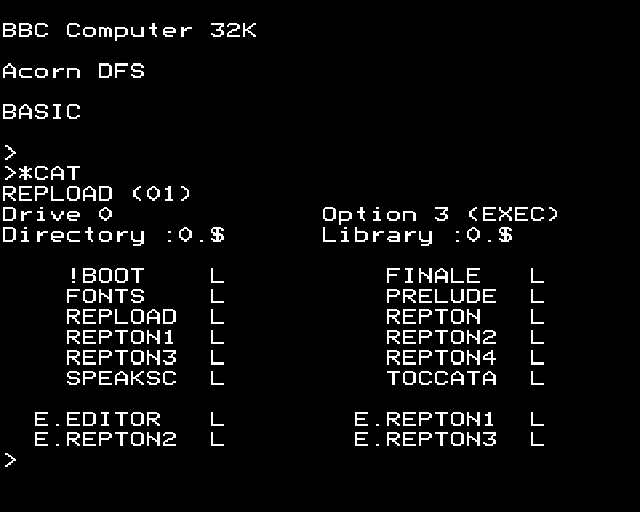
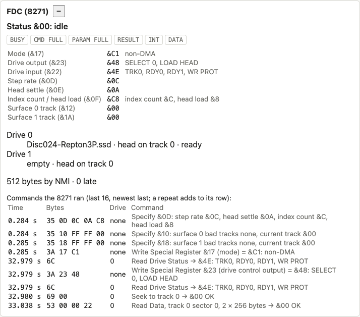
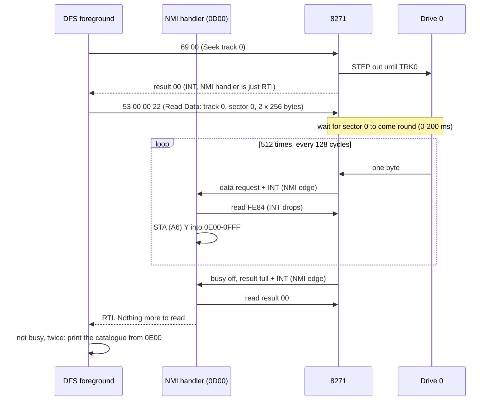
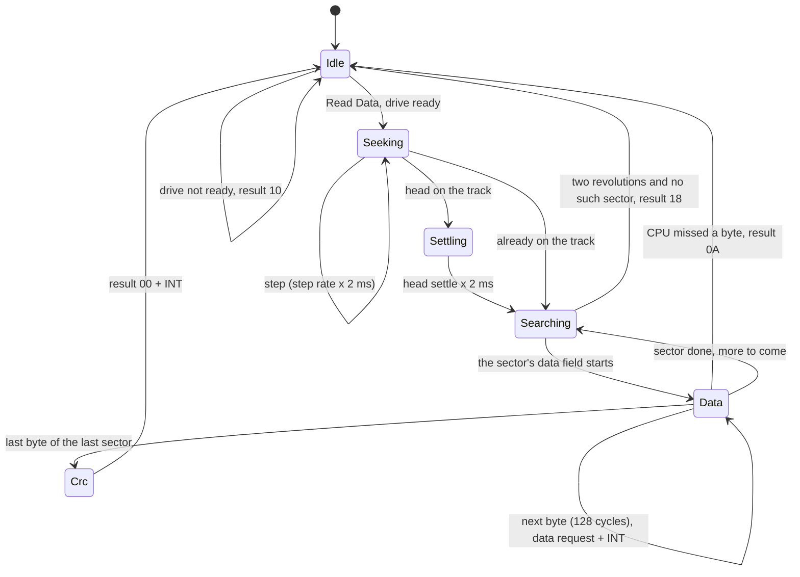
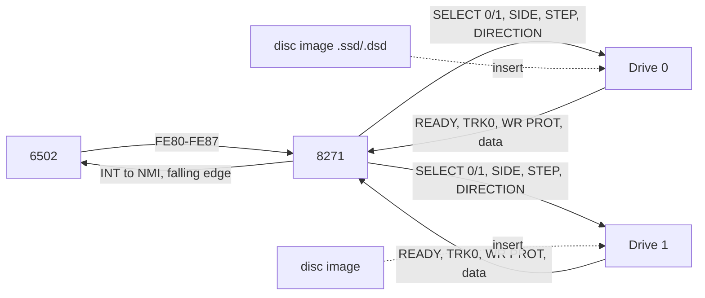

# Stage 50: 8271 data transfer & NMI

> **Part:** 11 (Disc) · **Branch:** `stage/50-fdc-data-nmi` · **Needs:** stage 49
> **Status:** done

## Goal

Stage 49 built the 8271's side of the conversation, but nothing was connected to it. This stage connects **a drive with a spinning disc**. The head steps between tracks, sectors come round under it, and each byte of a sector goes to the CPU **as its own NMI**. When it works, `*CAT` lists a real disc.

It comes now because everything it needs is in place. We have disc images and their geometry (Stage 47), the catalogue format (Stage 48, which now has to match what the real DFS prints), the 8271's command handshake (Stage 49), and the 6502's NMI (Stage 17), which has had nothing to drive it until now.

## What you can now see

You'll need `roms/os12.rom`, `roms/basic2.rom` and `roms/dfs.rom` (an 8271 DFS: DFS 0.98, as in Stage 49).

**In the browser:**

1. `npm run dev`, and open http://localhost:5173/?machine=mos.
2. In the **Disc** panel, choose (or drop anywhere on the page) an `.ssd` or `.dsd`. The panel shows its catalogue as before, and now also **Drive 0: *name*** with an **Eject** button. If you have no disc to hand, `npm run demo:disc -- make-disc` writes the Stage 48 test disc to `out/stage48.ssd`.
3. Click the screen and type `*CAT` (`*` is Shift + `'` on a PC keyboard), then Return. About a fifth of a second later, the real DFS prints the catalogue:



4. Open the **FDC (8271)** panel. The log ends with `69 00` (Seek to track 0 → `&00 OK`) and `53 00 00 22` (Read Data, track 0 sector 0, 2 × 256 bytes → `&00 OK`). Under the registers it says **`512 bytes by NMI · 0 late`**, and the drive input reads `&4E: TRK0, RDY0, RDY1, WR PROT`.



5. Click **Eject** and type `*CAT` again. You get Stage 49's behaviour: the DFS polls Read Drive Status (now `&02: TRK0`, the empty drive's head sensor) until you press Escape.

**In the terminal:**

```bash
npm run demo:dfs                                  # the Stage 48 test disc, built on the fly
npm run demo:dfs -- discs/Disc024-Repton3P.ssd    # or your own
```

It boots with the disc in drive 0, types `*CAT`, and steps the machine itself so it can time the read:

```
  │>*CAT                                   │
  │STAGE 48 (00)                           │
  │Drive 0             Option 3 (EXEC)     │
  │Directory :0.$      Library :0.$        │
  │                                        │
  │    !BOOT               EMPTY           │
  │    HELLO    L          README          │
  │                                        │
  │  E.DATA                                │
  │>                                       │

What the DFS asked the 8271 for:
  6C              Read Drive Status → &4E: TRK0, RDY0, RDY1, WR PROT
  3A 23 48        Write Special Register &23 (drive control output) = &48: SELECT 0, LOAD HEAD
  6C              Read Drive Status → &4E: TRK0, RDY0, RDY1, WR PROT
  69 00           Seek to track 0 → &00 OK
  53 00 00 22     Read Data, track 0 sector 0, 2 × 256 bytes → &00 OK

The read, measured (one byte every 128 cycles = 64 µs):
  Read Data sent → first byte:   1.1 ms  (waiting for sector 0 to come round)
  first byte → last byte:        36.3 ms  (512 bytes)
  last byte → result &00 + INT:  0.1 ms  (the CRC)
  NMIs taken:                    513  (one per byte, and one more at the end)
  cycles in the NMI handler:     39,535, about 77 per NMI
  so while the bytes came, the CPU spent 54% of its time in &0D00.
  late bytes: 0
```

Compare it with Stage 49. Read Drive Status now says `&4E`, so RDY0 is up, and the DFS gets on with it. 36.3 ms for 512 bytes is two sectors of 16.4 ms each, plus the gap between them. The wait for sector 0 is short here only because the boot is deterministic: the disc happens to be just before sector 0 when `*CAT` starts. 513 NMIs is one per byte plus the "finished" one.

## The real hardware

### The drive

A Model B drive is a 5¼" **single-density** floppy drive on a Shugart-style ribbon cable. As far as the 8271 is concerned, it has:

- **A spindle motor**, turning the disc at **300 rpm**: one revolution every **200 ms**, which is **400,000 CPU cycles** at 2 MHz.
- **A head on a stepper motor.** Each pulse on the STEP line moves it one track, in or out according to the DIRECTION line. There are 40 or 80 track positions. A sensor raises the **TRK0** line when the head is at the outermost track.
- **An index hole** in the disc, seen once a revolution. It is the "start" of every track.
- **A READY line**, raised once a disc is in and spinning.
- **A WRITE PROTECT line**, set by the notch in the disc's sleeve.

On the cable, only the **selected** drive drives these lines. The 8271's SELECT 0/SELECT 1 outputs pick the drive (Stage 49's output port bits 6 and 7).

### What's on a track

The Stage 47 image files hold only the 256-byte data of each sector. A real track also has an **ID field** in front of each sector, which is how the controller knows which sector is passing:

```
 index                                                                  index
 hole                                                                   hole
  │  ID 0      data 0            ID 1      data 1                         │
  ▼ ┌───────┐ ┌─────────────────┐ ┌───────┐ ┌─────────────────┐            ▼
 ───┤T S n z├─┤ 256 bytes + CRC ├─┤T S n z├─┤ 256 bytes + CRC ├─ ...  ID 9 ─
    └───────┘ └─────────────────┘ └───────┘ └─────────────────┘
       gap          gap              gap          gap
```

An ID field is four bytes, **track, side (head), sector, size code**, then a 2-byte CRC. On an Acorn DFS disc that is, for example, `&00 &00 &03 &01` for track 0, sector 3, with size code 1 (128 × 2¹ = 256 bytes). The data field follows after a short gap.

### How fast the bytes come

Single density is **FM** recording at 125,000 data bits a second. Eight bits take **64 µs**, so a new byte arrives under the head every **128 CPU cycles**, whether or not anyone is ready for it.

A whole track, gaps and all, is 200 ms ÷ 64 µs = **3,125 byte times**. Acorn DFS fits 10 sectors of 256 bytes (2,560 bytes of data) into that, so each sector, with its ID and gaps, gets about **312 byte times**, which is **40,000 cycles** (20 ms).

### The 8271 in non-DMA mode

The 8271 was designed to hand its bytes to a **DMA controller**, a chip that writes them straight into memory. The BBC hasn't got one. Instead, DFS sets the mode register's bit 0 (`&C1`, Stage 49), which means **non-DMA**. In that mode, every byte goes through the CPU:

1. A byte comes off the disc. The 8271 puts it in its **data register** (`&FE84`), sets **status bit 2** (data request) and raises its **INT** pin (status bit 3).
2. On the BBC the INT pin drives the 6502's **/NMI** line. *(Advanced User Guide: the 8271 is the Model B's only NMI source. Econet is the other, and it is out of scope.)*
3. The CPU reads `&FE84`. That takes the byte, clears status bits 2 and 3, and lets INT go again.
4. 128 cycles later, the next byte arrives.

If the CPU hasn't taken a byte by the time the next one arrives, the 8271 gives up. The command ends with result **`&0A` "late DMA"**. The name still says DMA, but in non-DMA mode the late party is the CPU.

When the last byte has gone and the CRC has checked out, the 8271 drops **busy** (bit 7), puts the result in `&FE81` (bit 4), and raises **INT** once more. So the NMI handler gets **one more** NMI at the end, with bit 2 clear and bit 3 set: "the command has finished".

### Seek and implied seek

**Seek** (`&29`, one parameter: the track) moves the head. The 8271 remembers which track each drive's head is on (special registers `&12` and `&1A`, Stage 49) and gives as many STEP pulses as it takes. Seek to track 0 is special: the 8271 steps outwards **until the drive raises TRK0**, so it finds track 0 even if the register is wrong. DFS does this before reading the catalogue (`&8ABE`: Seek track 0, from its command table at `&8CE7`).

Each step waits the **step rate** time (special register `&0D`). After the last step it waits the **head settling** time (`&0E`). DFS 0.98 sets `&0C` and `&0A`. The data sheet gives these in 1 ms units for an 8" drive, and **2 ms** for a 5¼" (mini-floppy) drive, where the chip runs on half the clock. That makes **24 ms per step** and **20 ms to settle**. I haven't confirmed the 2 ms unit, or the BBC's clock to the 8271, against a second source.

The read commands have an **implied seek**: their first parameter is the track, and the 8271 goes there itself before it starts looking for the sector.

### Read Data

**Read Data** (`&13`) takes three parameters: **track**, **first sector**, and **size and count** packed in one byte (bits 7-5: size code, 128 × 2ⁿ bytes; bits 4-0: number of sectors). The 8271:

1. seeks to the track (implied seek);
2. reads IDs as they come round until it finds the one with the right track and sector;
3. reads that sector's data field, one data request per byte;
4. moves on to the next sector number, until `count` sectors are done;
5. ends with result `&00` and an interrupt.

If no matching ID comes round, it gives up with **`&18` "sector not found"**. The data sheet ties this to the index hole: the 8271 counts index pulses while it searches. I have taken **two revolutions**, which is my reading and not confirmed.

`&12` is the short form: one 128-byte record, with two parameters (track and sector). `&17`/`&16` (Read Data and Deleted Data) are the same, except that sectors marked "deleted" are read too. Disc images have no deleted marks.

**Verify** (`&1F`/`&1E`) reads in the same way and checks the CRCs, but **without** data requests. Nothing goes to the CPU.

**Read ID** (`&1B`: track, a `&00`, count) gives the CPU the next `count` **ID fields** to pass under the head, four data requests each. Copy-protection code uses it to look at a track's real layout.

## Key concepts

### 1. Why every disc byte is an NMI

The CPU has 128 cycles to take each byte, every time, for as long as the transfer lasts: 32,768 cycles for one sector. Two things on the BBC could get in the way:

- **`SEI`.** The MOS turns IRQs off all the time: through its whole IRQ handler, in parts of the VDU drivers, and around anything that mustn't be interrupted. An IRQ-driven disc would lose bytes whenever one of those ran for more than about 128 cycles.
- **Other IRQs.** If the 100 Hz timer's IRQ were being handled when a disc byte came, the disc would have to wait its turn.

The **NMI** ("non-maskable interrupt") gets past both. `SEI` doesn't stop it, and it interrupts an IRQ handler half way through. That is why Acorn wired the 8271's INT to /NMI: **missing a disc byte is the one thing on the machine that can't wait.**

The cost is that **nothing else** can safely use NMI. The NMI handler lives in RAM at `&0D00`, where the MOS's vector at `&FFFA` points. DFS copies a handler there before each transfer (its routine at `&98A0` picks one of several from a table at `&9988`).

### 2. DFS 0.98's NMI handler, byte by byte

For a read, DFS copies `&8D02`-`&8D4F` to `&0D00`. Once there, it reads:

```
&0D00  PHA            ; 3   save A and Y (the NMI saved P and PC)
&0D01  TYA            ; 2
&0D02  PHA            ; 3
&0D03  LDA &FE80      ; 4   status
&0D06  AND #&04       ; 2   bit 2: a data byte?
&0D08  BEQ done?      ; 2   no: go and see if the command has ended
&0D0A  LDA &FE84      ; 4   take the byte. INT drops, ready for the next edge
&0D0D  LDY &A5        ; 3   bytes still wanted? (&A3-&A5 count down)
&0D0F  BEQ exit       ;     no: throw it away (the rest of a part-sector)
       ...
&0D1B  STA (&A6),Y    ; 6   store it, then step the pointer &A6/&A7 on
       ...
&0D2D  PLA : TAY : PLA
&0D30  RTI            ; 6
```

From the edge on /NMI to the `LDA &FE84` is 7 cycles for the NMI sequence (Stage 17) plus about 20 more, so **27 cycles**. The whole handler is about **77 cycles** (measured by `demo:dfs`). With a byte every 128, the CPU spends **over half its time** in this handler during a transfer. That's why the BBC feels frozen while it reads a disc: it more or less is.

The other half of the handler, at `&0D31`, runs when bit 2 is clear and bit 3 is set: the command has finished. It reads the result (`&8BF9` → `&8C8E`). If the result is `&00` and more sectors are wanted, it **sends the next Read Data from inside the NMI**: track + 1, sector 0. So a long `*LOAD` is a chain of commands, one track at a time, with no help from the foreground. The foreground code (`&98DA` → `&8C95`) just waits for "not busy".

It looks for "not busy" **twice in a row** (`&8C96` and `&8C9B`). Between one command's last NMI and the next command being sent, the 8271 really is briefly not busy. A single look could catch that moment and think the whole load was over.

### 3. Edges, not levels

The 6502's /NMI reacts to a **falling edge**, not to a low level (Stage 17). A held-down NMI fires once. So every byte has to be a fresh edge:

```
  byte ready          CPU reads &FE84           next byte ready
       │                     │                        │
INT  ──┘‾‾‾‾‾‾‾‾‾‾‾‾‾‾‾‾‾‾‾‾‾└────────────────────────┘‾‾‾‾‾‾‾
/NMI ‾‾┐_____________________┌────────────────────────┐_______
       ▲ edge: NMI #1                                 ▲ edge: NMI #2
```

Reading the data register is what lets INT fall, so that the next byte can make a new edge. A handler that forgets to read `&FE84` gets no more NMIs. What it gets instead is a late DMA.

### 4. Time matters now

Every Stage 49 command ran the moment its last parameter arrived. A disc read can't work like that. It takes as long as the head takes to move and the sector takes to come round:

| Step | Cycles | Real time |
|---|---|---|
| Seek, per track | 48,000 | 24 ms (`&0C` × 2 ms) |
| Head settling | 40,000 | 20 ms (`&0A` × 2 ms) |
| Waiting for the sector | 0-400,000 | 0-200 ms (100 ms on average) |
| One sector's data | 32,768 | 16.4 ms (256 × 64 µs) |

So the 8271 has to **tick** now, like the VIAs. It counts down to its next event: the next step, the sector arriving, the next byte. When nothing is happening, the tick returns at once.

The disc's **rotation** is just a clock: where the disc is now is `cycles mod 400,000`. Sector *n*'s ID field starts at *n* × 40,000 cycles from the index hole. To wait for sector 3, work out how far it is from where the disc is now.

### 5. Ready, and the one READY wire

DFS 0.98 sends Read Drive Status and tests **bit 2** (RDY0), **for either drive** (`&8B89`: `AND #&04`, after `&6C` or `&AC`). If drive 1 used its own RDY1 input (bit 6), DFS would never see drive 1 ready. So on the BBC the cable's one READY line, driven by whichever drive is selected, must reach both inputs. We model it that way: the **selected** drive's lines (READY, TRK0, WRITE PROTECT) appear in the input port, with READY on bits 2 **and** 6. That's my deduction from the ROM's code. I haven't checked it against the circuit diagram.

## Diagrams

`*CAT` with a disc in drive 0. These are the bus events DFS 0.98 causes (`&8ABE` onwards):



Where each sector is on the track, in CPU cycles from the index hole (our simplified layout):


The 8271 working through a Read Data, as we model it:



What's joined to what:



## Our design

- **`src/devices/disc-drive.ts`** adds `DiscDrive`, a passive drive:
  - It holds a `DiscImage | undefined` (`insert()`, `eject()`) and its own **head position** (0-79), which `step(±1)` moves.
  - It reports `ready` (a disc is in), `track0` (head at 0) and `writeProtected` (always true for now: images are read-only until Stage 51 decides about `SAVE`).
  - It holds the rotation constants: `CYCLES_PER_REVOLUTION = 400_000`, `CYCLES_PER_SECTOR = 40_000`, `CYCLES_PER_BYTE = 128`, and the data field's start in the sector, `DATA_FIELD_START = 2_048`.
  - There is **no motor spin-up** and **no head load**. A disc is ready the moment it's in.
- **`Fdc8271` changes:**
  - It becomes `Clocked`. It counts its own cycles, which give the disc's angle, and it counts down to its next event.
  - **Phases** (`as const` numbers): idle, seeking, settling, searching, data, CRC. Each `tick()` runs any events that are due, in a `while` loop, because one long instruction can cover more than one. Idle returns at once.
  - **Commands that need a drive** check READY on the drive their select bits name. Not ready gives `&10` at once, as before. Ready starts the phases.
  - **The data register** at offsets 4-7: reading it takes the byte and clears bits 2 and 3.
  - **Late DMA:** if a byte arrives while bit 2 is still set, the command ends with `&0A`.
  - **Write, Write Deleted and Format** on a ready drive end at once with **`&12` write protect**. That's true: our discs are read-only. DFS prints `Disc read only`. Scan isn't built, and still ends with `&10`.
  - **The input port** is worked out when asked: the selected drive's READY (bits 2 and 6), TRK0 and WRITE PROTECT. Commands with drive bits set copy them to the output port's SELECT bits. Specify and Write Special Register (drive bits `00`) leave them alone.
  - The log entry is written when a command **finishes**, so it has its result. Its time is the finishing time.
  - Counters for the panel: `bytesTransferred` (data requests taken by the CPU) and `lateBytes`.
- **The machine** gets `drives: readonly [DiscDrive, DiscDrive]`, `insertDisc(drive, image)` and `ejectDisc(drive)`. The 8271 is ticked with the other devices (called directly, not from the device list: see Gotchas). After every tick, the machine copies the 8271's INT to the CPU's /NMI with `cpu.setNmi(level)`, and the CPU's edge latch (Stage 17) does the rest. Power-on doesn't move the heads. A real head stays where it was when the power went off.
- **The DFS ROM in a slot** was done in Stage 49 (slot 14, from `loadStandardRoms`). Nothing to add.
- **The Disc panel** (Stage 48) now puts the disc it shows into drive 0, with an **Eject** button. The **FDC panel** gains the two drives (disc, head track), the phase of a busy command (`busy, waiting for the sector to come round`), and the count of bytes that came by NMI.
- **`npm run demo:dfs [file]`** for the terminal.
- **No allocation in the hot path.** Each sector's bytes are read one at a time from the image with a new `DiscImage.byteAt(offset)`. `readSector()` would make a new array every sector, inside `tick()`.

Alternatives considered:

- **Copying the sector into memory in one go**, with no NMIs ("high-level emulation" of the transfer). It would be faster and simpler, but it's not what the DFS's code expects. It would skip this stage's whole lesson, and break any program with its own NMI handler.
- **Instant seeks and no rotation.** Timing doesn't change what is read, but it does change how it feels: `*CAT` takes about a fifth of a second on a real machine. Some copy protection also times the disc. Keeping a simple rotation costs one subtraction per tick.
- **Real gap and sync bytes** (an exact FM track layout). Not needed for DFS: our fixed slot of 40,000 cycles per sector is close enough to the real 312 byte times. We say so.

## Code walkthrough

- [`src/devices/disc-drive.ts`](../../src/devices/disc-drive.ts): the drive. Most of it is the timing constants and `cyclesUntil(now, point)`, which is all "rotation" is. `sectorOffset(side, sector)` answers "is that sector on the track under the head, and where is it in the image?" with `-1` for no, so nothing throws or allocates inside a tick.
- [`src/devices/fdc8271.ts`](../../src/devices/fdc8271.ts): the chip.
  - **`tick()`** adds the cycles to `clock` (the disc's angle). If a command is running, it counts down and runs every event that's due, in a `while`. `countdown` can go negative: `clock + countdown` is exactly when the event was due. Every wait is added from that moment, not from "now", so time never drifts.
  - **`runDriveCommand()`** checks READY on the selected drive, then calls `start()` with what to do. Write and Format on a ready drive end at once with `&12`.
  - **`start()`** is the implied seek. It works out the steps from the current-track register, or for track 0 sets `stepsLeft = -1`, meaning "until TRK0".
  - **`event()`** is the state machine, one `case` per phase. `stepEvent()` moves the head one track. `search()` finds how far away the sector is, or schedules the two-revolution give-up. `dataEvent()` and `idEvent()` hand over a byte with `offerByte()`, which sets status bits 2 and 3 (the NMI's edge), or call `lateByte()` if the last one is still there.
  - **`read()`** at offsets 4-7 is the data register. Reading it clears bits 2 and 3, and that's the only thing that lets INT fall.
  - **`finish()`** sets result full + INT and logs the command, with its result.
- [`src/machine/bbc-model-b.ts`](../../src/machine/bbc-model-b.ts): `drives`, `insertDisc`/`ejectDisc`. In `tick()`: `this.fdc.tick(cycles)`, then `this.cpu.setNmi(this.fdc.interruptRequest)`. That one line is the wire from INT to /NMI. The CPU's existing edge latch (Stage 17) turns each rising INT into one NMI.
- [`src/disc/disc-image.ts`](../../src/disc/disc-image.ts): `byteAt(offset)` (no copy) and the image's `name`.
- [`src/disc/dfs-text.ts`](../../src/disc/dfs-text.ts): the `*CAT` imitation, corrected to what the real ROM prints (see Gotchas).
- [`src/web/workbench/disc-panel.ts`](../../src/web/workbench/disc-panel.ts), [`fdc-view-model.ts`](../../src/web/workbench/fdc-view-model.ts), [`fdc-panel.ts`](../../src/web/workbench/fdc-panel.ts): insert/eject, the drives and the NMI count.
- [`scripts/demo-dfs.ts`](../../scripts/demo-dfs.ts): it steps the machine itself so it can see each NMI (`m.pendingInterrupt === 'nmi'` before a step) and add up the cycles spent at `&0D00`-`&0D4F`.

## Tests

| Test file | What it proves |
|---|---|
| `src/devices/disc-drive.test.ts` | 300 rpm = 400,000 cycles; 128 cycles a byte; ten 40,000-cycle slots with room for the data; `cyclesUntil` wraps at the index hole. READY and WRITE PROTECT with and without a disc; TRK0; stepping and the end stops; the head stays put across a disc change; `sectorOffset` for real and missing sectors, and both sides of a `.dsd`. |
| `src/devices/fdc8271-data.test.ts` | Read Drive Status gives the selected drive's lines (`&4E`, READY on bits 2 and 6); command drive bits select, Specify/WSR don't. Seek takes steps × 24 ms + 20 ms, steps one track at a time, takes no time to the current track, finds TRK0 when the register is wrong, keeps drive 1's track in `&1A`. Read Data: exactly the sector's bytes, status `&8C` → `&80` on reading `&FE84`, bytes 128 cycles apart, sector 3 at 3 × 40,000 + 2,048 cycles, a just-missed sector costs a revolution, `&22` reads 512 bytes, implied seek, `&52` is 128 bytes, `&57` reads like `&53`, side 1 through output bit 5. Errors: late DMA `&0A`, sector 10 → `&18` after two revolutions, track past the end, wrong-track IDs, side 1 of an `.ssd`, reset mid-read, Write → `&12`. Verify (no data requests), Read ID (the next three IDs after an implied seek). Logged at the end, with the result. |
| `src/machine/disc-nmi.test.ts` | **No ROMs:** our own 6502 program and NMI handler at `&0D00` read a sector into `&3000` through real NMIs; it still works after `SEI`; a handler that doesn't read `&FE84` gets `&0A`; INT sets the CPU's NMI latch and the next step goes to `&0D00`. **With the ROMs:** `*CAT` of the test disc prints exactly what `dfs-text` imitates; the DFS sends Seek 0 and `53 00 00 22`, 512 bytes, none late. |
| `src/disc/dfs-text.test.ts`, `src/disc/test-disc.test.ts` | The corrected `*CAT` layout, and no blank line when every file is in `$`. |
| `src/disc/disc-image.test.ts` | `byteAt` matches `readSector`, and reads `&00` outside the file. |
| `src/web/workbench/fdc-view-model.test.ts` | The phase words when busy, `&8C`'s chips, the drive rows, the NMI count. |
| `src/machine/fdc-wiring.test.ts` | Stage 49's tests: Read Drive Status with an empty drive is now `&02` (TRK0). |
| `e2e/disc-cat.spec.ts` | In the browser: choose the test disc, type `*CAT`, the screen shows the catalogue and the panel says `512 bytes by NMI · 0 late`; after Eject, `*CAT` polls again. Real-time project; skips without the three ROMs. |
| `e2e/disc-panel.spec.ts`, `e2e/fdc-panel.spec.ts` | Updated for the corrected `*CAT` spacing and `&02`. |

The ROM tests skip (with the missing file named) if `os12.rom`, `basic2.rom` or `dfs.rom` is absent.

Totals: 3,186 Jest tests (62 new), and 161 Playwright tests (2 new).

## Gotchas & hardware quirks

- **The `*CAT` imitation was wrong in two places.** This stage settles the Stage 48 parking-lot question by running the real ROM on four discs:
  - DFS 0.98 puts `L` **two** spaces after the 7-character name (column 13, not 12).
  - It prints the other directories as **their own group after a blank line**, starting a new row even if the last `$` row has only one file.

  The ROM wins, so `dfs-text.ts` changed, along with its tests and the Disc panel's e2e.
- **An empty drive isn't "nothing".** Its head sensor still raises TRK0, so Read Drive Status with no disc is `&02`, not Stage 49's `&00`. DFS only looks at bit 2, so it doesn't care.
- **Seek to track 0 is a different command in disguise.** It steps until TRK0 and ignores the current-track register. That's what makes it the "restore" DFS does before reading the catalogue. The implied seek of a Read Data to track 0 does the same, in our model.
- **Reading `&FE84` is what re-arms the NMI.** The 6502's NMI is edge-triggered. If the handler doesn't read the data register, INT stays high, so there's no new edge and no new NMI. The next byte then arrives with the old one still there: late DMA. The `RTI`-only handler test shows exactly this.
- **The 6502 can't count NMI "levels".** DFS's completion path (`&0D31` onwards) sends the next Read Data and does a `CLI` **inside** the NMI handler. That's safe only because the next byte's NMI is at least a seek and a sector-wait away.
- **Performance: a fifth class in one call site cost 20%.** First, the 8271 joined the machine's `clocked` list. The whole emulator went from 7.1× to 5.7× real time, though the idle `tick()` is one addition and one comparison. The cause is V8's inline caches. The loop's `devices[i].tick()` call had seen four classes (Via6522, Crtc6845, Keyboard, Sn76489), and a fifth made it **megamorphic**: every call through it now takes a slow generic lookup. Calling `this.fdc.tick()` directly got it back to 6.7-7.0×. *(This is my explanation of a measured effect. I didn't confirm it with V8's tracing flags.)*
- **Our choices, unconfirmed:**
  - 2 ms units for step rate and settling.
  - Two revolutions before "sector not found".
  - A count of 0 finishes at once with `&00`.
  - ID fields carry head `0` on both sides.
  - Scan still answers `&10`.
  - One READY wire on both RDY0 and RDY1.
  - Command drive bits copied to the SELECT lines.
  - No motor spin-up or head-load time.
  - A fixed 40,000-cycle sector slot with the data field 2,048 cycles in.

  None of these change what DFS 0.98 reads.
- **Not modelled:** writing (write commands give `&12`; Stage 51 decides about `SAVE`), the INDEX line, bad-track renumbering, deleted-data marks, sector sizes other than 128 and 256 (longer reads give `&00` past byte 256), DMA mode (we always behave as non-DMA; DFS sets non-DMA anyway).

## Playwright verification

- Interactive (Playwright MCP): `/?machine=mos`, chose `discs/Disc024-Repton3P.ssd` in the Disc panel, typed `*CAT` with keys held 60 ms (a `press` is too quick for the key matrix to see). The screen showed the full Repton 3 catalogue (screenshot above), and the FDC panel said `512 bytes by NMI · 0 late` with `53 00 00 22 → &00 OK` last.
- Durable: `e2e/disc-cat.spec.ts` (2 tests, real-time project) as listed above. The whole suite passes: 161 tests.

## Check your understanding

1. Why did Acorn wire the 8271's INT to **NMI** rather than IRQ? Name two things on a running BBC that would make an IRQ-driven disc lose bytes.
2. A sector's data arrives at one byte per 128 cycles, and DFS's handler takes about 77 cycles per NMI. What fraction of the CPU is left for everything else while a sector is coming in? What happens if the handler gets longer than 128 cycles?
3. The 6502's NMI is edge-triggered. What, exactly, makes INT fall between two bytes, so that the next byte can make a new edge? What does the 8271 report if that never happens?
4. DFS checks "not busy" **twice in a row** while it waits for a multi-track load. What moment is the second look there to avoid?
5. `*CAT` sends `53 00 00 22`. Decode all four bytes. Then explain why the data arrived **about 36 ms** after the first byte, not 32.8 ms (512 × 64 µs).

<details>
<summary>Answers</summary>

1. NMI can't be masked, and it interrupts an IRQ handler. With IRQ, any `SEI` stretch longer than about 128 cycles would lose a byte, and so would being part-way through another IRQ (the 100 Hz timer, the keyboard, vsync). The MOS does both all the time. The disc is the one thing that can't wait.
2. 77 of every 128 cycles is about 60% of each byte's time. Measured over the whole transfer, gaps included, it's 54%, which leaves roughly half for the foreground. If the handler took longer than 128 cycles, the next byte would arrive before the CPU had taken the last one, and the 8271 would end with `&0A` late DMA. In practice the handler would never be re-entered in time.
3. Reading the data register `&FE84`. It clears status bit 2 (data request) and bit 3 (INT), so INT falls. When the next byte arrives, INT rises again, and that's a new edge on /NMI. If nobody reads it, the next byte finds bit 2 still set, and the command ends with `&0A`.
4. When one command's final NMI arrives, the 8271 really is not busy: the result is waiting, and the NMI handler is about to send the next track's Read Data. A foreground loop that looked at exactly that moment would think the whole load had finished. Looking twice makes it much less likely to be caught between commands.
5. `&53` = `&40` (drive 0) + `&13` (Read Data, multi-record). `&00` = track 0. `&00` = sector 0. `&22` = size code 1 (bits 7-5 = `001`, 256 bytes) and count 2 (bits 4-0). The two sectors are 16.4 ms each of data, but sector 1's data field doesn't start the moment sector 0's ends. In between come sector 0's CRC, a gap, sector 1's ID field and another gap: in our layout, 40,000 − 32,768 cycles = 3.6 ms. That makes 16.4 + 3.6 + 16.4 = 36.4 ms, and the demo measured 36.3 ms (first byte to last).

</details>

## Further reading

- *Intel 8271 Programmable Floppy Disk Controller* data sheet: the command table, non-DMA mode, the result codes, and the step-rate and settle units.
- *BBC Microcomputer Advanced User Guide*: the NMI vector at `&0D00` and the SHEILA map (`&FE80`).
- Stardot, "8271 de-cap" thread: the special register map.
- BeebWiki, "Acorn DFS disc format": the catalogue (Stage 48) and the 10 × 256 single-density layout.
- Stage 17's doc: the 6502's NMI edge latch, which this stage finally drives from a real chip.
