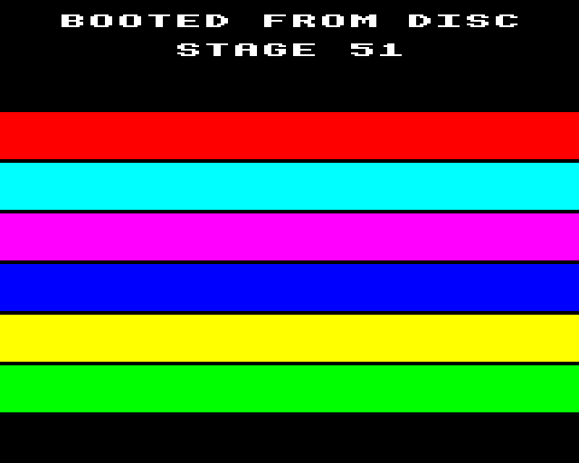
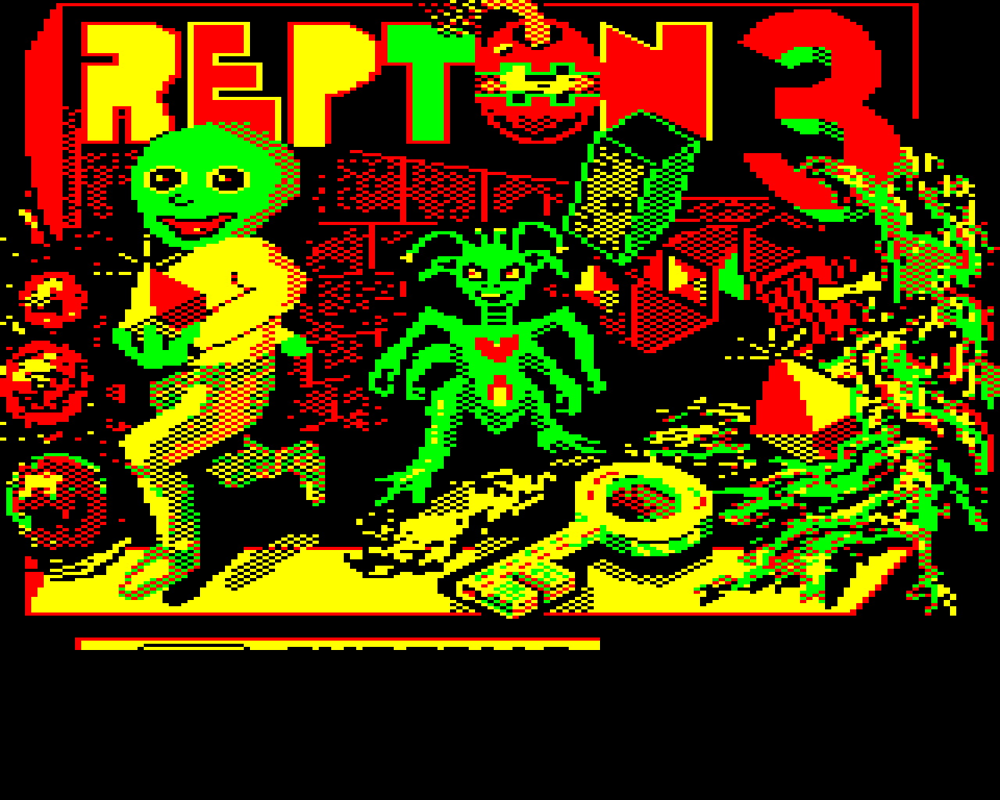
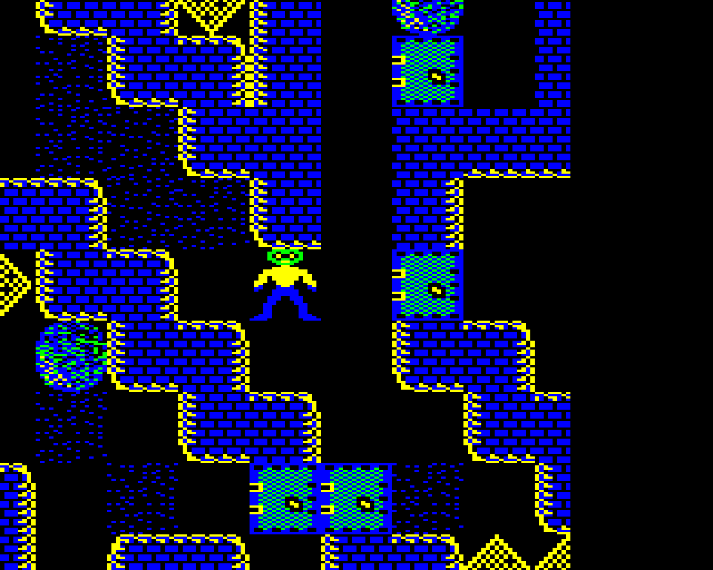
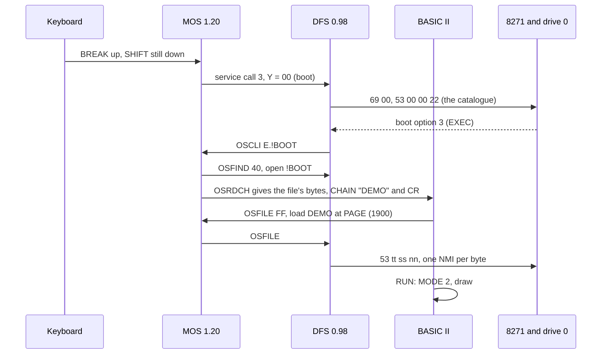
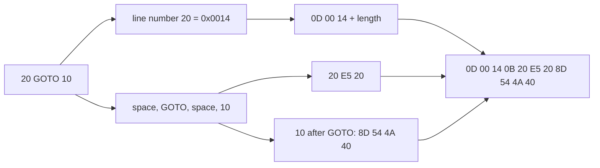
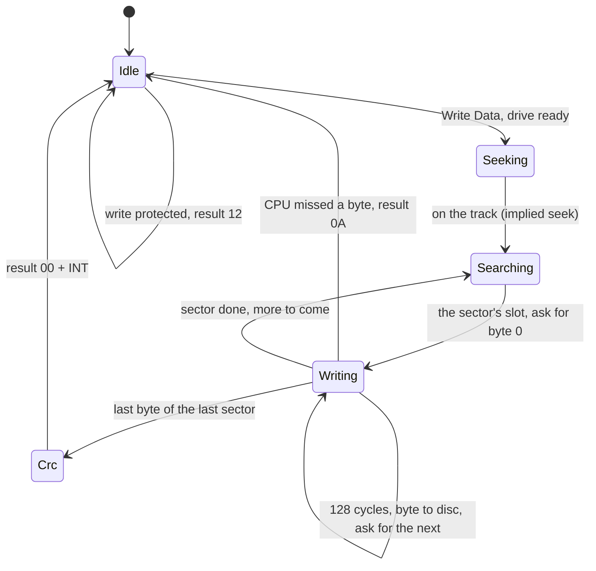

# Stage 51: Running software

> **Part:** 11 (Disc) · **Branch:** `stage/51-running-software` · **Needs:** stage 50
> **Status:** done

## Goal

Stage 50 got the first sector off a disc. This stage is the payoff: **software loads and runs from disc**. You can SHIFT-BREAK a disc and watch it boot, `CHAIN` a BASIC program, `*RUN` a machine-code program, and `SAVE` your own program back to the disc, then download the changed disc.

Most of the loading already works, because the real DFS ROM does the work and Stage 50 gave it a disc to read. This stage adds three things:

- **Writing.** The 8271's Write Data command, and disc images that can change.
- **A disc made of real software.** A BASIC program needs to be *tokenised* before `CHAIN` can run it, so we write a small BASIC II tokeniser, checked byte for byte against the real ROM.
- **The drive UI.** Two drives, insert, eject, write protect, download, a blank disc, a demo disc, and a SHIFT-BREAK button.

## What you can now see

You'll need `roms/os12.rom`, `roms/basic2.rom` and `roms/dfs.rom` (DFS 0.98, as in Stages 49-50).

**In the browser, the demo disc:**

1. `npm run dev`, and open http://localhost:5173/?machine=mos.
2. In the **Disc** panel, click **Demo disc**. Drive 0 now holds `demo.ssd`, and the panel shows its catalogue: `STAGE 51 (00)`, option 3 (EXEC), with `!BOOT`, `DEMO`, `GREET` and `HELLO`.
3. Click **SHIFT-BREAK** (or hold Shift and press F12 with the screen focused). About a second later:



   The bands change colour every few frames: the BASIC program is running, cycling the palette with `VDU 19`. Press Escape to stop it, then try `*RUN HELLO` and `CHAIN "GREET"`.

**In the browser, a real game.** Choose (or drop) a disc of your own, e.g. `discs/Disc024-Repton3P.ssd`, and click **SHIFT-BREAK**. Repton 3 boots: its instructions in MODE 7, then (after Space a few times) its loading picture, then the game, which you can play with the keyboard. The FDC panel counted **44,288 bytes by NMI · 0 late** by the time the game was on screen.

 

**In the browser, SAVE:**

1. Click **Blank disc**. Click the screen and type `10 PRINT "SAVED"`, Return, then `SAVE "PROG"`, Return.
2. The catalogue redraws at once: `BLANK (01)` (the cycle number went up) with `PROG` in it. Drive 0's row says `changed: 768 bytes written` and **Download** is enabled. It saves `blank.ssd`, 204,800 bytes, with your program on it.
3. Type `NEW`, then `CHAIN "PROG"`. It prints `SAVED`, read back from the disc.
4. Tick **Write protect** and `SAVE` again: `Disk read only`.

**In the terminal:**

```bash
npm run demo:software
```

It tokenises three lines of BASIC, writes the demo disc to `out/demo51.ssd`, and then runs `*RUN HELLO`, `CHAIN "GREET"`, SHIFT-BREAK and a `SAVE` on the real ROMs:

```
1. A line of BASIC, tokenised as BASIC II keeps it at PAGE:

   10 PRINT "HI"            0D 00 0A 0B 20 F1 20 22 48 49 22
   20 GOTO 10               0D 00 14 0B 20 E5 20 8D 54 4A 40
   30 X=TOP:TIME=0:A=TIME   0D 00 1E 11 20 58 3D B8 50 3A D1 3D 30 3A 41 3D 91
...
3. Booted with the disc in drive 0. Typing *RUN HELLO and CHAIN "GREET":

   │>*RUN HELLO                             │
   │HELLO FROM DISC                         │
   │>CHAIN "GREET"                          │
   │HELLO FROM BASIC ON DISC                │
   │         1 TIMES 7 IS 7                 │
   │         2 TIMES 7 IS 14                │
   │         3 TIMES 7 IS 21                │
   │>                                       │

4. SHIFT-BREAK. The DFS reads the catalogue, sees boot option 3 and *EXECs !BOOT:
   53 00 00 22   Read Data, track 0 sector 0, 2 × 256 bytes → &00 OK
   53 00 02 21   Read Data, track 0 sector 2, 1 × 256 bytes → &00 OK
   53 00 03 22   Read Data, track 0 sector 3, 2 × 256 bytes → &00 OK
   Video ULA control now &F4: MODE 2. DEMO is running
   logical colour 1's palette entry: &4, half a second later &5 (the colours turn)

5. SAVE to a blank disc:

   69 00         Seek to track 0 → &00 OK
   53 00 00 22   Read Data, track 0 sector 0, 2 × 256 bytes → &00 OK
   69 00         Seek to track 0 → &00 OK
   5F 00 08 22   Verify Data and Deleted Data, track 0 sector 8, 2 × 256 bytes → &00 OK
   4B 00 00 22   Write Data, track 0 sector 0, 2 × 256 bytes → &00 OK
   4B 00 02 21   Write Data, track 0 sector 2, 1 × 256 bytes → &00 OK
   768 bytes written, by 1280 NMIs in all (reads too), 0 late.

   BLANK (01)
   ...
       PROG
   $.PROG       FF1900 FF8023 00001B 002

   NEW, then CHAIN "PROG":
   │>CHAIN "PROG"                           │
   │SAVED AND LOADED                        │
```

In step 4, the three reads are the catalogue, `!BOOT` (sector 2), and `DEMO` (sectors 3-4), which `CHAIN` loaded. In step 5, 768 bytes is three sectors: the two catalogue sectors and the program's one.

## The real hardware

There's no new chip in this stage. Every new behaviour lives in code that already exists: the MOS, BASIC and the DFS ROM. The hardware question is only **writing**.

### Writing a sector

**Write Data** (`&0B`, or `&4B` for drive 0) is Read Data run backwards. It takes the same three parameters (track, first sector, size and count), seeks the same way, and waits for the same ID field to come round. Then the 8271 needs a byte every **128 cycles** to put on the disc, and in non-DMA mode it asks the CPU for each one:

1. The 8271 sets **status bit 2** (data request) and raises **INT** (bit 3). On the BBC that's /NMI (Stage 50).
2. The NMI handler **writes** the next byte to the data register `&FE84`. That clears bits 2 and 3, and INT falls.
3. 128 cycles later the 8271 writes that byte to the disc, and asks for the next one.

If a byte isn't there in time, the 8271 can't wait: the disc is moving. It ends the command with **`&0A` late DMA**, as a read does.

`&0A` (`Write Data` of one 128-byte record) is the short form, as `&12` is for reads. **Write Deleted Data** (`&0F`/`&0E`) writes a sector with a "deleted" mark in front of its data. Disc image files have nowhere to keep that mark.

*(Intel 8271 data sheet: command summary and non-DMA operation. The data sheet doesn't say exactly how far ahead of the data field the first request comes. We ask for the first byte when the data field's slot starts, so the CPU has 128 cycles to supply it, as it does for every other byte.)*

### The write protect notch

A 5¼" disc has a notch cut in the side of its sleeve. Cover the notch with a sticky tab and the drive's **WRITE PROTECT** line goes high. Then the 8271 refuses every write: it ends the command at once with **`&12` write protected**, and DFS 0.98 prints `Disk read only` (with a k: that's what the ROM says). Stage 50 made every disc write protected. This stage makes it a switch on each drive.

## Key concepts

### 1. What `*RUN`, `CHAIN` and `*EXEC` do

They all start by finding a file in the catalogue (Stage 48), and they all load it with Read Data commands (Stage 50). They differ in **where the bytes go** and **what happens next**.

| Command | Who handles it | Where the file goes | Then |
|---|---|---|---|
| `*RUN HELLO` | DFS, through OSCLI | its own **load address** (`&1900` for HELLO) | `JMP` to its **execution address** |
| `*LOAD HELLO` | DFS | its own load address | back to the prompt |
| `CHAIN "PROG"` | BASIC, through **OSFILE `&FF`** | **PAGE**, whatever the file's load address says | BASIC `RUN`s it |
| `*EXEC !BOOT` | MOS + DFS, through **OSFIND `&40`** | nowhere: it's opened as a stream | its bytes are typed in, as if from the keyboard |

We watched each of these in the emulator, at the OS entry points:

```
CHAIN "HELLO"   OSFILE A=&FF block &0037: name at &0600, load &FFFF1900, byte 6 = &00
*RUN HELLO      OSCLI "*RUN HELLO"
*EXEC !BOOT     OSCLI "*EXEC !BOOT", OSFIND A=&40 (open for input) ... OSFIND A=&00 (close)
```

**OSFILE `&FF`** is "load a whole file" (Advanced User Guide, OSFILE). Its control block holds a load address, and byte 6 (the low byte of the execution address) decides who wins. `&00` means "use the address in this block". Anything else means "use the file's own load address". BASIC puts **PAGE** in the block (`&1900` here: the DFS moves PAGE up from `&0E00` to make room for its workspace) and a `&00` in byte 6. So `CHAIN` loads every BASIC program at PAGE, whatever was in its catalogue entry.

The **`&FFFF`** at the top of `&FFFF1900` means "in the I/O processor": the BBC itself, not a second processor across the Tube (Stage 48). That's why the DFS `*INFO` line reads `FF1900`.

**`*EXEC`** works through the MOS's input stream. While an EXEC file is open, **OSRDCH** (read a character) takes the next byte from the file instead of the keyboard. So `!BOOT`'s text, `*RUN HELLO` and a CR, arrives at BASIC's prompt as though someone typed it. At the end of the file, the MOS closes it and the keyboard takes over again.

### 2. SHIFT-BREAK and `!BOOT`

When the BREAK key comes back up, the MOS restarts (Stage 23). Late in the restart it asks every sideways ROM, "anyone want to boot?". That's **service call 3** (Advanced User Guide, paged ROM service calls). The Y register says whether to:

```
BREAK         service 3: Y = &08     no boot
SHIFT-BREAK   service 3: Y = &00     boot!     (measured, all start-up links open: &028F = &FF)
```

The MOS works out Y from the SHIFT key and **bit 3 of the start-up options** (`&028F`, the keyboard links of Stage 28). With the link open, as ours is, SHIFT means boot. Close that link and the sense flips: plain BREAK boots, and SHIFT-BREAK doesn't. Some schools' machines were set up that way.

DFS answers service 3 by reading the catalogue and looking at the **boot option**, bits 4-5 of byte `&106` (Stage 48):

| Option | `*OPT 4,n` | SHIFT-BREAK does |
|---|---|---|
| 0 | none | nothing |
| 1 | LOAD | `*LOAD !BOOT` |
| 2 | RUN | `*RUN !BOOT` |
| 3 | EXEC | `*EXEC !BOOT` |

The Stage 48 test disc has option 3. In the emulator, DFS 0.98 then called `OSCLI "E.!BOOT"`: that's `*EXEC !BOOT`, abbreviated. The 8271 log for the whole boot is:

```
69 00          Seek to track 0                    the catalogue
53 00 00 22    Read Data, track 0 sector 0, 2 × 256 bytes
53 00 02 21    Read Data, track 0 sector 2, 1 × 256 bytes   !BOOT, read by *EXEC
53 00 03 21    Read Data, track 0 sector 3, 1 × 256 bytes   HELLO, read by *RUN HELLO
```

Almost every commercial BBC disc boots like this. Repton 3's `!BOOT` is a short EXEC file that `CHAIN`s a loader. The loader `*RUN`s the game.

### 3. A BASIC program on disc is tokenised

When you type `10 PRINT "HI"`, BASIC doesn't keep those letters. It **tokenises** the line: every keyword becomes one byte, `&80` or above. Then it stores the line in memory from **PAGE** onwards. `SAVE` writes that memory to disc as it is, and `CHAIN` loads it back as it is. So a BASIC file on disc is tokenised, and to put one on our test disc, we have to tokenise it ourselves.

This is what the real BASIC II made of three lines (read from memory at PAGE in the emulator):

```
10 PRINT "HI"
20 GOTO 10
30 X=TOP:TIME=0:A=TIME

0D 00 0A 0B  20 F1 20 22 48 49 22              line 10, 11 bytes: " PRINT "HI""
0D 00 14 0B  20 E5 20 8D 54 4A 40              line 20, 11 bytes: " GOTO <10>"
0D 00 1E 11  20 58 3D B8 50 3A D1 3D 30 3A 41 3D 91     line 30
0D FF                                          the end of the program
```

**Each line** is `&0D`, the line number high byte then low byte (so **not** the 6502's usual low-first order), the **length of the whole line** including these four bytes, and then the text. The program ends with `&0D &FF`: a line number can't start with `&FF`, because the highest is 32767 (`&7FFF`). BASIC finds the next line by adding the length. That's why `GOTO` has to search from the start, a line at a time.

**Keywords** become one byte each: `PRINT` is `&F1`, `GOTO` `&E5`, `TO` `&B8`, `TIME` `&91`. We checked all 121 keywords against the ROM (Gotchas has the details). Everything else stays as ASCII: variable names, numbers, punctuation and the spaces.

Five rules make it more than a simple find-and-replace:

1. **Line numbers after `GOTO`, `GOSUB`, `THEN`, `ELSE` and `RESTORE`** (and the commands `TRACE`, `LIST`, `DELETE`, `RENUMBER` and `AUTO`) get a token of their own, `&8D`, and three bytes. That way `RENUMBER` can find them, and they're never mistaken for an ordinary number. The bytes are scrambled so that none of them is a control code or a `&0D`:

   ```
   byte 1 = ((lo AND &C0) DIV 4  OR  (hi AND &C0) DIV 16)  EOR &54
   byte 2 =  (lo AND &3F) OR &40
   byte 3 =  (hi AND &3F) OR &40
   ```

   For line 10 (`hi = &00`, `lo = &0A`), that's `&54 &4A &40`. For line 1000 (`&03E8`), it's `&64 &68 &43`. After a comma or a space, as in `ON X GOTO 10,20`, numbers are still line numbers. Anything else ends it: `GOTO (10)` is an expression, not a line number.

2. **Nothing is tokenised inside strings, after `REM` or `DATA`, after a `*` command, or after an `&`.** `PRINT "AND"` keeps its `A N D`, and `*RUN HELLO` doesn't turn `RUN` into `&F9`.

3. **Nothing is tokenised inside a variable name**, or in a `PROC`/`FN` name. `ZPRINT` is a variable. `PROCPRINT` is `&F2` followed by the letters `PRINT`.

4. **Some keywords are *conditional*.** If a letter or digit follows them, they aren't keywords. `TIMEQ` and `TIME2` are variables, but `PRINTQ` is `PRINT Q`. There are 30 conditional keywords, such as `TIME`, `PAGE`, `TRUE`, `END`, `CLS` and `RUN` (see Gotchas). The others can be run together with what follows, so BBC programmers could write `FORI=1TO9`.

   Watch for one surprise. `TO` isn't conditional, so `TOP` is `TO` (`&B8`) followed by the letter `P`. BASIC's expression code knows that `&B8` followed by `P` means TOP.

5. **The pseudo-variables `PTR`, `PAGE`, `TIME`, `LOMEM` and `HIMEM`** have **two** tokens. At the start of a statement they're being assigned to, so they get `&40` more: `TIME=0` is `&D1`, but `A=TIME` is `&91`. A statement starts at the start of a line, after a `:`, and after `THEN`, `ELSE` or `REPEAT`.

### 4. Why `SAVE` is a chain of writes

`SAVE "PROG"` is BASIC calling **OSFILE `&00`**, "save a block of memory", with PAGE as the start, TOP as the end, load address `&FFFF1900` and execution address `&FFFF8023`. That's BASIC's own entry point, so `*RUN PROG` would start BASIC. Then the DFS takes over. Here is what DFS 0.98 really asked the 8271 for, saving a 3-line program to a blank disc:

```
69 00          Seek to track 0
53 00 00 22    Read Data, track 0 sectors 0-1        the catalogue: is there room? same name?
69 00          Seek to track 0
5F 00 08 22    Verify, track 0 sectors 8-9           (see below)
4B 00 00 22    Write Data, track 0 sectors 0-1       the NEW catalogue, cycle number 00 → 01
4B 00 02 21    Write Data, track 0 sector 2          the program
```

Each written byte is an NMI, like each read byte. A longer `*SAVE` writes one Write Data per track, chained from inside the NMI handler as reads are (Stage 50): `4B 00 02 28`, `4B 01 00 2A`, `4B 02 00 2A`, `4B 03 00 24` for `*SAVE BIG 3000 5000`.

I expected the data to go first and the catalogue last, so that a power cut half way through would leave the old catalogue. **DFS 0.98 does it the other way round**: catalogue first. A cut after that would leave a catalogue entry pointing at sectors of rubbish.

The **Verify of sectors 8-9** comes before every save, whatever the file's size or position. I don't know why. My guess is that it's a check that the disc is formatted and readable before anything is written to it, but I haven't read the ROM code to confirm. It's in the parking lot.

### 5. Where the changes go

An emulated disc is a `Uint8Array` in the browser's memory. When DFS writes a sector, our image changes. The `.ssd` file you chose doesn't. Browsers can't write to a file you chose. That's deliberate: a web page shouldn't be able to change files on your computer. So a changed disc gets a **Download** button, and what you do with the new file is up to you.

## Diagrams

Booting the demo disc, from the BREAK key going up to the program running:



The bytes of one tokenised line, the way our tokeniser and BASIC II make it:



The 8271 working through a Write Data, as we model it (the read states are Stage 50's):



## Our design

- **`src/basic/tokenise.ts`**: `tokeniseLine(text)` and `tokeniseProgram(source)` give exactly what BASIC II keeps at PAGE, `&0D &FF` and all. The keyword table is ours, written from the BASIC II keyword list, and every token value and conditional flag was checked against the ROM (see the probes above and in Gotchas). It handles the five rules, but **not abbreviations** (`P.` for `PRINT`): our programs are ours, so we always write keywords out in full. A line it can't handle (a line number out of range, a line over 255 bytes) throws.
- **The demo disc** (`src/disc/demo-disc.ts`, 80 tracks), built by our own writer (Stage 48), assembler (Stage 08) and tokeniser. Its `!BOOT` (option 3, EXEC) `CHAIN`s a BASIC program `DEMO` that draws six bands in MODE 2 and then cycles their colours with `VDU 19` until Escape, so you can see it's running. It also holds `GREET` (BASIC, prints in MODE 7, for the CHAIN test) and `HELLO` (Stage 48's machine code, for `*RUN`). `buildBlankDisc()` makes an empty formatted disc to `SAVE` onto. The Stage 48 disc stays as it is, so its tests don't move.
- **`DiscImage` can change.** `writeByte(offset, value)` (no copy and no allocation, for the hot path), a `changes` counter that panels can watch, and `bytes()`, which gives the image file as it is now, for a download. It's no longer "read only", but the geometry never changes: you can only write sectors the disc already has.
- **`DiscDrive.insert(image, { writeProtected })`.** Write protect is a property of the drive's disc, as the sticky tab is. The default is **not** protected: the file on your computer is never touched anyway (concept 5).
- **The 8271** gets Write Data and Write Deleted Data (the deleted mark is dropped: images can't keep it), with a new `'write'` operation in the `data` phase. In the data phase each event first stores the byte the CPU wrote, if the request was answered, and then asks for the next. The data register accepts writes at offsets 4-7. Format Track and Scan are still not built (the DFS ROM never sends them: `*FORMAT` is a separate utility program).
- **`shiftBreak(machine)`** (`src/machine/shift-break.ts`), for tests and demos: SHIFT down, BREAK for 2 frames, SHIFT for 25 more. It uses only the existing keyboard and BREAK switches. The browser does the same with timers.
- **The Disc panel** gets two drives (load into drive 0 or 1), Eject, a write protect tick box, **Download** (once the disc has changed), **Blank disc**, **Demo disc**, and **SHIFT-BREAK**. The catalogue view redraws when a drive's disc changes, so `SAVE` shows up straight away.

Alternatives considered:

- **Letting the real BASIC tokenise our programs** (type them in, copy PAGE to TOP). It's less code, but then building the demo disc would need the ROMs, in tests and in the browser. As it is, the ROM is only the *referee*: tests that have it check our tokeniser against it.
- **Writing straight back to the user's file** (the File System Access API). It only works in Chromium, it needs a permission prompt, and an emulator bug could damage a real disc image. Download is simpler and safer.
- **Making a changed disc write-protected by default.** That would be safer, but `SAVE` would fail until you unticked the box, and the original file isn't at risk either way.

## Code walkthrough

- [`src/basic/tokenise.ts`](../../src/basic/tokenise.ts): the tokeniser.
  - **`TABLE`** is the 121 keywords as `[word, token, flags]`. The flags are one letter each: `c` conditional, `l` line numbers follow, `r` rest of the line verbatim, `n` a name follows. `BY_LENGTH` sorts them longest first, so `ENDPROC` is tried before `END`.
  - **`tokeniseText()`** is one loop with two pieces of state: `statementStart` (for the pseudo-variables' `&40`-higher tokens, and for `*` commands) and `lineNumbers` (after `GOTO` and friends). Each branch handles one kind of thing: a space, a line number, a string, `:`, `*`, `&`, a keyword, a variable name, anything else.
  - **`encodeLineNumber()`** is the three-byte scramble, written out from the formula.
  - **`tokeniseLine()`** adds the `&0D`, high, low, length header. **`tokeniseProgram()`** adds the `&0D &FF` and checks that the line numbers go up.
- [`src/disc/demo-disc.ts`](../../src/disc/demo-disc.ts): `DEMO_SOURCE` and `GREET_SOURCE` as plain BASIC text, tokenised when the disc is built. `buildDemoDisc()` and `buildBlankDisc()`.
- [`src/disc/disc-image.ts`](../../src/disc/disc-image.ts): `writeByte()` (one store and a counter: it's called from inside the CPU's step), `changes`, and `bytes()`, which is the file as it is now.
- [`src/devices/disc-drive.ts`](../../src/devices/disc-drive.ts): `insert(image, writeProtected)`, `setWriteProtected()`, `writeByte()`.
- [`src/devices/fdc8271.ts`](../../src/devices/fdc8271.ts): the write path is small, because it reuses every read state.
  - `runDriveCommand()` refuses with `&12` if the tab is on, or starts a `'write'` op.
  - The `searching` event asks for the first byte as the data field starts (`offerByte()`: status bits 2 and 3, so an NMI).
  - `dataEvent()`, for a write: a request still pending means late (`&0A`). Otherwise it puts the byte on the disc, and asks for the next if there is one.
  - `write()` at offsets 4-7 takes the byte and clears bits 2 and 3, which lets INT fall for the next edge.
- [`src/machine/shift-break.ts`](../../src/machine/shift-break.ts): SHIFT-BREAK for tests and demos.
- [`src/web/workbench/disc-view-model.ts`](../../src/web/workbench/disc-view-model.ts): `discImageView()` views a disc in a drive, as it is now. `driveRowView()` gives each drive row's text and button states.
- [`src/web/workbench/disc-panel.ts`](../../src/web/workbench/disc-panel.ts): the drive UI.
  - `refresh()` runs every frame, so each row only touches the DOM when its text changes, and the catalogue redraws only when the shown disc, or its `changes` count, differs from what was drawn.
  - Download is a `Blob` and a temporary `<a download>`.
- [`src/main.ts`](../../src/main.ts): the browser's SHIFT-BREAK, with `setTimeout`: BREAK for 100 ms, then SHIFT for 500 ms more.
- [`scripts/demo-software.ts`](../../scripts/demo-software.ts): the terminal demo.

## Tests

| Test file | What it proves |
|---|---|
| `src/basic/tokenise.test.ts` | The line format (`&0D`, number high then low, length), the end marker, refusals. Keywords and their tokens: `TOP` = `TO`+`P`, `TAB(` with its bracket. Nothing tokenised in strings, after `REM`/`DATA`, in `*` commands, after `&`, in names, `FN`/`PROC` names or lowercase. Conditional keywords (`TIMEQ`, `TIME2`, `ENDPROCQ`). Pseudo-variables at a statement's start (line start, `:`, `THEN`, `ELSE`, `REPEAT`). Line numbers after all ten keywords, through spaces and commas, and five worked encodings. Every expected byte was read from the real BASIC II. |
| `src/basic/tokenise-rom.test.ts` | **The real BASIC II as referee:** 28 lines of every kind, plus DEMO and GREET, are `*EXEC`ed from a disc into real BASIC. PAGE to TOP equals `tokeniseProgram()`, byte for byte. Skips without the ROMs. |
| `src/disc/disc-image.test.ts` | `writeByte` (masked, counted), `bytes()` is a copy, a write past a short file's end lengthens it, a write outside the geometry is ignored. |
| `src/devices/disc-drive.test.ts` | Not write protected by default; the tab on insert, on and off with the disc in, and gone on eject; `writeByte`. |
| `src/devices/fdc8271-write.test.ts` | The tab in Read Drive Status (`&46` vs `&4E`); `&12` and nothing written. Write Data: the bytes land in the right sector, `&8C` then `&80` on writing `&FE84`, the first request as sector 3's data field comes round and then every 128 cycles, `&22` writes two sectors, implied seek, `&4A` writes 128 bytes, `&4F` writes too, reads back, logged with its result. Late byte `&0A` (at the start, and part way through, keeping what was written), sector 10 → `&18`. |
| `src/machine/disc-software.test.ts` | **No ROMs:** our own 6502 program and NMI handler write a sector through real NMIs. **With the ROMs:** `*RUN HELLO`; `CHAIN "GREET"` prints its output, and memory from `&1900` is the file's bytes; SHIFT-BREAK boots the demo disc into MODE 2 with the palette turning, reading only the catalogue, `!BOOT` and `DEMO`; plain BREAK doesn't boot. `SAVE "PROG"`: catalogue entry `FF1900 FF8023`, cycle 1, start sector 2, the bytes equal to our tokeniser's; the exact 8271 command list; `NEW` + `CHAIN` brings it back; write protected → `Disk read only` and no change. |
| `src/web/workbench/disc-view-model.test.ts` | `discImageView` sees a catalogue written into a disc; drive 1's sides are DFS drives 1 and 3; drive rows (empty, as it came, changed with Download). |
| `src/devices/fdc8271.test.ts`, `fdc8271-data.test.ts` | Updated: the data register holds a written byte; Stage 50's tests use a write-protected disc, as they were written for one. |
| `e2e/disc-software.spec.ts` | In the browser (real-time project): Demo disc + SHIFT-BREAK gives six coloured bands that change colour; Blank disc, `SAVE`, the catalogue shows `PROG` and `BLANK (01)`, Download saves `blank.ssd` (204,800 bytes), `NEW` + `CHAIN` prints `SAVED`; Write protect → `Disk read only`. Skips without the three ROMs. |
| `e2e/disc-cat.spec.ts` | Updated for two drive rows (`Eject drive 0`). |

Totals: 3,277 Jest tests (91 new since Stage 50), and 164 Playwright tests (3 new).

## Gotchas & hardware quirks

- **The 30 conditional keywords** are `PTR PAGE TIME LOMEM HIMEM BGET COUNT ERL ERR EXT FALSE PI POS RND TRUE VPOS EOF NEW OLD BPUT CLEAR CLOSE CLG CLS END ENDPROC REPORT RETURN RUN STOP`. Found by typing `1 KQ` into the real BASIC II for every keyword K, and seeing whether K became a token. They're mostly words that make sense alone, so `CLSX` can be a variable, but `PRINTX` is `PRINT X`.
- **`TOP` isn't a keyword.** It's `TO` (`&B8`) followed by a `P`, because `TO` isn't conditional. That's also why you can't have a variable called `TOTAL` in BBC BASIC. It becomes `TO` + `TAL`.
- **A line whose text starts with a digit** (`10 1AND2`) gets its numbers encoded as line numbers by the real BASIC: `8D 54 41 40 80 8D 54 42 40`. That's a leftover of how it reads a typed line's number. Our tokeniser doesn't copy that quirk, because no sensible program has it. No abbreviations (`P.`) either.
- **Numbers at the start of a `PRINT` are right-justified** in a 10-character field (`@%`'s default), so GREET prints `         1 TIMES 7 IS 7`. After a `;`, they aren't.
- **DFS 0.98 writes the catalogue before the data**, and verifies track 0 sectors 8-9 before every save. Both are recorded in concept 4, but neither is explained.
- **BASIC puts an error on a new line**: a blank row, then `Disk read only`.
- **The Video ULA's bit 0 is the flash phase.** The MOS turns it over to flash colours 8-15, so MODE 2's control byte reads `&F4` or `&F5`. Tests mask it.
- **Download, not save.** A web page can't write to the file you chose (concept 5). Each Download is a new file, and the browser may call it `blank (1).ssd`.
- **Write Deleted Data writes plain data.** An `.ssd` has nowhere to keep the deleted mark. Nothing in DFS 0.98 writes deleted data.
- **Our choices, unconfirmed:**
  - The first write request comes as the data field's slot starts.
  - A disc is write-enabled unless you tick the box.
  - Reading `&FE84` after writing it gives the written byte back.
  - Format Track is still not built (`&10`). `*FORMAT` is a program on a utilities disc, and it would need it.
- **Repton 3 runs**, from the user's own disc image: MODE 7 instructions, a MODE 1 loading picture, the menu and the game. No new emulation was needed for it beyond Stage 50. Manic Miner and Castle Quest load without 8271 errors too.

## Playwright verification

- Interactive (Playwright MCP), `/?machine=mos`:
  - **Demo disc**, then **SHIFT-BREAK**: the screenshot above, six MODE 2 bands under `BOOTED FROM DISC`.
  - Repton 3 (`discs/Disc024-Repton3P.ssd`) chosen in the Disc panel, then **SHIFT-BREAK**. The instructions, Space to page through, the loading picture (19,712 bytes by NMI by then), the menu, `1`, Space: the game, 44,288 bytes by NMI, 0 late. Screenshots above.
- Durable: `e2e/disc-software.spec.ts` (3 tests, real-time project). Whole suite: 163 of 164 passed. The one failure was Stage 43's `screen-wrap.spec.ts` (MODE 1 triangle after 10 scrolls: a lit-dot count). It passed 3 times out of 3 when run alone, so it looks timing-sensitive under a full run rather than broken by this stage. It's in the parking lot.

## Check your understanding

1. `CHAIN "GREET"` loads GREET at `&1900`, but its catalogue entry also says `FF1900`. If someone had saved it with load address `&3000`, where would `CHAIN` put it, and why? Where would `*LOAD GREET` put it?
2. What does a BBC have to do, from the moment BREAK goes up, before `!BOOT`'s first character reaches BASIC? Name the service call, what the Y register says, and how the text gets to BASIC.
3. Tokenise `20 IF A THEN 100` by hand. (`IF` is `&E7`, `THEN` is `&8C`.) How long is the line?
4. Why does `TIME` have two tokens, and why does `TOTAL=1` not do what you'd hope in BBC BASIC?
5. Write Data asks for each byte 128 cycles before it goes on the disc. What does the CPU have to do in that time, and what happens if it doesn't? Why can't the 8271 just wait?

<details>
<summary>Answers</summary>

1. At PAGE (`&1900`) anyway. BASIC calls OSFILE `&FF` with PAGE in the control block and `&00` in byte 6, which means "use my address, not the file's". `*LOAD GREET` passes no address, so the file's own load address wins: `&3000`.
2. The MOS restarts, and about 16 ms after BREAK goes up it offers **service call 3** to the sideways ROMs. **Y = `&00`** means "boot" (SHIFT down, with the start-up link open). DFS reads the catalogue (`53 00 00 22`), sees boot option 3, and calls OSCLI `E.!BOOT`. The MOS opens the file with OSFIND `&40`, and from then on **OSRDCH** takes characters from the file instead of the keyboard. So BASIC reads `CHAIN "DEMO"` and a CR as if they were typed.
3. `0D 00 14 0F 20 E7 20 41 20 8C 20 8D 44 64 40`. The header is `&0D`, `&00 &14` (line 20, high first), and the length. Then come space, `IF`, space, `A`, space, `THEN`, space, and line 100 encoded: `lo = &64`, `hi = &00`. Byte 1 is `((&64 AND &C0) DIV 4) EOR &54` = `&10 EOR &54` = `&44`. Byte 2 is `(&64 AND &3F) OR &40` = `&64`. Byte 3 is `&40`. That's 4 + 11 = 15 = **`&0F`** bytes: the length counts the header too.
4. Reading `TIME` and setting it are different routines in BASIC. Giving each its own token (`&91` in an expression, `&D1` at the start of a statement) means the interpreter doesn't have to look ahead for an `=`. `TOTAL` starts with `TO`, which isn't a conditional keyword, so it's tokenised as `TO` + `TAL`. `TOTAL=1` then reads as nonsense, and you get `Syntax error`. (`TIMES` is fine, because `TIME` is conditional.)
5. Take the NMI and write the next byte to `&FE84` (DFS's handler: `LDA (ptr),Y : STA &FE84`), which also lets INT fall for the next byte's edge. If the byte isn't there when the disc reaches that spot, the 8271 ends with `&0A` late DMA. It can't wait, because the disc doesn't: the head is over the sector *now*, and a pause would leave a hole in the middle of the data field.

</details>

## Further reading

- *BBC Microcomputer Advanced User Guide*: OSFILE (the control block, and byte 6's choice of load address), OSFIND and the EXEC handle, paged ROM service call 3 (auto-boot), and the start-up options at `&028F`.
- *Acorn DFS User Guide*: `*OPT 4`, the boot options, `!BOOT`, `*RUN`, `*EXEC`, and `SAVE` on disc.
- *Intel 8271 data sheet*: Write Data and Write Deleted Data, non-DMA data requests, result `&12`.
- *BBC Microcomputer User Guide*: the BASIC keyword list, `@%`, and the pseudo-variables.
- BeebWiki: "BBC BASIC tokens" and "Acorn DFS disc format". Our token values were checked against the ROM, not taken from these pages.
